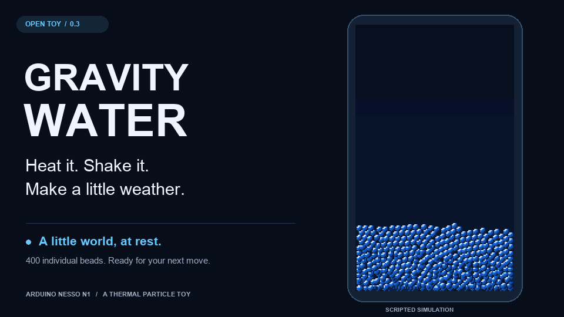

# OpenToy

OpenToy is an MIT-licensed teaching prototype for changing a small toy over Bluetooth. This working repository is private at the owner's request as of October 1, 2026. Start with live behavior changes, then add carefully tested firmware updates. The bench project includes two Seeed Studio XIAO ESP32-S3 boards and a native Mac control app; the OLED class board was attached at the Face v2 handoff.

## Gravity Water · ready to play

[](projects/gravity-water/README.md)

A thermal particle toy for Arduino Nesso N1. **Tilt, boil, cool, touch, shake and
listen.** The v0.3.0 playtest build is installed and owner-tested.

[Explore the visual guide](projects/gravity-water/README.md) ·
[Download the source release](https://github.com/yury-g/OpenToy-Coursework/tree/gravity-water-v0.3.0) ·
[Saved stopping point](projects/gravity-water/STOPPING-POINT.md)

*Preview: scripted host simulation using the device's particle code, not camera footage.*

## Playtesting with AI

OpenToy looks at what the toy does, how it feels to play with, and how it handles failure.

- **Blue Team · Does it work?** Compare what the program is meant to do with
  what the physical toy actually does. An acknowledgment can confirm that a
  command reached the board. Seeing the response confirms what the player gets.
- **Green Team · Does it invite play?** Notice what people discover on their
  own, what they want to do again, and where they lose interest. The timing
  and feel of a working feature are part of its play value.
- **Red Team · What makes it fail?** Look for deliberate stress and unexpected
  everyday use that can interrupt a feature or stop the toy. Explain what the
  player experiences and how the toy recovers.

### The hidden design lesson in each chapter

| Chapter | What AI can help students notice |
| --- | --- |
| [Bare XIAO board](projects/xiao-toy/README.md) | Even one LED gives the player feedback. The app can acknowledge a change to the blink rhythm, while the LED shows whether the change is visible and understandable. |
| [OLED + touch board](projects/xiao-class/README.md) | A touch reading, a display update, and a reaction someone sees are different pieces of evidence. How the toy is held can affect whether a touch control feels deliberate or accidental. |
| [Face v1 · Eye puppetry](docs/V1-EYES.md) | Pupils and eyelids can suggest attention or attitude with just a few shapes. The same eyes can look alive or awkward depending on how the controls map to gaze and winks. |
| [Face v2 · Doodle puppetry](docs/V2-FACE.md) | Timing and combinations give simple curves personality. A blink, mouth pull, or springy settle can change how a pose reads even when the expression preset stays the same. |
| [Nearby Buddy](https://github.com/yury-g/OpenToy-Coursework/blob/feature/nearby-buddy/projects/nearby-buddy/README.md#how-to-playtest) | Bluetooth signal strength gives the toys an imperfect clue about distance. The timing of a smile, a pause, or a transition to sleep determines whether the pair seems to notice each other. |
| [Orange Face](https://github.com/yury-g/OpenToy-Coursework/blob/feature/orange-face/projects/orange-face/README.md#how-to-playtest) | A toy can sense continuous motion and wait for a clear gesture before reacting. The delay before rotation, the different tickle reactions, and whether the rear glow is visible all shape how the player reads the response. |
| [Gravity Water](projects/gravity-water/README.md) | A thermal particle toy: tilt and shake the beads, hold a button to boil them, or push them with a fingertip. Energy colors and generated sound follow the activity; timing counters and physical feel are separate evidence. |
| [Arduino Nesso N1](projects/nesso-n1/README.md) | The same OpenToy face can run on an ESP32-C6 touchscreen. A tap becomes a shared Face v2 command that the Mac relay can pass to an OLED class board. |
| [Plant v0.2](mechanical/plant-v02/README.md) | Turn, nod, and roll can give a body a vocabulary of gestures. The CAD animation shows how that could look. The feel of those gestures depends on the assembled joints and powered motion, which are still unverified. |

### Give this to your AI assistant

Share this section and the chapter you’re looking at, or copy the prompt below.

```text
Read the OpenToy chapter I'm looking at and any bench notes, images,
or observations I already have. Help me see one design choice the toy
makes and why it matters in another electronic toy.

Use Blue Team for what the physical toy does, Green Team for what players
actually discover or enjoy, and Red Team for how a feature might fail under
deliberate stress or unexpected use and how it could recover. Say which
claims come from a demo, code, hardware checks, or player observations.
Treat untried failure cases as possibilities and leave play value open
when there are no player observations.

For setup and troubleshooting, run the checks you can access and verify
the fix. Ask for one specific action only when you need my access, input,
or hands on the hardware. Offer examples to notice during play. Keep
them optional and avoid assigning work.
```

## Possible 3D-printable toy: Plant v0.2


**One possible mechanical design for OpenToy.** A three-servo flower with three identical captive print-in-place joints and a separately printed base, stalk, elbow and head. The design includes editable CAD, STL parts, review slicer projects, a hardware list and illustrated assembly instructions.

[**Explore the plant design and assembly →**](mechanical/plant-v02/README.md) · [Print files](mechanical/plant-v02/stl/) · [Assembly PDF](mechanical/plant-v02/assembly-guide.pdf) · [Editable CAD](mechanical/plant-v02/plant-v02.scad)

**Digital prototype only:** this animation is a CAD render. Physical printing, motor fit, assembly and powered motion remain untested; the existing firmware does not yet drive the three servos. Start with clearance gauges and one joint before building a complete prototype. Other mechanical designs are welcome.

## Watch Face v2


**38-second looping firmware simulation.** Five expressions, eye/brow/mouth controls, jaw opening, blink, both winks and combined movement. It uses the actual firmware's curve renderer and spring/wiggle animation; it is not a video of the physical OLED. [Controls and animation](docs/V2-FACE.md) · [Saved checkpoint](docs/STOPPING-POINT.md).

## Visual development history


[**Open the complete visual design log →**](docs/DESIGN-HISTORY.md) Each major stop records what changed, what was checked, the visual evidence and its source/recovery checkpoint. The sequence includes early USB/Bluetooth work, the class OLED/touch circuit, Xbox smoke test, layered eyes, face drawings, both animation approaches, firmware refinements, native app handoff and saved releases.

[**Watch every saved design GIF →**](docs/DESIGN-HISTORY.md#animated-design-archive--chronological) The gallery at the bottom follows the first neck prototype, the four giraffe/plant/arm/swan concepts, the later plant and swan revisions, and the Face v2 tour. It preserves the alternatives and superseded drafts too.

| Preserved stop | Revisit it |
| --- | --- |
| First controller/face smoke test | [Historical source archive](https://github.com/yury-g/OpenToy-Coursework/tree/checkpoint-2026-10-02-visual-history) · [Evidence](docs/DESIGN-HISTORY.md#04--first-controller-smoke-test) |
| V1 · separate whites, pupils and eyelids | [v1.0.0-eyes](https://github.com/yury-g/OpenToy-Coursework/tree/v1.0.0-eyes) · [Visuals and controls](docs/V1-EYES.md) |
| Face v2 · drawing alternatives | [Design-review source](https://github.com/yury-g/OpenToy-Coursework/tree/9126153) · [Concept sheet](docs/concepts/V2-FACE.md) |
| Face v2 · procedural curves | [v2.0.0-face](https://github.com/yury-g/OpenToy-Coursework/tree/v2.0.0-face) · [Procedural/morph comparison](docs/V2-FACE.md#try-both-approaches-without-flashing) |
| Owner-selected stopping point | [checkpoint-2026-10-01-face-v2](https://github.com/yury-g/OpenToy-Coursework/tree/checkpoint-2026-10-01-face-v2) · [Recovery inventory](docs/STOPPING-POINT.md) |
| Visual-history edition | [checkpoint-2026-10-02-visual-history](https://github.com/yury-g/OpenToy-Coursework/tree/checkpoint-2026-10-02-visual-history) · [Complete design log](docs/DESIGN-HISTORY.md) |

The installed version still uses **controller → Mac → Bluetooth → toy**. Power-only, computer-free controller operation is the next requested experiment and is not implemented yet. The controller remains usable for Apple TV games; no controller firmware was modified.

**The working path:** Mac app → Bluetooth LE → toy. The Mac can keep its internet connection on Ethernet or Wi-Fi. Campus Wi-Fi is not needed for live control or for transferring a locally built update.

**Face v2** adds playful curved eyes, brows and a mouth, with continuously adjustable curvature and a short damped wiggle. Xbox input uses Apple's GameController framework: left stick bends eyes/brows, right stick bends/pulls the mouth, triggers control jaw/blink, D-pad winks and buttons select five expressions. The [guide](docs/V2-FACE.md) includes exact pixel simulations and an algorithmic-versus-preset-morph comparison. Version 1 eye puppetry remains preserved as `v1.0.0-eyes`.

A physical Microsoft USB controller is recognized by Apple's Xbox Series X driver. The owner confirmed the original eyes work. New face electronic verification and remaining physical judgments are tracked in the [progress log](docs/concepts/V2-PROGRESS.md).

## Start here

- [Gravity Water · Nesso first](projects/gravity-water/README.md): a miniature thermal particle bottle with touch, boiling, shaking, energy colors and generated sound.

- [Plant v0.2 mechanical candidate](mechanical/plant-v02/README.md): printable parts, hardware, assembly, digital checks and remaining physical/integration work.
- [Visual design log and checkpoints](docs/DESIGN-HISTORY.md): development history with drawings, exact pixel simulations, real app screenshots and saved versions.
- [Saved stopping point, October 1](docs/STOPPING-POINT.md): current version, animated tour, reproduction and recovery.
- [Version 1: eye puppetry, screenshots and controls](docs/V1-EYES.md): the working baseline preserved as `v1.0.0-eyes`.
- [Face v2: procedural doodle puppetry](docs/V2-FACE.md): controls, algorithm, simulations, build/test commands and recovery.
- [Face v2 progress](docs/concepts/V2-PROGRESS.md) and [concept drawings](docs/concepts/V2-FACE.md): the selected direction and dated iteration record.
- [Setup and reproducible commands](docs/SETUP.md): identify the chip, preserve source, back up flash, generate each toy's private key, seed once by USB, build the local Mac launcher.
- [Student workshop](docs/WORKSHOP.md): live changes first, controller mapping, then one small firmware change.
- [Controller design and compatibility](docs/CONTROLLERS.md): tested boundaries, mappings, USB/Bluetooth model checks and the later iPad path.
- [Protocol and firmware updates](docs/PROTOCOL.md): authenticated upload, inactive slot, verification and recovery.
- [Recovery](docs/RECOVERY.md): interrupted transfers, rollback and USB fallback.
- [Bench evidence and limitations](docs/TEST-RESULTS.md): what actually passed and what still needs hardware/student testing.

## Hardware examples

| Example | Required hardware | Confirmed configuration |
| --- | --- | --- |
| `projects/xiao-toy` | Bare XIAO ESP32-S3 | USB serial, GPIO21 onboard LED state, BLE live controls and OTA |
| `projects/xiao-class` | XIAO ESP32-S3 plus the documented class circuit | SH1106G 128×64 at I2C 0x3C; SDA GPIO5/D4, SCL GPIO6/D5; native touch inputs GPIO1–4/D0–D3 |
| [Nearby Buddy](https://github.com/yury-g/OpenToy-Coursework/tree/feature/nearby-buddy/projects/nearby-buddy) | Two Reverse TFT Feathers | Enrolled BLE proximity pair with the shared procedural renderer |
| [Orange Face](https://github.com/yury-g/OpenToy-Coursework/tree/feature/orange-face/projects/orange-face) | Reverse TFT Feather, MPR121 and LSM6DS3TR-C | Touch, rotation and shake reactions with the shared renderer |
| [Arduino Nesso N1](projects/nesso-n1/README.md) | ESP32-C6, built-in TFT touchscreen and BMI270 | Orange Face behavior on integrated hardware, USB and shared Face v2 BLE live control |
| [Plant v0.2 mechanical candidate](mechanical/plant-v02/README.md) | Seven printed parts, three MG92B servos, stock horns, fasteners and a suitable controller/power supply | Digital CAD/slicing review only; physical assembly and OpenToy servo integration pending |

The class configuration came from preserved existing source and successful electronic tests. Do not apply it to an unknown OLED or touch module. An I2C acknowledgment alone cannot identify its display controller. No OLED glass appearance or physical pad-touch response was observed remotely.

## Reproducibility status

Two physical boards were ROM-identified, backed up and USB-seeded; live Bluetooth control and full-image updates were exercised. Actual failed-boot rollback worked on both. A local native app compiled, updated and verified each toy. Face commands were independently corroborated through USB and checked I2C writes.

The launcher uses local alias packaging: it needs its project and Python runtime to remain installed. There is no signed portable installer. The local executor launched the app successfully; background first-launch behavior still needs investigation. First-time provisioning on additional student hardware and other Macs remains unvalidated. The included preparation helper is covered by host identity checks; it is not a claim that a whole classroom deployment has been tested.

iPad live control has a researched native-client route, but iPad testing was deferred. The custom Bluetooth firmware uploader is implemented for Mac, not iPad. An AI-to-iPad build-delivery service and direct Xbox-to-XIAO connection are separate, unfinished work.

## License and private files

Original OpenToy code and the Plant v0.2 CAD, meshes, visuals and documentation are MIT licensed. Third-party licenses and notices are preserved under each example's `licenses/` and `THIRD-PARTY-NOTICES.md`. Arduino/SDK dependencies retain their licenses; vendor radio binaries are not entirely open source.

The optional GIF exporter uses Pillow 12.3.0; its full license is preserved in [licenses/](licenses/README.md).

Keep `device.json`, `Secrets.h`, keys, flash backups and all compiled images private. The images embed that toy's key. They are ignored by Git and excluded from the source archive. Preserved pre-existing class source is a private preservation artifact, not relicensed by OpenToy.
