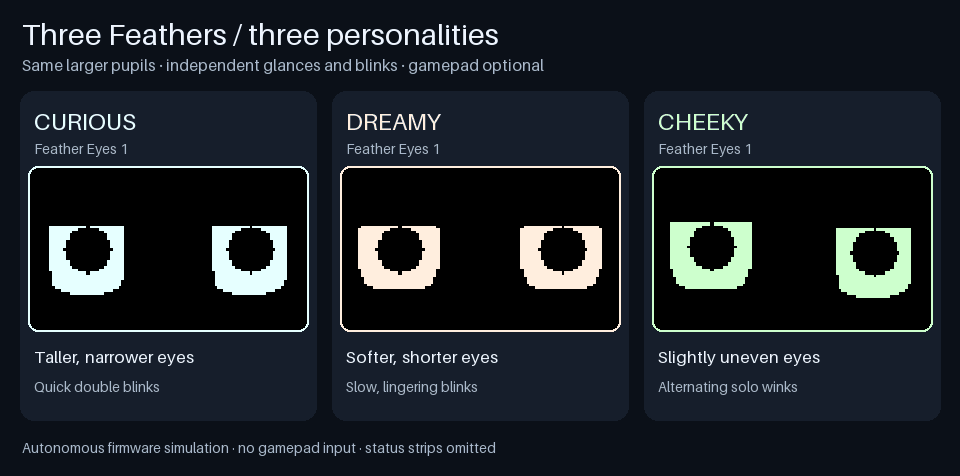
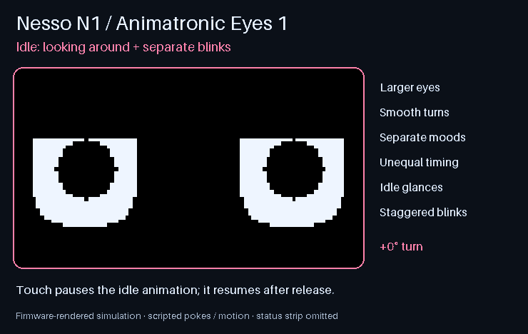
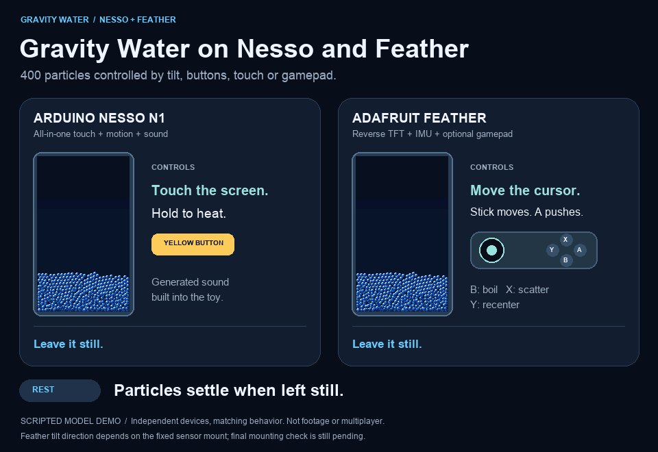

# OpenToy

Expressive toy apps across small color screens, round touchscreens, reflective LCDs and larger touch panels. **Shared behavior, familiar controls, device-specific hardware support.**

[All projects and source locations](projects/README.md) · [Shared controls](docs/CONTROLS.md) · [App status bar](docs/APP-STATUS-BAR.md) · [Roadmap](docs/ROADMAP.md) · [Device-family strategy](docs/DEVICE-FAMILY-ARCHITECTURE.md)

## Devices and capabilities

Snapshot: **2026-11-17**. Hardware capability, installed firmware and owner-confirmed behavior are different things. Each device guide carries its detailed versions and checks; the tables below summarize the family without claiming every feature is ready.

| Device | Display and direct input | Motion / camera | Sound | Battery information |
| --- | --- | --- | --- | --- |
| [Reverse TFT Feather ESP32-S3](projects/feather/README.md) | 240 × 135 color; QT gamepad in current Eyes builds; onboard buttons unassigned | Motion needs an add-on; no built-in touchscreen | Current Eyes assembly has no speaker; mic/speaker add-ons to qualify | MAX17048 gauge estimate where fitted/working; charging is a separate check |
| [Arduino Nesso N1](projects/nesso/README.md) | Color touchscreen; poke either eye | Eyes uses motion sensing for smooth orientation | Sound exists in the Water project; microphone response needs qualification | Local reading in existing app; shared-header migration pending |
| [Waveshare 1.85C BOX, V2](projects/waveshare-1.85c/README.md) | 360 × 360 round color touch | Fixed orientation in current Eyes; no motion port | Quiet reaction playback implemented; mic disabled pending qualification | Measured volts or unknown; no verified percentage/charging flag |
| [Waveshare ESP32-S3-RLCD-4.2](https://github.com/yury-g/OpenToy-Coursework/tree/device/waveshare-rlcd-4.2/projects/waveshare-rlcd-4.2) | 400 × 300 landscape reflective monochrome; no backlight; KEY user button | Fixed orientation; no implemented touch/motion input | Audio hardware track; capture/playback not qualified in Eyes | Calibrated voltage sampling; supplied battery reported installed; charging unconfirmed |
| [Elecrow CrowPanel P4, 9-inch V1.0](projects/crowpanel/README.md) | 1024 × 600 color touch; XIAO not needed for local Eyes | Camera optional, connected-camera operation unverified; no qualified automatic orientation | Audio qualification planned | Battery measurement/charging under investigation; unknown is not empty |
| XIAO ESP32-S3 companion | Optional separate controller/sensor/radio role; not a display target here | Depends on attached hardware | Depends on attached hardware | Do not substitute its reading for the panel battery |

**Latest device work:** CrowPanel's device track reports native smooth Eyes installed; its next battery revision is under verification. RLCD has a working Eyes port and a native-contour/black-background update underway. Copy-Face is in development. Main-branch device guides may lag these active checkpoints; do not treat old “not installed” notes as current hardware state. The RLCD link explicitly points to its device branch. Neither battery is currently confirmed charging by this overview.

## App support matrix

**Live** = device operation recorded, with remaining physical checks in its guide. **Source** = existing project/release; not a fresh deployment claim. **Developing** = implementation work, not a tested camera/app. **Assess** = requires a port and capability check. No universal app launcher is installed.

| App | Feather | Nesso | Round Waveshare | RLCD 4.2 | CrowPanel P4 |
| --- | --- | --- | --- | --- | --- |
| [Animatronic Eyes 1](projects/animatronic-eyes/README.md) | Live: Curious / Dreamy / Cheeky | Live: touch + orientation | Live: touch + quiet reactions | Live; smooth-render update underway | Live; smooth renderer, touch checks tracked separately |
| [Animatronic Eyes 2](projects/animatronic-eyes/README.md) | Live/source: QT gamepad | Assess | Assess | Assess | Assess |
| [Gravity Water](https://github.com/yury-g/OpenToy-Coursework/tree/feature/gravity-water-feather/projects/gravity-water) | Live: add-on motion | Live: touch + motion | Assess: motion missing | Assess: motion missing | Assess: motion missing |
| [Orange Face](https://github.com/yury-g/OpenToy-Coursework/tree/feature/orange-face/projects/orange-face) | Source: motion + touch-pad add-ons | Assess | Assess | Assess | Assess |
| [Nearby Buddy](https://github.com/yury-g/OpenToy-Coursework/tree/main/companions/nearby-buddy/main) | Source: two peers; distance calibration unfinished | Assess | Assess | Assess | Assess: radio transport + peer |
| [Battery Faces](https://github.com/yury-g/OpenToy-Coursework/tree/main/companions/battery-faces/main) | Source: gauge/gamepad/haptic variants | Assess | Assess | Assess: voltage adaptation | Assess: battery interface |
| [Nesso Face](https://github.com/yury-g/OpenToy-Coursework/tree/feature/nesso-n1/projects/nesso-n1) | Assess | Source | Assess | Assess | Assess |
| **Copy-Face** | Not targeted yet | Not targeted yet | Not targeted yet | Not targeted yet | Developing: camera face-following eyes + copied mouth shapes |

Copy-Face first needs a verified camera and usable face/mouth analysis on the panel. Sound-triggered alertness and expressive listening are [family roadmap items](docs/ROADMAP.md), not completed capabilities. Physical prints are listed separately under [3D printed designs](projects/3d-printed-designs/README.md).

## One control language

**BOOT and RESET are recovery controls, never normal app controls.** Use exposed, qualified user buttons and touchscreens. The following is the new design standard; existing mappings listed below still need versioned migration.

| Action | User buttons | Touchscreen |
| --- | --- | --- |
| Play / react | Short Primary press performs the labelled app action | Touch the object: poke an eye, interact with water |
| Menu | Hold Primary for 0.8 seconds | Tap visible **Menu** in the safe header |
| Navigate / select | Next / Previous / Select; one-button devices use short-next, hold-select | Tap labelled items |
| Back | Back button or explicit Back item | Back item |
| Performance | **Display → Performance** hides information and control bars | Same menu item |
| Restore from performance | Hold Primary to restore information and open Menu | Hold top-center safe edge for 0.8 seconds |

Same menu order: **Return to play · Apps · Personality · Sound · Display · Controls · About**. Unsupported options are explained or omitted. Apps only launches firmware actually available on that device. Menu layouts scale to the screen; labels and meaning stay consistent. [Full rules, one-button navigation and acceptance checks](docs/CONTROLS.md).

## Controls today and migration

| Device | Current normal-play controls | Current menu / information controls | Next shared-control step |
| --- | --- | --- | --- |
| Feather Eyes | Stick, A/B/X/Y, Select/Start modifiers; [full mapping](projects/animatronic-eyes/README.md#controls) | No common menu; onboard buttons unassigned | Qualify exposed user buttons; add Menu. Gamepad entry needs conflict testing with the existing blink chord |
| Nesso Eyes | Poke eyes; motion rotates the face | No common menu documented | Add visible touch Menu and the shared performance restore gesture |
| Round Waveshare | Poke either eye | Top-cap hold toggles information; lower-left hold mutes; lower-right hold changes personality | Put settings in the labelled common menu; preserve eye pokes |
| RLCD Eyes | Existing build uses BOOT for left poke and KEY for right | Existing BOOT+KEY chord toggles information | **Migration required:** remove BOOT from play; use qualified KEY with one-button menu and explicit left/right actions |
| CrowPanel Eyes | Poke eyes; touch personality/eco/information buttons | Footer controls; no common family menu yet | Consolidate settings into Menu; hide all control bars for performance; no BOOT/RESET mappings |
| Copy-Face | Planned camera-driven eyes and mouth | UI being developed | Adopt shared touch menu from first maintained UI; camera confidence/loss does not require a button |

Historical controls remain documented so existing installations are usable; they are not the new family standard. Each device migration must update its version, controls guide and tests. User buttons that double as boot straps must be excluded even if their board label is ambiguous.

## See the projects

| Eye personalities | Touch and rotation | Water on two devices |
| --- | --- | --- |
|  |  |  |

These are scripted source/model previews, not camera recordings of current installations. Further artwork, controls, wiring and evidence live in the project guides rather than repeated galleries here.

## Find source, history and recovery

[All projects and source locations](projects/README.md) distinguishes files on main from device/feature branches and existing standalone repositories. Downloading main does not include every app. Preserve original releases and renderer provenance when making a new port.

[3D printed designs](projects/3d-printed-designs/README.md) · [Historical XIAO / pre-Feather archive](archive/README.md) · [Playtesting](docs/PLAYTESTING.md) · [License](LICENSE) · [Third-party licenses](licenses/README.md)

The archived XIAO projects are distinct from the new optional CrowPanel companion. Keep device identities, credentials, compiled firmware, raw logs and flash backups private. Each device track owns its hardware operations; adding a README row does not make firmware interchangeable.
