# OpenToy

**Open courseware under active development. Projected launch out of draft: January 10, 2027.** Explore experiments, working builds and unfinished ideas as they develop. This is the public home for ongoing OpenToy work. [Start here](docs/COURSEWORK.md) · [Project source map](docs/COURSEWORK.md#project-source-map) · [How we work](CONTRIBUTING.md)

OpenToy turns development boards into expressive toys. Poke a blinking eye, tilt a pool of particles, or make two faces react as you bring them together.

**[Projects](#see-the-projects) · [Devices](#devices-and-capabilities) · [App support](#app-support-matrix) · [Controls](#one-control-language) · [Parts and sourcing](#main-device-family) · [CAD and schematics](hardware/README.md)**

New here? [Choose a device](projects/README.md), check its supported apps below, then use the build instructions in its project guide. Each firmware image targets a particular board and display.

## See the projects

[Interactive viewers: assembly, folding and face controls](docs/INTERACTIVE-VIEWERS.md)

Select a preview to open its guide. Nearby Buddy and Battery Faces source snapshots are included in the companion folders. The captions identify recorded screens, simulations and CAD studies.

<!-- project-gallery:start -->

| [ditherCam · flip camera](projects/ditherCam/README.md) | [CYD tri-fold · three screens](projects/3d-printed-designs/cyd-trifold/README.md) | [Eyes 1 · Feather personalities](projects/animatronic-eyes/README.md) |
| --- | --- | --- |
| [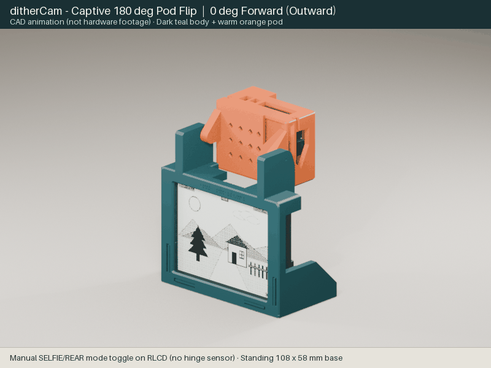](projects/ditherCam/README.md) |  |  |
| RLCD viewfinder and XIAO Sense camera with a pivoting selfie pod. Firmware, enclosure and assembly guides. | One print with three captive frames. A6 CAD checks passed. Physical fit remains open. | Three simulated Feather screens show the double blink, slow close and alternating wink. |

| [Eyes 1 · Nesso touch and rotation](projects/animatronic-eyes/NESSO.md) | [Gravity Water](https://github.com/yury-g/OpenToy-Coursework/tree/main/projects/gravity-water) | [Eyes 2 · Doodle puppetry](projects/animatronic-eyes/README.md#controls) |
| --- | --- | --- |
|  |  |  |
| Poke one eye or turn the toy. Each eye trembles and settles on its own timing. | Tilt the board to pour particles. Use touch on Nesso or a gamepad cursor on Feather. Scripted simulation. | Use the Feather gamepad to bend the eyes, brows and mouth. Firmware expression tour. |

| [Orange Face](https://github.com/yury-g/OpenToy-Coursework/tree/main/projects/orange-face) | [Nesso Face](https://github.com/yury-g/OpenToy-Coursework/tree/main/projects/nesso-n1) | [Nearby Buddy](https://github.com/yury-g/OpenToy-Coursework/tree/main/companions/nearby-buddy/main) |
| --- | --- | --- |
|  | [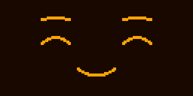](https://github.com/yury-g/OpenToy-Coursework/tree/main/projects/nesso-n1) | [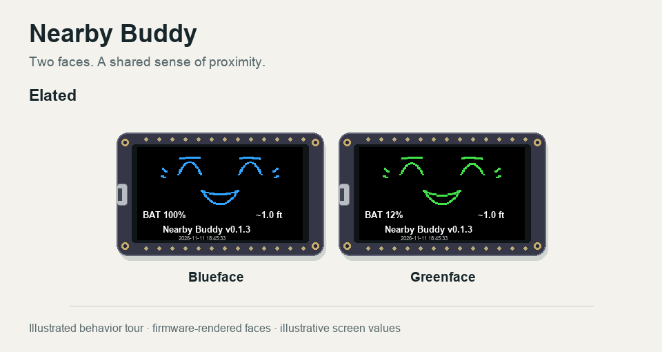](https://github.com/yury-g/OpenToy-Coursework/tree/main/companions/nearby-buddy/main) |
| Tickle the touch pads or shake the Feather to change its expression. Scripted tour. | Tickle one side or shake the Nesso. This renderer preview shows its smile and startled poses. | Two Feathers react to one another as they move closer. Illustrated pair. |

| [Battery Faces](projects/feather/README.md#battery-faces) | [Copy-Face](https://github.com/yury-g/OpenToy-Coursework/tree/main/projects/copy-face) | [Vibe Coding Camera Eye](projects/vibe-coding-camera-eye/README.md) |
| --- | --- | --- |
|  |  | [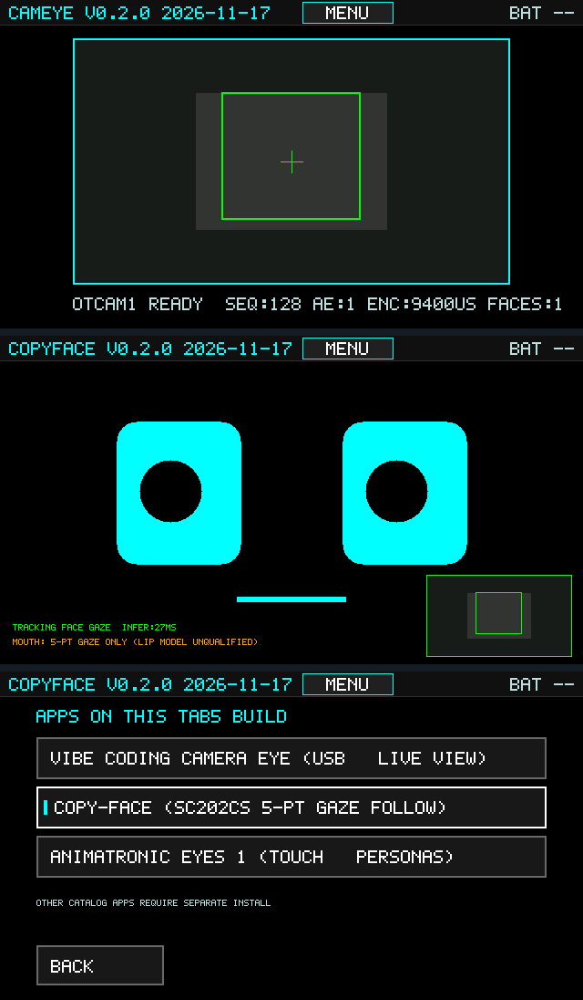](projects/vibe-coding-camera-eye/README.md) |
| Watch battery readings and peer status. The accessory builds add buttons, gamepad input and haptics. | Scripted gaze and mouth shapes. CrowPanel runs the simulation. Live smile and frown copying remains open. | Tab5 photographed the UNO Q and round Waveshare screens over USB. The pictured local viewfinder is a mockup. |

| [Orange Face · printable faceplate](projects/3d-printed-designs/orange-face/README.md) | [Plant · servo mechanism](mechanical/plant-v02/README.md) | [XIAO · bare board](projects/xiao-toy/README.md) |
| --- | --- | --- |
|  | [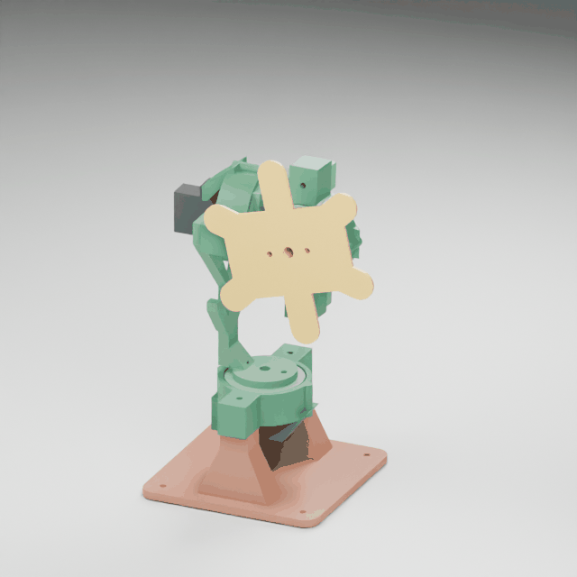](mechanical/plant-v02/README.md) |  |
| One printed part holds the Feather and touch pads. Open the CAD, print files and assembly views. | Archived mechanical project. Explore the joint motion and printable parts. | Archived starting point for the Bluetooth toy. Board model shown. |

| [XIAO · OLED class toy](projects/xiao-class/README.md) | [Mechanical design archive](docs/DESIGN-HISTORY.md) |
| --- | --- |
|  | [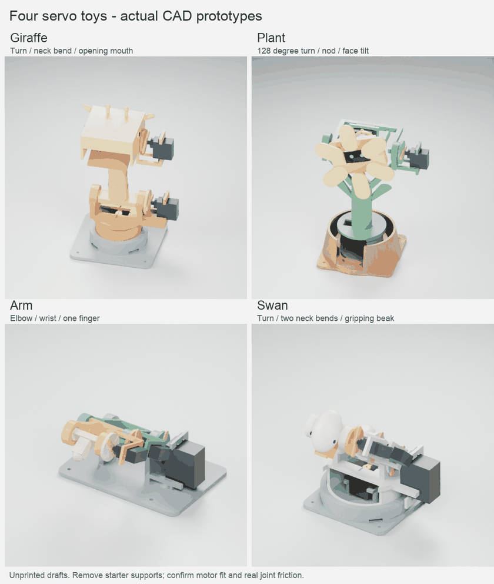](docs/DESIGN-HISTORY.md) |
| Archived OLED and touch build. Open the sketch and classroom setup. | Compare plant, arm, giraffe and swan motion studies in CAD. |

<!-- project-gallery:end -->

[Project directory and source branches](projects/README.md) · [Firmware builds](docs/FIRMWARE-BUILDS.md) · [Roadmap](docs/ROADMAP.md) · [Latest bench checkpoint](docs/CHECKPOINT-2026-11-17.md)

## Devices and capabilities

Snapshot: **2026-11-17**. Hardware capability, installed firmware and owner-confirmed behavior are different things. Each device guide carries its detailed versions and checks; the tables below summarize the family without claiming every feature is ready.

| Device | Display and direct input | Motion / camera | Sound | Battery information |
| --- | --- | --- | --- | --- |
|  [Reverse TFT Feather ESP32-S3](projects/feather/README.md) | 240 × 135 color; QT gamepad in installed `1.3.0`; `1.4.0` candidate qualifies `D1`/`D2` user buttons (`D0` BOOT excluded) | Motion needs an add-on; no built-in touchscreen | Stock assembly has no mic/speaker; `SoundWake.h` hook ready for add-ons | MAX17048 gauge estimate where fitted/working (`BAT XX%` / `BAT --`); charging separate |
|  [Arduino Nesso N1](projects/nesso/README.md) | Color touchscreen; poke either eye (`1.4.0` candidate adds 360°-rotated Menu) | Eyes uses motion sensing for smooth orientation | Sound exists in the Water project; microphone response needs qualification | Local reading in installed `1.3.2`; `1.4.0` candidate uses shared `BAT XX%` / `BAT --` |
| [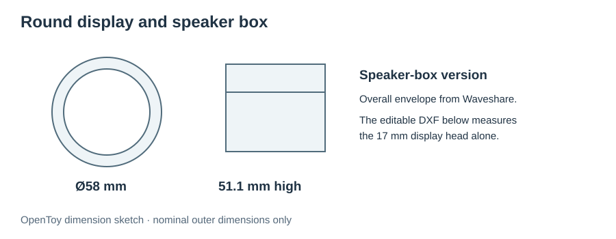](hardware/waveshare-round/README.md) [Waveshare 1.85C BOX, V2](projects/waveshare-1.85c/README.md) | 360 × 360 round color touch | Fixed orientation in current Eyes; no motion port | Quiet reaction playback implemented; mic disabled pending qualification | Measured volts or unknown; no verified percentage/charging flag |
|  [Waveshare ESP32-S3-RLCD-4.2](https://github.com/yury-g/OpenToy-Coursework/tree/main/projects/waveshare-rlcd-4.2) | 400 × 300 landscape reflective monochrome; no backlight; KEY user button | Fixed orientation; no implemented touch/motion input | Audio hardware track; capture/playback not qualified in Eyes | Voltage sampling; owner saw steady CHG light with supplied battery; firmware cannot report charging or accurate percentage |
|  [Elecrow CrowPanel P4, 9-inch V1.0](projects/crowpanel/README.md) | 1024 × 600 color touch; XIAO not needed for local Eyes | Camera optional, connected-camera operation unverified; no qualified automatic orientation | Audio qualification planned | BAT --; controller candidate voltage is diagnostic only; percentage/charging unverified |
|  [M5Stack Tab5](projects/tab5/README.md) | Installed 0.2.0, physical screen dark at the checkpoint. 5-inch `720x1280` `ST7123` MIPI-DSI + `0x55` touch (`disp=1, touch=1`), 3 modes + Common Menu | **Live `0.2.0`**: `1280x720` `SC202CS` (`OTCAM1`) + `HumanFaceDetect` `0.5.2` gaze tracking + `BMI270` (`0x24`) | `ES7210` (`0x1072`) opt-in volatile loudness + `SoundWake` verified (`MIC 1`/`MIC 0`); `ES8388` (`0x10`) probed | `INA226` (`0x2260`): truthful `BAT --` on USB (`1.20 V`) or `BAT X.XXV` on 2S (`5.4–9.0 V`) |
|  [Arduino UNO Q + 2.8-inch TFT shield](projects/uno-q/README.md) | Eyes 0.1.0 live on the 320 × 240 TFT with a write-only ILI9341-compatible bus. Touch unqualified | No camera in this assembly established | No OpenToy audio established | `BAT --`; no qualified battery sensor |
|  XIAO ESP32-S3 / Sense companion | Optional separate controller/sensor/radio role; not a display target here | Depends on attached hardware | Depends on attached hardware | Do not substitute its reading for the panel battery |

**Bench status, November 17.** The UNO Q with its shield and the round Waveshare are parked with Eyes 0.1.0 and 1.1.1 respectively. The Tab5 photographed both screens. Its own screen was reported black. Tab5 development is parked with 0.2.0 installed. Its camera took a fresh mirror photo showing a dark display. The next session starts with a visible boot pattern. [Display checkpoint](projects/tab5/README.md) · [Build records](docs/FIRMWARE-BUILDS.md).

## App support matrix

**Live** = device operation recorded, with remaining physical checks in its guide. **Source** = existing project/release; not a fresh deployment claim. **Developing** = implementation work, not a tested camera/app. **Assess** = requires a port and capability check. No universal app launcher is installed.

| App | Feather | Nesso | Round Waveshare | RLCD 4.2 | CrowPanel P4 |
| --- | --- | --- | --- | --- | --- |
| [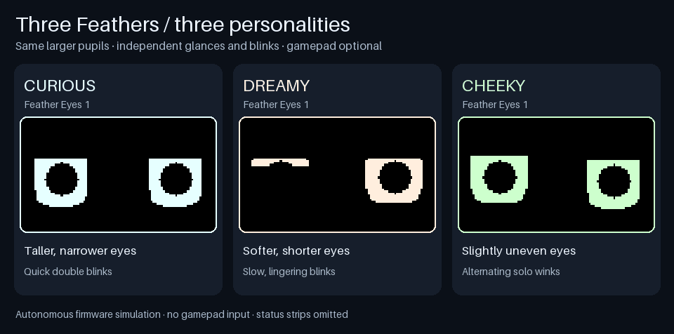](projects/animatronic-eyes/README.md) [Animatronic Eyes 1](projects/animatronic-eyes/README.md) | Live: Curious / Dreamy / Cheeky | Live: touch + orientation | **Live `1.1.1`**: curved header, 4-page enlarged Menu + quiet reactions (fingertip feel pending) | Live `0.2.0` (`0.2.1` neutral `BAT` candidate host-verified) | Previously live `0.2.2`; currently Copy-Face selected |
|  [Animatronic Eyes 2](projects/animatronic-eyes/README.md) | Live/source: QT gamepad | Assess | Assess | Assess | Assess |
| [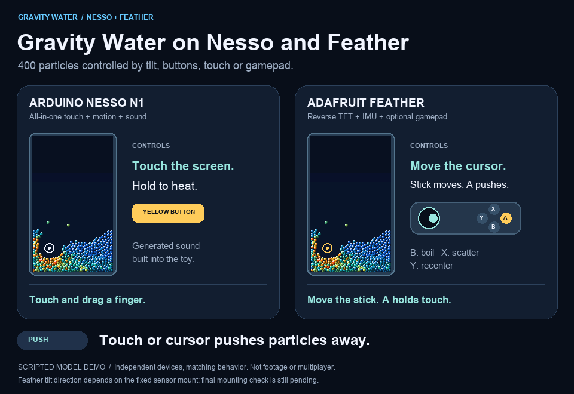](https://github.com/yury-g/OpenToy-Coursework/tree/main/projects/gravity-water) [Gravity Water](https://github.com/yury-g/OpenToy-Coursework/tree/main/projects/gravity-water) | Live: add-on motion | Live: touch + motion | Assess: motion missing | Assess: motion missing | Assess: motion missing |
|  [Orange Face](https://github.com/yury-g/OpenToy-Coursework/tree/main/projects/orange-face) | Source: motion + touch-pad add-ons | Assess | Assess | Assess | Assess |
|  [Nearby Buddy](https://github.com/yury-g/OpenToy-Coursework/tree/main/companions/nearby-buddy/main) | Source: two peers; distance calibration unfinished | Assess | Assess | Assess | Assess: radio transport + peer |
|  [Battery Faces](https://github.com/yury-g/OpenToy-Coursework/tree/main/companions/battery-faces/main) | Source: gauge/gamepad/haptic variants | Assess | Assess | Assess: voltage adaptation | Assess: battery interface |
|  [Nesso Face](https://github.com/yury-g/OpenToy-Coursework/tree/main/projects/nesso-n1) | Assess | Source | Assess | Assess | Assess |
| [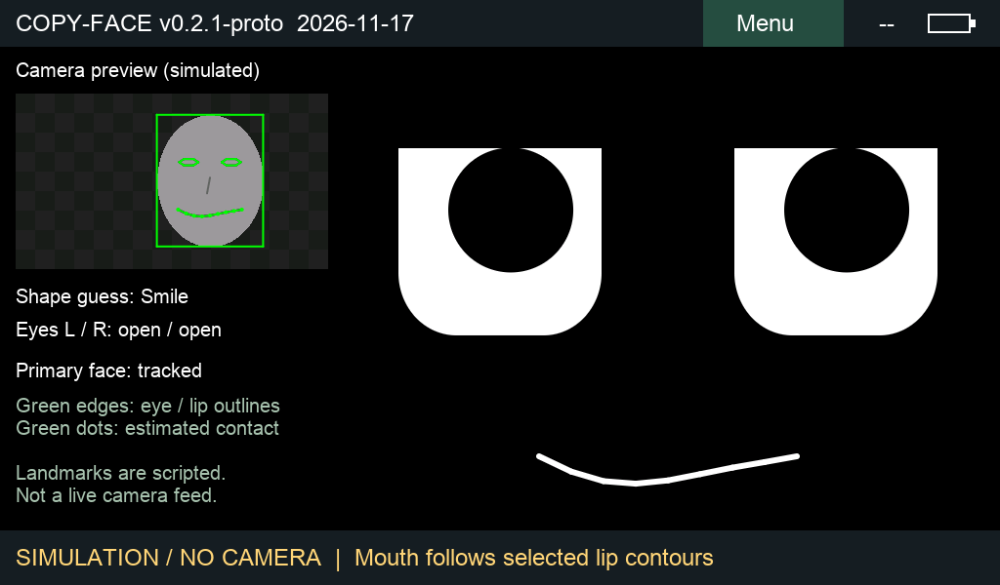](https://github.com/yury-g/OpenToy-Coursework/tree/main/projects/copy-face) [Copy-Face](https://github.com/yury-g/OpenToy-Coursework/tree/main/projects/copy-face) | Not targeted yet | Not targeted yet | Not targeted yet | Not targeted yet | Installed prototype/simulation; real camera and mouth copying unverified |

### Waveshare 1.69 touch

| Device | Apps and controls | Status |
| --- | --- | --- |
| [Waveshare ESP32-S3-Touch-LCD-1.69](hardware/waveshare-1.69/README.md) | Curious eyes + Gravity Water. Swipe sideways to switch; down for hardware, up for settings. Water fills the screen beneath the labels. | `0.2.2-dev`: host tests and target build passed. [Install and physical-check status](projects/waveshare-1.69/README.md#verification-and-next-physical-checks). Battery remains `BAT --` until qualified. |

### New platform and camera-helper tracks

| App | Tab5 | UNO Q + TFT |
| --- | --- | --- |
|  Animatronic Eyes 1 | Installed `EYES1` mode on 0.2.0, local display pending: Curious / Dreamy / Cheeky + dual-eye touch pokes + Common Menu | Live 0.1.0 on 2.8-inch TFT. Tab5 verified both eyes and the version/date header |
|  Copy-Face | Installed `COPYFACE` mode on 0.2.0, local display pending: `320x180` camera inset + `HumanFaceDetect` `0.5.2` gaze follow + honest `mouthValid=false` notice; dense inner-lip model pending | Not targeted |
|  [Vibe Coding Camera Eye](projects/vibe-coding-camera-eye/README.md) | `CAMEYE` on 0.2.0 delivered 1280×720 USB snapshots. The local viewfinder is awaiting a visible screen | Tab5 photographed the four-color diagnostic and then Eyes with the version header |
| [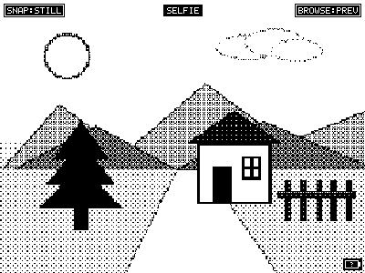](projects/ditherCam/README.md) [ditherCam](projects/ditherCam/README.md) | Active two-board wireless photos-only camera (Waveshare RLCD 4.2 + XIAO ESP32-S3 Sense on Expansion Base; active despite earlier XIAO archive rule). [Print & assembly](projects/3d-printed-designs/ditherCam/README.md) | Not targeted |
| Eyes 2, Gravity Water, Orange Face, Nearby Buddy, Battery Faces, Nesso Face | Assess separately; no blanket compatibility claim | Assess separately; native matrix eye deferred |

Copy-Face first needs a verified camera and usable face/mouth analysis on the panel. Sound-triggered alertness and expressive listening are [family roadmap items](docs/ROADMAP.md), not completed capabilities. Physical prints are listed separately under [3D printed designs](projects/3d-printed-designs/README.md).

## One control language

 [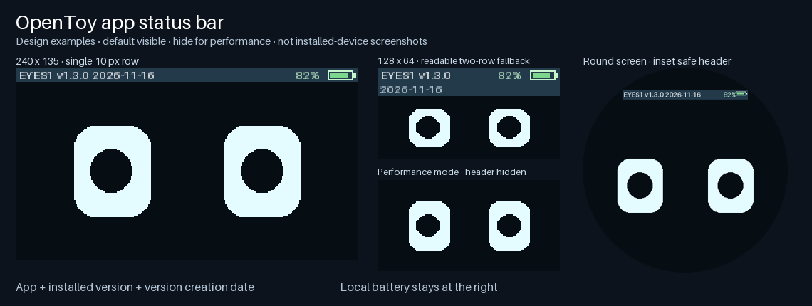](docs/APP-STATUS-BAR.md)

The round menu preview opens the Waveshare guide. The status bar drawing opens the layout specification.

**BOOT and RESET are recovery controls, never normal app controls.** Use exposed, qualified user buttons and touchscreens. The following is the new design standard; existing mappings listed below still need versioned migration.

| Action | User buttons | Touchscreen |
| --- | --- | --- |
|  Play / react | Short Primary press performs the labelled app action | Touch the object: poke an eye, interact with water |
|  Menu | Hold Primary for 0.8 seconds | Tap visible **Menu** in the safe header |
|  Navigate / select | Next / Previous / Select; one-button devices use short-next, hold-select | Tap labelled items |
|  Back | Back button or explicit Back item | Back item |
|  Performance | **Display → Performance** hides information and control bars | Same menu item |
|  Restore from performance | Hold Primary to restore information and open Menu | Hold top-center safe edge for 0.8 seconds |

Same menu order: **Return to play · Apps · Personality · Sound · Display · Controls · About**. Unsupported options are explained or omitted. Apps only launches firmware actually available on that device. Menu layouts scale to the screen; labels and meaning stay consistent. [Full rules, one-button navigation and acceptance checks](docs/CONTROLS.md).

## Controls today and migration

| Device | Current normal-play controls | Current menu / information controls | Next shared-control step |
| --- | --- | --- | --- |
|  Feather Eyes | Stick, A/B/X/Y, Select/Start modifiers; [full mapping](projects/animatronic-eyes/README.md#controls) | Installed `1.3.0`: no common menu. Compiled `1.4.0`: `D1` Primary (`0.8s` Menu), `D2` Secondary (`D0` BOOT excluded), stationary `Select+Start >=0.8s` Menu | Bounded install & physical acceptance of compiled `1.4.0` candidate on bench boards |
|  Nesso Eyes | Poke eyes; motion rotates the face | Installed `1.3.2`: no common menu. Compiled `1.4.0`: rotated `[MENU]`, 2-page Common Menu, `0.8s` top-center restore | Bounded install & physical acceptance of compiled `1.4.0` candidate on Nesso N1 |
|  Round Waveshare | Poke either eye | Eyes 1.1.1: enlarged `>=48px` targets, 4-page Menu; Display → Performance; 0.8s top-edge hold restores Menu | Installed `1.1.1` Camera-Eye-verified; owner physical fingertip tap feel pending |
|  RLCD Eyes | KEY short press reacts; BOOT/RESET unused | Hold KEY 0.8s for Menu; short Next, hold Select; Back and per-eye actions | Installed in 0.2.0; physical button/menu confirmation remains open |
|  ditherCam (RLCD + XIAO Sense) | KEY (`Snap`) tap shoots / returns live, hold ~1s switches `SELFIE`/`REAR`; Expansion Base `D1` saves on camera; **explicit prototype exception:** `Browse` uses `BOOT` (`GPIO0`) per owner request | Full-screen `400 × 300` overlay badges omit the family version/date status bar (tracked exception, not standard-compliant) | Physical `KEY` hold feel, outward `REAR` shot, and audible shutter confirmation pending |
| [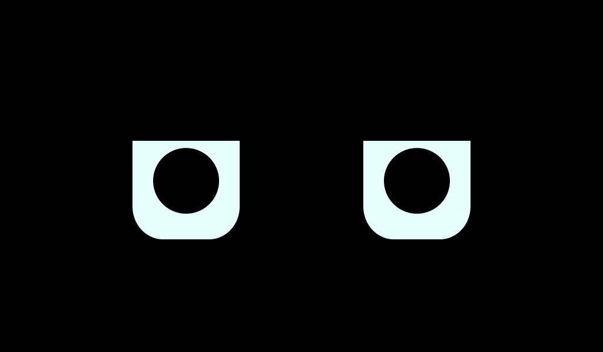](projects/crowpanel/README.md) CrowPanel Eyes | Prior 0.2.2: poke eyes; personality/eco/information controls | Shared Menu 0.3.0 built, not installed; current app is Copy-Face | Qualify candidate in a later controlled deployment |
|  Copy-Face | Prototype/simulation on CrowPanel; camera detector available on Tab5 0.2.0, visible gaze pending | Shared Menu on Tab5 `0.2.0`; developer/status UI on CrowPanel | Dense inner-lip model export (`esp-dl` int8 ONNX) & physical acceptance |
|  Tab5 | 0.2.0 includes Eyes, Camera Eye and Copy-Face. Local play awaits a visible screen. | 0.2.0 includes a seven-item touch menu + `0.8s` top-center Performance restore on `ST7123` (`0x55`) | Restore and verify the display, then test touch |
|  UNO Q + TFT | No qualified shield input yet | Default header visible | Verify actual user controls/touch; BOOT/RESET excluded |

Historical controls remain documented so existing installations are usable; they are not the new family standard. Each device migration must update its version, controls guide and tests. User buttons that double as boot straps must be excluded even if their board label is ambiguous.

## Find source, history and recovery

[Device-family strategy](docs/DEVICE-FAMILY-ARCHITECTURE.md) · [App status bar](docs/APP-STATUS-BAR.md) · [Shared controls](docs/CONTROLS.md) · [Firmware builds](docs/FIRMWARE-BUILDS.md)

[All projects and source locations](projects/README.md) distinguishes files on main from device/feature branches and existing standalone repositories. Downloading main does not include every app. Preserve original releases and renderer provenance when making a new port.

[3D printed designs](projects/3d-printed-designs/README.md) · [Historical XIAO / pre-Feather archive](archive/README.md) · [Playtesting](docs/PLAYTESTING.md) · [License](LICENSE) · [Third-party licenses](licenses/README.md) · [Contributing](CONTRIBUTING.md)

The archived XIAO projects are distinct from the new optional CrowPanel companion. Keep device identities, credentials, compiled firmware, raw logs and flash backups private. Each device track owns its hardware operations; adding a README row does not make firmware interchangeable.

## Bill of materials — devices and sourcing

Choose the device for the app you want to build, then add only that project's accessories. These are alternatives, not one combined shopping list. Quantities below are **per device** unless a pair is explicitly stated. Manufacturer links and model names were checked **2026-11-17**; prices, stock and supplied revisions can change. Use the [app support matrix](#app-support-matrix) and linked build guides to check readiness before choosing hardware.

### Main device family

Select a board image for mechanical drawings, schematics and revision notes. Images show manufacturer models or product views.

| Device to source | Quantity / role | Manufacturer source | Match before buying |
| --- | --- | --- | --- |
|  **Adafruit ESP32-S3 Reverse TFT Feather — #5691** | 1 per Feather toy; **2 for Nearby Buddy** | [Adafruit shop](https://www.adafruit.com/product/5691) | Reverse TFT model, 4 MB flash / 2 MB PSRAM. Display is included. See [Feather projects](projects/feather/README.md) for each app's add-ons. |
|  **Arduino Nesso N1 — TPX00227** | 1 per Nesso toy | [Arduino shop](https://store.arduino.cc/products/nesso-n1) | ESP32-C6 Nesso N1; built-in screen, touch and motion sensing. [Nesso projects](projects/nesso/README.md). |
|  **Waveshare ESP32-S3-Touch-LCD-1.85C-BOX-EN — 30685, V2** | 1 per round-screen toy | [Waveshare shop](https://www.waveshare.com/esp32-s3-touch-lcd-1.85c.htm) · [model/revision guide](https://docs.waveshare.com/ESP32-S3-Touch-LCD-1.85C) | Select **BOX-EN**, V2 ES8311 audio; standard board 30683 and BOX 30684 are different packages. Current [OpenToy adapter](projects/waveshare-1.85c/README.md) also requires the enrolled case2 panel initialization. Confirm battery contents separately. |
|  **Waveshare ESP32-S3-RLCD-4.2 — 33298 / -EN 33507** | 1 per reflective-screen toy | [Waveshare shop](https://www.waveshare.com/esp32-s3-rlcd-4.2.htm) · [manufacturer guide](https://docs.waveshare.com/ESP32-S3-RLCD-4.2) | 4.2-inch reflective LCD, not an e-paper panel. Confirm package/battery contents and board revision. [OpenToy source and setup are on `device/waveshare-rlcd-4.2`](https://github.com/yury-g/OpenToy-Coursework/tree/main/projects/waveshare-rlcd-4.2). |
|  **Elecrow CrowPanel Advanced 9-inch ESP32-P4 — DHE04209D, V1.0** | 1 per large-screen toy | [Elecrow shop](https://www.elecrow.com/crowpanel-advanced-9inch-esp32-p4-hmi-ai-display-1024x600-ips-touch-screen-wifi-6-support.html) · [manufacturer guide](https://media-cdn.elecrow.com/wiki/CrowPanel_Advanced_9inch_ESP32-P4_HMI_AI_Display_1024x600_IPS.html) | OpenToy's enrolled target is **V1.0**. The listing spans revisions; do not assume a newly supplied panel matches its wiring. [Panel guide](projects/crowpanel/README.md) · [V1.0 wiring](projects/crowpanel/HARDWARE.md). Camera is optional. |
|  **M5Stack Tab5 — C145 / K145** | 1 for new OpenToy camera/display track | [Manufacturer guide](https://docs.m5stack.com/en/core/Tab5) | Enrolled P4 target qualified as **`ST7123`** (`720x1280` MIPI-DSI + `0x55` touch; `0.2.0` auto-detects `ILI9881C+GT911`/`ST7123`/`ST7121`), original firmware backed up. Physical touch acceptance and dense lip inference remain open. |
|  **Arduino UNO Q + 2.8-inch TFT LCD shield** | 1 board + 1 shield | [Arduino UNO Q](https://docs.arduino.cc/hardware/uno-q/) | UNO Q, not R4 WiFi. The tested shield accepts the MAR2808-style parallel pin map and ILI9341-compatible commands. Its exact manufacturer, IC marking and compatibility with other shields remain unconfirmed. |
|  **Seeed Studio XIAO ESP32-S3 — 113991114** | 0 or 1 optional CrowPanel companion | [Seeed shop](https://www.seeedstudio.com/XIAO-ESP32S3-p-5627.html) · [manufacturer guide](https://wiki.seeedstudio.com/xiao_esp32s3_getting_started/) | Standard ESP32-S3, not automatically Sense/Plus or another XIAO chip. Confirm actual revision and flash size. Local CrowPanel Eyes needs no XIAO; follow [separate-power/connection guidance](projects/crowpanel/HARDWARE.md). |
| [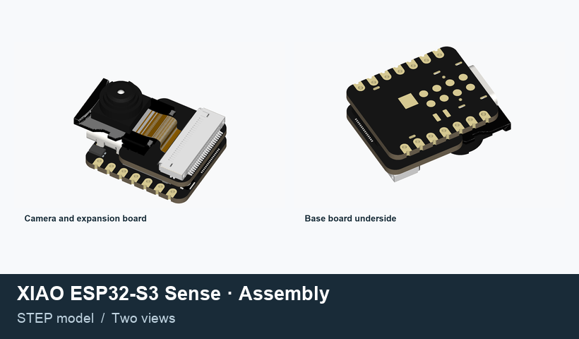](hardware/xiao/README.md) **Seeed Studio XIAO ESP32-S3 Sense — camera version** | 0 or 1 future Copy-Face camera node | [Seeed model guide](https://wiki.seeedstudio.com/xiao_esp32s3_getting_started/) · [camera/stream setup](https://wiki.seeedstudio.com/xiao_esp32s3_camera_usage/) | Owner has this camera-equipped variant. A CrowPanel link is **roadmap only**: image transport, power and latency need qualification. It is not a direct replacement for the panel's MIPI camera module. |

### Project accessories

Accessory photos link to their source. The optional camera row shows the host panel while module identification is open.

| Part to source | When / quantity | Manufacturer source and build notes |
| --- | --- | --- |
|  **Adafruit Mini I2C Gamepad with seesaw — #5743** | 1 for Feather Eyes 2 or classic Eyes 1; optional for Eyes 1 personalities and Feather Gravity Water | [Adafruit shop](https://www.adafruit.com/product/5743) · [Eyes controls/build](projects/animatronic-eyes/README.md) · [Water setup](https://github.com/yury-g/OpenToy-Coursework/blob/main/projects/gravity-water/FEATHER.md). Battery Faces gamepad code remains on its separate [`feature/seesaw-gamepad` branch](https://github.com/yury-g/OpenToy-Coursework/tree/main/companions/battery-faces/feature/seesaw-gamepad). |
|  **Adafruit LSM6DS3TR-C 6-DoF IMU — #4503** | 1 for Feather Gravity Water or Orange Face | [Adafruit shop](https://www.adafruit.com/product/4503) · [Water mounting/wiring](https://github.com/yury-g/OpenToy-Coursework/blob/main/projects/gravity-water/FEATHER.md). Secure the sensor to the toy and follow the documented axis orientation. |
|  **Adafruit MPR121 12-Key Gator touch breakout — #4830** | 1 for Orange Face | [Adafruit shop](https://www.adafruit.com/product/4830) · [Orange Face hookup](https://github.com/yury-g/OpenToy-Coursework/blob/main/projects/orange-face/README.md#plug-in-the-sensors). This is the Gator/QT board with 12 touch pads; the [printed faceplate](projects/3d-printed-designs/orange-face/README.md) exposes its back electrodes. Separate external electrodes/leads depend on your enclosure design. |
|  **STEMMA QT / Qwiic cables, 4-pin JST-SH, 1.0 mm pitch** | 1 per connection: 1 for Feather → gamepad; 2 for Feather → MPR121 → IMU | [Adafruit #4210, 100 mm](https://www.adafruit.com/product/4210) is one sourcing option; choose length to fit the build. Adding another board requires its own connection. These are not larger JST-PH/Grove cables. |
|  **SparkFun Qwiic Button** | 1 per equipped Battery Faces Feather; 2 for the Blue/Green pair | Manufacturer options: [red LED BOB-15932](https://www.sparkfun.com/sparkfun-qwiic-button-red-led.html) / [green LED BOB-16842](https://www.sparkfun.com/sparkfun-qwiic-button-green-led.html). The project records the Qwiic Button interface, not the fitted color SKU; color is not a board identity. [Accessory setup/source](https://github.com/yury-g/OpenToy-Coursework/tree/main/companions/battery-faces/feature/qwiic-accessories/docs/qwiic-accessories.md). |
|  **SparkFun Qwiic Haptic Driver, DA7280 — ROB-17590** | 1 per equipped Battery Faces Feather; 2 for Blue/Green | [SparkFun shop](https://www.sparkfun.com/sparkfun-qwiic-haptic-driver-da7280.html). Includes the soldered LRA motor used by the [accessory branch](https://github.com/yury-g/OpenToy-Coursework/tree/main/companions/battery-faces/feature/qwiic-accessories); no separate motor is needed for that configuration. Use its wiring and motor settings. |
|  **CrowPanel camera module** | Optional for the panel; required for real camera-driven Copy-Face | Use the optional camera offering on the [Elecrow panel listing](https://www.elecrow.com/crowpanel-advanced-9inch-esp32-p4-hmi-ai-display-1024x600-ips-touch-screen-wifi-6-support.html), after confirming V1.0 connector/module compatibility. **Owner confirms no module is fitted; a separately orderable, verified compatible module SKU remains unresolved**; see [camera evidence](https://github.com/yury-g/OpenToy-Coursework/blob/main/projects/copy-face/docs/CAMERA-RESEARCH.md). A generic USB or XIAO camera is not the documented native CSI path. |

For a complete **Nearby Buddy pair**, start with two #5691 boards and use the [standalone project's parts/enclosure guide](https://github.com/yury-g/OpenToy-Coursework/tree/main/companions/nearby-buddy/main). For **Orange Face**, the documented electronics are one #5691, one #4503, one #4830 and two QT cables. Printed parts and their fit status are in the [3D design directory](projects/3d-printed-designs/README.md). Firmware on feature branches and in standalone repositories is not included merely by downloading OpenToy `main`.

### Related Battery Faces hardware

These belong to the [separate Battery Faces family](https://github.com/yury-g/OpenToy-Coursework/tree/main/companions/battery-faces/feature/qwiic-accessories#current-family). These are historical companion roles. Waveshare 1.69 now also has the separate [Eyes + Water port](projects/waveshare-1.69/README.md); other companion roles do not establish an OpenToy Eyes/Water port. Tab5 now also has the separate unfinished OpenToy camera track listed above; the Battery Faces dashboard is not that implementation.

| Device / role | Quantity for that role | Source and selection note |
| --- | --- | --- |
|  **M5Stack Tab5 — C145 / Kit K145**, dashboard | 1 dashboard | [M5Stack shop](https://shop.m5stack.com/products/m5stack-tab5-iot-development-kit-esp32-p4) · [revision guide](https://docs.m5stack.com/en/core/Tab5). Display/touch revisions have changed; match the project's driver before substituting a newer unit. This Battery Faces dashboard role is separate from the new OpenToy Tab5 camera track. |
|  **M5Stack StickS3 — K150**, Orange reporter | 1 | [M5Stack shop](https://shop.m5stack.com/products/m5sticks3-esp32s3-mini-iot-dev-kit). This role is separate from the Orange Face Feather app. |
|  **Waveshare ESP32-S3-Touch-LCD-1.69 — 27350**, Yellow/Rainbow reporters | 1 per reporter; 2 to reproduce both roles | [Waveshare shop](https://www.waveshare.com/esp32-s3-touch-lcd-1.69.htm) · [revision/pin guide](https://docs.waveshare.com/ESP32-S3-Touch-LCD-1.69/FAQ). Match the project's printed-model revision; do not substitute the non-touch LCD-1.69. |
| [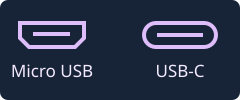](https://github.com/yury-g/OpenToy-Coursework/tree/main/companions/battery-faces/feature/qwiic-accessories) **ESP32-2432S028 CYD, dual micro-USB + USB-C, resistive touch**, Purple companion | 1, USB powered in the documented build | [Project hardware reference](https://github.com/yury-g/OpenToy-Coursework/tree/main/companions/battery-faces/feature/qwiic-accessories/hardware/BOARDS.md). Exact manufacturer SKU/store is unverified; generic “CYD” listings span different displays and pin mappings. |

Historical XIAO/OLED/mechanical builds remain in the [archive](archive/README.md), with their original parts and source paths. Battery Faces' discontinued camera experiment remains on [`archive/camera-test-v17`](https://github.com/yury-g/OpenToy-Coursework/tree/main/companions/battery-faces/archive/camera-test-v17); its XIAO Sense camera is not needed by the current battery-only/accessory builds or the optional CrowPanel companion above.

**Power and cables:** use a USB **data** cable matching the selected device and its setup guide. CrowPanel's programming connection is **UART0 USB-C**; follow its [power instructions](projects/crowpanel/README.md#first-usb-connection). Battery packs are device-specific: match chemistry, voltage, connector polarity, charge-rate requirement and enclosure fit. For Feather, follow [Adafruit's battery guidance](https://learn.adafruit.com/esp32-s3-reverse-tft-feather/pinouts) and the [OpenToy power notes](projects/animatronic-eyes/docs/POWER.md), including the 250 mAh minimum for the stock charging setup. For other devices, use the manufacturer guides linked above and check what the chosen package includes. There is no universal OpenToy battery kit.
