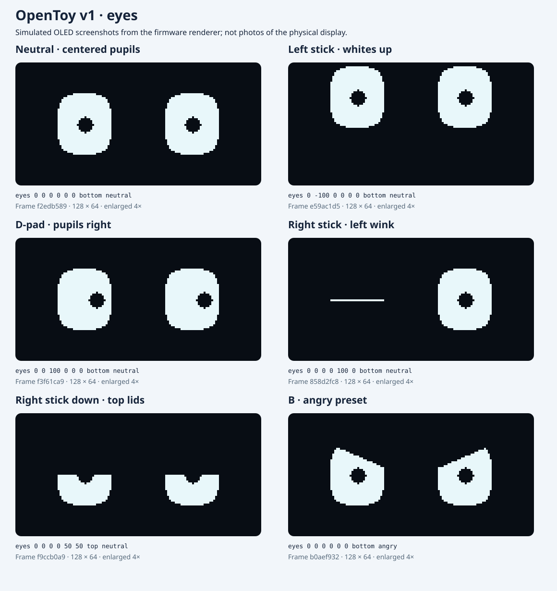
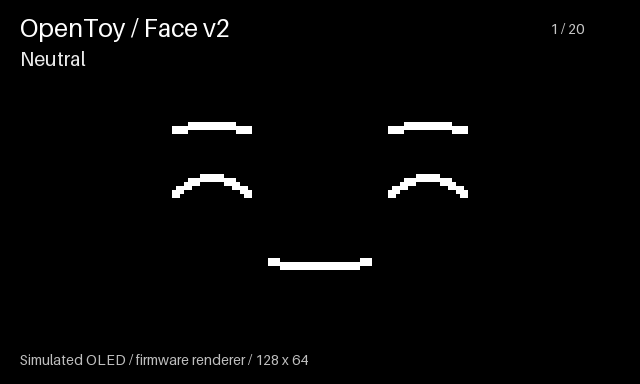

# OpenToy

Toy projects for **Adafruit Feather ESP32-S3 Reverse TFT** and **Arduino Nesso N1**.
The earlier XIAO projects and pre-Feather experiments are in the archive.

[**Feather projects**](projects/feather/README.md) · [**Nesso projects**](projects/nesso/README.md) · [**Archive**](archive/README.md) · [All projects and source locations](projects/README.md)

## Feather projects

<table>
<tr>
<td width="50%" valign="top">

### [Gravity Water](https://github.com/yury-g/OpenToy-Coursework/blob/feature/gravity-water-feather/projects/gravity-water/FEATHER.md)

400 particles with tilt, shake, heat colors and gamepad interaction.
**Feather + LSM6DS3TR-C + optional QT gamepad.**

[Setup and controls](https://github.com/yury-g/OpenToy-Coursework/blob/feature/gravity-water-feather/projects/gravity-water/FEATHER.md) · [Source](https://github.com/yury-g/OpenToy-Coursework/tree/feature/gravity-water-feather/projects/gravity-water)

</td>
<td width="50%" valign="top">

### [Orange Face](https://github.com/yury-g/OpenToy-Coursework/blob/feature/orange-face/projects/orange-face/README.md)

A face that rotates, reacts to shaking and responds to touch pads.
**Feather + LSM6DS3TR-C + MPR121.**

[Setup and controls](https://github.com/yury-g/OpenToy-Coursework/blob/feature/orange-face/projects/orange-face/README.md) · [Wiring and models](https://github.com/yury-g/OpenToy-Coursework/tree/feature/orange-face/projects/orange-face/mechanical)

</td>
</tr>
<tr>
<td width="50%" valign="top">

### [Nearby Buddy](https://github.com/yury-g/OpenToy-Coursework/tree/main/companions/nearby-buddy/main)

Two faces respond to each other's Bluetooth signal strength.
**Two Reverse TFT Feathers.** Distance calibration remains unfinished.

[Project and downloads](https://github.com/yury-g/OpenToy-Coursework/tree/main/companions/nearby-buddy/main) · [Enclosures](https://github.com/yury-g/OpenToy-Coursework/tree/main/companions/nearby-buddy/main/enclosure)

</td>
<td width="50%" valign="top">

### [Battery Faces](https://github.com/yury-g/OpenToy-Coursework/tree/main/companions/battery-faces/feature/seesaw-gamepad)

Battery displays, gamepad expressions and Qwiic haptic experiments.
**Blue and Green are Feathers; Tab5 is the dashboard.**

[Gamepad version](https://github.com/yury-g/OpenToy-Coursework/tree/main/companions/battery-faces/feature/seesaw-gamepad) · [Buttons and haptics](https://github.com/yury-g/OpenToy-Coursework/tree/main/companions/battery-faces/feature/qwiic-accessories) · [Battery-only version](https://github.com/yury-g/OpenToy-Coursework/tree/main/companions/battery-faces/main)

</td>
</tr>
<tr>
<td width="50%" valign="top">

### [Face v1 — eye puppetry](docs/V1-EYES.md)

Eye movement, pupils, blinks, winks and expressions. **Feather project.**

[Guide](docs/V1-EYES.md) · [Saved release](https://github.com/yury-g/OpenToy-Coursework/tree/v1.0.0-eyes)

</td>
<td width="50%" valign="top">

### [Face v2 — doodle puppetry](docs/V2-FACE.md)

Curved eyes, brows, mouth shapes and controller-driven expressions. **Feather project.**

[Guide](docs/V2-FACE.md) · [Saved release](https://github.com/yury-g/OpenToy-Coursework/tree/v2.0.0-face)

</td>
</tr>
</table>

Previews: Face v1/v2, Gravity Water and Orange Face use firmware simulations;
Nearby Buddy is an illustrated device render; Battery Faces shows recorded
screens. Follow each project for its hardware checks and limits.

## Nesso projects

| Project | Hardware and controls | Open |
| --- | --- | --- |
| **Gravity Water** | Built-in motion, touchscreen repulsion, heat button and generated sound | [Visual guide](https://github.com/yury-g/OpenToy-Coursework/blob/feature/gravity-water-feather/projects/gravity-water/README.md) · [Nesso setup](https://github.com/yury-g/OpenToy-Coursework/blob/feature/gravity-water-feather/projects/gravity-water/INSTALL.md) |
| **Nesso Face** | Touch zones, motion reactions and shade buttons on Nesso N1 | [Project and source](https://github.com/yury-g/OpenToy-Coursework/blob/feature/nesso-n1/projects/nesso-n1/README.md) |

### Gravity Water · play on Nesso or Feather

[Controls by device](docs/images/gravity-water-cross-platform-controls.png) ·
[Feather setup](https://github.com/yury-g/OpenToy-Coursework/blob/feature/gravity-water-feather/projects/gravity-water/FEATHER.md) · [Nesso source release](https://github.com/yury-g/OpenToy-Coursework/tree/gravity-water-v0.3.0)

Both versions have been played on hardware. Feather gamepad controls are confirmed;
screen-relative tilt direction awaits a fixed IMU mount. Nesso includes sound;
the current Feather configuration has no speaker. Each device runs independently.
The animation is a scripted model preview, not camera footage.

## Archive · XIAO and pre-Feather projects

[**Browse the archive**](archive/README.md) for the bare XIAO board, OLED class
board, historical Mac/Xbox setup, Plant v0.2 and earlier mechanical concepts.
Their source, guides and saved releases remain available at their original paths.
They are historical projects, not the setup instructions for the current Feather work.

## Finding the right files

This page is the project index. Some complete projects live on their named
branches or in separate repositories; each card links to that project's files.
Downloading this repository's `main` branch does not include every project.
The [source directory](projects/README.md) records the correct location for each.

[Playtesting with AI](docs/PLAYTESTING.md) · [License](LICENSE) · [Licenses](licenses/README.md)

OpenToy is currently private. Repository links require access where applicable.
Keep device profiles, keys, compiled firmware, raw logs and flash backups private.
