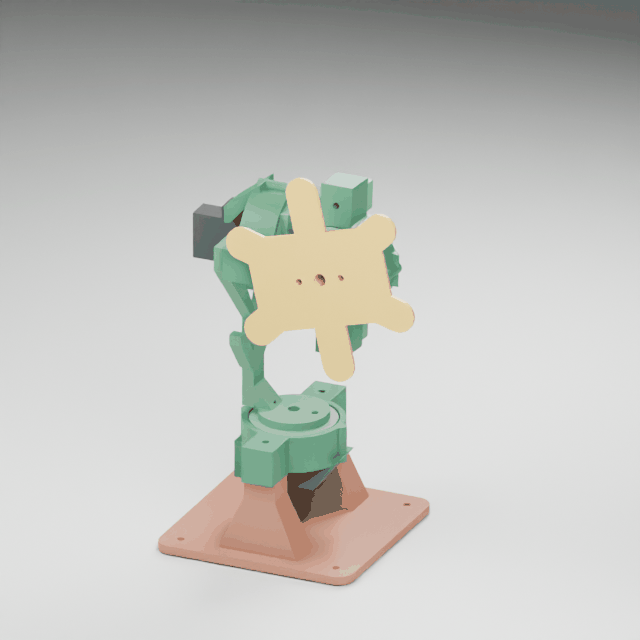

# Archive · XIAO and pre-Feather projects

Archived from the active project index on November 15, 2026 at the owner's
request. These are preserved projects and experiments, not the current Feather
setup. No source, release or recovery history was deleted.

[Current Feather projects](../projects/feather/README.md) · [Nesso projects](../projects/nesso/README.md) · [All projects](../projects/README.md)

**Face v1 and Face v2 are active [Feather projects](../projects/feather/README.md).**

## XIAO projects

| Project / material | Preserved files |
| --- | --- |
| Bare XIAO ESP32-S3 | [Source](../projects/xiao-toy) |
| XIAO OLED + touch class board | [Source](../projects/xiao-class) |
| Mac / Xbox / Bluetooth control | [Controller guide](../docs/CONTROLLERS.md) · [Workshop](../docs/WORKSHOP.md) |
| XIAO setup and update recovery | [Setup](../docs/SETUP.md) · [Protocol](../docs/PROTOCOL.md) · [Recovery](../docs/RECOVERY.md) · [Test results](../docs/TEST-RESULTS.md) |
| October 1 checkpoint | [Stopping-point record](../docs/STOPPING-POINT.md) |

The earlier controller route was Xbox → Mac → Bluetooth → XIAO. That historical
requirement does not apply to the standalone Feather projects. Shared face code
can still be reused by newer projects without making their hardware XIAO-based.

## Earlier mechanical experiments

- [Plant v0.2](../mechanical/plant-v02/README.md): printable three-servo mechanism;
  physical assembly and firmware integration were not validated at its checkpoint.
- [Earlier concepts and visual history](../docs/DESIGN-HISTORY.md): neck,
  giraffe, plant, arm and swan iterations, face concepts and saved source versions.
- [Design archive files](../docs/design-archive/README.md).

These images are firmware/CAD simulations, not demonstrations of assembled hardware.
Nearby Buddy's newer Feather enclosure remains with [Nearby Buddy](https://github.com/yury-g/OpenToy-Coursework/tree/main/companions/nearby-buddy/main/enclosure).

## Historical overview

[README before the hardware-family reorganization](https://github.com/yury-g/OpenToy-Coursework/blob/main/README.md).
Statements such as “current” or “installed” in old notes describe their recorded
checkpoint, not today's device state. Source folders remain in place to preserve
links and build dependencies; this archive is the entry point for browsing them.
