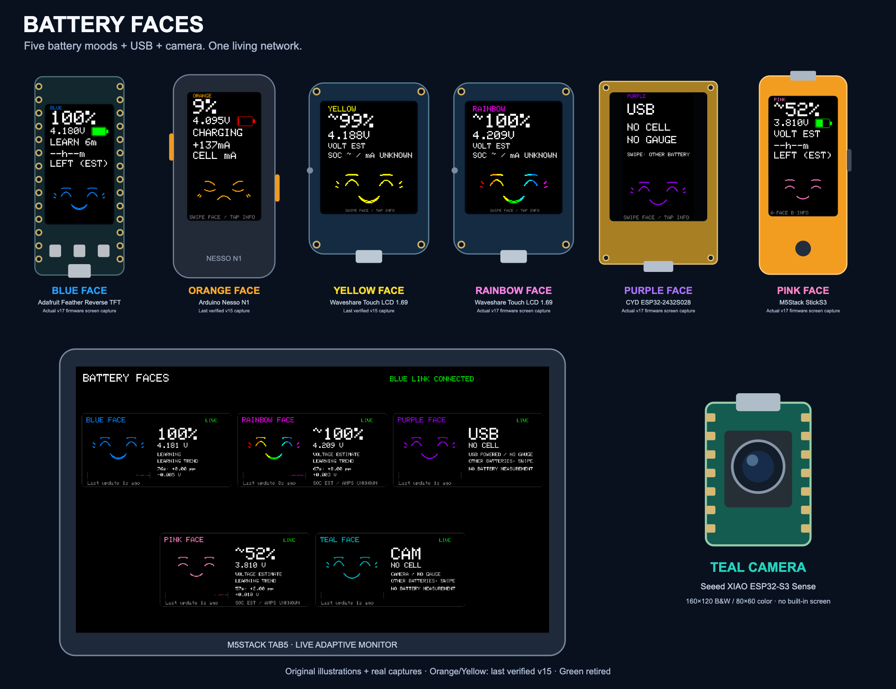
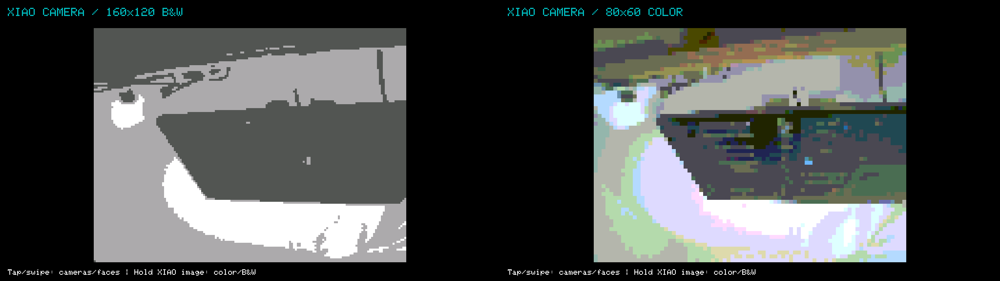
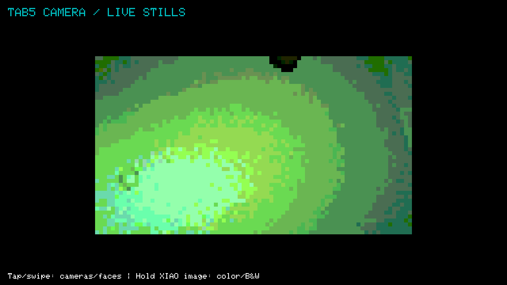
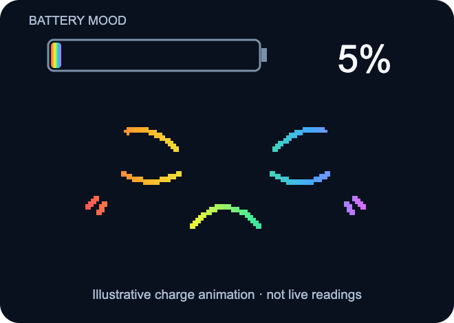

# Battery Faces

Five expressive battery companions, a USB-powered Purple friend, Teal’s live camera, and a shared big-screen monitor. Tab5 reshapes its layout around the faces that are live.

**🔵 Blue · 🟠 Orange · 🟡 Yellow · 🌈 Rainbow · 🟣 Purple · 🩷 Pink · 🟦 Teal Camera · 🖥️ Tab5**

**Current family:** Blue (Adafruit Feather Reverse TFT), Orange (Arduino Nesso N1), Yellow and Rainbow (two Waveshare ESP32-S3 Touch LCD 1.69 boards), Purple (ESP32-2432S028 CYD), Pink (M5Stack StickS3), Teal (Seeed Studio XIAO ESP32-S3 Sense camera), plus the M5Stack Tab5 monitor. **Green is retired and excluded after renewed board heat. Keep its USB and LiPo disconnected while it cools.** [Board details and original design files](hardware/BOARDS.md).

## Cameras and battery pages

**XIAO is the default view when its camera is live.** It sends sharper **160×120 four-shade grayscale** stills every two seconds. **Hold the info button (Blue D1 / Pink B), or hold and release the camera image on a touch screen, to toggle 80×60 color ↔ 160×120 grayscale.** Both formats use the same4,800-byte image payload; the quality setting changes the shared XIAO feed on all screens. This is a compact live still preview, not HD video.

**The battery faces stay:** a short info press or tap leaves the startup camera for that device’s battery face. Subsequent information pages include trend and the available cameras. A next-face press or horizontal swipe leaves a camera for the local battery face; later presses/swipes browse the family. Up/down swipes browse camera pages on touch boards. On Tab5, tap/swipe cycles the battery grid, XIAO and Tab5 camera. Hold the XIAO image to toggle quality.

**Tab5 also supplies its own onboard camera.** It captures locally and sends a second feed through Blue to the other screens. The native16:9 view is letterboxed, preserving its aspect ratio. Its first driver uses fixed manufacturer exposure and baseline ISP conversion; color balance is preliminary. XIAO remains the preferred default.

Battery measurements, expressions and trends keep updating on every page. After **five seconds without a complete image**, a selected camera returns to battery faces—even if the other camera is still working. If all cameras are off, the battery application continues. A startup-following view resumes XIAO when it returns; browsing away keeps your page choice until reboot. Partial or corrupt images never replace complete frames.

The mixed-board network uses ESP-NOW and a private Wi-Fi link through Blue. No internet, microphone, SD recording or external router is used. [All captures](assets/archive) · [Transport and controls](docs/camera-transport.md) · [Native Tab5 driver](docs/tab5-camera-driver.md).

Pink’s screen orientation is owner-confirmed upright. **October20 installation:** Blue, Rainbow, Purple, Pink, Teal and Tab5 are connected and updated. Orange and Yellow need USB reconnection for this update; their illustrations retain the last verifiedv15 screen. Green stays excluded.

## A face for the charge

The expression follows estimated charge: tired/angry below 20%, sorry up to 45%, neutral through 70%, and happy above 70%. The animation is an illustrative loop using the actual OpenToy renderer, not a live feed or an automatic charge/discharge cycle. [Editable animated SVG](assets/animation/battery-mood.svg).

Each battery reporter shows large percentage and voltage, a face, and an alternate recent-trend page. Purple shows USB power and can select the battery reporters. The trend page updates percentage-point and voltage changes across the last minute or two; a five-minute observation window helps distinguish gaining, losing and holding. A reboot restarts that software history. All faces retain the original renderer's 2:1 geometry; Waveshares render directly at native 240×280 with equal face scaling.

## The family

| Device | Readings | Controls |
|---|---|---|
| **Blue** · Adafruit Feather ESP32-S3 Reverse TFT | MAX17048 estimated charge and voltage; Wi-Fi gateway | D0 next face; D1 information page; D2 auto face on ordinary pages |
| **Orange** · Arduino Nesso N1 | BQ27220 estimated charge, voltage and signed cell current; charger status | Swipe left/right next/previous; tap information; A next / B page |
| **Yellow** · Waveshare ESP32-S3-Touch-LCD-1.69 | Voltage, **~SOC** voltage estimate; amps unknown | Swipe, tap; BOOT next |
| **Rainbow** · second Waveshare ESP32-S3-Touch-LCD-1.69 | Voltage, **~SOC** voltage estimate; multicolor face | Swipe, tap; BOOT next |
| **Purple** · ESP32-2432S028 CYD | USB-powered presence; **no battery/gauge** | Swipe/tap; BOOT next |
| **Pink** · M5Stack StickS3 | M5PM1 voltage; **~SOC** voltage estimate; no measured cell current | A next face; B face/trend/cameras; hold on XIAO for quality |
| **Teal** · Seeed XIAO ESP32-S3 Sense | OV3660 camera on this unit; camera presence, **no onboard battery reading** | Headless sender; view it on the family’s screens |
| **Tab5** · M5Stack | Mirrors every fresh enrolled source, with deltas, traces and sample ages | Automatic live tiles; tap/swipe cameras/grid; hold XIAO image for quality |

Selection cycles **Blue → Orange → Yellow → Rainbow → Purple → Pink → Teal → Blue**. Device identity keeps its own face color on every display. No squished faces or crowded combined views on the small devices.

Tab5 adds a tile when an enrolled reporter appears and reflows after it has been absent for eight seconds. Varying live node counts fit automatically; Green cannot reappear. The layout calculation supports varying counts, while radio membership remains an explicit device-MAC allowlist. Future boards need enrollment in the registry. Keep **Blue powered** for Tab5's gateway; Blue can use its battery.

ESP-NOW broadcasts a battery/presence sample every two seconds between enrolled companions on channel 1. Blue relays to Tab5 over a private WPA2 Wi-Fi link and UDP. No internet/router/cloud is involved. Source ages survive relaying and UI/USB delays. ESP-NOW samples are MAC-filtered and validated, but not encrypted or cryptographically authenticated.

## What the numbers mean

- **Orange's mA** is measured current into/out of the cell, not USB input watts. Charger state is read directly on Orange.
- **Blue** shows gauge/voltage trends. Its amber charging LED is the direct charger indication; software cannot read that LED's signal.
- **Yellow/Rainbow/Pink** have voltage-derived estimates, marked `~` and `VOLT EST`. Charging and load can shift them substantially; there is no measured cell current or software charger-done signal on these adapters. Pink reads M5PM1 voltage without changing its charger control byte; the installed manufacturer library’s charging method is a stub, so firmware reports unknown charging state.
- **Purple** uses USB power and has no attached battery or gauge. It smiles as a live USB friend and can browse battery sources. Its card shows `USB / NO CELL`, never an invented percentage. The CYD uses a small logical buffer uniformly scaled to a 180×320 area on its 240×320 screen, leaving RAM for Wi-Fi.
- **100% / NEAR FULL** is an estimate, not proof of charger termination, capacity, battery health or safety. Faces describe charge level, not cell health. No health certification, runtime/load test, or automatic battery cycling was performed.

## Screens and editable artwork

The hero uses **actual framebuffer captures** superimposed on original simplified board illustrations. Native screen ratios are preserved. These drawings are not photographs or precision mechanical CAD renders.

| Actual screen | Editable illustrated board |
|---|---|
| [Blue](assets/screenshots/blue.png) | [SVG](assets/renders/blue-board.svg) |
| [Orange](assets/screenshots/orange.png) | [SVG](assets/renders/orange-board.svg) |
| [Yellow](assets/screenshots/yellow.png) | [SVG](assets/renders/yellow-board.svg) |
| [Rainbow](assets/screenshots/rainbow.png) | [SVG](assets/renders/rainbow-board.svg) |
| [Purple CYD](assets/screenshots/purple.png) | [SVG](assets/renders/purple-board.svg) |
| [Pink StickS3](assets/screenshots/pink.png) | [SVG](assets/renders/pink-board.svg) |
| Teal camera · headless | [SVG](assets/renders/teal-board.svg) |
| [Tab5, native 1280×720](assets/screenshots/tab5.png) | [SVG](assets/renders/tab5-board.svg) |

[Download every image](assets/battery-faces-images.zip) · [Editable family SVG](assets/renders/battery-faces-family.svg) · [All historical and current captures](assets/archive) · [Image checksums/provenance](assets/manifest.json) · [Manufacturer CAD/schematics and attribution](hardware/BOARDS.md).

## Build and validation

Current firmware: **v17-tab5-camera**, October 20, 2026. [Reproducible build steps](docs/BUILDING.md) · [Rainbow/layout plan](docs/rainbow-plan.md) · [Purple/CYD plan](docs/purple-plan.md) · [Green heat hold](GREEN-HEAT-HOLD.md).

- Deterministic host tests cover battery logic, packet validation, source-age preservation, disabled Green identity, navigation, equal face geometry and tile bounds.
- Hardware proof and native captures are retained in `outputs/*v15*.json` and `outputs/*v16*.json` and `outputs/*v17*.json` and the image archive. The v15 evidence records the previous 20-path battery family check. Current v17 evidence records two independent camera feeds on the connected displays, remote quality switches, startup defaults, a20-second no-reader check, individual and complete camera loss → battery-face fallback → fresh recovery. USB-unavailable Orange/Yellow are explicitly listed. No battery test is started.
- USB-idle checks verify the faces and radio keep advancing when an attached host stops reading. Purple’s physical left/right swipes and taps were recorded on hardware. Physical touch checks on other boards remain separate from serial selection and gesture unit tests.

Original full-flash backups, local network credentials and compiled firmware remain private **on the owner's machine**, outside Git. Source, test evidence, captures, editable graphics and manufacturer references are retained here. The original OpenToy renderer remains MIT-licensed and unchanged; manufacturer design files retain their own licenses.
