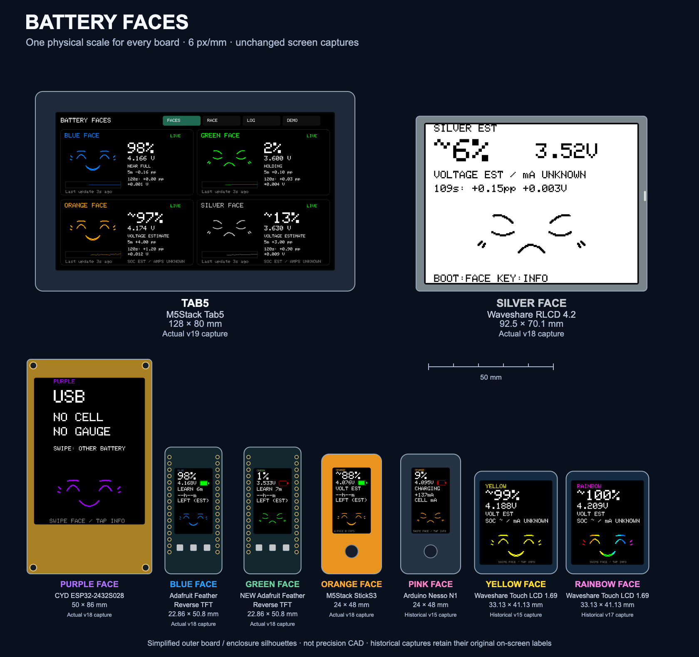
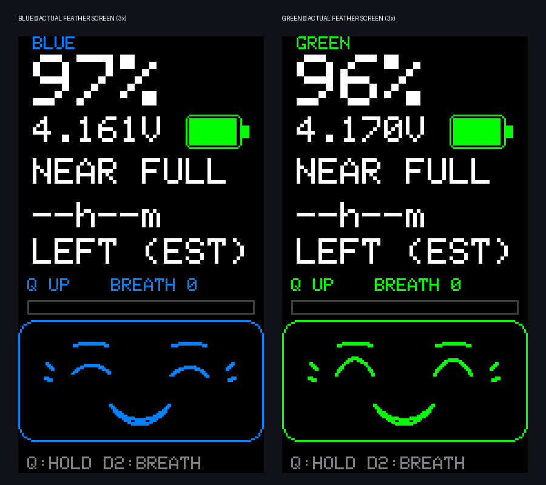
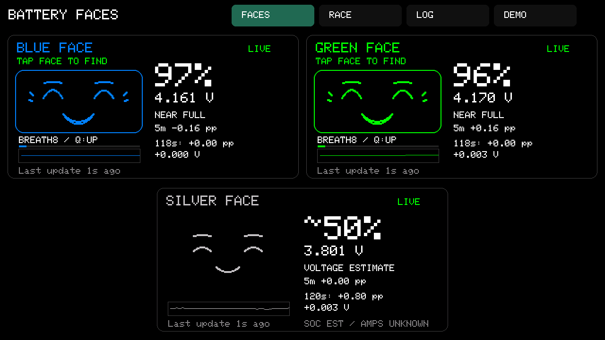
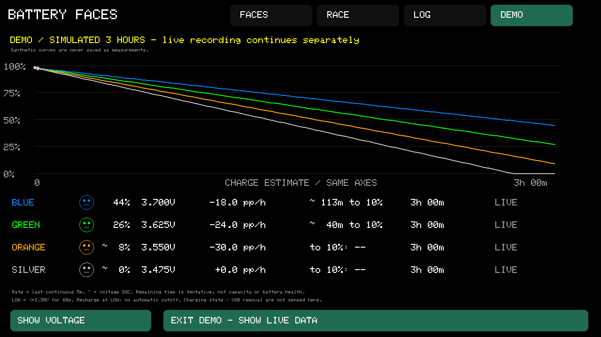
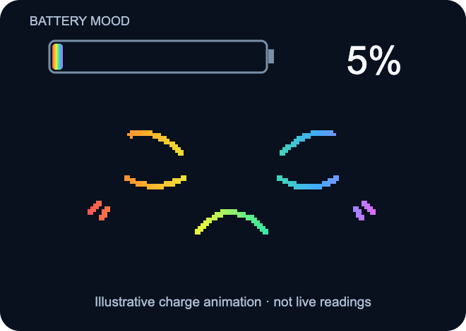

# Battery Faces

A family of expressive battery monitors, with a live M5Stack Tab5 dashboard.



**🔵 Blue · 🟢 Green · 🟠 Orange · 🩷 Pink · 🟡 Yellow · 🌈 Rainbow · 🟣 Purple · ◻️ Silver · 🖥️ Tab5**

The application starts on battery faces again. Percentage, voltage, expressions and recent trends remain active. **The camera test has ended:** capture, streaming, camera pages and camera relay are removed from active firmware. Its working code is available on [the camera-test branch](https://github.com/yury-g/OpenToy-Coursework/tree/main/companions/battery-faces/archive/camera-test-v17); the XIAO can be disconnected.

**Saved checkpoint:** [v26 strong haptics](docs/checkpoint-v26.md) · [`checkpoint-v26-strong-haptics`](https://github.com/yury-g/battery-faces/tree/checkpoint-v26-strong-haptics). Latest accessory code lives on `feature/qwiic-accessories`; `main` preserves the battery-only checkpoint.

## Qwiic buttons, breathing and Find Me

This branch adds SparkFun Qwiic Buttons and DA7280 haptic motors to **Blue and replacement Green**. Their button LEDs act as locators, brighten while held, and fade with breathing intensity to dark rests. The screen shows button state, activity and amplitude alongside the battery face.

- **Qwiic Button:** hold for a full-command buzz (**127/127**); release to stop. It overrides breathing while held, then breathing resumes if enabled.
- **D2 tap:** toggle slow creature breathing on/off. Blue and Green use one smooth model with stable, different identity seeds, varied timings and stronger **64–96/127** peaks.
- **Tab5:** tap Blue or Green's face to find it; tap again or use **STOP BUZZ** from any page. It stops automatically if renewal disappears, with a fixed two-minute maximum. Each card also shows **BREATH / HOLD / BUZZ / IDLE**, command intensity, and **Q UP / DOWN / PRESS**, with the same colored face outline and gray buzz afterglow as the Feather screens. Quick presses remain visible briefly; stale activity clears.

**Earlier USB bench checkpoints:** 18 short bursts and 10 full breathing cycles passed across Blue/Green. Both passed Tab5 Find Me start/stop and lost-renewal expiry, with no reported resets, I2C errors or driver faults. These measurements do not establish circuit current or battery-only runtime.

**Stronger v26 haptics:** both Feathers passed brief64/127 command bursts and stronger breathing checks; motor limits remain active. [Evidence](outputs/strong-haptics-v26-live.json).

**Current outline check:** both native screens and Tab5 were captured with matching active outlines; both motors then returned to verified zero/inactive. The longer uninterrupted creature test was interrupted by physical button presses and is recorded as incomplete. [Evidence](outputs/outline-live-v25.json).





[Accessory controls, limits and test evidence](docs/qwiic-accessories.md) · [Find Me protocol](docs/find-me.md) · [Roadmap](docs/ROADMAP.md). The battery-only checkpoint remains on [main](https://github.com/yury-g/OpenToy-Coursework/tree/main/companions/battery-faces/main); this experiment lives on `feature/qwiic-accessories`.

## Current family

| Face | Physical board | Battery information | Controls |
|---|---|---|---|
| **Blue** | Adafruit Feather ESP32-S3 Reverse TFT | MAX17048 estimated charge and voltage; network gateway | D0 next face; D1 face/trend; D2 breathing toggle; Qwiic hold buzz |
| **Green** | **New** Adafruit Feather ESP32-S3 Reverse TFT | MAX17048 estimated charge and voltage | D0 next face; D1 face/trend; D2 breathing toggle; Qwiic hold buzz |
| **Orange** | M5Stack StickS3 with the orange housing | M5PM1 voltage and **~SOC** voltage estimate | A next face; B face/trend |
| **Pink** | Arduino Nesso N1, previously Orange | BQ27220 charge estimate, voltage, signed cell current; charger status | A next / B information; swipe/tap |
| **Yellow** | Waveshare ESP32-S3-Touch-LCD-1.69 | Voltage and **~SOC** voltage estimate | Swipe/tap; BOOT next |
| **Rainbow** | Second Waveshare ESP32-S3-Touch-LCD-1.69 | Voltage and **~SOC** voltage estimate | Swipe/tap; BOOT next |
| **Purple** | ESP32-2432S028 CYD | USB-powered companion, **no cell/gauge** | Swipe/tap; BOOT next |
| **Silver** | Waveshare ESP32-S3-RLCD-4.2 | Voltage and **~SOC** voltage estimate | BOOT next face; KEY face/trend |
| **Tab5** | M5Stack Tab5 | Live faces, continuous background log and optional runtime race | Faces / Race / Log / Demo tabs; swipe pages; Blue/Green Find Me |

**Orange/Pink were swapped by owner request:** the orange-cased StickS3 is now Orange; Nesso becomes Pink when reconnected. Stable radio slots follow physical boards, so measurements are not reassigned to a different battery.

**Green is replacement hardware:** new MAC `02:00:00:00:00:02`. The original cracked/hot Green, `02:00:00:00:00:03`, remains blocked and must stay disconnected. [Old hardware hold](GREEN-HEAT-HOLD.md).

**Silver is monochrome and landscape:** 400×300, no backlight. It uses the same face drawing and 2:1 face geometry as Tab5. Its 200×150 logical image scales exactly2×, with no stretching. Large battery information sits above the face; its trend page shows recent percentage-point and voltage changes. [Driver and manufacturer references](docs/silver-rlcd-driver.md).

Current accessory work targets **Blue, new Green and Tab5**; Orange/StickS3 and Silver retain their previous battery firmware. Purple retains its installed USB-only companion firmware. Pink/Nesso, Yellow and Rainbow are USB-unavailable; their updated reporter builds are prepared but not installed. Historical pictures of those boards are labeled and do not claim current readings or a completed rename on absent hardware.

## Background log and battery race

Tab5 observes Blue, Green, Orange and Silver continuously, even while displaying Faces. **Log** keeps voltage/charge curves, observed contact time, recent five-minute slopes and low-voltage warnings. **Race** adds a deliberately started comparison, overlaid curves, elapsed time, observed time per runner and tentative minutes to10%. Toggle between voltage and charge axes. Colored faces remain on their original page.



**The image above is an explicitly labeled synthetic three-hour demo. No real discharge run was started during installation or testing.** Demo never becomes measurements and does not interrupt the real background log. [Actual charging/waiting screen](assets/screenshots/tab5-race-waiting.png) · [Actual background log](assets/screenshots/tab5-background-log.png).

To compare the four batteries:

1. Keep **Tab5 on USB**. Charge the other four to90%+. Race shows readiness and blocks arming until all four readings are fresh and above that threshold.
2. Open **Race → Start new race** while still charged. During its confirmation screen, unplug the four reporters from USB, keep their batteries attached, then tap to start within two minutes. This permits normal voltage/SOC relaxation after unplugging; USB removal itself is not detected.
3. Leave Tab5 running. Faces and Log remain available. **LOW / RECHARGE** means observed voltage <=3.30V for60continuous seconds; recharge then. This is an observation endpoint, **not chemical empty or an automatic power cutoff**. Stop race retains its curves; Log continues separately.

The first two minutes are settling. A rate needs approximately five continuous minutes of fresh, distinct samples; radio gaps or a source reboot restart that learning. Remaining time is a rough linear projection to10%, not a guarantee. Orange/Silver percentages come from voltage, so their estimates can shift with charging and load. Different displays/radios create different normal-use loads; these comparisons do not measure intrinsic cell capacity or SOH.

**Blue is still the gateway.** If it goes flat first, Tab5 cannot hear the remaining reporters and labels link loss. Silence never counts as empty or a completed runtime. An independent powered gateway is the next architectural step for complete multi-battery tests beyond Blue’s runtime.

Two bounded histories checkpoint to a dedicated Tab5 NVS namespace every five minutes and at race state changes, with write/readback checks. A Tab5 restart preserves curves, marks an active race **interrupted**, and resumes Log with a gap. Time while Tab5 was off is unknown and excluded. Existing partitions, original filesystems and charger settings are preserved. Before swapping packs, export the previous comparison and begin a new one; radio identities identify boards, not batteries.

For a local CSV export with Tab5 on USB:

```sh
.venv/bin/python tools/export_runtime.py outputs/my-battery-log.csv
```

The CSV distinguishes background/comparison data, charge estimate, voltage and gaps. These are passive normal-use observations, not an autonomous load/capacity tester or automatic charging/discharging system. Repeated, pack-labeled comparisons under a consistent load can help reveal changing runtime; measuring capacity requires cell current integration or a separate controlled tester.

## Battery faces and trends



The expression follows estimated charge: tired/angry below20%, sorry up to45%, neutral through70%, and happy above70%. This animation uses the preserved OpenToy renderer and illustrates charge levels; it is not a live feed or automatic battery cycling.

Each connected companion can browse the other batteries. Short information presses or taps alternate the face and trend pages. The trend page shows recent percentage-point and voltage changes; a five-minute observation window distinguishes gaining, losing and holding. Each reporter’s short trend window restarts after reboot; Tab5’s longer logs persist as described above. Tab5 adds fresh enrolled reporters and reflows after an eight-second absence. Keep Blue powered for Tab5’s private gateway.

The radio sends one battery/presence sample every two seconds on ESP-NOW channel1. Blue forwards fresh readings to Tab5 over a private Wi-Fi/UDP link. No external router or internet service is required. Source ages survive relaying. Enrollment is an explicit MAC allowlist; filtering is not cryptographic authentication.

## What readings establish

- **Pink/Nesso** measures signed current into/out of the cell, not USB input watts, and reads charger status.
- **Blue/Green** provide gauge charge estimates and voltage trends. Their amber LED is the direct charger indication; firmware cannot read that LED signal.
- **Orange/StickS3, Silver, Yellow and Rainbow** estimate charge from voltage and mark it `~` / `VOLT EST`. Charging and load can shift these estimates. Cell current and charger-done status are unknown on these adapters. Charger settings are preserved.
- **Purple** is USB-powered and never invents a battery percentage.
- **100%** does not prove charger termination, capacity, battery health or safety. Faces describe charge estimates. No real discharge race or automatic charge/discharge cycle was performed. The accessories branch also performs bounded USB-powered motor tests; these do not establish battery capacity or electrical power consumption.

## Source, pictures and validation

[Build instructions](docs/BUILDING.md) · [Board details](hardware/BOARDS.md) · [Every retained image](assets/battery-faces-images.zip) · [Capture archive](assets/archive) · [Editable family SVG](assets/renders/battery-faces-family.svg).

Every active board is drawn at one common physical scale (**6px/mm**), including Tab5. Silver is second largest by front area. [Manufacturer dimensions and scale assumptions](assets/physical-dimensions.json) document the simplified outer board/enclosure silhouettes; they are not precision CAD. Screen captures retain their native aspect ratios and historical labels. Original pre-correction drawings are retained in the image archive. Silver’s native monochrome image is rendered from its logical readback using the driver’s documented rotation/scaling. Old board screenshots retain their historical labels. Original full-flash backups, network credentials and binaries remain private on the owner’s machine and are excluded from Git.

On this branch Tab5 runs **v25-accessory-outline**, and Blue/Green run **v26-strong-haptics**. Other reporter firmware remains **v18-green-silver-faces**, October20,2026. The preceding battery checkpoint is preserved: [Runtime observer smoke-test evidence](outputs/runtime-observer-v19-live.json) records four fresh sources, isolated Demo, shared touch hit tests, CSV export, checked NVS saves and final Faces/WAITING state. Physical touch was not manually reconfirmed in this run. [Restart recovery evidence](outputs/runtime-restart-v19.json) verifies real saved curves survive an app restart. [Host tests](outputs/host-tests-v19.json) cover rates under timing jitter, reordering, stale/duplicate packets, gateway gaps, low endpoints, compaction, clock wrap, interrupted restores and continued background observation.

Earlier reporter validation: `tools/verify_faces_family.py` checks new Green/Silver telemetry on connected peers and Tab5, own-face startup, face/trend navigation and20seconds without USB reads. `outputs/faces-family-v18-live.json` retains hardware proof; `outputs/host-tests-v18.json` records packet, battery, geometry, registry and monochrome-packing tests. The owner confirms that new Green and Silver’s final landscape display are upright and correct.

The vendored SparkFun DA7280 code retains its public-domain/Beerware attribution; see the [accessory source notes](docs/qwiic-accessories.md). The original OpenToy renderer remains MIT-licensed. The Waveshare-derived Silver display initialization retains Apache-2.0 attribution.
