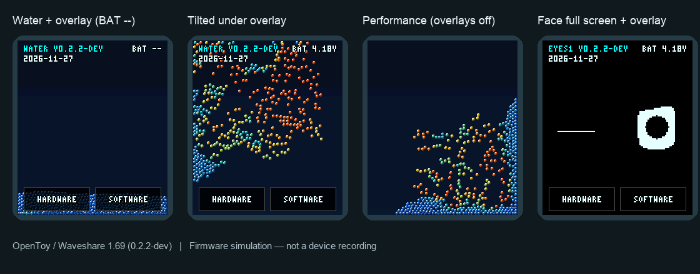

# OpenToy app status bar — design standard v1.1

Created: 2026-11-17. Updated: 2026-11-27. Applies to existing maintained apps and all new apps/device ports. This is the shared design specification; the adoption table below is not a claim that every installed device already implements it.

The owner wants to identify the running app by looking at the device, then hide technical labels for performance. The normal display therefore shows the app, its installed version, the creation date of that version, and the local battery indication together.

*Firmware-rendered v1.1 layout demonstration, not camera footage. Battery readings and motion in this preview are simulated. [Original v1.0 layout studies](images/app-status-bar-spec.png) remain for history; their reserved bars are superseded.*

## Required content

| Item | Rule |
| --- | --- |
| App | A stable, recognizable short name, such as `EYES1`, `EYES2`, `WATER` or `ORANGE`. Keep a registry in each app's metadata; do not rename its repository or project folder to fit the screen. |
| Version | The version of the firmware actually installed, including any prerelease suffix. Never display a hard-coded old label while loading newer behavior. |
| Creation date | `YYYY-MM-DD`, the creation/release date of that version. It is fixed in version metadata, not the device clock, boot date, flash date or current date. The original app's first creation date may be recorded separately. |
| Battery | Right-aligned within the visible header. Show a battery icon and genuine available information: gauge percentage when supported, otherwise measured voltage. Use `--` when unavailable. Do not invent a percentage from an uncalibrated voltage reading. Only show charging when the hardware actually reports it. |

Suggested one-line layout: `EYES1 v1.3.0 2026-11-16       82% [battery]`.

Battery refers to the device providing this display. A companion board's reading must not be presented as the display board's battery without an explicit label. Personality names, connection state and a short source revision may be supplementary; they must not displace the required identity fields.

## Layout and readability

- **Full native canvas under overlay (default):** Apps render across the full native display from edge to edge by default, with no opaque full-width reserved status bar, no reserved footer bar, and no tank/viewport borders.
- **Draw status after the app with contrast shadow/halo:** Draw default-visible app, version, creation date, and battery text (plus any small visible control button overlays) **after** rendering the app scene, using a compact 1-pixel shadow or halo so text stays legible over moving or bright content.
- **Two readable rows when needed (no self-overlap):** Keep all four required fields visible together without truncating, scrolling, or alternating pages. Header strings must never overlap each other; on portrait or narrow displays, use two readable rows (for example, app/version on row 1 left, battery on row 1 right, creation date on row 2 left, and optional sensor notice on row 2 right).
- **Round or clipped displays:** Safe text bounds remain required. Inset the overlaid header enough to stay inside the visible circle, keeping battery at the row's right safe bound rather than an invisible rectangular corner while the underlying app scene remains full-screen.
- **High-contrast readable scaling:** Scaling should suit the physical screen; a high-resolution large screen does not need microscopic ten-physical-pixel text.
- **Fixed physics, projection, and touch geometry:** App physics bounds, eye/face projections, cursor limits, and touch-to-scene coordinates use direct full-screen coordinates and remain fixed regardless of header visibility.
- **Control hit consumption:** Only taps/presses starting inside actual visible control overlays are consumed by controls (never triggering water repulsion or eye pokes). Taps outside or between controls pass directly to the full-screen app, and swipe/restore gestures remain available. Do not consume an entire header or footer strip as if it were a frame.
- **Partial display transfer audit:** When using dirty-row or partial screen updates, track moving particles and cursors under the overlaid metadata so they are always redrawn cleanly, and re-transfer the metadata rows whenever label text changes.
- **Performance mode:** Hiding the status overlay and control button overlays must **only** hide the overlays. It must not resize viewports, change eye/water layout, reset physics, or alter touch transforms.

## Default and performance behavior

1. On a normal boot, the status bar is **on**. Every new app/port inherits that default.
2. A deliberate, documented user action enters performance mode and hides the complete status bar. An explicit app launcher/system menu can offer the same toggle.
3. A reliable, documented action restores the bar without rebooting. Hiding it must not hide the only way to restore it.
4. Each device chooses an appropriate gesture or button combination after checking its existing controls. Do not consume ordinary eye pokes, gamepad buttons or touch gestures already used by the app without updating the control design.
5. Performance mode is session state. It can remain active while switching apps within that session; a reboot restores the default visible bar. Do not silently save a permanent hidden setting.
6. No periodic debug labels, automatic metadata popups or test overlays should interrupt a performance. Necessary fault indications should be explicitly designed and documented.

## Metadata and implementation contract

Each target should consume one canonical version record containing at least:

- `app_id` and `display_name_short`;
- `firmware_version` and `version_created`;
- `hardware_target` and a source revision/build identifier for diagnostic output;
- the local battery source and its supported reading type.

The README, release record, status bar and status-query output must agree on version/date. A changed firmware behavior gets an appropriate version change and dated revision-log entry. Do not assign today's date to an old release merely because it was rebuilt. For legacy releases whose dates are not yet verified, report the date as unknown and track it as a migration gap rather than guessing.

Keep the header layout/state separate from each app's animation logic and from hardware battery reads. Use a common implementation where toolchains permit it, or equivalent adapters where they do not. Do not force unrelated boards to share pin definitions, drivers or firmware images. Battery reads and diagnostics must remain bounded and must not block animation if a peripheral is absent.

## Adoption and compatibility tracking

Existing and future apps are in scope. Historical tags and original binaries remain unchanged; adoption happens in maintained source branches and new versioned builds. Some projects live outside OpenToy's main branch or in their existing standalone repository; follow the [project directory](../projects/README.md) rather than relocating them.

| App/track | Current status | Required next step |
| --- | --- | --- |
| Waveshare 1.69 touch (`Curious169`) | `0.2.2-dev` (2026-11-27): full `240x280` Water and Face under 2-row shadowed overlay + compact button overlays; direct full-screen touch/control hit separation and Performance overlay toggle pass host checks and target compile | Rainbow app-only install/digest and live touch/IMU telemetry passed; physical screen/tilt/full-screen touch/control feel and battery ADC qualification pending (`BAT --` until qualified); `0.1.0`–`0.2.1` records preserved as historical |
| Gravity Water — Feather | `gravity-water-feather-v0.3.0` (2026-11-27): full `135x240` native canvas, 2-row shadowed overlay, direct screen cursor and audited dirty-row tracking pass host checks and target `2.0.17` compile | Physical installation/check pending; `v0.2.0` bench evidence preserved as historical |
| Gravity Water — Nesso | `gravity-water-v0.3.1` (2026-11-27): full `135x240` native canvas, 2-row shadowed overlay, direct screen touch and audited dirty-row tracking pass host checks and `arduino_nesso_n1` compile | Installed `v0.3.0` bench unit untouched; physical check pending; `v0.3.0` bench evidence preserved as historical |
| Waveshare 1.85C BOX device track | Eyes `1.1.1` installed: already uses fixed full-screen projection with overlaid curved safe-arc text and no opaque bar; Performance hides header without moving eyes or touch coordinates | [Verification](../projects/animatronic-eyes/docs/WAVESHARE-VERIFICATION.md): owner fingertip tap feel pending; battery zero displays `--`. [Catalog matrix](../projects/waveshare-1.85c/README.md) tracks remaining ports |
| Animatronic Eyes 1 and 2 — Feather | **Migration pending:** uses opaque `240x15` `FeatherMenu.h` bar | Migrate to full-screen overlay with shadowed text in next versioned release |
| Animatronic Eyes 1 — Nesso | **Migration pending:** uses opaque `15px` rotated strip and `Transform` scale reduction when header visible | Migrate to full-screen overlay with fixed eye scale in next versioned release |
| CrowPanel P4 + XIAO device track | **Migration pending:** `0.2.2`/`0.3.0` uses `88px` opaque header and `Presentation.h` scale change (`7` vs `8`); local battery `--` | [Verification](../projects/crowpanel/EYES1-VERIFICATION.md) & [matrix](../projects/crowpanel/COMPATIBILITY.md) track remaining ports; migrate header in next versioned release |
| Waveshare 4.2 RLCD, M5Stack Tab5, UNO Q + TFT Eyes | **Migration pending:** RLCD (`50px` reserved header), Tab5 (`28px` opaque bar), UNO Q (reserved header) | Migrate to overlaid status text over full native canvas in future versioned releases |
| Orange Face, Nearby Buddy, Battery Faces, Nesso Face, Copy-Face | **Migration pending:** not yet audited/migrated to full-screen overlaid status standard | Audit maintained sources, existing controls and battery capabilities, then record versioned migration results |
| Archived XIAO and other historical apps | Historical releases retained | Record compatibility; apply the standard when making a new maintained port, without rewriting old release history |

Each device track keeps a per-project matrix: source location, required peripherals, port status, installed version, display/touch/audio/network checks, and remaining limitations. “Builds,” “runs on hardware,” and “owner-observed behavior” are separate states. Updating this design document does not mark a firmware port complete.

## Acceptance checks for a migrated app

- Verify app/version/date against the installed build record and diagnostic output.
- Check the entire header at every supported orientation, including circular corners, long version strings and missing battery readings.
- Confirm the header is visible after reboot; performance mode hides it, remains quiet, and can be exited without rebooting.
- Confirm switching apps updates the identity and preserves performance session state intentionally.
- Confirm hiding/showing does not break app bounds, touch coordinates, gamepad mappings or animation timing.
- Confirm battery failures do not freeze the app and do not display fabricated charge information.
- Record the actual device/build tested. Simulations and visual mockups are supporting evidence, not substitutes for physical observations.

## Change history

- v1.1 — 2026-11-27: full native canvas under overlaid status text as default on all maintained and new apps; compact contrast shadow/halo with no opaque full-width reserved bars or tank borders; two non-overlapping readable rows when needed; fixed physics/touch geometry independent of Performance mode; explicit control hit consumption; dirty-row audit rule; unmigrated apps documented as migration pending.
- v1.0 — 2026-11-17: app identity, installed version, version creation date, right-aligned battery, default-visible status bar, reversible session-only performance mode, adaptive layouts and backward adoption tracking.
