# OpenToy — visual development history

Recorded October 2, 2026; development below began October 1. This is the chronological design log and checkpoint index. It distinguishes concept drawings, browser experiments, exact firmware pixel simulations, real Mac app screenshots, electronic hardware checks and owner feedback. We do not have historical photographs of the toy's OLED glass. Earlier bench steps were recorded before Git was initialized; they share a preserved smoke-test source archive rather than separate invented Git tags.

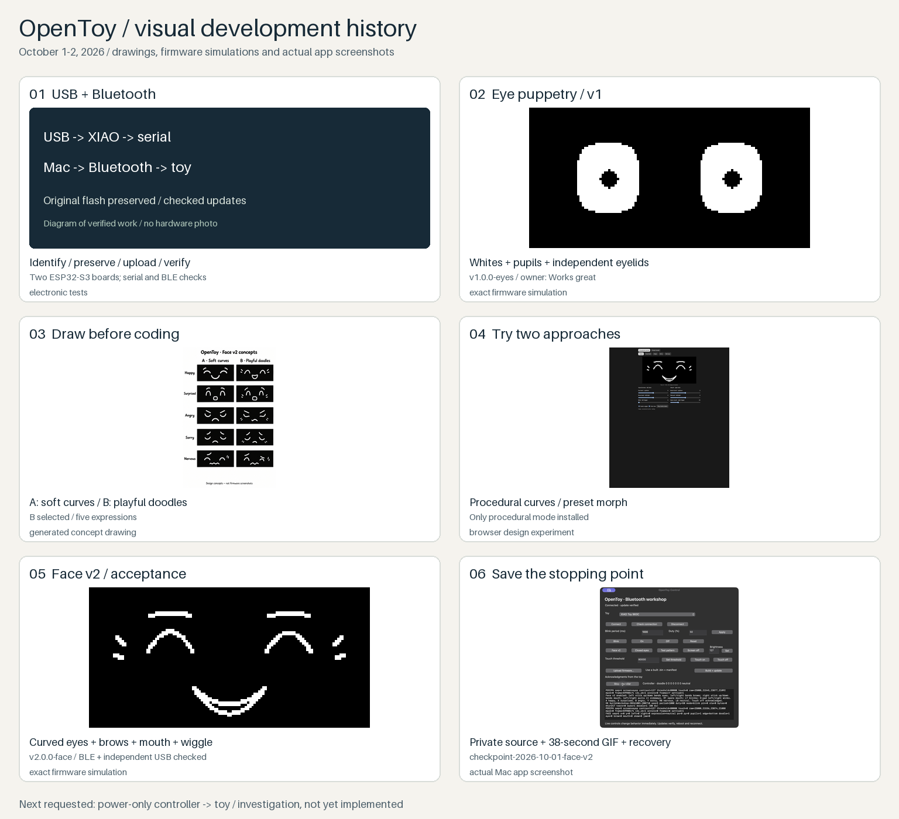

## Checkpoint index

| Stop | Change | Evidence / preserved state |
| --- | --- | --- |
| [01](#01--first-usb-result) | Correct chip, preserve old flash, first USB-programmed result | Independent serial output; original flash kept privately |
| [02](#02--bluetooth-live-control-and-updates) | Live BLE controls and full-image updates | Both boards, update verification, real failed-boot rollback |
| [03](#03--class-oled-and-touch-circuit) | Add the documented class circuit | Original wiring/controller source; real display writes and touch readings |
| [04](#04--first-controller-smoke-test) | Xbox → Mac → toy | Native input, BLE/USB-matched poses; historical smoke source |
| [05](#05--v1-layered-eye-puppetry) | Independent whites, pupils and lids | Exact pixel references, recorded physical input, owner feedback; v1 tag |
| [06](#06--stop-and-draw-the-face) | Soft curves versus playful doodles | Generated concept sheet; drawing-review commit |
| [07](#07--algorithmic-curves-versus-preset-morphing) | Compare two movement approaches | Browser simulations; procedural approach selected for device |
| [08](#08--first-procedural-firmware-iteration) | DoodleV2 first transfer | Initial BLE iteration; superseded by r2 |
| [09](#09--refine-and-verify-the-renderer) | DoodleV2r2 acceptance | Exact target hashes, moving frames, hidden/idle fixes, regressions |
| [10](#10--native-app-build-and-update-handoff) | Build + update from the app | Actual app screenshot; new build and neutral state corroborated over USB |
| [11](#11--owner-selected-stopping-point) | Private source checkpoint and GIF | Preserved tags, 38-second tour, source archive, local recovery archive |
| [12](#12--reconnect-and-make-the-history-visible) | Restore connection; put visuals in README | Bluetooth and USB readback; visual-history source checkpoint |
| [Next](#next--power-only-standalone-control) | Computer-free controller operation | Requested goal; wireless compatibility investigation still open |

## 01 — First USB result

**October 1 · electronic checkpoint.** The executor was verified to be native macOS with access to the Mac's USB serial ports. The first raw board was ROM-identified as an ESP32-S3, resolving the earlier C3 naming confusion. Original flash was read before replacement. Firmware was compiled and USB-seeded without a routine whole-flash erase.

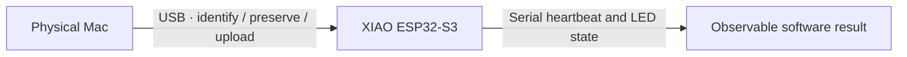

The first observable result was serial status and reported LED state, rather than claiming to see an LED remotely. The raw board had no OLED attached. See [bench evidence](TEST-RESULTS.md). Original full flash/source remains in the private local recovery files.

## 02 — Bluetooth live control and updates

**October 1 · electronic checkpoint.** Bounded period, duty and mode changes were sent over BLE and corroborated through USB. The updater writes the inactive application slot, authenticates each toy's image, checks it and verifies the running build after reconnect. Multiple full updates and deliberately failed-boot rollback worked on both physical boards.

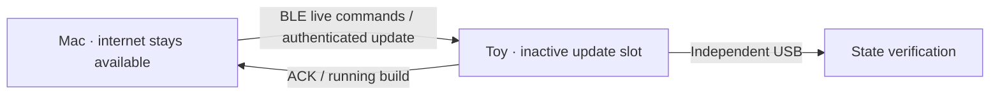

Initial incomplete fast transfers and malformed-image validation failures are retained in the private bench evidence; fixes and passing results are summarized in [TEST-RESULTS](TEST-RESULTS.md). [Protocol](PROTOCOL.md) · [Recovery](RECOVERY.md).

## 03 — Class OLED and touch circuit

**October 1 · electronic checkpoint.** A second XIAO was added with the existing class circuit. Preserved source established an SH1106G 128×64 OLED at 0x3C, SDA GPIO5/SCL GPIO6 and touch GPIO1–4. Configuration was established from source rather than guessed from an I2C address.

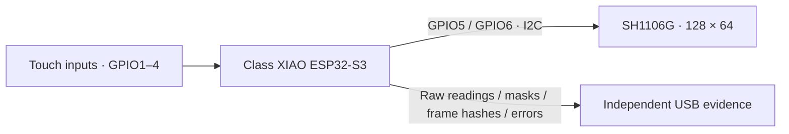

Screen modes, contrast, touch threshold/gating, changing raw sensor values and checked display writes were exercised over BLE/USB. These are electronic checks; the agent did not observe physical pad feel or OLED glass. [Circuit/setup](SETUP.md) · [Results](TEST-RESULTS.md).

## 04 — First controller smoke test

**October 1 · first puppetry checkpoint.** The attached Microsoft USB controller was recognized by Apple's driver and GameController framework. The Mac mapped sticks/buttons to gaze, lids and expressions, then relayed them over BLE. Recorded stick/D-pad inputs were replayed with 41 USB-matched poses. The owner said the first smoke test worked well, then requested independent eye layers.

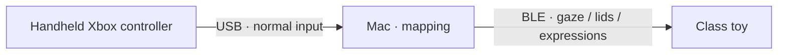

The [historical smoke-test source archive](https://github.com/yury-g/OpenToy-Coursework/tree/checkpoint-2026-10-02-visual-history) preserves this earlier state. It is separate from v1's later whites/pupils/lids. There is no invented image of this early OLED state. [Detailed evidence](TEST-RESULTS.md#physical-xbox-connection-added).

## 05 — V1 layered eye puppetry

**October 1 · source stop `v1.0.0-eyes`.** Left stick moves the white shapes vertically; D-pad moves black pupils; right stick winks and closes lids from either edge. Expression buttons select presets. The owner approved the gestures and subsequently said “Works great.”

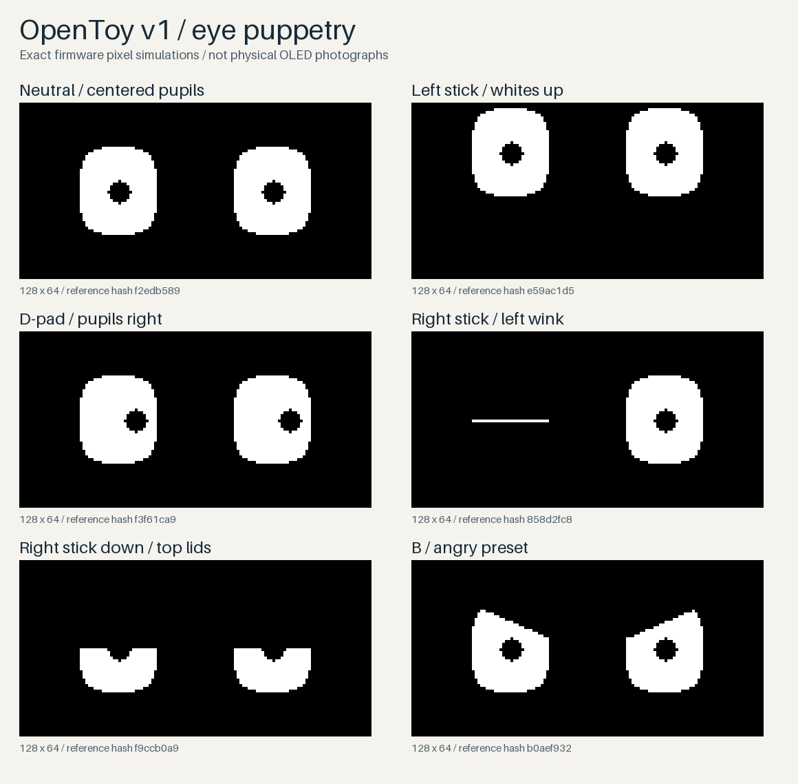

**Exact firmware simulations.** The displayed pixel buffers match saved reference hashes. The hardware suite checked 15 reference poses plus 20 combined synthetic poses, invalid-command atomicity and BLE-disconnect neutralization. A separate simultaneous recording matched 82 real-controller poses to independent USB/frame references; it does not qualify every remaining range/button/unplug condition.

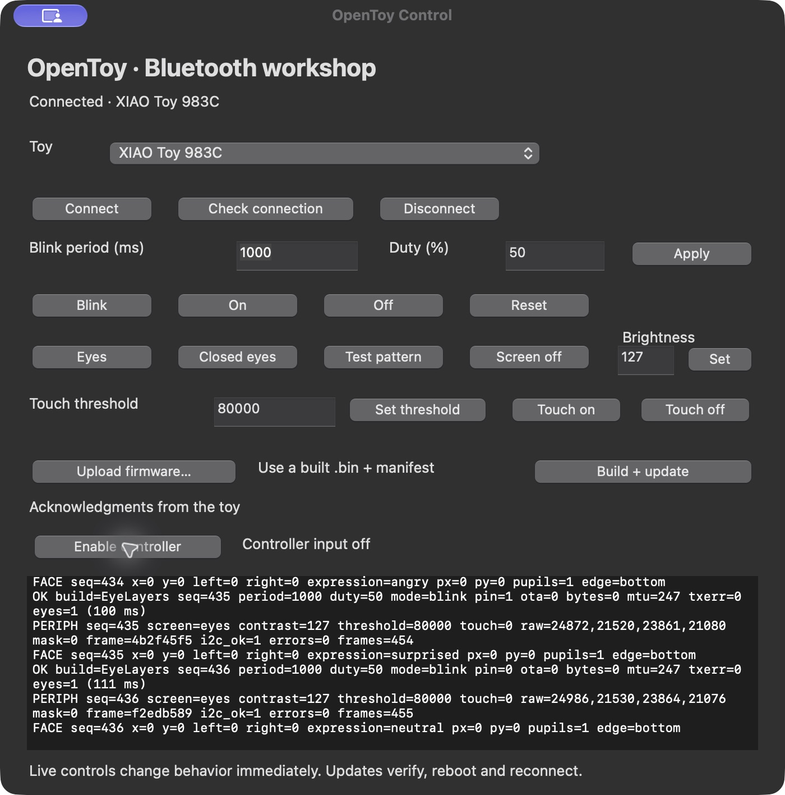

**Actual Mac screenshot**, rather than a hardware photograph. [V1 source release](https://github.com/yury-g/OpenToy-Coursework/tree/v1.0.0-eyes) · [Controls/rebuild/recovery](V1-EYES.md). Exact pre-v2 application/manifest and matching source/app/mapper are preserved privately in `projects/xiao-class/backup/before-face-v2/`.

## 06 — Stop and draw the face

**October 1 · visual review stop `9126153`.** The owner asked for eyes and a mouth made from kawaii curved lines: happy, surprised, angry, sorry and nervous. We paused firmware work to explore drawings first.

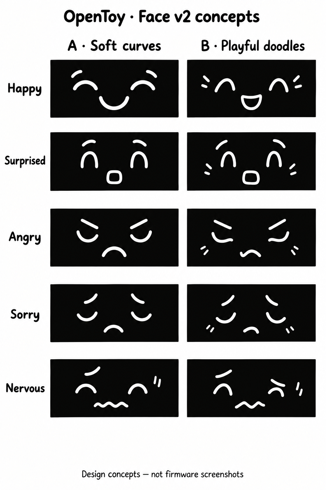

**Generated concept drawings**, not firmware screenshots. A uses sparse smooth strokes; B adds asymmetry and small squiggles. The owner chose **B · Playful doodles**, requested controllable curvature and motion-following wiggle, then authorized the best iteration to be uploaded while away.

[Drawing-review source](https://github.com/yury-g/OpenToy-Coursework/tree/9126153) · [Concept prompt and selection record](concepts/V2-FACE.md).

## 07 — Algorithmic curves versus preset morphing

**October 1 · browser comparison stop.** The owner asked to try algorithmic art and an alternative to fixed still images. Both approaches regenerate line geometry from parameters. Procedural mode applies independent eye/brow/mouth offsets. Preset morphing blends feature geometry toward expression anchors.

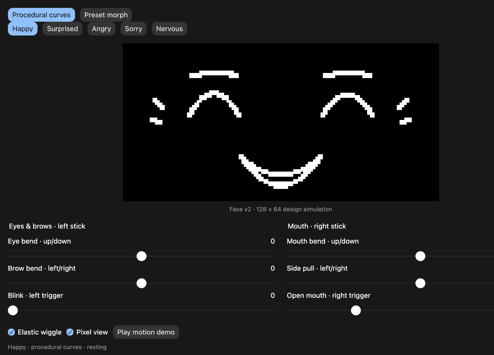

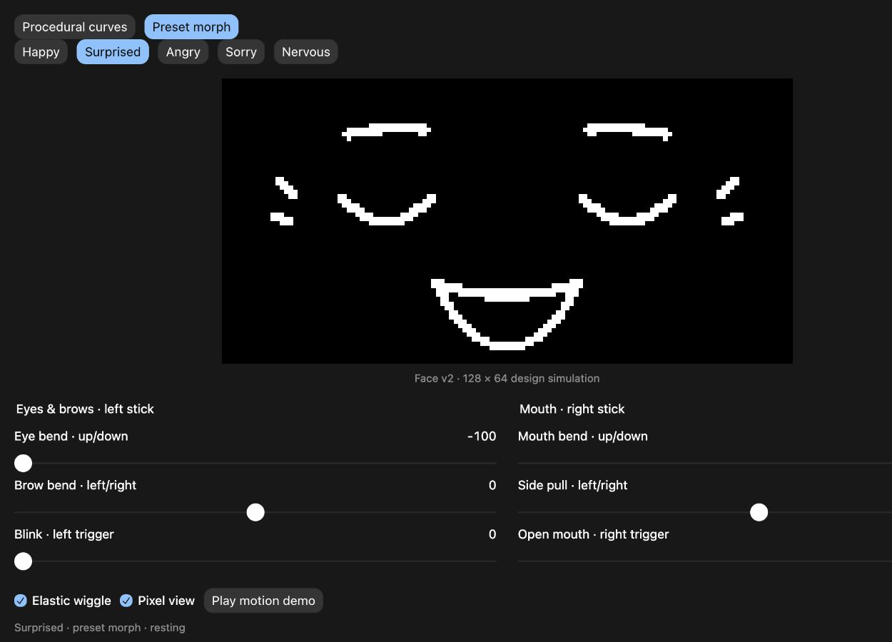

**Browser design screenshots.** Canvas approximates the strokes; it is not the exact device rasterizer. Only procedural mode is installed in Face v2. The alternative remains a saved comparison. [Run the comparison](V2-FACE.md#try-both-approaches-without-flashing) · [Saved preview source](simulations/face-v2-fragment.html).

## 08 — First procedural firmware iteration

**October 1 · interim build `DoodleV2`, superseded.** The chosen face became a pure bounded renderer: quadratic eye/brow curves, cubic mouth curves, a damped parameter spring and localized decaying wiggle. New commands/maps preserved the old eyes/face commands and update/recovery path.

The initial 652556-byte build was accepted over BLE in 65.1 seconds. This was an intermediate device iteration; the final reference gallery and GIF below represent the refined accepted version, not an invented recording of this earlier build. Private build/evidence files preserve the intermediate transfer. [Iteration record](concepts/V2-PROGRESS.md#procedural-iteration-and-comparison).

## 09 — Refine and verify the renderer

**October 1 · accepted build `DoodleV2r2`.** Review caught hidden-screen motion continuing to redraw and a final snapped frame that could be skipped. Both were fixed with regression checks before acceptance.

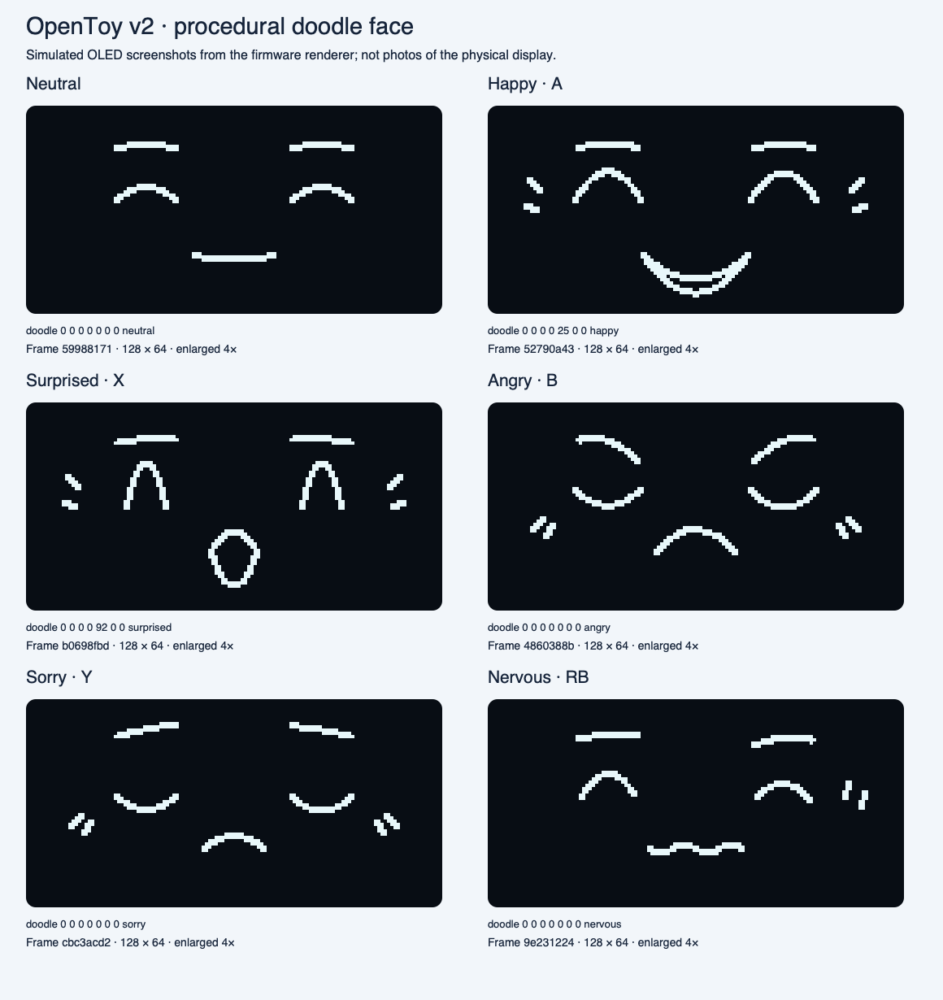

**Exact firmware simulations.** All 45 Python checks and 11 C++ programs passed. The accepted build transferred/reconnected in 64.4 seconds. Real BLE plus independent USB matched 19 target hashes, 20 combined synthetic poses, moving/hidden/idle behavior, invalid-command atomicity and disconnect reset. Legacy eye/face/peripheral/invalid-update suites passed; zero display/BLE errors held.

[Accepted source `v2.0.0-face`](https://github.com/yury-g/OpenToy-Coursework/tree/v2.0.0-face) · [Algorithm/commands](V2-FACE.md) · [Acceptance evidence](concepts/V2-PROGRESS.md#hardware-acceptance). Optical appearance and complete new physical-control qualification remain distinct from this electronic evidence.

## 10 — Native app Build + update handoff

**October 1 · installed build `Workshop-20261001-200710`.** The native app compiled the accepted face source, uploaded it, rebooted/reconnected, acknowledged Touch off and reapplied actual resting controller input. Transfer/reconnect took 73.3 seconds, with compilation additional.

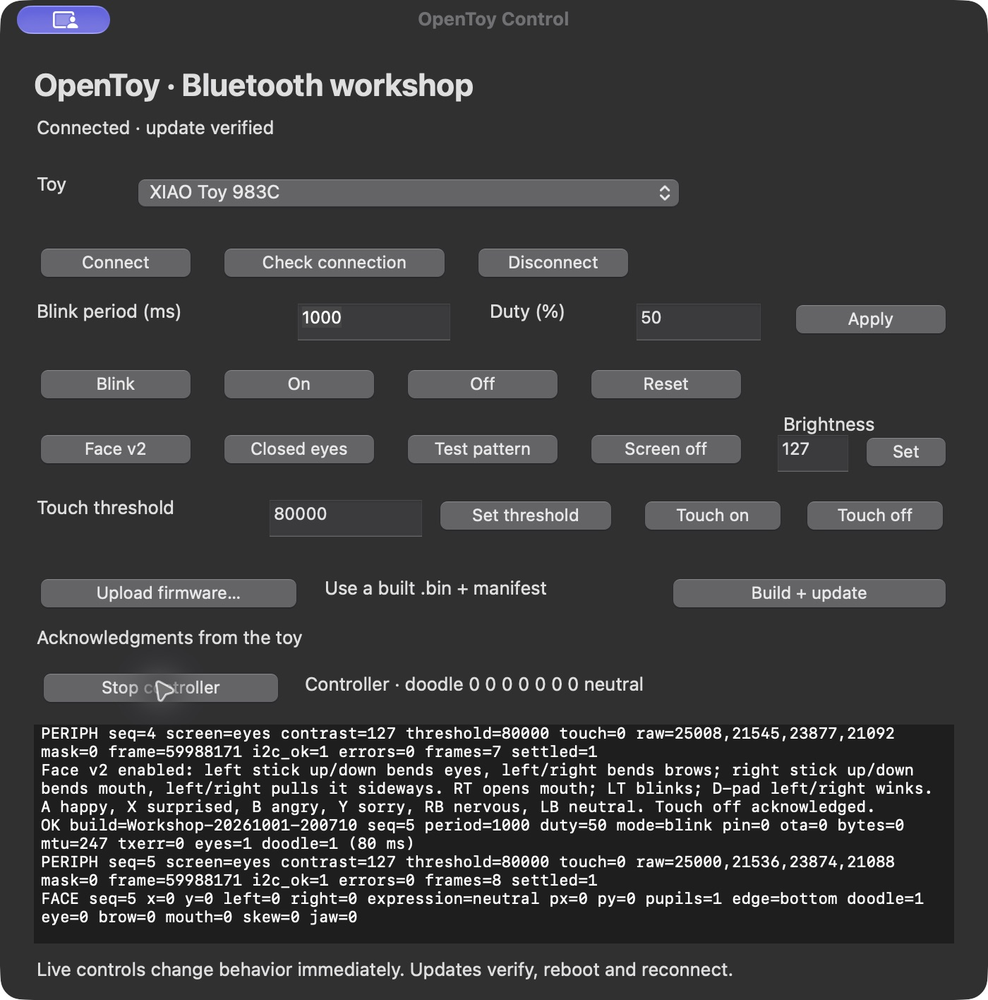

**Actual Mac screenshot.** Independent USB matched the new build and settled neutral frame `59988171`, with zero display/BLE errors. Stop was also corroborated. This tested stationary input across the update; held non-neutral input remains an open qualification test. [Handoff record](V2-FACE.md#native-buildupdate-handoff).

## 11 — Owner-selected stopping point

**October 1 · `checkpoint-2026-10-01-face-v2`.** The owner said “Excellent,” selected a stopping point, requested a private GitHub repository and asked to save all code plus an animated tour. Repository visibility was changed to **PRIVATE**; the original MIT and dependency licenses remain intact.

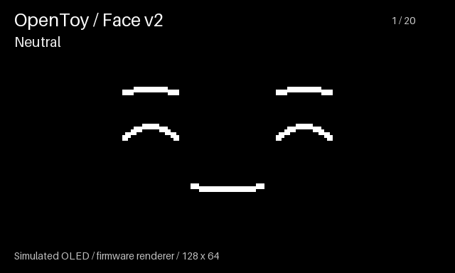

**38-second firmware-rendered simulation, not physical OLED video.** It samples 760 animation frames, encoded as 330 GIF frames with 311 distinct OLED buffers. All 19 reference poses plus the neutral return have checked final pixel hashes after GIF decoding. [Commands/timings/hashes](images/v2-face-tour.json) · [Reproducible exporter](../tools/render_animation.py).

The [stopping-point release](https://github.com/yury-g/OpenToy-Coursework/tree/checkpoint-2026-10-01-face-v2) preserves clean source and visual assets. A separate owner-only local recovery archive was read back: 2940 members, including Git history, original source/flash backups, profiles/keys, the v1 return image, current/intermediate builds and evidence. Private key-bearing material was not uploaded. [Resume/recovery inventory](STOPPING-POINT.md).

## 12 — Reconnect and make the history visible

**October 2 · `checkpoint-2026-10-02-visual-history`.** After the owner unplugged/replugged devices, the class toy was reconnected through the native app. BLE and independent USB confirmed the same installed build, settled neutral frame and zero errors. Controller input was left off following the owner's clarification; no controller firmware or pairing was changed by that reconnect.

The owner then requested that the GIF appear directly in the GitHub README and that this visual log show the development stops. This edition adds the prominent animation, overview, chronological evidence and checkpoint/source links. The firmware is unchanged. [Visual-history release](https://github.com/yury-g/OpenToy-Coursework/tree/checkpoint-2026-10-02-visual-history).

## Next — Power-only standalone control

**October 2 · requested goal, not an achieved checkpoint.** The owner wants the toy/controller to work without the computer, automatically reconnect after powering on, and preserve the controller's normal Apple TV use. A dedicated animatronics controller is acceptable for convenience, but no purchase or direct-controller compatibility success is assumed.

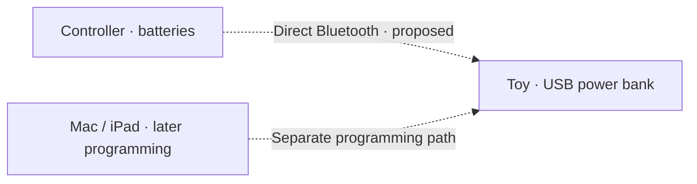

The installed version still requires the Mac relay for puppetry. Bluepad32 documents BLE Xbox model/firmware candidates on ESP32-S3; the exact attached controller's wireless behavior, persistent pairing, restart/loss recovery and coexistence with the updater remain tests. The owner was given the physical Pair-button step for a wireless compatibility inspection. [Bluepad32 compatibility](https://bluepad32.readthedocs.io/en/latest/supported_gamepads/) · [Apple's Xbox/Apple TV guidance](https://support.apple.com/en-us/111101).

## Keep the log reproducible

Update this log at meaningful design/device stops. Add real visuals and a source/recovery link; label simulations and untested goals. Do not rewrite earlier accepted tags, extrapolate owner feedback to untested hardware, or upload private keys/images/evidence. Dates here are the owner's local dates, not invented exact event times.

`tools/render_history.py` regenerates the overview and v1 PNG gallery from preserved visuals and exact firmware fixtures. It uses the optional Pillow dependency/license already saved for GIF export and a C++ compiler; it never connects to hardware. Run it from the repository root:

```sh
.venv/bin/python -m pip install -r tools/requirements-animation.txt
.venv/bin/python tools/render_history.py
```
