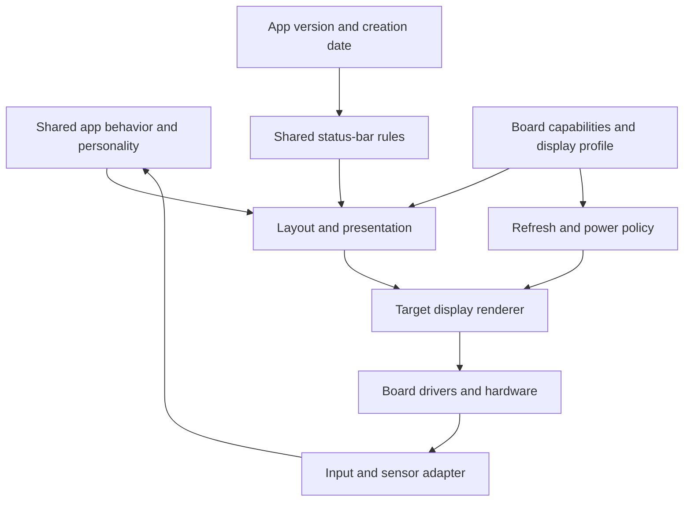

# OpenToy device family — porting strategy

Planned cross-device features are tracked in the [family roadmap](ROADMAP.md).

Created 2026-11-17. Recommended architecture and migration guide; this document does not claim a universal runtime exists or that new devices already run OpenToy. The [project directory](../projects/README.md) remains the source catalog, and the [app status-bar standard](APP-STATUS-BAR.md) applies to every maintained port.

## One app behavior, several hardware targets

Keep the recognizable experience shared: eye personalities, blink timing, anger/recovery, idle glances and app rules. Adapt its presentation and controls to each device. An ESP32-S3 is a processor family, not a complete board specification or an interchangeable firmware target.

The recommended approach is a small shared behavior layer with explicit board adapters. Copying whole applications per device is initially quick but makes fixes and personalities diverge. A universal graphics framework and launcher could reduce duplication later, but would add migration work before the actual display constraints are known. Start from existing shared code and extract only the parts that two working ports demonstrably need.

| Part | Responsibility |
| --- | --- |
| App behavior | Time-based state, independent eye reactions, personalities and semantic actions such as look, poke-left, poke-right and change-expression. No board pins or display-driver calls. |
| Presentation | Fit the scene to safe bounds, choose readable colors/patterns, reserve the status area, and map input through the same rotation/layout transform. |
| Board profile | Exact model/revision, toolchain, display shape/resolution/pixel format, verified peripherals, memory constraints and supported power modes. Unknown is distinct from absent. |
| Hardware adapters | Display transfers, buttons/gamepad/touch, motion, audio, battery sensing and communication. Unsupported capabilities remain explicit. |
| Scheduling | Advance behavior using elapsed time; render at a target-specific cadence. Avoid unchanged redraws where supported without skipping driver-required maintenance. Keep input responsive between frames. |

Keep personality settings separate from hardware profiles: Curious, Dreamy and Cheeky are characters, not separate boards. Use deterministic seeds for repeatable tests and distinct per-instance seeds/timing in normal play. Preserve current public protocols and renderer provenance while gradually moving reusable behavior behind these boundaries.

## Different screens need deliberate treatment

- **Small rectangular color screens:** prioritize recognizable eyes and readable metadata within the content viewport.
- **Round screens:** use actual visible geometry. A rectangular bounding box alone is insufficient; inset the header and fit rotated content inside the circle.
- **Reflective/monochrome displays:** choose deliberate foreground/background polarity, strong silhouettes and non-color cues. Measure animation/transfer cadence and use the supported display power policy. Do not assume backlight dimming exists or apply e-paper refresh rules.
- **Larger screens:** scale composition and text for physical readability. Do not merely stretch a tiny framebuffer or force ten physical pixels for the header.

For the new **Waveshare ESP32-S3-RLCD-4.2**, the vendor documents a 300 × 400 reflective LCD requiring no backlight. This makes it a useful first target for validating a distinct display profile. Exact controller behavior, pixel format, sustainable cadence, available inputs and power savings must be confirmed in its device track before being advertised as tested. See [official documentation](https://docs.waveshare.com/ESP32-S3-RLCD-4.2) and [vendor source](https://github.com/waveshareteam/ESP32-S3-RLCD-4.2). These specifications do not identify the connected unit by themselves.

Never infer a touchscreen, motion sensor or battery gauge from the MCU. Without motion sensing, use a documented manual orientation choice. Without touch, provide an intentional button/controller mapping where practical. Required missing peripherals make an app blocked or adapted; an adaptation must state how it differs. Optional audio may be disabled without replacing the app's visual behavior.

## Evidence and ownership

Each device chat owns its hardware access, target-specific source, recovery record and compatibility matrix. This coordinator maintains cross-device direction and common standards. Use separate checkouts, refresh main before integration and coordinate edits to shared interfaces. A chat handoff is not automatic background supervision.

For each runnable catalog project, record source repository/branch and revision, required capabilities, adaptation, target build/version/date, installed state, tests and remaining gaps. Use distinct evidence columns:

| Evidence | What it establishes |
| --- | --- |
| Planned / blocked | Feasibility and missing requirements; no working-port claim |
| Host tests / build | Logic or compilation passes for the named revision |
| Installed / live checks | Correct physical target runs the recorded build; list actual checks |
| Owner observation | Named visual/control behavior was confirmed on a dated build |

A successful Eyes port does not mark Water, Orange Face, Nearby Buddy or Battery Faces complete. Preserve external repository and feature-branch locations in the catalog. Printed designs have mechanical compatibility records, not firmware status.

## Incremental rollout

1. **Enroll each board:** verify exact hardware, official sources, USB/ROM identity, private recoverable backup and compatible partition/update path. Never flash by a generic ESP32-S3 selection alone.
2. **Establish one representative port:** Eyes first for new display tracks. Preserve the current large-pupil behavior and personalities; implement the common header and explicit control mappings. Record real display limits.
3. **Extract proven common behavior:** existing Eyes code already separates several reaction, idle, presentation and personality components. Reuse those first; do not relocate working projects or rewrite historical releases to fit a speculative framework.
4. **Expand app by app:** publish each device's matrix, then adapt other catalog projects according to their actual dependencies. A multi-app launcher is a separate feature, not assumed to exist.
5. **Verify releases:** check bounds/orientation, header and performance toggle, input disconnect/recovery, independent timing, battery failures and relevant audio/network behavior. Compare host simulations with live evidence; measure current before claiming battery runtime improvements.

Every behavior or target change gets a dated revision entry. Record app version, board target/revision, source revision and pinned toolchain; preserve old tags and recovery records. The status bar identifies the installed build. Public documentation must exclude private device identifiers, raw logs, backups, keys and compiled images.

## Current adoption boundary

Feather and Nesso have existing Eyes implementations; the shared header migration is tracked separately. CrowPanel P4/XIAO, Waveshare 1.85C touch/speaker and Waveshare 4.2 RLCD have dedicated device tracks. Their device guides and test records determine current readiness. This strategy introduces no firmware changes and performs no hardware tests.
