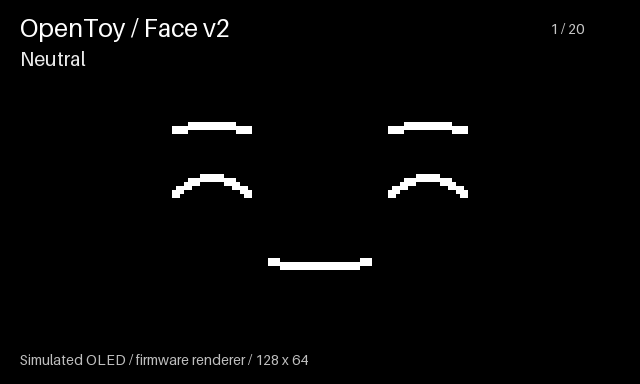

# OpenToy Face v2 — saved stopping point

October 1, 2026. The owner chose this as a stopping point and requested a private GitHub checkpoint. Repository: [yury-g/OpenToy](https://github.com/yury-g/OpenToy), now **private**. Checkpoint: [`checkpoint-2026-10-01-face-v2`](https://github.com/yury-g/OpenToy-Coursework/tree/checkpoint-2026-10-01-face-v2). The earlier `v1.0.0-eyes` and `v2.0.0-face` tags remain intact. Repository privacy does not change the code's MIT license or third-party licenses.

## What is saved

- Both example projects, the native Mac app, Xbox adapter, tests, provisioning/build/upload tools, protocol/recovery instructions, original dependency notices and Git history.
- Face v2 procedural firmware, exact pixel fixtures, design drawings, screenshots and both browser design approaches. Only the procedural approach is installed; preset morphing remains a comparison experiment.
- The animated tour below and the exporter that regenerates it from firmware code.
- A separate **private local recovery archive** preserves original flash/source backups, v1 return image, current compiled images, private toy profiles/keys and bench evidence. These remain outside Git and GitHub release assets.



This is a **firmware-rendered simulation, not physical OLED video**. It samples the actual spring/wiggle animator and the 128×64 monochrome renderer at 50ms intervals. The looping 38-second GIF has 330 encoded frames, 311 distinct OLED frames and 20 stops: all 19 reference poses plus a return to neutral. The encoder merges duplicate holds. Final OLED pixels for every stop match their checked target hashes after decoding. [Animation manifest](images/v2-face-tour.json).

## Device and app handoff

The last independently checked class-toy build is `Workshop-20261001-200710`, compiled from the accepted Face v2 source: 652736 bytes, SHA256 `68a0cf9c52110b7390d68854eee2ff106315e488c4b538918c207c62f20f79bc`. The Mac app's Bluetooth update/reconnect took 73.3 seconds, with compilation additional. USB corroborated the running build, settled neutral framebuffer `59988171`, Touch off, and zero display/BLE errors. The app was left connected with Xbox input enabled at that handoff. This save/export step did not change or reflash the firmware.

Left stick bends eyes/brows; right stick bends/pulls the mouth; RT opens the jaw; LT blinks; D-pad left/right winks. A/X/B/Y select happy/surprised/angry/sorry; RB selects nervous; LB selects neutral. See [Face v2](V2-FACE.md) for complete control behavior and [progress](concepts/V2-PROGRESS.md) for evidence and limits.

## Regenerate the GIF

From the repository root, use the project Python environment and a C++ compiler:

```sh
.venv/bin/python -m pip install -r tools/requirements-animation.txt
.venv/bin/python tools/render_animation.py
```

The exporter compiles `tools/animation_dump.cpp`, which includes the actual firmware `DoodlePixels.h`. It reads the saved pose fixtures, renders movement and verifies hashes before and after GIF encoding. It never connects to the toy. `CXX` can select an alternative compiler, including a quoted command such as `CXX='/path/to/zig c++'`. The saved export used Python 3.12.14, Pillow 12.3.0 and Zig 0.16.0 on macOS arm64. [Pillow license](../licenses/README.md).

The source archive includes all exporter dependencies' declarations and licenses, rather than a bundled toolchain. Follow [SETUP](SETUP.md) for firmware/app dependencies and reproducible build/upload commands; follow [Face v2](V2-FACE.md) for its tests.

## Local recovery checkpoint

Beside the repository, `OpenToy-checkpoint-2026-10-01/` contains a clean source ZIP, GIF/manifest, checksum inventory and `private-local-recovery.tar.gz`. The recovery archive is owner-readable only and contains the full repository, including ignored preservation files and Git history, plus relevant session evidence. It is intentionally not a GitHub asset. Installed toolchains and Python environments remain on this Mac; the archive is not a portable application installer.

For a fresh restore, extract the archive into an empty directory and follow its `CHECKPOINT.md`; do not overlay an active checkout. The pre-v2 application/manifest live in `projects/xiao-class/backup/before-face-v2/`. The existing authenticated uploader can restore that application, paired with the v1 app/mapper. Initial full flash backups and preserved class source remain private. See [RECOVERY](RECOVERY.md) for USB ROM fallback; routine application restoration needs no whole-flash erase.

## Resume from here

Next is the owner's physical judgment of the installed Face v2 and its controller mapping. Previous remote tests establish BLE/USB/frame/I2C behavior, including synthetic input sweeps, rather than OLED glass appearance or every physical control gesture. iPad execution, direct Xbox-to-XIAO operation, held-input update qualification, student deployment and a portable installer remain unvalidated. No background monitoring was installed.
