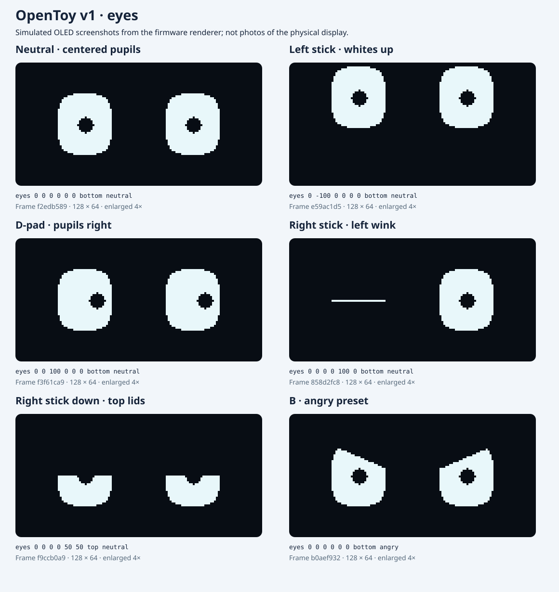
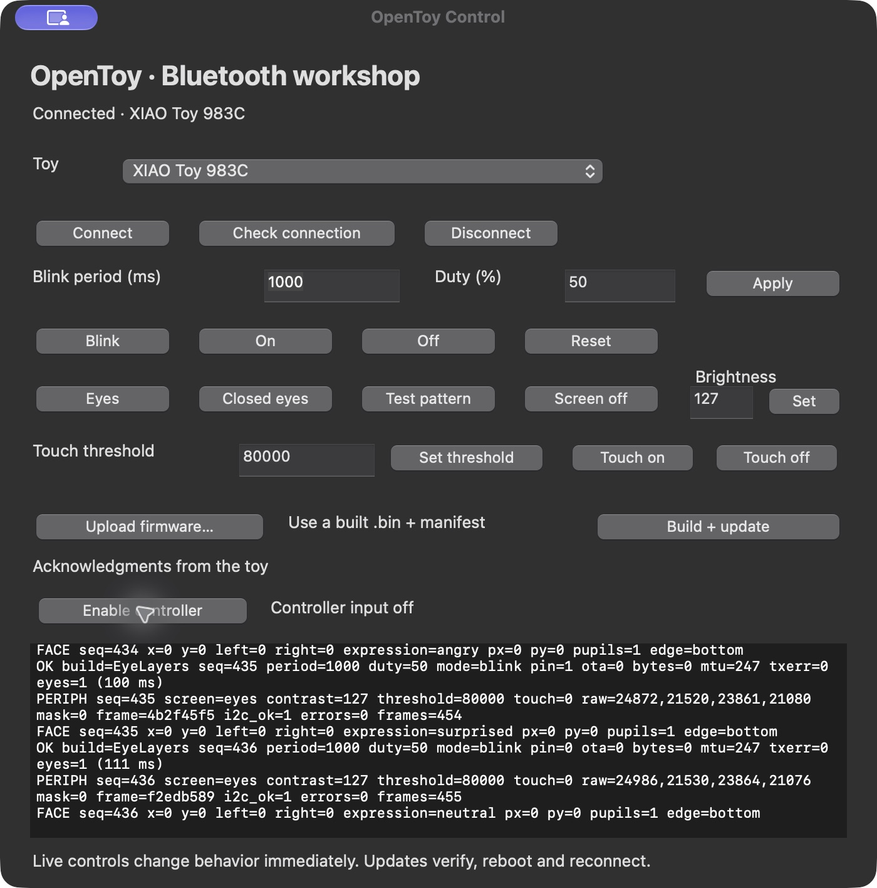
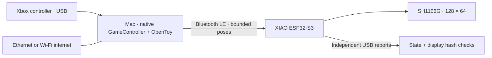

# Version 1: Xbox eye puppetry

> Current OpenToy Feather + direct QT gamepad project: [Animatronic Eyes 1 and 2](https://github.com/yury-g/OpenToy-Coursework/tree/main/projects/animatronic-eyes). [OpenToy port checkpoint](../projects/face-feather/README.md). The record below preserves the earlier XIAO/Xbox release.

This is the working OpenToy baseline, preserved as **v1.0.0-eyes**. The owner confirmed “Works great” on October 1, 2026. It controls a real XIAO ESP32-S3 over Bluetooth from this Mac, with an Xbox controller connected to the Mac by USB.



These are **simulations**, produced by the same pure pixel renderer used by the firmware. Their hashes match the references checked on the toy through independent USB. They show the intended framebuffer, not a photograph or optical measurement of the OLED glass.

## Play with the working toy

1. Power the toy. A USB cable or the existing USB power bank can power this board/display setup. This statement does not establish a power design for future servos.
2. Connect the tested Xbox controller to the Mac with its USB data cable.
3. Open the locally prepared **OpenToy Control** app, select the OLED toy and click **Connect**. Select the correct named toy if you have more than one.
4. Click **Enable controller**. The app waits for **Touch off** acknowledgment, so the touch pads do not fight the puppeteer's input.
5. Try the controls below. Click **Stop controller** before manual display controls, diagnostics or changing the controller mapping.

| Control | What it does |
| --- | --- |
| Left stick up/down | Moves the white eye shapes vertically |
| D-pad | Moves the black pupils inside the whites |
| Right stick left/right | Winks the corresponding screen eye, proportionally |
| Right stick up | Closes both eyes from the bottom |
| Right stick down | Closes both eyes from the top |
| Release right stick | Opens both lids |
| A / B / X / Y | Happy / angry / surprised / neutral; stays selected after release |
| Stop or controller loss | Centers the eyes and pupils, opens lids, returns to neutral |

Left-stick horizontal movement and triggers are unused in v1. There is a 15% inner stick dead zone. Screen-left/right refer to the viewer's view. Simultaneous right-stick motions combine a wink and closure; the larger closure wins for each lid.



This is an actual screenshot of the Mac app after **Stop controller**. It shows the acknowledged EyeLayers build, neutral eye state and successful display-write report. The app's report and independent USB are separate evidence paths; the screenshot itself is not an independent USB measurement.

## How the system fits together



Campus Wi-Fi is not required for the Mac-to-toy connection. The controller talks to the Mac; this version does not connect Xbox directly to the XIAO. The iPad route is still deferred.

## Rebuild and repeat

An instructor or authorized local AI agent can follow [SETUP.md](SETUP.md) to install pinned dependencies, identify an ESP32-S3, preserve its source/flash and create its own private profile/key. Never copy another toy's profile or key. The first seed is USB; later compatible images use the authenticated Bluetooth uploader.

The source is separated so students can change one layer:

| Change | Source |
| --- | --- |
| Remap Xbox controls | `projects/xiao-toy/scripts/controller_input.py` |
| Recognize native controls and send poses | `projects/xiao-toy/scripts/mac_app.py` |
| Change white/pupil/lid drawing | `projects/xiao-class/firmware/ToyBLE/EyePixels.h` |
| Parse bounded eye parameters | `projects/xiao-class/firmware/ToyBLE/FaceProtocol.h` |
| Display and touch circuit | `projects/xiao-class/firmware/ToyBLE/Peripherals.h` |
| Identity, radio and update validation | Existing firmware/client update code; preserve it during drawing edits |

Atomic wire command:

```text
eyes X Y PX PY LEFT RIGHT EDGE EXPRESSION;
eyes 0 0 0 0 0 0 bottom neutral;
```

Axes are -100…100; positive Y points down. Lids are 0…100. EDGE is `top` or `bottom`; expression is `neutral`, `happy`, `angry` or `surprised`. The firmware rejects an invalid command without changing the eye state. The app sends the newest pose at up to 10 Hz and waits for acknowledgment. [PROTOCOL.md](PROTOCOL.md) describes transport, update authentication and recovery.

Run host checks, then `eyes_test.py`, `face_test.py` and `peripheral_test.py` on the identified toy, one client at a time. `eyes_test.py` checks 15 exact frame references, 20 combined synthetic poses, invalid-command atomicity and actual BLE disconnect. [TEST-RESULTS.md](TEST-RESULTS.md) distinguishes these from 82 simultaneously captured real-controller poses. The owner also confirmed the physical behavior. Full physical ranges/button/unplug checks, held-input updates and a second student kit remain qualification work.

To regenerate the simulations with a working C++ compiler:

```sh
.venv/bin/python tools/render_gallery.py
```

## Return to this version

The `v1.0.0-eyes` Git tag preserves this source. Stop the controller and disconnect before switching source versions. Build this tagged source with the toy's existing private profile/key and a new label, then use the compatible Bluetooth uploader. On the owner's bench, the previously tested EyeLayers image and manifest are also preserved privately; binaries are not distributed because they contain a device key. Keep each toy's files outside Git. See [RECOVERY.md](RECOVERY.md) for USB fallback and original-flash restoration.

## What this release means

This is a tested prototype on one Mac and the owner's documented circuit. It includes source, dependency notices, tests, commands, screenshots and recovery guidance. The local app is an alias launcher needing its installed runtime; a signed portable installer and fresh classroom deployments are not validated. No iPad uploader, AI build-delivery service, direct Xbox connection or motor power design is promised by this release.
