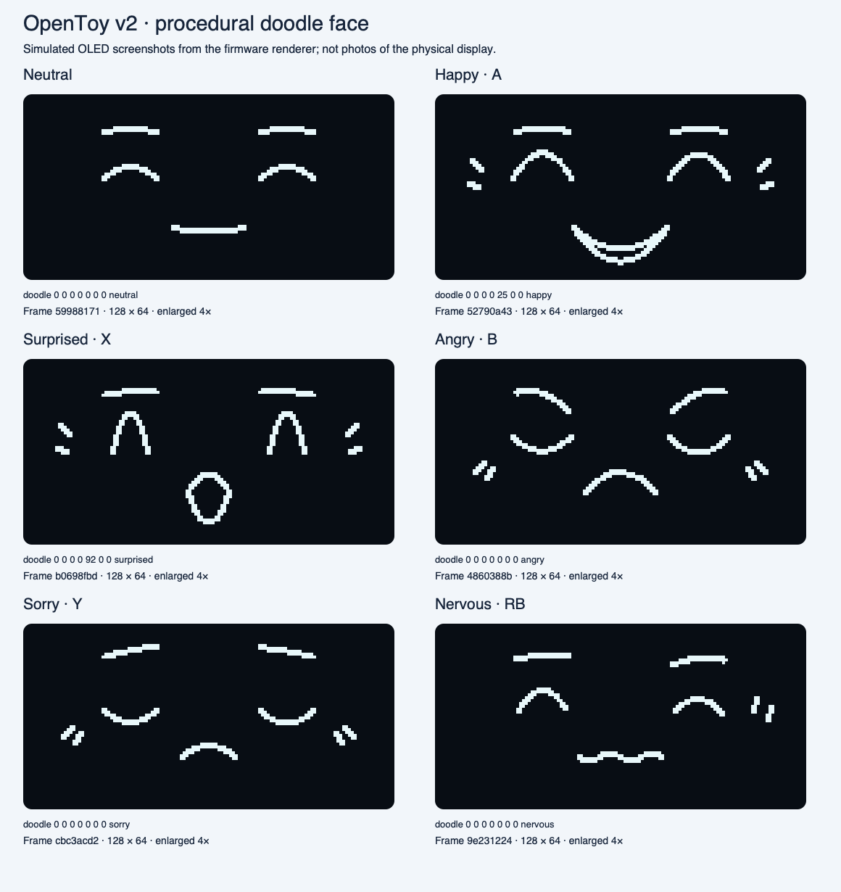
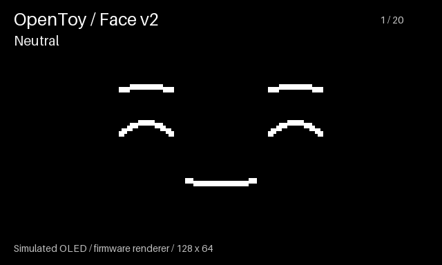
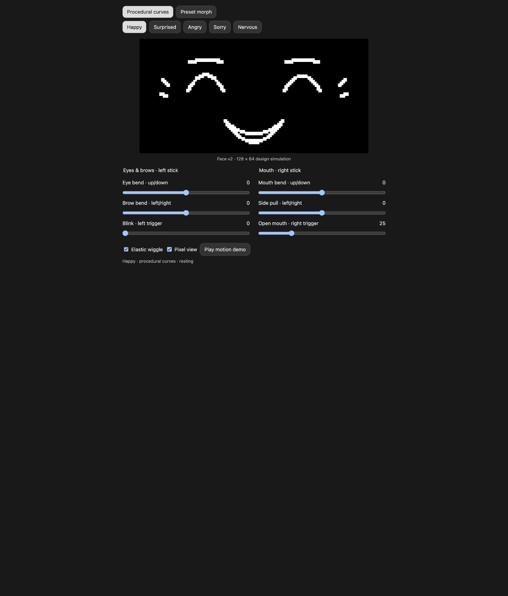
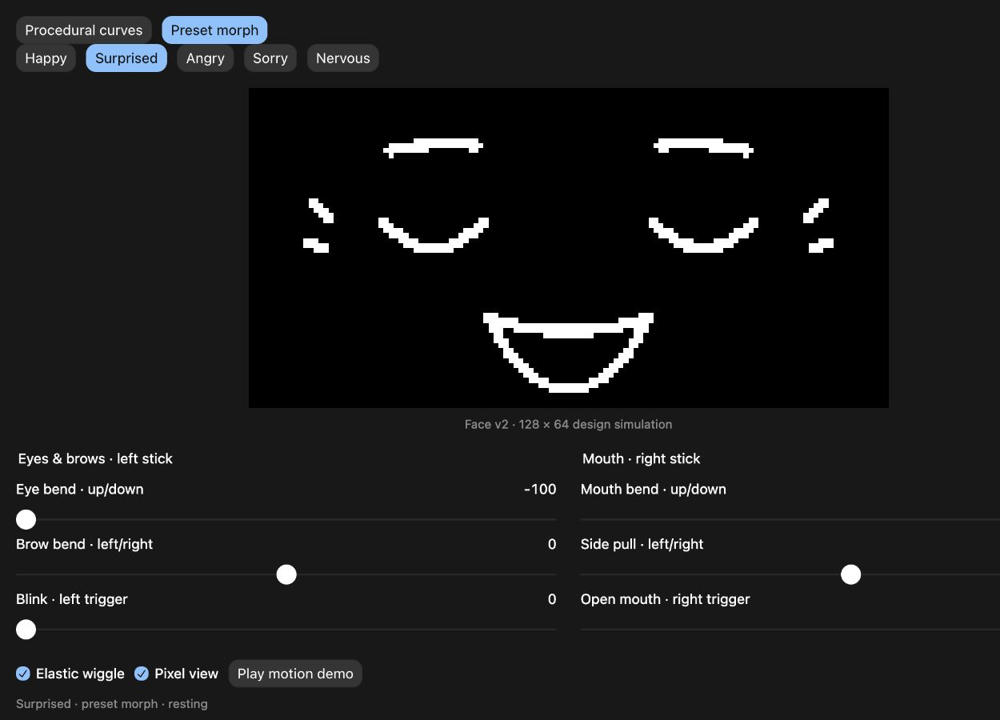
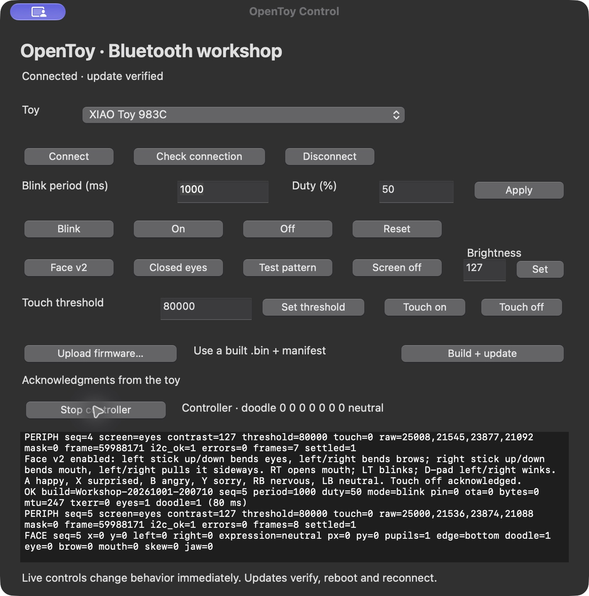

# OpenToy Face v2: procedural doodle puppetry

> Current OpenToy projects: [Animatronic Eyes 1 and 2](https://github.com/yury-g/OpenToy-Coursework/tree/main/projects/animatronic-eyes). Installed and owner-tested on Reverse TFT Feathers with direct QT gamepad controls, November 15, 2026. This page preserves the earlier XIAO/Xbox release.

October 1, 2026. Acceptance build: `DoodleV2r2`. Source release: `v2.0.0-face`. Read the current [progress log](concepts/V2-PROGRESS.md) for verified bench results and remaining human tests.

Version 2 adds a mouth, brows and continuously adjustable curved eyes. It follows the owner's **B · Playful doodles** direction: happy, surprised, angry, sorry and nervous. The owner authorized the best iteration to be uploaded while away; physical judgment of this new face remains for their return.



These are enlarged **simulated screenshots**, not photographs. Every settled example is generated by the same pure C++ renderer used in the firmware and has a checked framebuffer hash. The browser comparison approximates those strokes; its Canvas rasterization is not the device's exact pixel reference.



The 38-second loop covers all 19 reference poses and returns to neutral: five expressions, eye and brow bends, mouth curves and sideways pulls, jaw opening, blink, each wink and a combined extreme. It runs the actual procedural animation and pixel renderer, including the damped wiggle. It is a **simulation**, not a recording of the OLED. All 20 final pose hashes were checked again after decoding the GIF. The adjacent [manifest](images/v2-face-tour.json) records commands, timings and hashes; the [stopping-point guide](STOPPING-POINT.md) explains how to regenerate it.

## Pick up the controller

Power the class toy; connect the Xbox to the Mac with its tested USB data cable. Open OpenToy Control, select the OLED + touch toy, Connect, then Enable controller. The Mac relays input over BLE; no campus Wi-Fi is needed.

| Xbox input | Face v2 result |
| --- | --- |
| Left stick up/down | Bend the two eye lines |
| Left stick left/right | Bend/tilt the brows |
| Right stick up/down | Curve the mouth into a smile or frown |
| Right stick left/right | Pull the mouth sideways |
| Right trigger | Open the mouth; release returns to the selected preset's opening |
| Left trigger | Blink both eyes proportionally |
| D-pad left/right | Wink the corresponding eye |
| A / X / B / Y | Happy / surprised / angry / sorry |
| RB | Nervous |
| LB | Neutral preset |
| Stop controller / controller loss / toy BLE disconnect | Neutral face with open eyelids and closed mouth |

D-pad up/down is unassigned in Face v2. Left/right wink combines with LT using the stronger closure for each eye. Presets are sticky press-edge selections; sticks remain independent. LB selects neutral without suppressing a currently held stick/trigger. Full stop/loss clears all inputs. The app disables touch and waits for its acknowledgment before streaming. Stop controller before using manual screen controls.

The host keeps the newest pose, one command in flight, and a maximum 10Hz send rate. The device requests moving-curve frames at no more than 20Hz (I2C transfers add latency), then stops sending unchanged display frames. It reports desired face fields separately from the currently drawn framebuffer: wait for `settled=1` before comparing the exact target hash.

## How it is algorithmic

No bitmap sequence or still-image crossfade is stored. Each frame is rebuilt from parameters:

1. Choose a small parameter set for the selected emotion: eye curvature/width/height, brow bend, mouth curvature/width, asymmetry and nervous wave.
2. Add continuous joystick offsets to eye, brow and mouth curvature. Clamp geometry to defined ranges; triggers set jaw/lid amounts.
3. Generate each eye and brow as a quadratic Bézier curve. Generate the mouth as cubic curves, with separated upper/lower curves when the jaw opens. Sample 32 segments per curve and rasterize a two-pixel stroke into the 1024-byte monochrome buffer.
4. Smooth parameter changes with a damped spring: acceleration is `82 × (target − current) − 15 × velocity`. A feature that changes receives a localized decaying wiggle: `1.4 × energy × sin(25t) × exp(−6t)`. No background randomness or endless idle animation is used.
5. Snap to the exact target after settling, remove residual wiggle, and present that final frame once. Hiding the face lets animation settle without repeatedly writing the off/test screen.

The spring interpolates **parameters**, but the line geometry is generated continuously. Algorithmic art and interpolation can coexist. To make it more generative later, vary the parameters with noise, touch rhythm or audio; keep those inputs separate from transport and retain limits. This iteration intentionally uses controllable deterministic curves.

## Try both approaches without flashing

Run the local comparison, using the setup environment:

```sh
.venv/bin/python tools/preview_face.py
```

Open the printed local address. **Procedural curves** adds independent joystick offsets directly. **Preset morph** blends selected feature geometry toward emotion anchors: eye input toward surprised/angry, brow input toward angry/sorry, mouth input toward happy/sorry. The same inputs can produce different widths, heights and bends. Both regenerate line geometry, rather than fading pixels.

The comparison is a design experiment. Only the procedural mode is installed in this device build; the Mac controller has no morph-mode switch. Preview source is MIT licensed at `docs/simulations/face-v2-fragment.html`, with no external libraries or toy connection.




## Reproduce the build and checks

Follow [SETUP.md](SETUP.md) for pinned dependencies, USB identity checks and initial provisioning of a new kit. Each toy needs its own private profile/key; this source release includes neither the owner's key nor a binary containing it.

```sh
.venv/bin/python tools/check.py
.venv/bin/python projects/xiao-class/scripts/project.py build --label DoodleV2r2
.venv/bin/python projects/xiao-class/scripts/ble_client.py --fast --upload projects/xiao-class/firmware/ToyBLE/build/DoodleV2r2/ToyBLE.ino.bin
.venv/bin/python projects/xiao-class/scripts/doodle_test.py
```

The real test requires the USB data connection **and** BLE, with the Mac app disconnected so it is the sole BLE client. It verifies factory MAC through the identity service, commands over BLE, corroborates independent USB `FACE`/`PERIPH` reports and compares 19 settled frame hashes. It also tests malformed-command atomicity, actual evolving frames, hidden/idle settling and disconnect reset. Controller inputs in that script are synthetic.

Generate the exact settled gallery:

```sh
.venv/bin/python tools/render_gallery.py --fixtures projects/xiao-class/tests/doodle_frames.json --output docs/images/v2-all-poses.svg --title 'Face v2 reference poses'
```

`tools/check.py` requires a C++ compiler; `CXX` can select an alternative. On the owner's Mac the Apple compiler was unavailable pending its EULA, so the bench used the official Zig C++ toolchain. No EULA was accepted by the agent. The build itself uses the pinned Arduino ESP32 compiler.

## Native build/update handoff

The agent exercised **Build + update** with the attached Xbox enabled. The installed handoff build is `Workshop-20261001-200710`, compiled from the accepted Face v2 source. It transferred/reconnected in 73.3 seconds, negotiated the face capability, acknowledged Touch off again and reapplied actual resting input. Independent USB matched its neutral face and `59988171` frame with zero display/BLE errors. Stop also delivered neutral. The app was left connected with the controller enabled. This tests stationary input across an update; a held non-neutral control is still an open test.



## Recovery and boundaries

The original full flash/source backup and v1 `EyeLayers` application/manifest are preserved privately; v1 public source is tagged `v1.0.0-eyes`. The private `projects/xiao-class/backup/before-face-v2/` has the exact pre-v2 files and known-good binary. Restore that application through the same authenticated BLE uploader; pair it with the v1 Mac app/mapper. Face v2's app pauses its controller if `doodle=1` is absent. No whole-flash erase is needed for application reversion. See [RECOVERY.md](RECOVERY.md) for USB ROM fallback.

This remains a Mac bridge. iPad execution, direct Xbox-to-XIAO input, classroom deployment and full physical qualification of the new mapping are separate tests. Independent USB/frame/I2C checks establish electronic behavior; they do not observe the OLED glass or prove every physical button has been operated. The owner already confirmed v1 works; v2 requires their new judgment.
