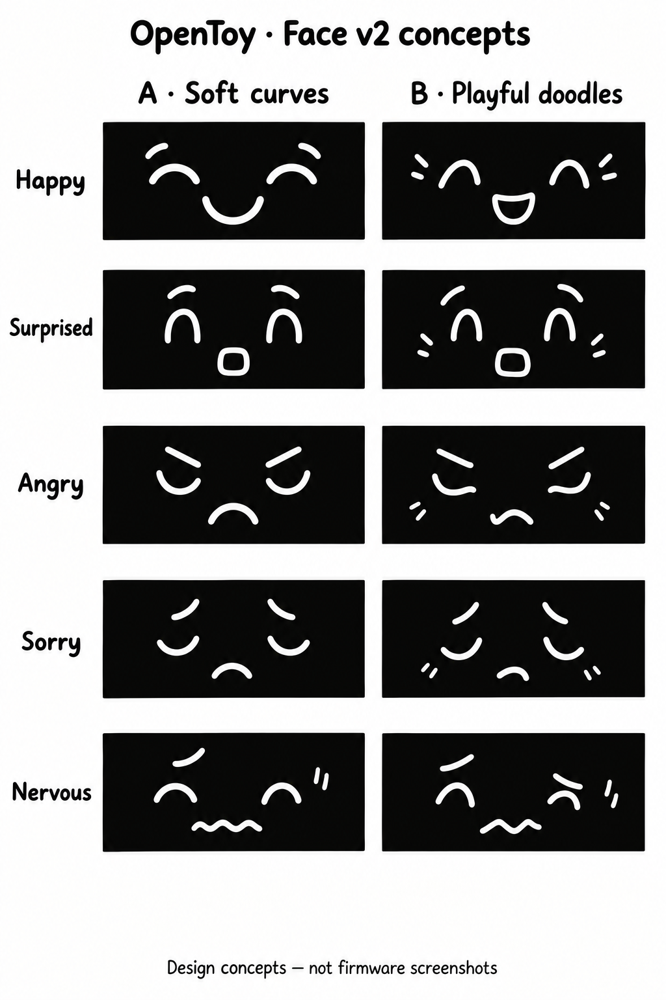

# Face v2: visual exploration

Status: **playful doodles selected and implemented**. October 1, 2026. The owner chose B, requested a curvature/wiggle simulation, then authorized the agent's best iteration to be uploaded while away. See [the Face v2 guide](../V2-FACE.md) and [dated progress log](V2-PROGRESS.md) for current build and verification status.

The owner asked for eyes **and a mouth**, drawn as kawaii curved lines and doodles, with five expressions: **happy, surprised, angry, sorry and nervous**. The order is visual exploration → review and refinement → choose the best drawings → code and test. This order supersedes the earlier proposed immediate mouth implementation.



The left column, A, favors sparse smooth curves. The right column, B, uses more asymmetry, small accents and squiggles. These are generated **concept drawings**, not pixel-accurate OLED simulations or firmware screenshots. Their apparent stroke width and screen layout must still be tested at the actual 128×64 resolution after a design is chosen.

## Selection and iteration

The owner preferred B · Playful doodles. The five expressions were simulated at 128×64, then translated to a procedural bounded renderer. A/B/X/Y plus RB select five presets; sticks change feature curvature, RT opens the mouth, LT blinks and D-pad left/right winks. The HTML comparison also explores preset morphing; the device uses procedural curves. The owner will judge the actual new face on return.

The working eye baseline is [v1.0.0-eyes](https://github.com/yury-g/OpenToy-Coursework/tree/v1.0.0-eyes). Its source, actual app screenshot and exact frame simulations are documented in [V1-EYES.md](../V1-EYES.md).

## Generation record

Created with Codex's built-in image-generation tool, using the imagegen skill. No external CLI/API key was needed. Image: `docs/images/v2-face-concepts-01.png`. The original image is preserved locally; the repository copy is the review artifact.

Final prompt:

```text
Use case: stylized-concept.
Asset type: visual exploration contact sheet for OpenToy version 2, a cute toy face on a small monochrome 128-by-64 OLED.
Primary request: draw kawaii doodle LINE faces with EYES AND A MOUTH, using curved lines and lively tiny squiggles instead of circular eyes or large filled shapes. We must visually choose and iterate on the drawing BEFORE coding. This sheet is concept art, not screenshots from working firmware.
Composition: a beautifully clear portrait contact sheet, TWO COLUMNS and FIVE ROWS, ten distinct faces total. Put the column titles above: "A · Soft curves" and "B · Playful doodles". Put row labels at the left or neatly above each pair: "Happy", "Surprised", "Angry", "Sorry", "Nervous". Keep all words accurate, large and legible. Modest heading "OpenToy · Face v2 concepts". Small footer "Design concepts — not firmware screenshots".
Background: clean warm-white page. Each face sits alone inside a black horizontal rectangle with aspect ratio exactly 2:1, representing an enlarged monochrome OLED screen. The face marks are crisp white uniform-stroke line art on pure black. Leave generous blank black space between the eyes and around the face. No product devices, mock hardware, buttons, controller, body, head perimeter, nose, hair, ears or anatomy. Just expressive eye/brow lines and a mouth. Optional one or two short cheek/sweat lines when useful, no colorful cheeks. Do not use filled round pupils, circular eye outlines, gradients, glow, gray pixels, shading, texture or 3D.
Design A: spare, smooth, friendly curved strokes with rounded ends; symmetric eye placement, subtly asymmetrical mouth where emotion calls for it. Design B: equally simple but more charmingly hand-doodled, slightly asymmetric eyes and tiny squiggle mouths. Both designs must still be drawable with a few line/curve segments at 128x64, not busy handwriting.
Emotion requirements, in the stated row order:
Happy: unmistakably joyful upward arch eyes or closed smiling eye arcs, a clear broad U-shaped smile, optional short lifted brow accents.
Surprised: raised brows, two OPEN U-shaped eye arcs (not closed circles) and a tiny open-mouth loop drawn as a softly squared irregular outline, suggesting an open talking mouth.
Angry: inward slanting brows, narrow angled curved eyes, a small curled frown; cute frustration rather than menace.
Sorry: brows rising at the inner corners, downcast eye arcs, a shy drooping small mouth, visibly apologetic; clearly different from nervous.
Nervous: one anxious raised brow, asymmetrical tense eye arcs, a wobbly/squiggly uncertain mouth and optional two little stress marks; clearly different from sorry.
Make all ten faces visually distinct but coherent, expressive and adorable. The mouth must be visible in every face. Take care that none reads as a pair of floating eyes without a mouth. Give each face similar scale and placement so comparison is effortless. No firmware, wire commands, graphs or technical copy.
```
