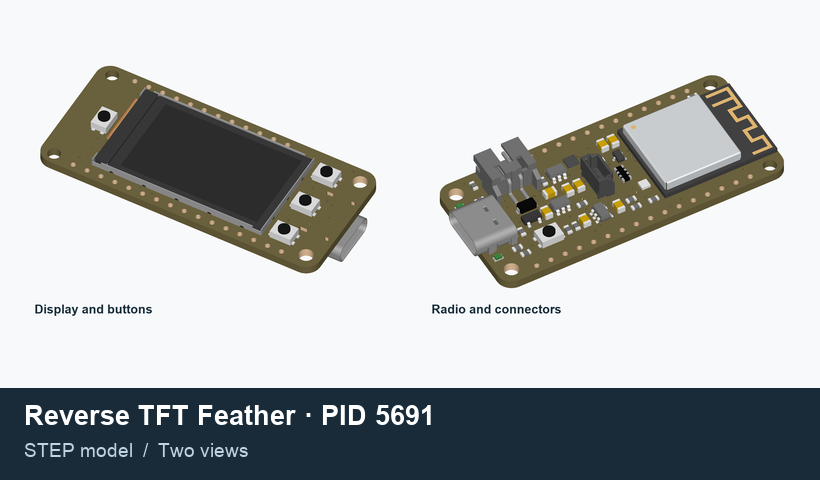
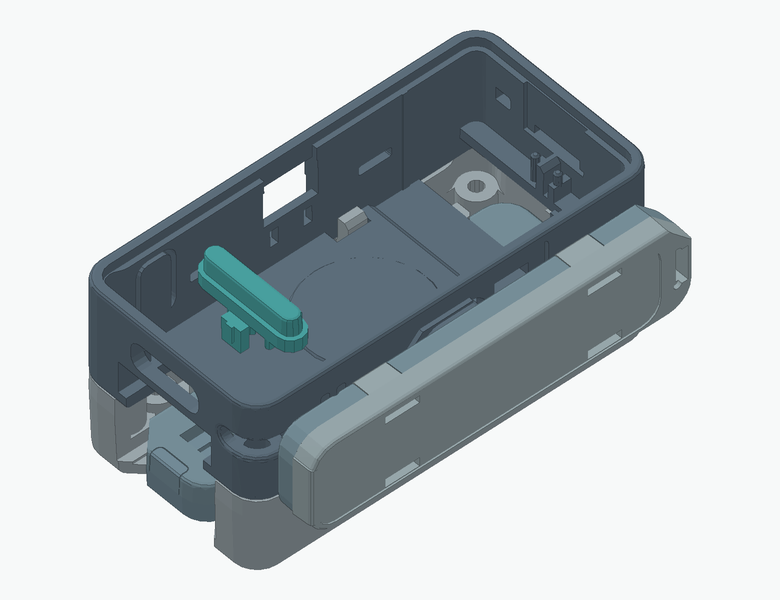
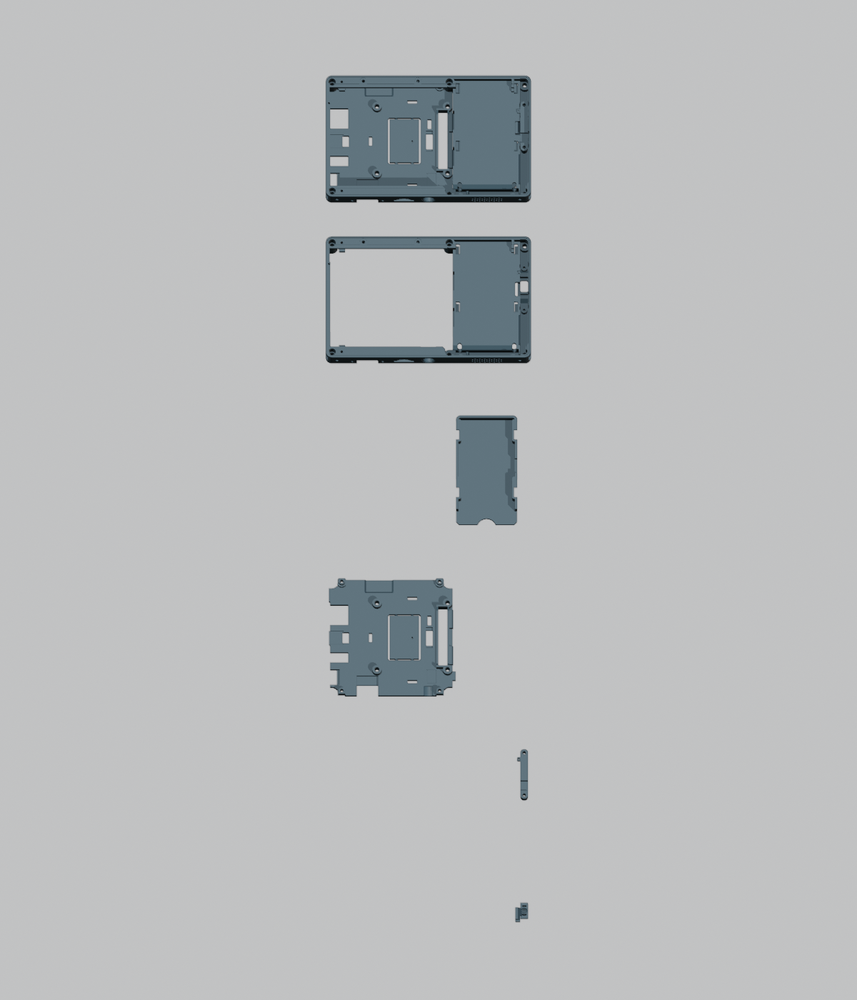
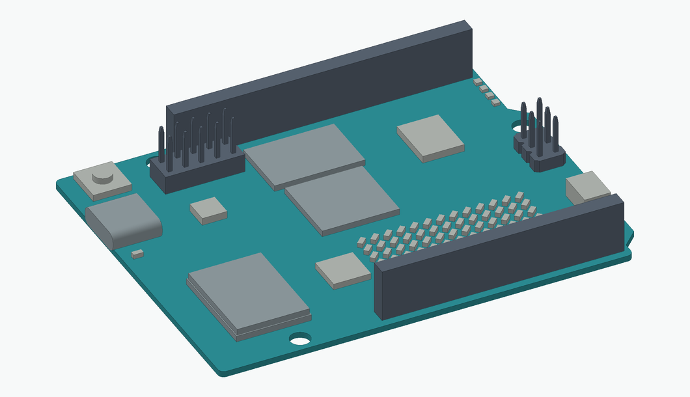
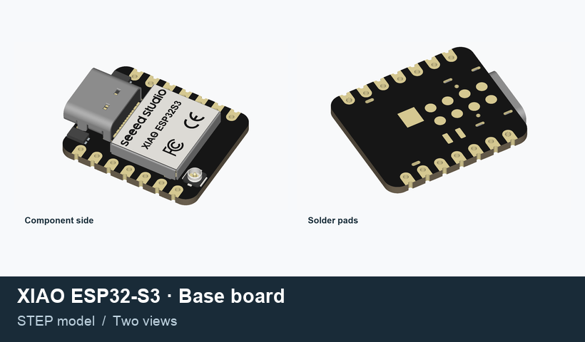
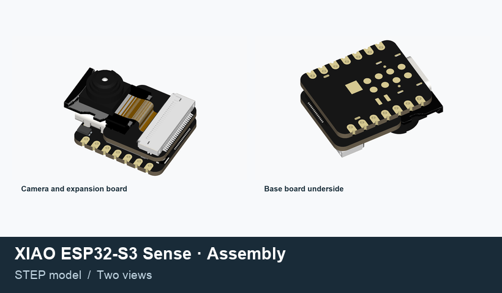
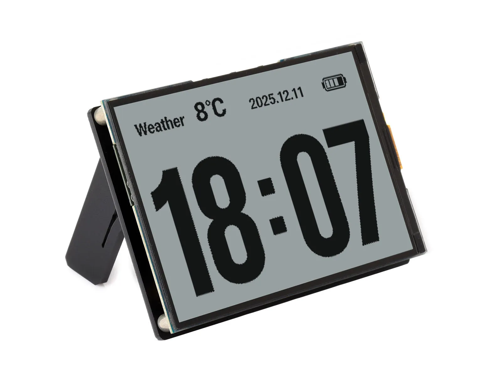

# Manufacturer hardware gallery

[← OpenToy](../README.md) · [App and firmware projects](../projects/README.md) · [OpenToy 3D printed designs](../projects/3d-printed-designs/README.md)

Find manufacturer models, board designs, schematics and dimension drawings for the OpenToy device family. Open a device below for its original files, full-size previews, source links and license notes. Checked **November 17, 2026**.

## Browse the designs

| Reverse TFT Feather | Nesso N1 | Tab5 |
| --- | --- | --- |
|  |  |  |
| **[Reverse TFT Feather](feather/README.md)** | **[Nesso N1](nesso-n1/README.md)** | **[Tab5](tab5/README.md)** |

| UNO Q base board | XIAO ESP32-S3 | XIAO Sense |
| --- | --- | --- |
|  |  |  |
| **[UNO Q — shield not identified](uno-q/README.md)** | **[XIAO base board](xiao/README.md)** | **[XIAO Sense add-on](xiao/README.md)** |

| Round 1.85C BOX V2 | Reflective LCD 4.2 | CrowPanel P4 9-inch V1.0 |
| --- | --- | --- |
|  |  |  |
| **[Round display and speaker box](waveshare-round/README.md)** | **[RLCD — V1/V2 references](waveshare-rlcd/README.md)** | **[CrowPanel — exact V1.0 links](crowpanel/README.md)** |

The last row uses manufacturer drawings or product photographs. CrowPanel and RLCD design originals remain upstream where redistribution rights are unclear; their pages explain preview alternatives and revision differences. No full BOX V2 enclosure solid was found in the reviewed round-display resources.

Model colors are for presentation. CAD images show source geometry; vendor photographs show manufacturer products, not OpenToy’s installed devices. Each device page includes its schematic sheets and additional design previews.

## Choose a platform

| Platform | Hardware assets and revision notes |
| --- | --- |
| [Adafruit Reverse TFT Feather ESP32-S3](feather/README.md) | Native board sources and mechanical references; distinguish the Reverse TFT board from other Feather variants. |
| [Arduino Nesso N1](nesso-n1/README.md) | Manufacturer mechanical and schematic references for Nesso N1. |
| [Waveshare round 1.85C BOX](waveshare-round/README.md) | **OpenToy target: BOX V2.** Older board/enclosure references are not a verified V2 match. |
| [Waveshare ESP32-S3-RLCD-4.2](waveshare-rlcd/README.md) | Reflective-display board and enclosure references. |
| [Elecrow CrowPanel P4, 9-inch](crowpanel/README.md) | **OpenToy target: V1.0.** Assets for newer revisions must remain separately labeled. |
| [M5Stack Tab5](tab5/README.md) | Original enclosure STL, real mesh renders, block diagram, all five B08 schematic sheets and dimension drawing. |
| [Arduino UNO Q](uno-q/README.md) | UNO Q board assets. **The attached 2.8-inch TFT shield is unidentified**; no shield model or pinout is implied. |
| [Seeed XIAO ESP32-S3 / Sense](xiao/README.md) | Base board and Sense add-on references, distinct from panel hardware and archived XIAO toy projects. |

[File inventory and SHA-256 checksums](inventory.json) cover the local assets.

## How to use the collection

- **Originals** are manufacturer files retained in their supplied formats where redistribution terms permit it. Each device records provenance, revision evidence and licenses. OpenToy’s root license does not replace the upstream hardware licenses.
- **Previews** are real CAD/mesh renders, schematic-sheet images, board plots or explicitly labeled manufacturer-hosted views. Open the image for detail and the linked original for modeling. A preview is not proof of mechanical fit or electrical compatibility.
- **Linked-only assets** stay on the manufacturer’s site when redistribution rights are unclear. Each affected page gives the source and available preview or explains the missing preview. External links can change.
- **Unknown or missing assets** are stated explicitly. Do not substitute a nearby product, display size or revision without checking the actual board and enclosure.

This collection documents hardware sources. It does not change firmware, resume development, or establish which software is installed. Use the [project directory](../projects/README.md) for those records.
