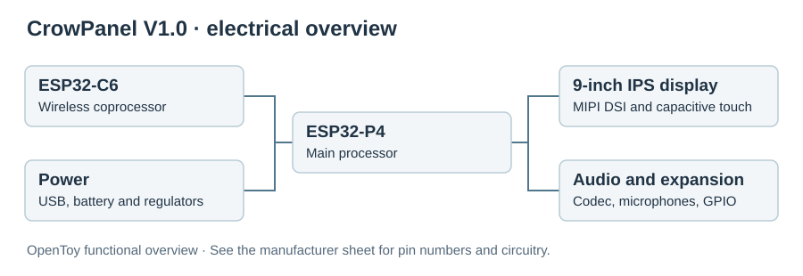

# Elecrow CrowPanel Advanced 9-inch

[← Hardware gallery](../README.md)

**DHE04209D · ESP32-P4 · V1.0 electronics.** Elecrow quotes **222 × 130 × 16 mm** for the display assembly. The single STEP file is dated December 30, 2025. It has no electronics-revision label and includes projecting ribbon cables. Its full bounding box therefore exceeds the enclosure dimensions. [Product and revision specifications](https://github.com/Elecrow-RD/CrowPanel-Advanced-9inch-ESP32-P4-HMI-AI-Display-1024x600-IPS-Touch-Screen/blob/342a40719c98601fbd282f72e7fc2cd413133dd8/readme.md)

## Schematic and PCB

| V1.0 resource | Open at Elecrow |
| --- | --- |
| Schematic · one sheet | [Editable Eagle schematic](https://github.com/Elecrow-RD/CrowPanel-Advanced-9inch-ESP32-P4-HMI-AI-Display-1024x600-IPS-Touch-Screen/blob/342a40719c98601fbd282f72e7fc2cd413133dd8/Eagle_SCH%26PCB/1.0/ESP32-P4%20Display%209.0%20inch%20V1.0.sch) · [View the complete manufacturer sheet](https://github.com/Elecrow-RD/CrowPanel-Advanced-9inch-ESP32-P4-HMI-AI-Display-1024x600-IPS-Touch-Screen/blob/342a40719c98601fbd282f72e7fc2cd413133dd8/Eagle_SCH%26PCB/1.0/ESP32-P4%20Display%209.0%20inch%20V1.0-PDF.pdf) |
| PCB layout | [Editable Eagle board](https://github.com/Elecrow-RD/CrowPanel-Advanced-9inch-ESP32-P4-HMI-AI-Display-1024x600-IPS-Touch-Screen/blob/342a40719c98601fbd282f72e7fc2cd413133dd8/Eagle_SCH%26PCB/1.0/ESP32-P4%20Display%209.0%20inch%20V1.0.brd) |
| Physical assembly | [Download STEP](https://raw.githubusercontent.com/Elecrow-RD/CrowPanel-Advanced-9inch-ESP32-P4-HMI-AI-Display-1024x600-IPS-Touch-Screen/342a40719c98601fbd282f72e7fc2cd413133dd8/3D%20file/ESP32-P4-9_0-inch-20251230.stp) · [Browse the upstream model folder](https://github.com/Elecrow-RD/CrowPanel-Advanced-9inch-ESP32-P4-HMI-AI-Display-1024x600-IPS-Touch-Screen/tree/342a40719c98601fbd282f72e7fc2cd413133dd8/3D%20file) |

The V1.1 and V1.2 electrical files are in separate vendor folders. V1.1 changes the ESP32-C6 SDIO data-pin mapping, and V1.2 changes wireless-module pins. Use the V1.0 links above for the OpenToy reference. [Elecrow revision history](https://github.com/Elecrow-RD/CrowPanel-Advanced-9inch-ESP32-P4-HMI-AI-Display-1024x600-IPS-Touch-Screen/blob/342a40719c98601fbd282f72e7fc2cd413133dd8/readme.md)

### Display interface · schematic detail

### Audio output · schematic detail

### Rear PCB and connector positions

The connector drawing and product photograph provide orientation for opening the Eagle board and STEP assembly. The STEP file includes cables in their modeled positions. [Elecrow board guide](https://media-cdn.elecrow.com/wiki/CrowPanel_Advanced_9inch_ESP32-P4_HMI_AI_Display_1024x600_IPS.html) · [Native 3D assembly](https://raw.githubusercontent.com/Elecrow-RD/CrowPanel-Advanced-9inch-ESP32-P4-HMI-AI-Display-1024x600-IPS-Touch-Screen/342a40719c98601fbd282f72e7fc2cd413133dd8/3D%20file/ESP32-P4-9_0-inch-20251230.stp)

## Sources and reuse

Elecrow publishes these Eagle and STEP originals in its product repository. The pinned tree has no top-level hardware redistribution license. A Creative Commons notice embedded in the Eagle files applies to the included SparkFun component library. Full CAD and original sheet artwork remain available at Elecrow's links. The display, audio and board pictures above are hosted by the manufacturer. [Product source tree](https://github.com/Elecrow-RD/CrowPanel-Advanced-9inch-ESP32-P4-HMI-AI-Display-1024x600-IPS-Touch-Screen/tree/342a40719c98601fbd282f72e7fc2cd413133dd8)
