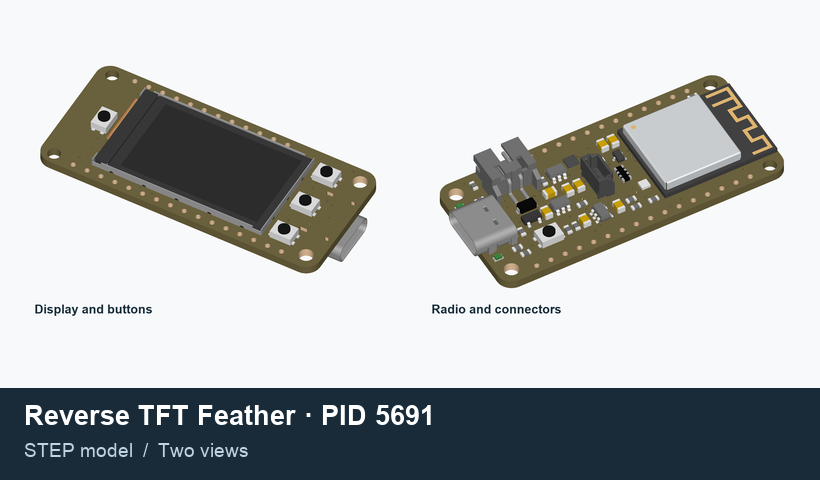
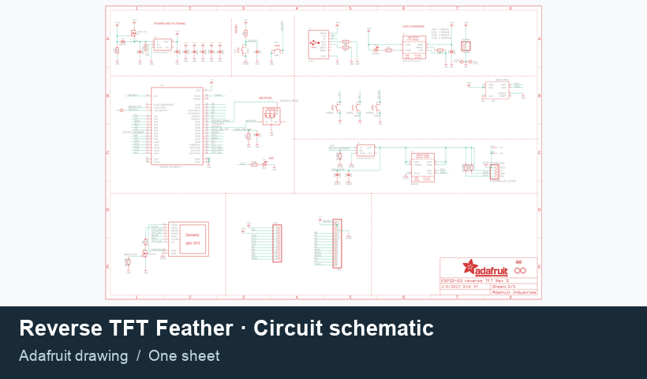

# Adafruit ESP32-S3 Reverse TFT Feather

[Hardware gallery](../README.md) · [OpenToy Feather projects](../../projects/animatronic-eyes/README.md)

**Product 5691** has a 1.14-inch display and three buttons on one face, with the radio, USB-C and battery connector on the other. The two views below come from Adafruit’s STEP assembly. [Manufacturer downloads](https://learn.adafruit.com/esp32-s3-reverse-tft-feather/downloads)

| Mechanical model | Circuit schematic |
| --- | --- |
|  |  |
| [Open the STEP assembly](source/5691-reverse-tft-feather.step) · [Enlarge both views](previews/feather-model.png) | [Open the editable EAGLE schematic](source/5691-reverse-tft-feather.sch) · [Enlarge the 3,823 × 2,573 drawing](previews/feather-schematic.png) |

Adafruit documents a shared schematic and fabrication print for the board variants in its Reverse TFT guide. The BME280 position shown on the schematic is an unpopulated footprint. [Adafruit design notes](https://learn.adafruit.com/esp32-s3-reverse-tft-feather/downloads)

## Sources and licenses

- **Mechanical design.** Adafruit Industries’ original STEP is unchanged apart from its filename. The two views were rendered from that file for this gallery. The upstream directory also contains Adafruit’s Fusion and STL versions. [Pinned CAD source](https://github.com/adafruit/Adafruit_CAD_Parts/tree/88494a13f8677b72da95d128aa12269fca0b3b18/5691%20Feather%20ESP32%20S3%20Reverse%20TFT) · [MIT license](licenses/CAD-MIT.txt)
- **Circuit design.** Designed by Limor Fried/Ladyada for Adafruit Industries. The EAGLE schematic is unchanged apart from its filename. The full-size PNG is Adafruit’s published schematic plot. OpenToy added the preview label. The matching board layout is available alongside the upstream schematic. [Pinned PCB source](https://github.com/adafruit/Adafruit-ESP32-S3-Reverse-TFT-Feather-PCB/tree/633459d74623227a18f7c4b1594db0840ba5592d) · [Original schematic image](https://cdn-learn.adafruit.com/assets/assets/000/119/046/original/adafruit_products_schem.png?1677680378) · [CC BY-SA 3.0](licenses/PCB-CC-BY-SA-3.0.txt) · [Adafruit attribution and redistribution notice](licenses/Adafruit-PCB-notice.txt)
