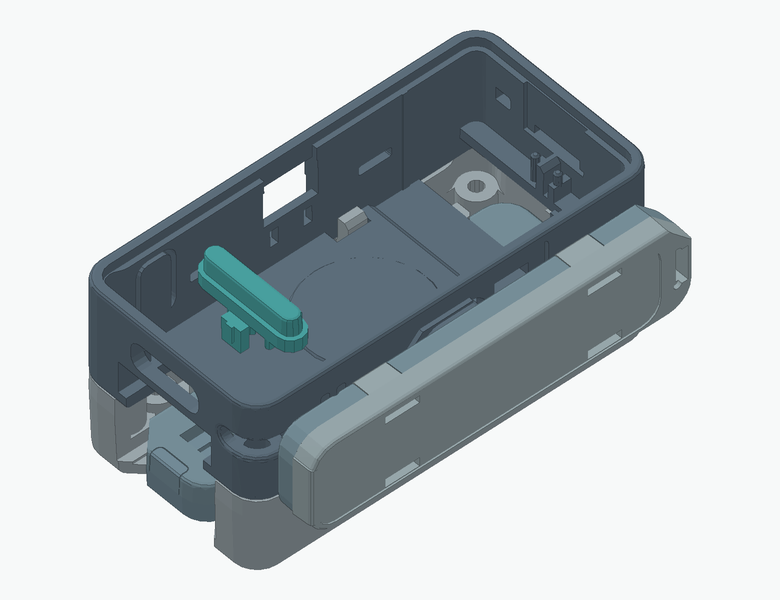
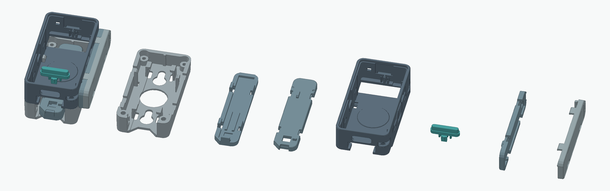
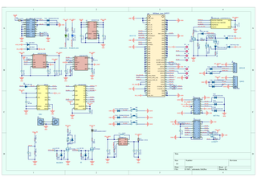

# Arduino Nesso N1 hardware

[Hardware gallery](../README.md) · [OpenToy Nesso projects](../../projects/nesso/README.md)

**[Download M5Stack’s original Nesso N1 enclosure STL](originals/Arduino_Nesso_N1.stl)** to model around the case. The mesh includes an assembled casing and separate copies of its parts in one file. Use millimeters when importing. The rendered views use presentation colors. The model covers the enclosure assembly, with the case openings and button geometry visible.

## Circuit schematic

**[Open the full-resolution circuit sheet](schematics/nesso-n1.png)** for power, charger, IMU, expansion connectors, LCD/touch interface, buzzer and infrared circuits. Arduino’s TPX00227 download contains one sheet dated March 27, 2025. The M5Stack LoRa/C6 module appears as a component on this sheet. M5Stack additionally provides block diagrams and three dimensioned enclosure views. [M5Stack diagrams and dimensions](https://docs.m5stack.com/en/core/Arduino_Nesso_N1)

## Manufacturer sources and licenses

- **3D model.** M5Stack supplies `Arduino_Nesso_N1.stl` under the MIT license. Its STL header identifies the assembly as `STICKC6L_00_01_ASM_V1_ASM`. The local file is an unchanged copy from M5Stack's DK001 hardware directory. OpenToy rendered the two previews from its 20,696 triangles. [Pinned manufacturer model](https://github.com/m5stack/M5_Hardware/blob/dde6a98d8a487d298cf5451f6dbcbbca4e90ecdb/Products/DK001_Arduino_Nesso_N1/Structures/Arduino_Nesso_N1.stl) · [M5Stack MIT notice](licenses/M5Stack-MIT.txt)
- **Schematic.** Arduino and M5Stack designed the Nesso N1. Arduino’s hardware bundle licenses the project hardware under CC BY-SA 4.0. OpenToy converted the schematic sheet to PNG under the same license. [Manufacturer notice](licenses/Arduino-hardware.txt) · [CC BY-SA 4.0](https://creativecommons.org/licenses/by-sa/4.0/) · [Arduino hardware page](https://docs.arduino.cc/hardware/nesso-n1/)
- **Board fabrication.** Arduino's separate PCB bundle includes Gerbers and layout drawings for the V1.0 main board and V0.2 flexible circuit. The pinned release also contains the source schematic. [Manufacturer PCB bundle](https://docs.arduino.cc/static/589c38114821d4417fb0f3418b0325e6/TPX00227-cad-files.zip) · [Pinned Arduino source files](https://github.com/arduino/docs-content/tree/38bd285cf3726438b95b5d9cdcff27980139b4d8/content/hardware/kits/maker/nesso-n1/downloads)
