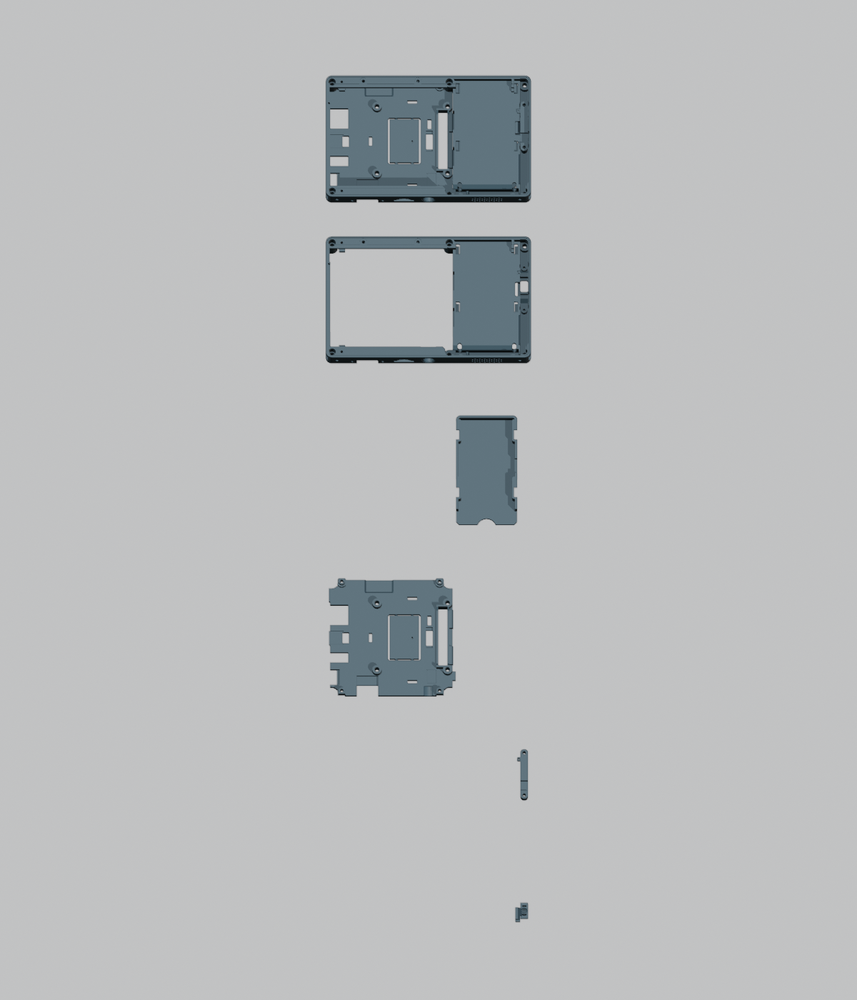
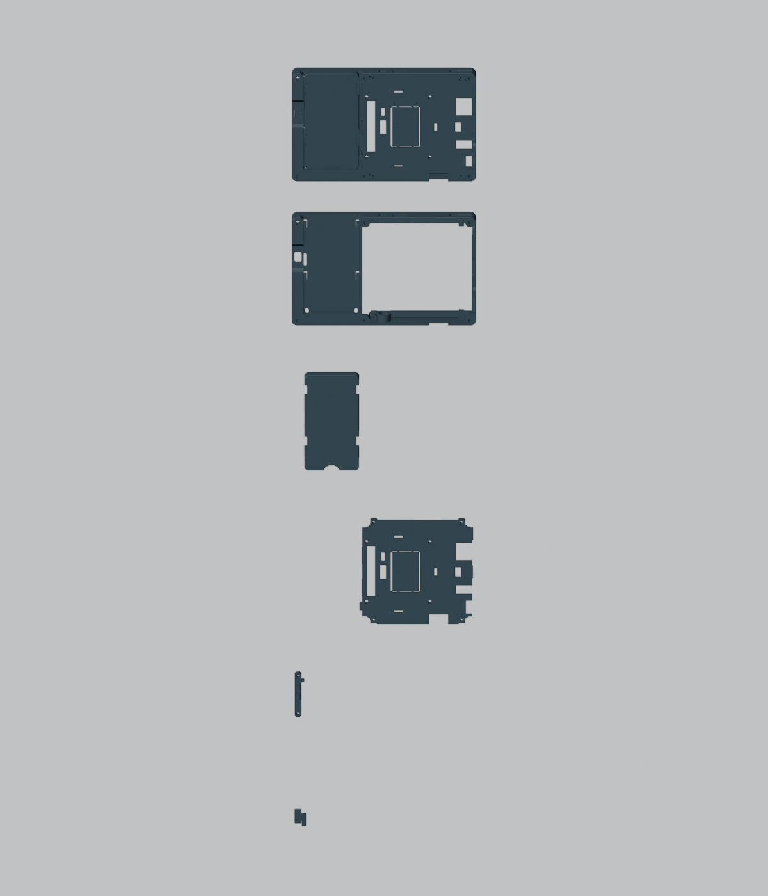

# M5Stack Tab5 — manufacturer hardware

[← Hardware gallery](../README.md) · [OpenToy Tab5 project](../../projects/tab5/README.md) · [Manufacturer documentation](https://docs.m5stack.com/en/core/Tab5)

**Identity:** Tab5 C145 / kit K145. The manufacturer model has no explicit mechanical revision label. The schematic preview filenames identify **B08**; this is not proof that every Tab5 board, camera or display variant matches B08. OpenToy’s enrolled display is ST7123; verify the actual unit before designing a mating part.

## 3D model

[Download original Tab5.stl](originals/Tab5.stl) · [Upstream pinned source](https://github.com/m5stack/M5_Hardware/blob/d3ae864f161167af3f9698214012e1d135adc357/Products/C145_Tab5/Structures/Tab5.stl) · [MIT license](licenses/M5_Hardware-MIT.txt)

| View A | View B |
| --- | --- |
|  |  |

These are actual Blender renders of the unmodified manufacturer STL with a neutral material. STL is a mesh, not a parametric CAD assembly; no STEP or editable CAD source was present in the checked Tab5 structure directory. The STL contains separated enclosure parts laid out across approximately 128 × 556.44 × 12 source units, rather than an assembled tablet. The two views show opposite sides of that layout; the 556.44 extent is not the tablet size. STL does not encode units; consult the manufacturer dimension drawing and physically check clearances. No print-fit validation is claimed.

## Schematics and dimensions

Each image below links to its manufacturer-hosted original and can be opened at full resolution. They remain externally hosted: the old `m5stack/m5-docs` repository has an MIT license credited to its documentation theme author, but contains no Tab5 page in its checked tree. That does not clearly establish redistribution rights for current vendor CDN assets. These images and schematic originals are therefore linked, not copied into OpenToy. No editable PCB/schematic project was found in the checked Tab5 hardware directory.

### Overall design block diagram

### Schematic B08 — sheet 1 of 5

### Schematic B08 — sheet 2 of 5

### Schematic B08 — sheet 3 of 5

### Schematic B08 — sheet 4 of 5

### Schematic B08 — sheet 5 of 5

### Manufacturer dimension drawing

## Provenance and limitations

- Retrieved and checked: **2026-11-17** (America/New_York).
- Local STL is byte-for-byte upstream, with its exact repository MIT license. Commit `d3ae864f161167af3f9698214012e1d135adc357`; Git blob `4cc142875bffa18c0ad5e2843deb308eac5f987d`.
- [Machine-readable provenance](provenance.json) includes checksums and source URLs; [render metadata](previews/render-metadata.json) records the mesh bounds.
- Manufacturer page is a changing source; external previews can change or disappear. If an embed fails, open the manufacturer documentation’s Schematics or Model Size section.
- The manufacturer documentation also links its original schematic and block-diagram documents. The gallery uses individual image sheets for browsing rather than a PDF deliverable.
