# Arduino UNO Q hardware

[Hardware gallery](../README.md) · [OpenToy UNO Q project](../../projects/uno-q/README.md)

[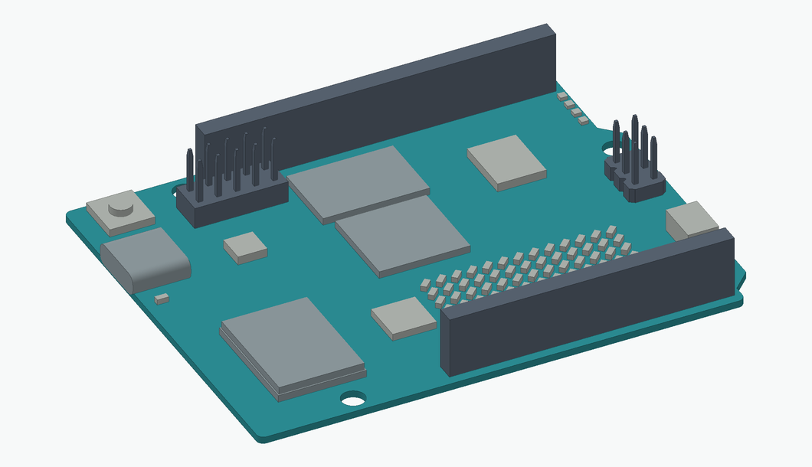](previews/uno-model.png)

**[Download the simplified UNO Q STEP assembly](originals/UNO-Q-simplified.stp)** for board placement, header positions and component clearances. Arduino's STEP header is dated August 27, 2025. The preview uses presentation colors and the geometry of all 128 imported solids. The separate 2.8-inch TFT shield used in the OpenToy project still needs exact identification. A MAR2808-style 8-bit ILI9341-compatible driver has demonstrated functional compatibility; this does not identify the shield manufacturer, actual controller IC or mechanical revision. No guessed shield CAD is included.

## Circuit schematics

Arduino’s ABX00162 release contains two dated sets of 24 circuit drawings. Select a thumbnail for the full sheet. The first set starts at printed sheet 2 of 25. The dates and printed numbering below follow the title blocks. Arduino leaves the version field blank.

| Circuit | September 30, 2025 · printed sheet | October 1, 2025 · printed sheet |
| --- | --- | --- |
| PM4125 - CDC | [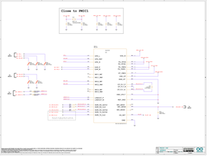](schematics/page-01.png) [Sheet 2 of 25](schematics/page-01.png) | [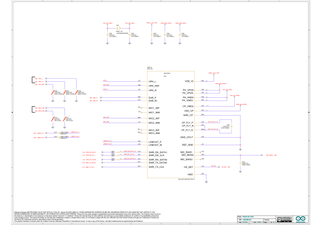](schematics/page-25.png) [Sheet 1 of 24](schematics/page-25.png) |
| PM4125 - CHG | [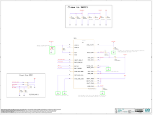](schematics/page-02.png) [Sheet 3 of 25](schematics/page-02.png) | [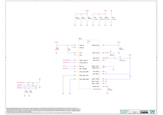](schematics/page-26.png) [Sheet 2 of 24](schematics/page-26.png) |
| PM4125 - HK | [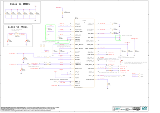](schematics/page-03.png) [Sheet 4 of 25](schematics/page-03.png) | [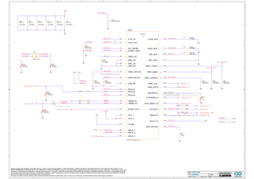](schematics/page-27.png) [Sheet 3 of 24](schematics/page-27.png) |
| PM4125 - LDO | [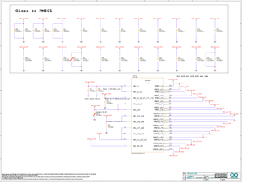](schematics/page-04.png) [Sheet 5 of 25](schematics/page-04.png) | [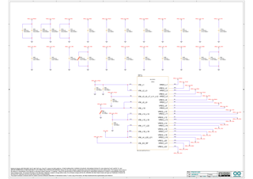](schematics/page-28.png) [Sheet 4 of 24](schematics/page-28.png) |
| PM4125 - UI | [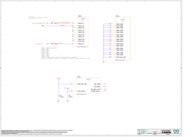](schematics/page-05.png) [Sheet 6 of 25](schematics/page-05.png) | [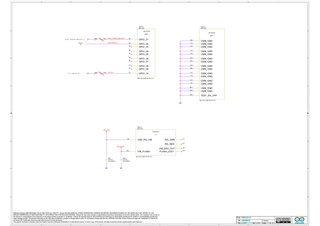](schematics/page-29.png) [Sheet 5 of 24](schematics/page-29.png) |
| PM4125 - VREG | [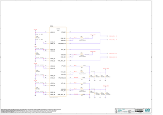](schematics/page-06.png) [Sheet 7 of 25](schematics/page-06.png) | [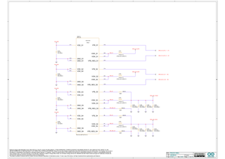](schematics/page-30.png) [Sheet 6 of 24](schematics/page-30.png) |
| Level Shift | [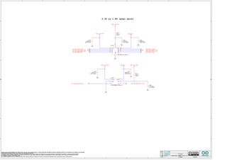](schematics/page-07.png) [Sheet 8 of 25](schematics/page-07.png) | [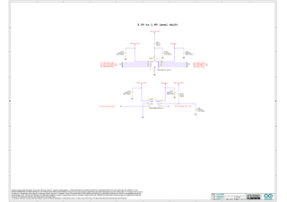](schematics/page-31.png) [Sheet 7 of 24](schematics/page-31.png) |
| QRB2210 - Control | [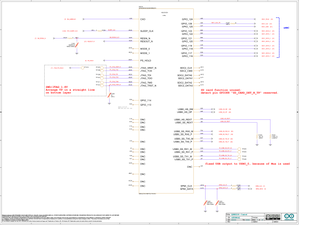](schematics/page-08.png) [Sheet 9 of 25](schematics/page-08.png) | [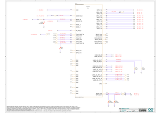](schematics/page-32.png) [Sheet 8 of 24](schematics/page-32.png) |
| QRB2210 - GPIO | [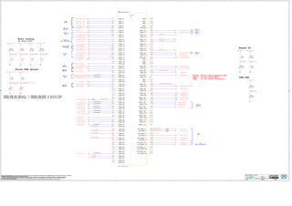](schematics/page-09.png) [Sheet 10 of 25](schematics/page-09.png) | [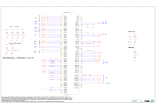](schematics/page-33.png) [Sheet 9 of 24](schematics/page-33.png) |
| QRB2210 - EBI | [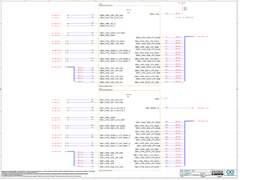](schematics/page-10.png) [Sheet 11 of 25](schematics/page-10.png) | [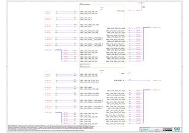](schematics/page-34.png) [Sheet 10 of 24](schematics/page-34.png) |
| QRB2210 - MIPI | [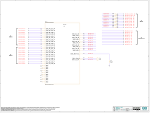](schematics/page-11.png) [Sheet 12 of 25](schematics/page-11.png) | [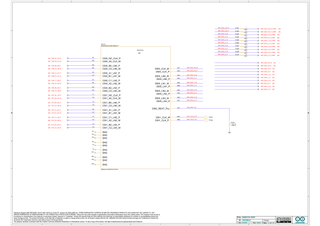](schematics/page-35.png) [Sheet 11 of 24](schematics/page-35.png) |
| QRB2210 - WLAN | [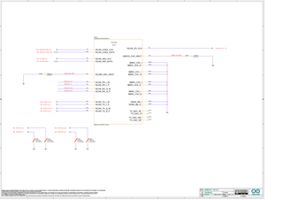](schematics/page-12.png) [Sheet 13 of 25](schematics/page-12.png) | [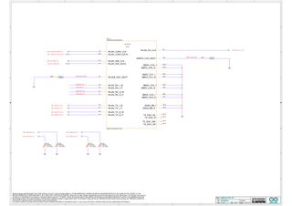](schematics/page-36.png) [Sheet 12 of 24](schematics/page-36.png) |
| QRB2210 - PWR1 | [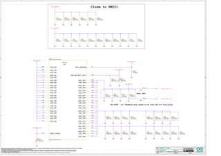](schematics/page-13.png) [Sheet 14 of 25](schematics/page-13.png) | [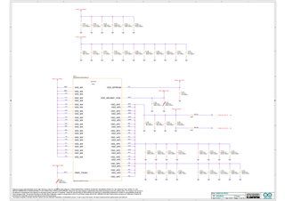](schematics/page-37.png) [Sheet 13 of 24](schematics/page-37.png) |
| QRB2210 - PWR2 | [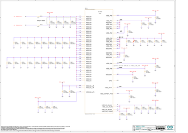](schematics/page-14.png) [Sheet 15 of 25](schematics/page-14.png) | [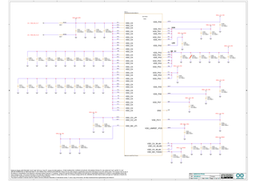](schematics/page-38.png) [Sheet 14 of 24](schematics/page-38.png) |
| QRB2210 - PWR3 | [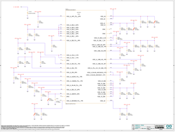](schematics/page-15.png) [Sheet 16 of 25](schematics/page-15.png) | [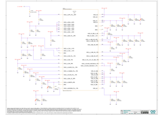](schematics/page-39.png) [Sheet 15 of 24](schematics/page-39.png) |
| QRB2210 - GND | [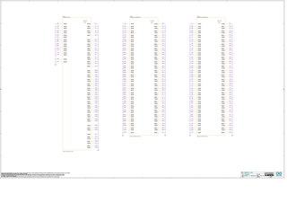](schematics/page-16.png) [Sheet 17 of 25](schematics/page-16.png) | [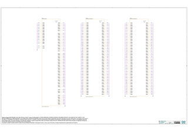](schematics/page-40.png) [Sheet 16 of 24](schematics/page-40.png) |
| eMMC | [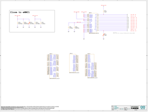](schematics/page-17.png) [Sheet 18 of 25](schematics/page-17.png) | [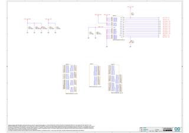](schematics/page-41.png) [Sheet 17 of 24](schematics/page-41.png) |
| LPDDR4X | [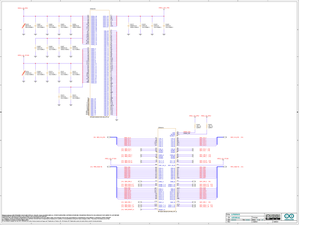](schematics/page-18.png) [Sheet 19 of 25](schematics/page-18.png) | [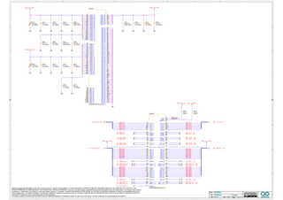](schematics/page-42.png) [Sheet 18 of 24](schematics/page-42.png) |
| MCU | [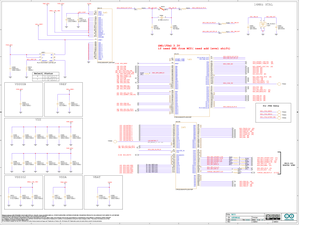](schematics/page-19.png) [Sheet 20 of 25](schematics/page-19.png) | [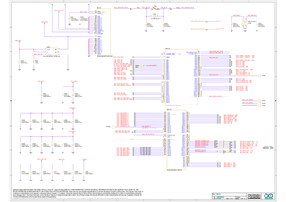](schematics/page-43.png) [Sheet 19 of 24](schematics/page-43.png) |
| IO | [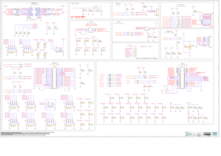](schematics/page-20.png) [Sheet 21 of 25](schematics/page-20.png) | [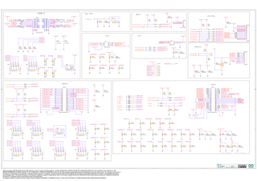](schematics/page-44.png) [Sheet 20 of 24](schematics/page-44.png) |
| LED | [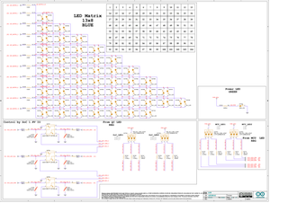](schematics/page-21.png) [Sheet 22 of 25](schematics/page-21.png) | [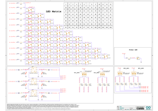](schematics/page-45.png) [Sheet 21 of 24](schematics/page-45.png) |
| DC / DC | [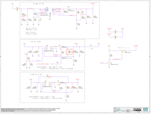](schematics/page-22.png) [Sheet 23 of 25](schematics/page-22.png) | [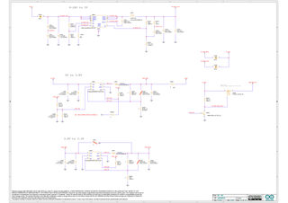](schematics/page-46.png) [Sheet 22 of 24](schematics/page-46.png) |
| RF and wireless module | [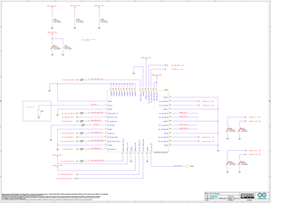](schematics/page-23.png) [Sheet 24 of 25](schematics/page-23.png) | [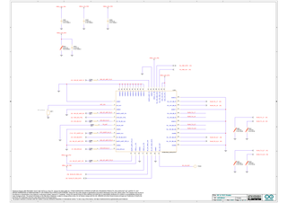](schematics/page-47.png) [Sheet 23 of 24](schematics/page-47.png) |
| ANX7625 | [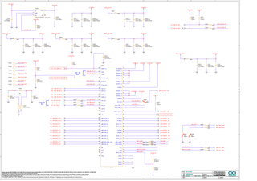](schematics/page-24.png) [Sheet 25 of 25](schematics/page-24.png) | [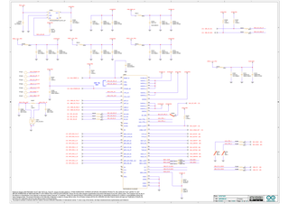](schematics/page-48.png) [Sheet 24 of 24](schematics/page-48.png) |

[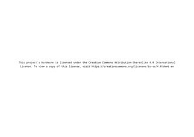](schematics/page-49.png) [License page accompanying both sets](schematics/page-49.png)

## Manufacturer sources and license

- Arduino SA supplied the STEP assembly and the ABX00162 schematics. The assembly is byte-identical to `UNO Q simplified.stp` inside Arduino’s model archive. OpenToy rendered the isometric preview and converted every schematic page to PNG. The original drawing notices remain on the sheets. [Arduino hardware page](https://docs.arduino.cc/hardware/uno-q/) · [Original STEP archive](https://docs.arduino.cc/resources/models/ABX00162-step.zip)
- Arduino licenses this project’s hardware under CC BY-SA 4.0. The same license applies to the schematic images and STEP preview. [Manufacturer notice](licenses/Arduino-hardware.txt) · [CC BY-SA 4.0](https://creativecommons.org/licenses/by-sa/4.0/)
- The separate PCB fabrication bundle includes Arduino’s Cadence board file, Gerbers and drill data. The pinned release also contains the source schematics. [Manufacturer PCB bundle](https://docs.arduino.cc/static/757d9262f8a7b1c02a77636ec1906780/ABX00162-cad-files.zip) · [Pinned Arduino source files](https://github.com/arduino/docs-content/tree/38bd285cf3726438b95b5d9cdcff27980139b4d8/content/hardware/uno/boards/uno-q/downloads)
