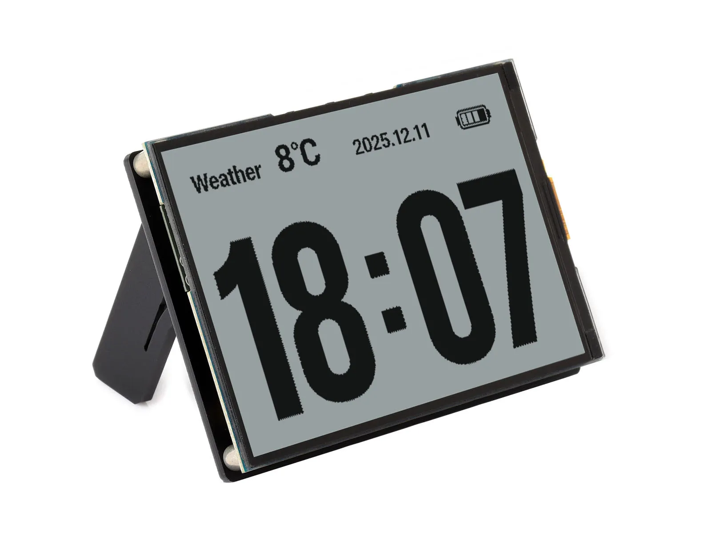
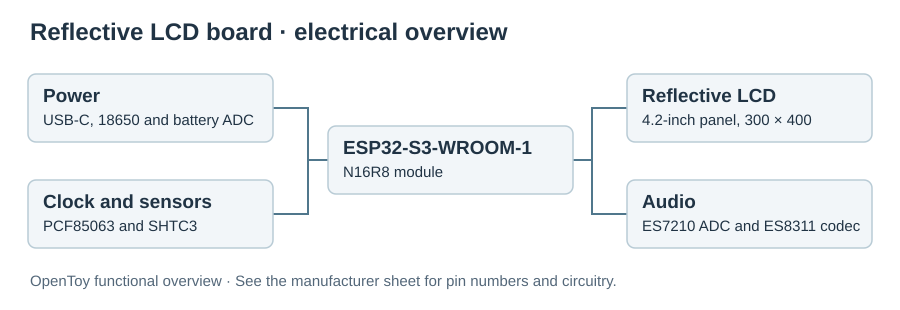

# Waveshare 4.2-inch reflective LCD

[← Hardware gallery](../README.md)

**ESP32-S3-RLCD-4.2 · 300 × 400 reflective display.** The QC label identifies the spacer revision. OpenToy's unit has no recorded QC revision. Both revisions use the same electrical schematic. [Waveshare revision guide](https://docs.waveshare.com/ESP32-S3-RLCD-4.2)

## Circuitry

The manufacturer's single sheet covers the ESP32-S3 module, reflective display, TF card, audio, clock, temperature and humidity sensor, and battery power path. [Open the manufacturer schematic](https://files.waveshare.com/wiki/ESP32-S3-RLCD-4.2/ESP32-S3-RLCD-4.2-schematic.pdf) · [Resources and drawings](https://docs.waveshare.com/ESP32-S3-RLCD-4.2/Resources-And-Documents)

### Manufacturer pin and interface drawing

## Choose the mechanical revision

| Manufacturer file set | LCD-to-acrylic spacing | Body thickness | Files in the download |
| --- | --- | --- | --- |
| [V1 · December 8, 2025](https://files.waveshare.com/wiki/ESP32-S3-RLCD-4.2/ESP32-S3-RLCD-4.2-3dFile.rar) | 3.75 mm | 13.50 mm | STEP assembly, editable DXF, dimension sheet |
| [V2 · October 10, 2026](https://files.waveshare.com/wiki/ESP32-S3-RLCD-4.2/ESP32-S3-RLCD-4.2_20261010.zip) | 4.35 mm | 14.10 mm | STEP assembly, editable DXF, dimension sheet |

The dimension drawings show a **69.1 × 92.5 mm PCB** and **62.1 × 85.5 mm** mounting-hole spacing. The stand extends beyond the body thickness in the table. Measure the physical stack before designing a shell that touches the screen. [Manufacturer dimensions and assembly note](https://docs.waveshare.com/ESP32-S3-RLCD-4.2#dimensions)

### V1 drawing and STEP reference

[Open V1 drawing](https://docs.waveshare.com/assets/images/ESP32-S3-RLCD-4.2-ProductSize-15ee5bf4861e7963ca32409a7fdb4d00.webp) · [Download the V1 CAD archive](https://files.waveshare.com/wiki/ESP32-S3-RLCD-4.2/ESP32-S3-RLCD-4.2-3dFile.rar)

### V2 drawing and STEP reference

[Open V2 drawing](https://www.waveshare.net/photo/LCD/ESP32-S3-RLCD-4.2/ESP32-S3-RLCD-4.2-size.jpg?v=26010402) · [Download the V2 CAD archive](https://files.waveshare.com/wiki/ESP32-S3-RLCD-4.2/ESP32-S3-RLCD-4.2_20261010.zip)

## Sources and reuse

The product photograph comes from Waveshare's Apache-2.0 repository. The schematic and mechanical archives are separate downloads on Waveshare's file server. Those archives contain no license notice, so their CAD and full-sheet artwork are linked at the manufacturer. The figures above the download links are Waveshare's own hosted dimension views. [Photograph source](https://github.com/waveshareteam/ESP32-S3-RLCD-4.2/blob/9e754fdf431ef4fce21e4e8b19bd4079ba043e86/docs/images/esp32-s3-rlcd-4.2.webp) · [Photograph license](LICENSE-Waveshare.txt)
