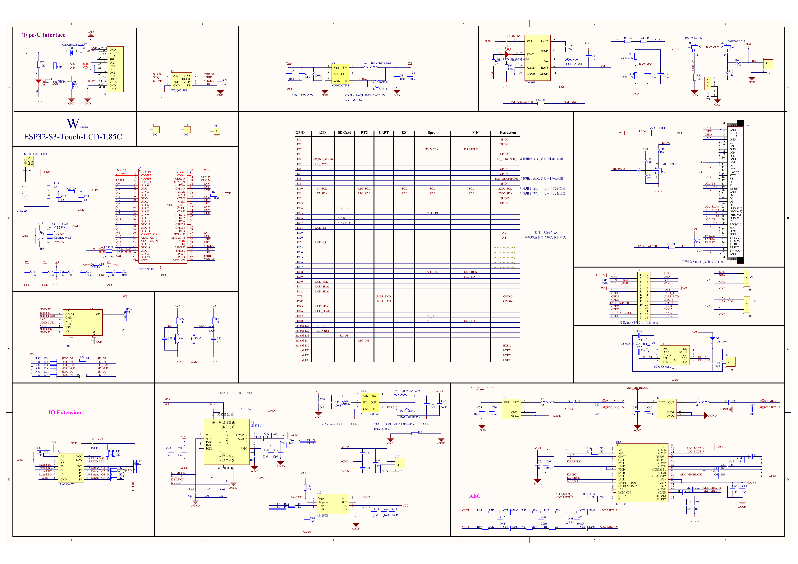
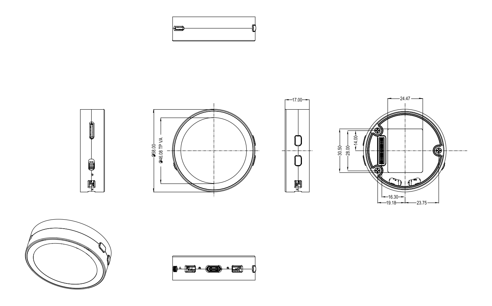

# Waveshare round display and speaker box

[← Hardware gallery](../README.md)

**ESP32-S3-Touch-LCD-1.85C-BOX-EN · V2 · SKU 30685.** The 1.85-inch touch display has a 360 × 360 panel. Look for Rev2.0 on the PCB or a V2 QC sticker on the case. Waveshare publishes one V2 schematic for the 1.85C family. [Model and revision guide](https://docs.waveshare.com/ESP32-S3-Touch-LCD-1.85C)

## V2 schematic

Open the image at full size to read component and pin labels. The source is the V2 sheet from the manufacturer's hardware folder. [Original sheet](https://github.com/waveshareteam/ESP32-S3-Touch-LCD-1.85C/blob/8ead4a96bf3a278fc4ebd8ef4768657e17fa2880/hardware/schematics/ESP32-S3-Touch-LCD-1.85C-V2--Schematic.pdf_.pdf)

## Housing dimensions

[Open the dimension sketch](previews/speaker-box-envelope.svg)

The speaker-box assembly is approximately **58 mm in diameter × 51.1 mm tall**. The display head measures **58 × 17 mm** and has a Ø46.08 mm visible touch area. Waveshare’s shared DXF shows the head, rear connector and screw locations. The manufacturer resources reviewed list no downloadable STEP or other 3D solid for the complete BOX-EN enclosure. [Version dimensions](https://www.waveshare.com/wiki/ESP32-S3-Touch-LCD-1.85C#Dimensions) · [Manufacturer hardware files](https://github.com/waveshareteam/ESP32-S3-Touch-LCD-1.85C/tree/8ead4a96bf3a278fc4ebd8ef4768657e17fa2880/hardware)

### Editable display-head drawing

[Download the original DXF](source/ESP32-S3-Touch-LCD-1.85C-dimension.dxf) · [Open the manufacturer's dimension sheet as an image](previews/dimension-sheet.png)

## Source and license

Waveshare publishes the DXF and both source sheets under the repository's Apache-2.0 license. The DXF is unmodified. OpenToy rendered the drawings as PNGs and drew the speaker-box envelope from the published measurements. [License](LICENSE-Waveshare.txt) · [Pinned upstream hardware folder](https://github.com/waveshareteam/ESP32-S3-Touch-LCD-1.85C/tree/8ead4a96bf3a278fc4ebd8ef4768657e17fa2880/hardware) · [Source checksums](SOURCES.md)
