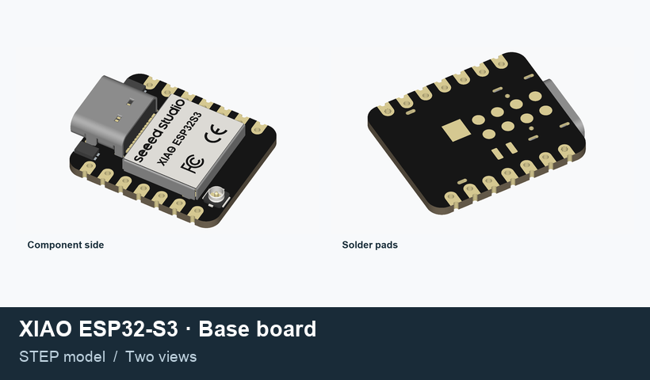
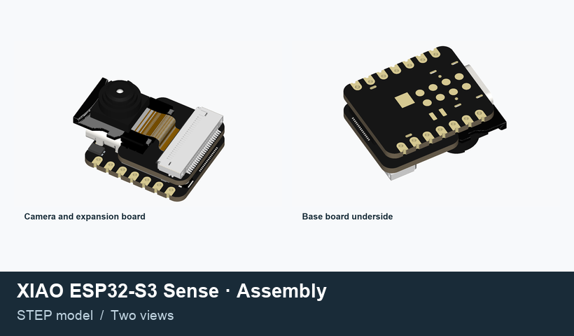
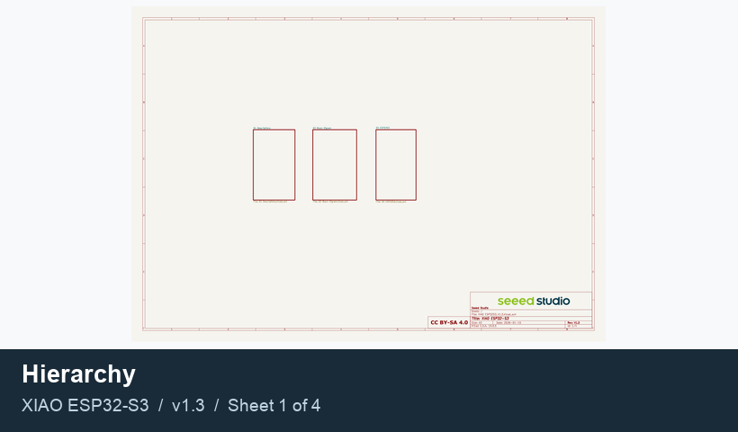
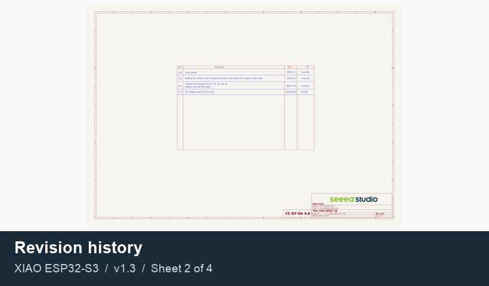
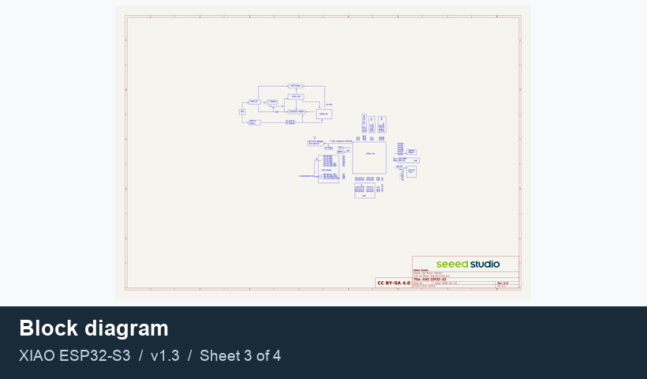
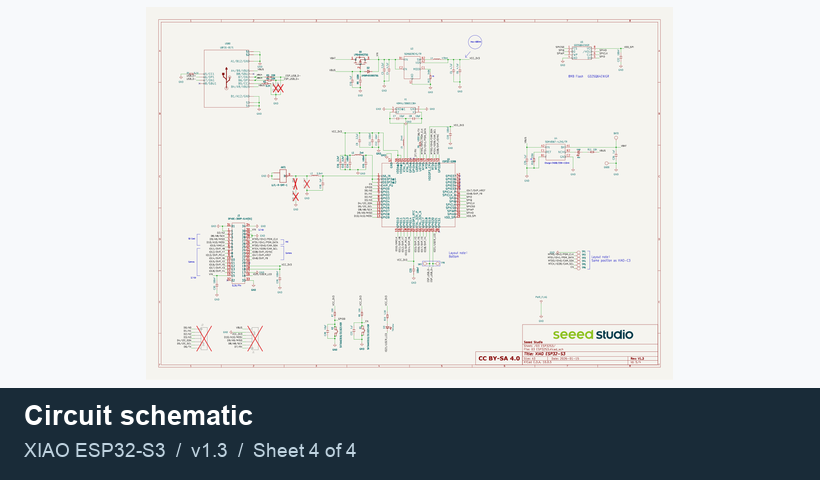
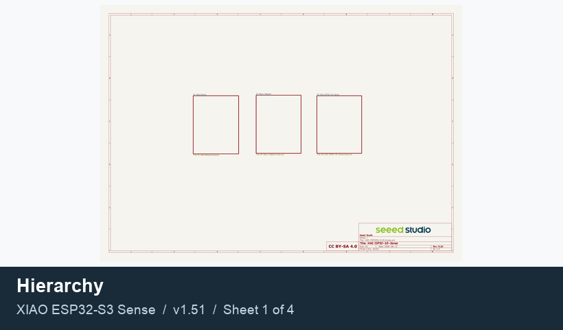
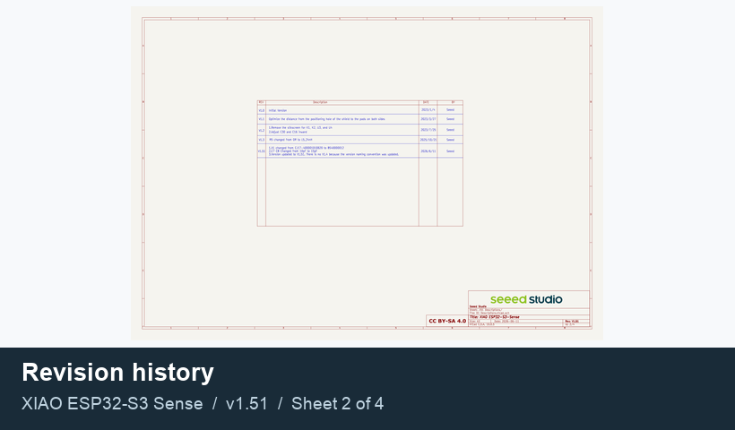
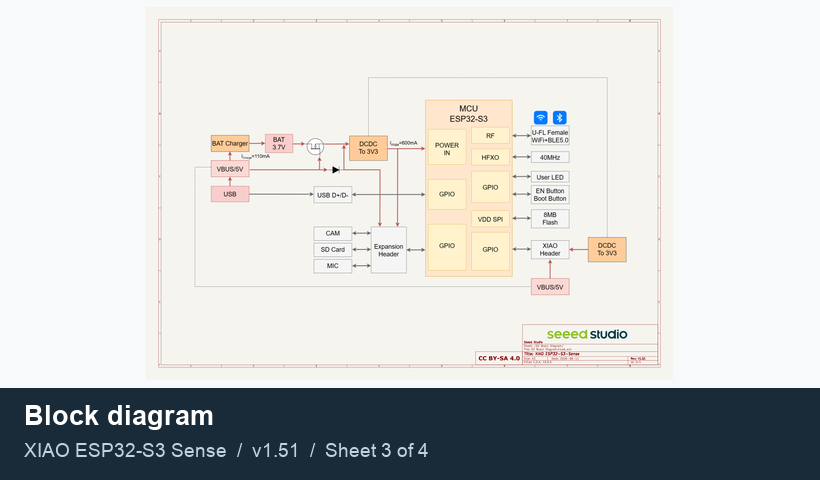
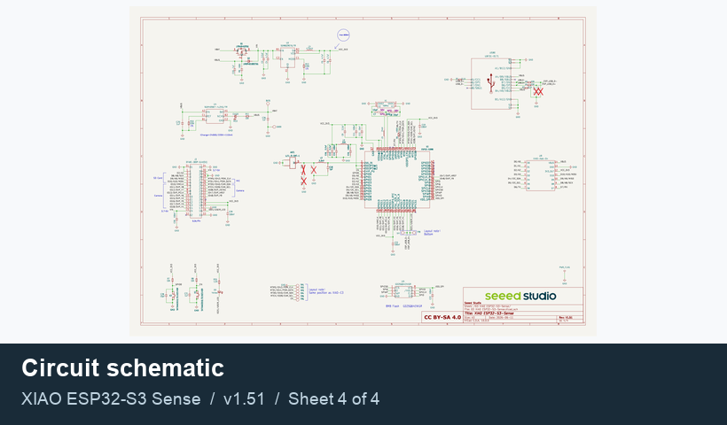

# Seeed Studio XIAO ESP32-S3 and Sense

[Hardware gallery](../README.md) · [Archived OpenToy projects](../../archive/README.md)

The base model shows the standalone XIAO. The Sense model adds the removable camera, digital microphone and microSD expansion board. Use the stack model for camera clearance and the separate expansion-board reference for its circuitry. Seeed has shipped multiple camera sensors. The STEP file establishes the geometry of the pictured assembly, and the installed camera revision remains unverified. [Seeed’s board and camera guide](https://wiki.seeedstudio.com/xiao_esp32s3_getting_started/)

## Mechanical models

| XIAO ESP32-S3 base | XIAO ESP32-S3 Sense assembly |
| --- | --- |
|  |  |
| [Open the base STEP](source/xiao-esp32s3-base-v3.step) · [Enlarge both views](previews/base-model.png) | [Open the Sense STEP](source/xiao-esp32s3-sense.step) · [Enlarge both views](previews/sense-model.png) |

Both STEP files came from Seeed Studio’s model listings. The “v3” in the base STEP is the model filename. PCB revision numbers below come from the schematics. [Base STEP source](https://www.printables.com/model/1344060-3d-model-for-seeed-studio-xiao-esp32-s3/files) · [Sense STEP source](https://www.printables.com/model/1344045-3d-model-for-seeed-studio-xiao-esp32s3-sense/files)

## Base-board schematic · v1.3

Open the hierarchy sheet in KiCad with the other three files beside it. Click any preview to enlarge its complete sheet. The current wiki download labeled “base v1.4” contains a Sense v1.5 project. Seeed’s earlier v1.3 release identifies the base board on the sheets themselves. [Seeed’s v1.3 KiCad release](https://files.seeedstudio.com/wiki/SeeedStudio-XIAO-ESP32S3/res/XIAO_ESP32S3_V1.3_SCH%26PCB_260115.7z) · [Manufacturer’s earlier resource index](https://github.com/Seeed-Studio/wiki-documents/blob/e40fa9e306/sites/en/docs/Sensor/SeeedStudio_XIAO/SeeedStudio_XIAO_ESP32S3/XIAO_ESP32S3_Getting_Started.md)

| Schematic sheets | Schematic sheets |
| --- | --- |
|  **Hierarchy** · [Editable KiCad sheet](source/base-v1.3/XIAO%20ESP32S3_V1.3.kicad_sch) |  **Revision history** · [Editable KiCad sheet](source/base-v1.3/01%20Descriptions.kicad_sch) |
|  **Block diagram** · [Editable KiCad sheet](source/base-v1.3/02%20Block%20Digram.kicad_sch) |  **Circuit schematic** · [Editable KiCad sheet](source/base-v1.3/03%20ESP32S3.kicad_sch) |

## Sense mainboard schematic · v1.51

These four sheets cover the Sense mainboard, including the connector to the removable expansion board. Keep the sheet filenames together when opening the hierarchy in KiCad. [Seeed’s v1.51 KiCad release](https://files.seeedstudio.com/wiki/SeeedStudio-XIAO-ESP32S3/res/XIAO_ESP32S3-Sense_V1.51_SCH%26PCB_260611.zip)

| Schematic sheets | Schematic sheets |
| --- | --- |
|  **Hierarchy** · [Editable KiCad sheet](source/sense-v1.51/XIAO%20ESP32S3_V1.51.kicad_sch) |  **Revision history** · [Editable KiCad sheet](source/sense-v1.51/01%20Descriptions.kicad_sch) |
|  **Block diagram** · [Editable KiCad sheet](source/sense-v1.51/02%20Block%20Diagram.kicad_sch) |  **Circuit schematic** · [Editable KiCad sheet](source/sense-v1.51/03%20XIAO%20ESP32-S3-Sense.kicad_sch) |

## Removable Sense expansion board

Seeed’s photo shows the **v1.0** marking and the connector to the XIAO. Its v1.0 EAGLE package contains the editable daughterboard schematic and layout. Seeed also lists a later v1.2 drawing on its resources page. The v1.0 package carries no explicit redistribution grant, so the native download and identification photo are hosted by Seeed. A separately published STEP for the daughterboard alone was not found. The Sense STEP above includes it in place. [Download the v1.0 EAGLE package](https://files.seeedstudio.com/wiki/SeeedStudio-XIAO-ESP32S3/res/XIAO_ESP32S3_ExpBoard_v1.0_SCH%26PCB_230324.zip) · [Seeed’s expansion-board resources](https://wiki.seeedstudio.com/xiao_esp32s3_getting_started/#for-seeed-studio-xiao-esp32-s3-sense) · [Photo and card-slot reference](https://wiki.seeedstudio.com/xiao_esp32s3_sense_filesystem/#card-slot-circuit-design-for-expansion-boards)

## Attribution

Seeed Studio publishes both STEP models and both mainboard schematics under Creative Commons Attribution-ShareAlike 4.0. The local STEP files retain the original geometry and use shorter filenames. The eight KiCad sheets retain their original filenames and bytes. OpenToy rendered the STEP views and plotted the schematics, then added labeled previews. These derived previews carry the same license. [CC BY-SA 4.0 license](licenses/CC-BY-SA-4.0.txt)

Maurice1995 shared the earlier base and Sense geometry with Seeed’s community in 2023. The Sense STEP in Seeed’s wiki download is byte-identical to the Sense model above. [Original model contribution](https://github.com/Seeed-Studio/wiki-documents/discussions/124#discussioncomment-6018598) · [Seeed’s Sense STEP package](https://files.seeedstudio.com/wiki/SeeedStudio-XIAO-ESP32S3/res/seeed-studio-xiao-esp32s3-sense-3d_model.zip)
