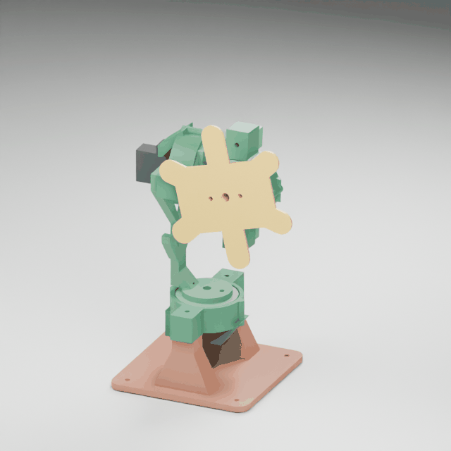
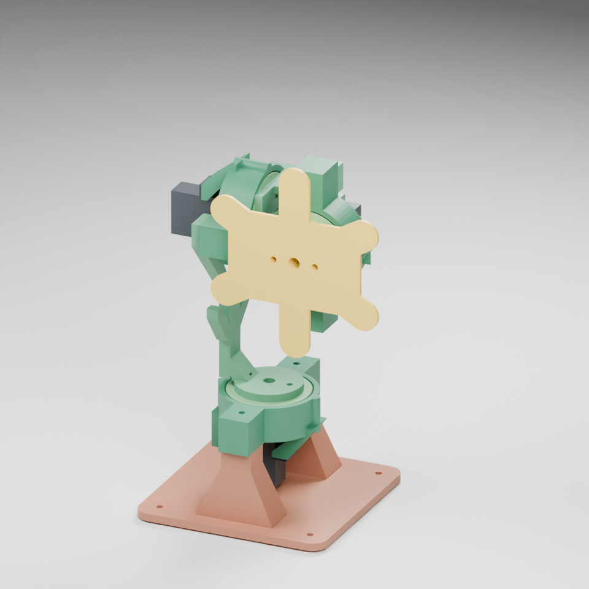
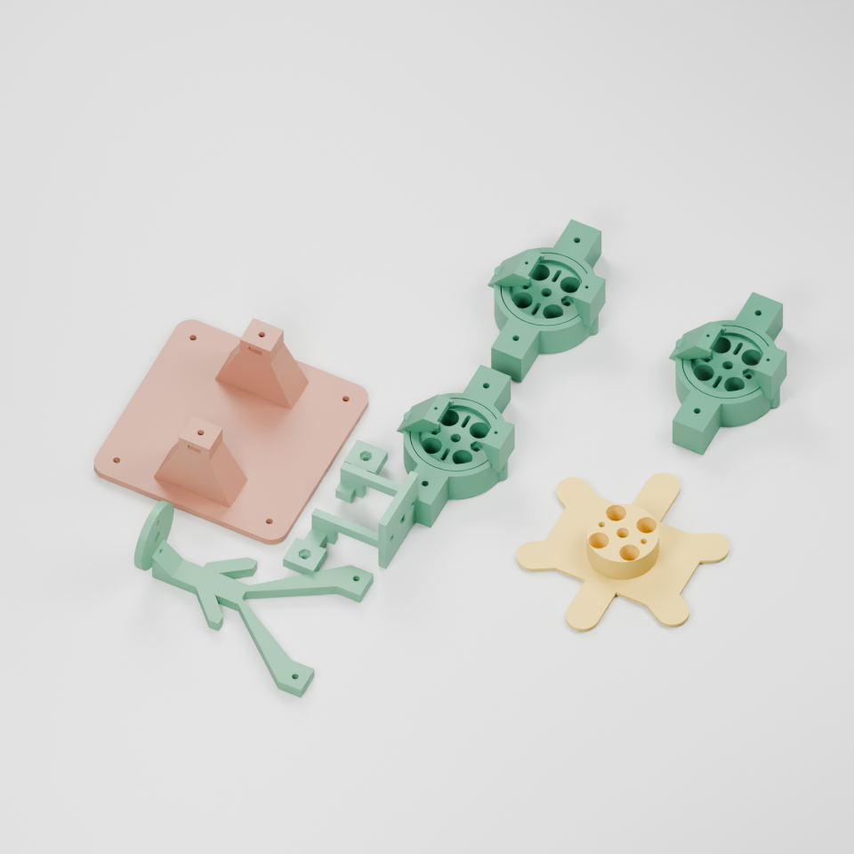
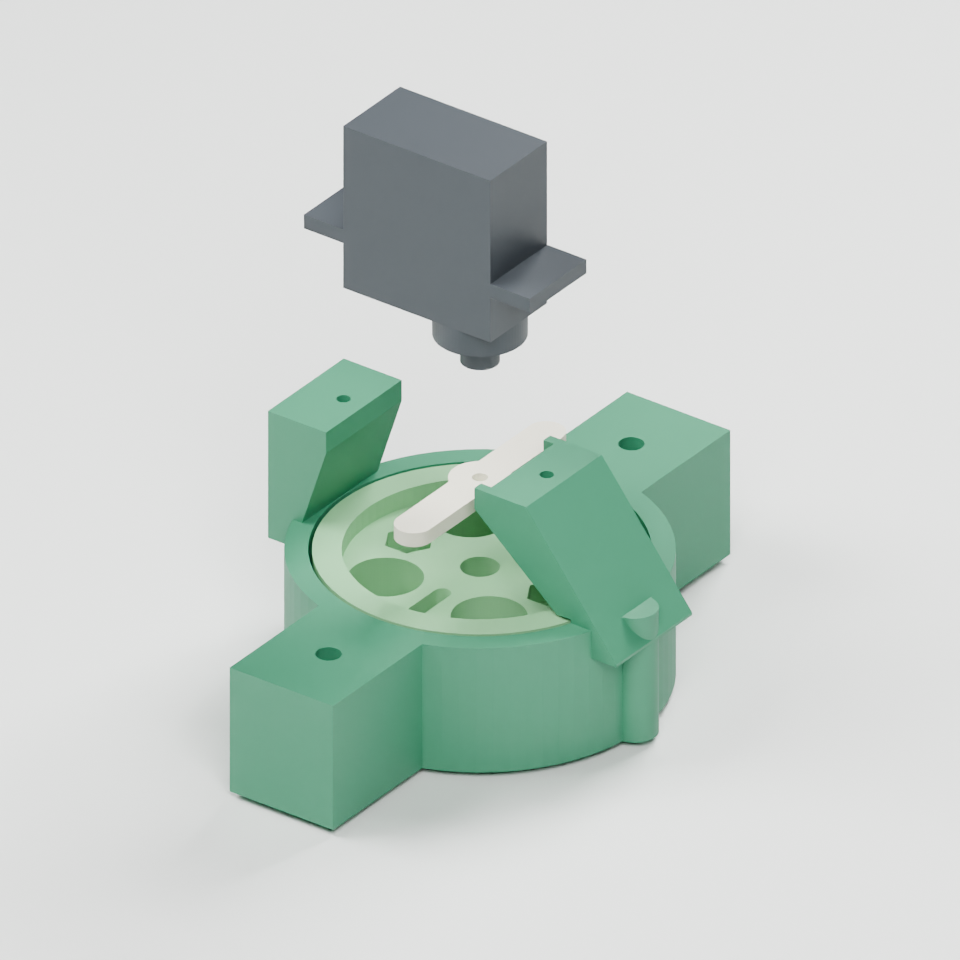
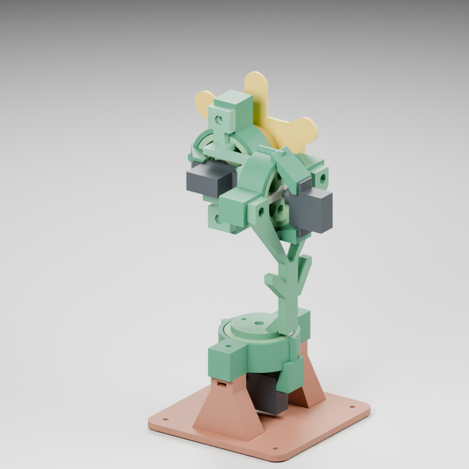

# Plant v0.2 — one possible OpenToy mechanical design

A three-axis, 3D-printable mechanical flower: it turns at the base, nods at the stalk and rolls its flower head. Three identical captive rotary modules use stock microservo horns, with a separate base, stalk, elbow and decorative flower. This is one candidate body for an open-source toy; OpenToy can accommodate other bodies too.

**Status: digital prototype, awaiting a physical print and assembly.** The animation below is rendered from the CAD. No joint release, purchased motor fit, screw engagement, powered movement, durability or classroom assembly time has been physically verified. The existing OpenToy software and firmware examples do not yet control these servos.



[Assembly guide (PDF)](assembly-guide.pdf) · [Editable OpenSCAD](plant-v02.scad) · [STL print files](stl/) · [Slicer projects](slicer-projects/) · [Editable Blender animation](plant-v02.blend) · [Digital review](#digital-review-and-physical-checks)

## Start with one joint

1. Print [clearance gauges](stl/gauges.stl). Their labels `40`, `50` and `60` mean 0.40, 0.50 and 0.60 mm radial clearance per side.
2. Print **one** [joint](stl/joint.stl), release its rotor by hand and fit your actual MG92B motor and stock horn. The default CAD clearance is 0.50 mm per side. Change `gap` and re-export if your printer needs another clearance.
3. Complete one prototype and the physical checks below before printing a classroom batch.



The flower center is 70 × 46 mm; the petal outline is about 100 mm high. This version has no camera, microphone, display, electronics enclosure or printed power wiring. Adding an OLED or other head hardware needs a mounting design and a revised load review.

## Files and print quantities

| File | Quantity for one toy | Supports | Purpose |
| --- | ---: | --- | --- |
| [joint.stl](stl/joint.stl) | 3 | Off | Identical captive housing/rotor pair at each axis |
| [base.stl](stl/base.stl) | 1 | Off | Base and yaw mount |
| [stalk.stl](stl/stalk.stl) | 1 | Build plate only | Yaw-to-nod structure |
| [elbow.stl](stl/elbow.stl) | 1 | Build plate only | Nod-to-roll structure; **five walls** |
| [flower.stl](stl/flower.stl) | 1 | Off | Decorative head |
| [gauges.stl](stl/gauges.stl) | Calibration print | Off | Three captive clearance test pairs |
| [shims.stl](stl/shims.stl) | As needed | Off | 0.4 / 0.8 / 1.2 mm motor-ear shims |

There are **seven actual printed parts**: three joint modules and four body pieces. The joints are print-in-place pairs; the entire toy is assembled from separate prints. It has no purchased bearing, axle or printed servo spline.



Use the supplied STL orientations and print each file separately for the first trial. The overview above is **not a single printer-bed layout**.

### Reviewed print settings

The October 1 digital slicing review used an Ender-3 V2 class 220 × 220 × 250 mm bed, PLA and a 0.4 mm nozzle:

- 0.20 mm layers, 15% gyroid infill, three walls; **five walls for the elbow**.
- Four top and three bottom layers; 0.15 mm elephant-foot compensation; zero XY hole compensation.
- Supports off for joints, base, flower, gauges and shims. Never fill the captive running gap with supports or a brim.
- Normal build-plate supports for stalk and elbow: 30° threshold, 0.20 mm top gap.
- The reviewed generic PLA profile used 220°C nozzle / 60°C bed. Use your filament's verified temperatures.

The seven `*-REVIEW.3mf` files contain models and settings, with generated G-code removed. Re-slice for your printer. The example JSON profiles describe the joint setup; the elbow needs five walls and the stalk/elbow need supports as above. Slicer estimates are about 3 h 33 min per joint, 3 h 55 min base, 1 h 27 min stalk, 1 h 32 min elbow and 1 h 44 min flower. These are estimates, not measured machine times.

## Mechanical bill of materials

| Quantity | Item | Fit notes |
| ---: | --- | --- |
| 3 | MG92B positional microservo | Same motor at all axes; purchased batch fit unverified |
| 3 | Stock two-arm horn plus matching center screw | Use the motor's matched spline and screw |
| 6 | M3 × 30 mm pan/button-head screw | Fixed housings to base, stalk and elbow |
| 4 | M3 × 20 mm pan/button-head screw | Yaw rotor to stalk; nod rotor to elbow |
| 2 | M3 × 35 mm pan/button-head screw | Roll rotor to flower, including 16 mm standoff |
| 12 | Standard M3 hex nut, 5.5 mm across flats | Seat in accessible pockets before closing connections |
| 6 | Servo-ear screw, approximately 2 × 6 mm | Match actual ears and 1.8 mm printed pilot holes |
| 6 | Horn coupling screw, approximately M2 × 6 mm | Match actual stock horn holes/threads; not guaranteed kit contents |

Also needed: a suitable three-channel positional-servo controller/tester, a regulated servo power supply and wiring. A complete OpenToy controller/power integration is still to be designed and tested.

The [TowerPro MG92B manufacturer page](https://towerpro.com.tw/product/mg92b/) was checked October 1, 2026: 13.8 g, 22.8 × 12 × 31 mm case, operating 5.0–6.6 V, stall torque 3.1 kg·cm at 5 V / 3.5 kg·cm at 6 V. Stall torque is not a continuous-duty rating.

**Provisional fit assumptions:** 31.5 mm ear pitch, 6 mm output offset, 14 mm output-to-ear stack and an 8 mm wide × 33 mm long stock horn. The horn recess is 34.6 mm in diameter; coupling holes must be 8–13.5 mm from the shaft. These dimensions need checking against the actual motor/horn. Adjust `mount_z` and mount geometry in the CAD when needed. The shims raise a motor only; print matched pairs for its two ears. Do not pull an incorrect stack into alignment with screws.

## Assembly

Use the illustrations in the [three-page PDF](assembly-guide.pdf) while following this sequence. Tools include a driver matched to the screw heads, a suitable servo tester/controller and tools for support cleanup. Do the motor/horn work on the bench before connecting the body parts.

### Prepare each of the three joint modules

1. Remove cleanup material and gently release the captive rotor by hand. The nominal upper gap is 0.50 mm; the sloped capture also permits axial play. Do not clamp away the running clearance.
2. Place two M3 nuts into the rotor's open motor-side pockets.
3. Center the servo using a suitable tester/controller. Attach its stock two-arm horn in the illustrated direction using the matched center screw.
4. Lower the motor **with the horn already attached** into the open mount, with the cable outward. Fasten both motor ears.
5. From the opposite face, insert two coupling screws through the counterbores into the stock horn. Check thread engagement and screw length; they must not bottom out or pull the rotor into the housing.
6. Check free movement and fit before moving to the next module.



### Connect the body

| Step | Connection | Fasteners | Orientation |
| ---: | --- | --- | --- |
| 1 | Yaw housing → base | 2 × M3 × 30 mm | Motor down |
| 2 | Stalk → yaw rotor | 2 × M3 × 20 mm | Match the illustrated stalk direction |
| 3 | Nod housing → stalk fork | 2 × M3 × 30 mm | Motor to the side |
| 4 | Elbow → nod rotor | 2 × M3 × 20 mm | Match the illustrated elbow direction |
| 5 | Roll housing → elbow | 2 × M3 × 30 mm | Motor rearward |
| 6 | Flower → roll rotor | 2 × M3 × 35 mm | Flower last; through its standoff |

Seat all 12 nuts before closing connections. Tighten structural screws into the nuts, rather than bare PLA. Center screws are accessible during bench assembly; later access to the nod center screw requires removing the elbow's two screws.



Leave slack loops in the cables, keep them away from moving gaps and prevent repeated full turns at the base. Flexible cables were not modeled in the collision review.

## Motion, power and OpenToy integration

The sampled mechanical travel is yaw ±64°, nod ±15° and roll ±20°. The rendered animation uses ±64° / ±12° / ±18°. These angles are CAD motions, not a servo pulse calibration or verified safe operating limits. Center each motor and begin with slow ±5° movements; expand only after observing a complete prototype.

The planning power arrangement is an appropriate regulated 6 V servo supply with common ground to the controller. Size the supply and wiring from the actual servo batch and load; a verified continuous current specification is still needed. The existing board/display USB-power evidence does not establish that its supply can run three servos.

OpenToy's existing Mac → BLE → XIAO examples cover LED/display puppetry and updates. They do not currently provide a three-servo driver, pins, plant control commands or a tested motor power circuit. To turn this mechanical candidate into an integrated OpenToy example, the remaining work is:

- Choose available output pins or a servo driver, and document power, grounding, connectors and cable routing.
- Add bounded yaw/nod/roll commands, per-motor center/pulse calibration and startup/disconnect behavior. Keep controller mapping separate from delivery.
- Test power-on, movement under load, cable clearance and temperature on the physical prototype. Check the updater and current display behavior if combining them.

No firmware change or device flashing is part of this mechanical contribution.

## Digital review and physical checks

**Review performed October 1, 2026; added to OpenToy October 2.** [Detailed verification record](verification.txt), [mesh results](mesh-review.json), [collision/load results](engineering-review.json), [insertion/tool access](fit-access-review.json), [slicing results](slicer-review.json) and [layer-path results](layer-path-review.json) are included.

| Check | Recorded result | Limit |
| --- | --- | --- |
| STL geometry | All seven supplied STL files watertight; joint has two bodies | Does not prove release, strength or printer fit |
| Collision samples | 157 poses, 18,840 pair checks; no overlap above 0.05 mm³ | Sampled poses and representative motors/horns; no continuous-path or cable proof |
| Bench insertion/access | 41 motor/horn insertion positions and seven tool envelopes clear | Actual purchased shapes and tools unverified |
| Slicing | Seven Bambu Studio 02.00.03.54 slices completed without recorded floating, clipping or plate errors | No physical print; re-slice for your machine |
| Toolpath presence | 913 model layers, 1,948 cross-section components checked; none missing model extrusion or extruding outside the bed | Presence check, not full-coverage or strength proof |
| Animation | 32 frames from exported CAD; camera framing checked | Render, not powered hardware |

Conservative planning torques are **0.323 / 0.903 / 0.150 kg·cm** for yaw/nod/roll. The estimate assumes solid PLA, downstream motors/horns, 24 g total fastener/cable allowance, PLA friction coefficients 0.2/0.35/0.5, 14 mm bearing span, acceleration 1 rad/s² and 0.10 kg·cm startup reserve. The worst nod estimate exceeds the earlier quarter-stall comparison target of 0.875 kg·cm. That target is not a manufacturer continuous-duty rating. Infill reduces mass, while friction and warping may increase the real demand.

Physical qualification remains open:

- [ ] Clearance gauges and full joints release on the actual printer/PLA.
- [ ] Actual motor, horn, ear stack, nuts and screws fit and engage correctly.
- [ ] One complete prototype assembles with service access and slack cable loops.
- [ ] Loaded nod breakaway torque and slow travel are acceptable without binding, heating or cable snagging.
- [ ] Power/current, control calibration, startup and disconnect behavior are tested.
- [ ] Durability and classroom assembly time are measured before classroom use.

## Editing, provenance and license

[plant-v02.scad](plant-v02.scad) is standalone OpenSCAD in millimeters. Set `part` to `joint`, `base`, `stalk`, `elbow`, `flower`, `gauges` or `shims` for an individual export; the default `assembly` shows the whole design. Use the CGAL backend for strict mesh exports, for example:

```sh
openscad --backend=CGAL -D 'part="joint"' -o joint.stl plant-v02.scad
```

The supplied STL exports had degenerate faces removed and coordinates rounded to 0.0001 mm. [plant-v02.blend](plant-v02.blend) contains the editable animation scene built from those CAD meshes. Its render output is set to the relative path `//renders/plant-` for portability. Motor/horn shapes are original representative envelopes for review, not manufacturer-certified models or printable motor replacements.

The files preserve the October 1 v0.2 mechanical kit, with new repository documentation and a portable Blender render-output path. [Original-source hashes](original-source-sha256.json) identify earlier draft inputs preserved outside this directory; those earlier drafts are not the printable files supplied here. [checksums-sha256.json](checksums-sha256.json) identifies the files in this OpenToy contribution.

Original CAD, meshes, animation scene, renders and documentation in this directory are distributed under OpenToy's [MIT license](LICENSE). Keep that notice with copies and derivatives. This candidate does not replace OpenToy's existing face design, software examples, firmware or third-party notices.
