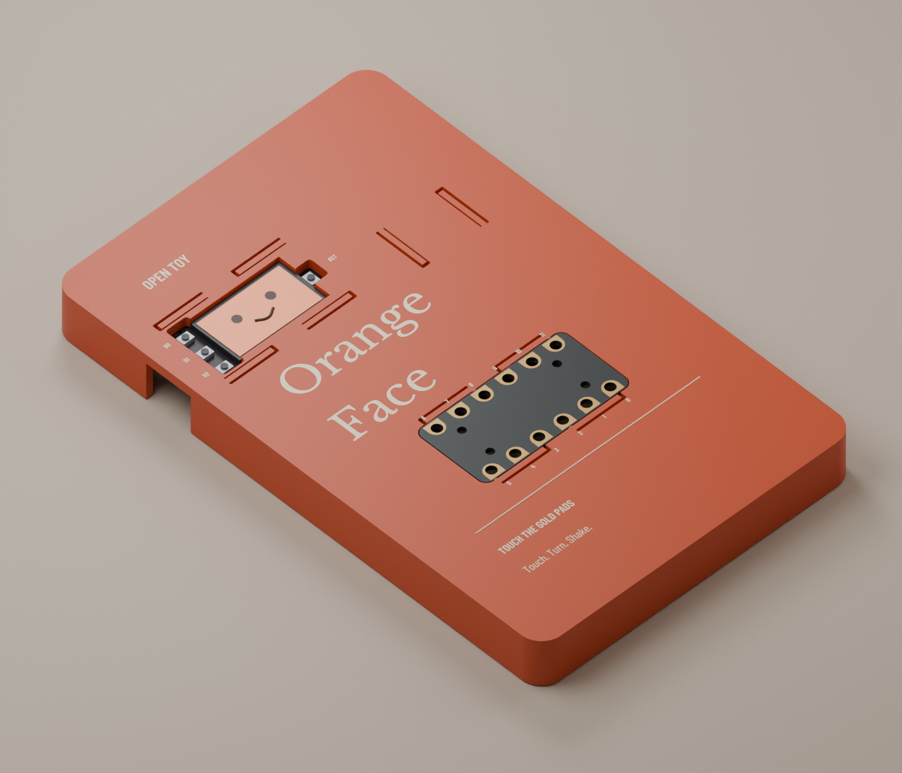
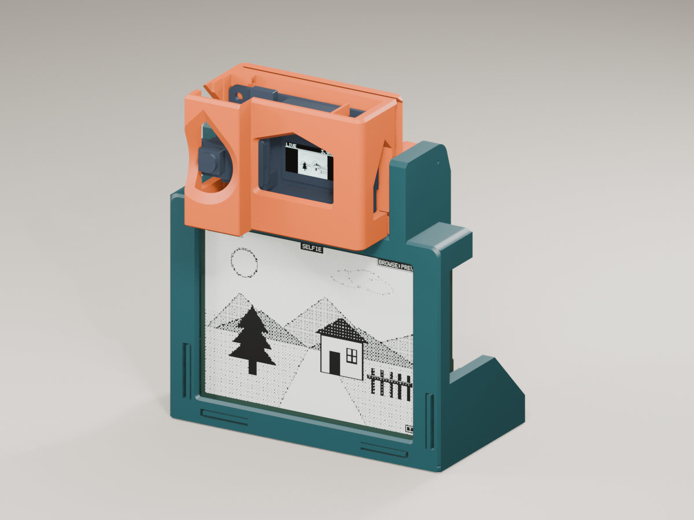
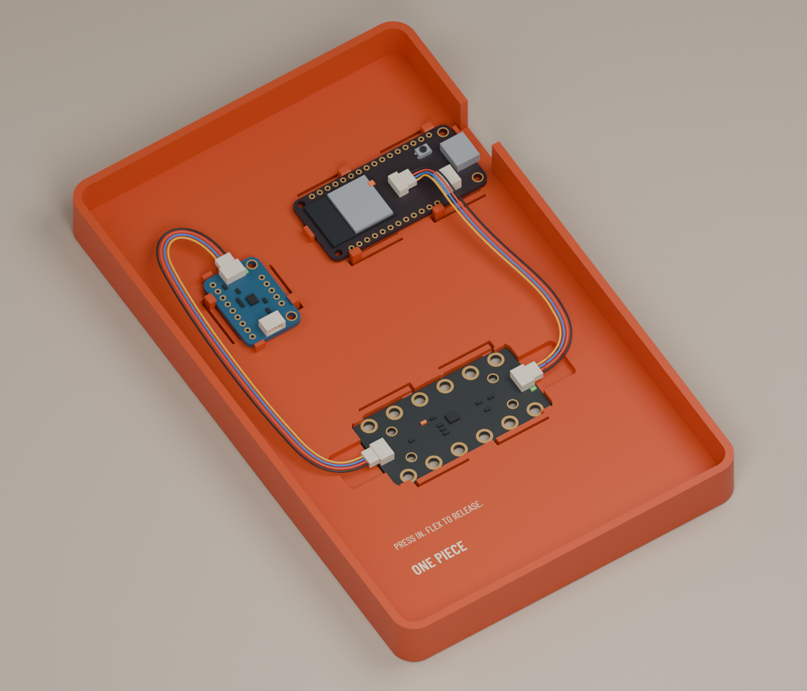

# 3D printed designs

[All projects](../README.md) · [Feather projects](../feather/README.md) · [Nesso projects](../nesso/README.md) · [Home](../../README.md)

Choose a design, check its hardware and test status, then open its print and
assembly guide. Editable CAD and Blender files live with the design.

| Preview | Design | Hardware and status |
| --- | --- | --- |
|  | **[Orange Face — one-piece faceplate](orange-face/README.md)** One printed part with flexible board grips, a flush touch surface and an open back. [Print files](orange-face/README.md#print) · [Assembly and removal](orange-face/README.md#assemble-and-remove-the-boards) · [Editable models](orange-face/README.md#edit-the-design) | Reverse TFT Feather #5691 + MPR121 #4830 + LSM6DS3TR-C #4503. **First-fit prototype:** CAD and slicing checked; physical fit not yet tested. |
|  | **[ditherCam — captive top-flip enclosure](ditherCam/README.md)** Print-in-place teal body and pivoting 180° orange pod with stepped lens/OLED faceplate. [Print files](ditherCam/README.md#print) · [Assembly GIFs](ditherCam/README.md#assembly) · [3D flip viewer](ditherCam/index.html) · [Assembly guide](ditherCam/assembly/index.html) | Waveshare ESP32-S3-RLCD-4.2 + XIAO ESP32-S3 Sense + Expansion Base. **Printed prototype; owner fit attempt:** not a formal clip-life, hinge-fatigue, or Snapmaker U1 slice qualification. |

## Inside the Orange Face design

The guide shows the front, installed electronics, empty print, loose parts and
clip release close-up. All images are Blender/CAD renders; no physical
print or retention test is implied.

## Related designs in their existing locations

- **[Nearby Buddy enclosures](https://github.com/yury-g/OpenToy-Coursework/tree/main/companions/nearby-buddy/main/enclosure)** — in the separate Nearby Buddy repository; follow its own hardware and print notes.
- **[Earlier mechanical designs](../../archive/README.md#earlier-mechanical-experiments)** — Plant v0.2 and previous concepts remain in the archive with their original status and files.

## How designs are filed

Each design has its own folder and visual `README.md`, with `images/`, `print/`,
`cad/`, `blender/`, `source/`, `verification/` and `licenses/` as needed. Begin
with the README rather than guessing which model or printer file to use.
Printer-specific slices always identify the machine, nozzle, material and plate.
