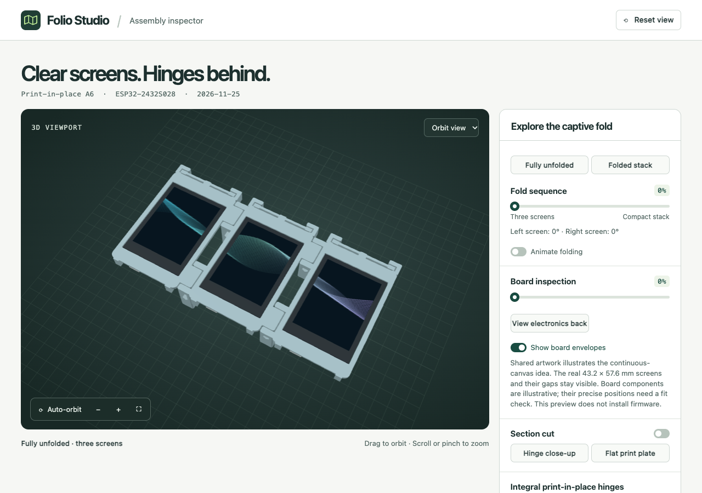
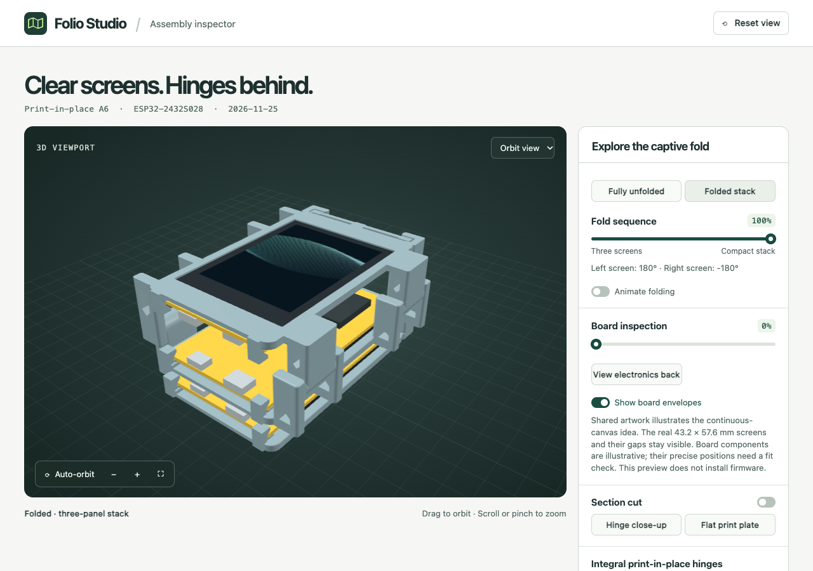
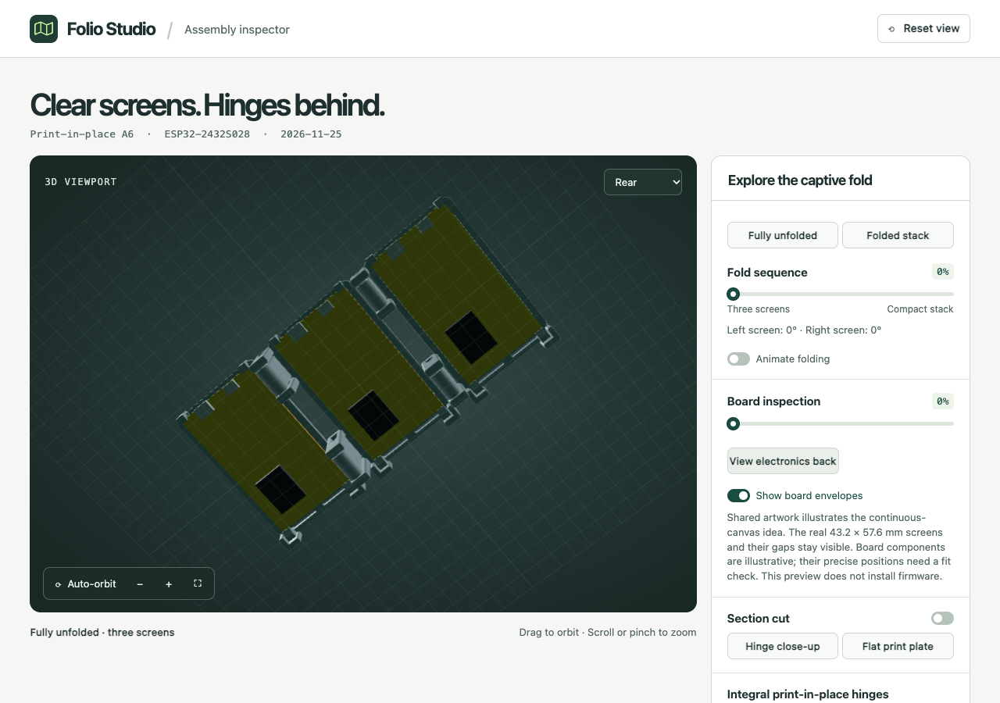

# CYD tri-fold · A6

[OpenToy gallery](../../../README.md) · [Printed designs](../README.md) · [A6 interactive fold viewer](Folio%20Dashboard/index.html)

A print-in-place folding frame for three CYD screens. The latest A6 design places the hinges behind the screens and brings the glass within 0.4 mm of the front rim. It prints as one object containing three captive moving frames. Install the three boards after printing.

## From three screens to a folded frame

| Open the canvas | Fold for carrying | Inspect the electronics |
| --- | --- | --- |
|  |  |  |
| The three glass fronts share a plane, recessed 0.4 mm. | Right frame first, then left. Exterior glass stays exposed. | The four captive hinges sit on the electronics side. |

These are views of the actual A6 CAD viewer with illustrative screen artwork. The interactive version includes folding, board insertion and hinge inspection.

## Current design

[Print and assembly notes](CYD%20Trifold%20A6/Read%20me.txt) · [Editable OpenSCAD](CYD%20Trifold%20A6/One-piece%20A%20trifold.scad) · [Arranged STL](CYD%20Trifold%20A6/One-piece%20trifold%20-%20print%20flat.stl) · [U1 plate 3MF](CYD%20Trifold%20A6/Print-in-place%20A6%20-%20U1%20plate.3mf) · [Geometry metadata](CYD%20Trifold%20A6/metadata.json)

Open size is 194 × 99 × 27.35 mm. Fold the right frame first by −180°, then the left by +180°. The design keeps the glass exposed when folded. Keep the supplied relative positions in the print file.

Digital checks covered 362 loaded fold poses, USB approach, connector access, catches, insertion and unobstructed views of the glass. Physical fit, hinge release, strength and fatigue remain untested. Connector positions are approximate. This project currently supplies a mechanical frame and viewer. Coordinated three-screen firmware is future work.

Download the folder to use the interactive HTML viewer locally. GitHub displays the HTML source when opened in its file browser.

## Design history

[A5](CYD%20Trifold%20A5/) · [A4](CYD%20Trifold%20A4/) · [A3 rejected prototype](CYD%20Trifold%20A3/) · [A2](CYD%20Trifold%20A2/) · [Original A](CYD%20Trifold%20A/) · [Earlier folio](CYD%20Folio/) · [Hinge comparison](Hinge%20comparison/) · [Hinge notebooks](Hinge%20notebooks/)

These directories preserve the iterations and their own verification records. A6 is the current November 25 design candidate.
