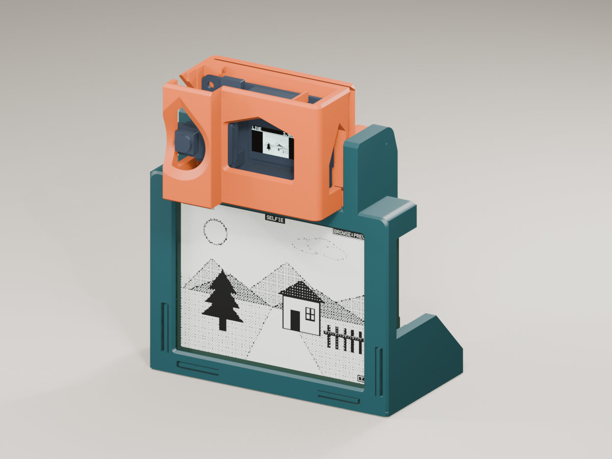
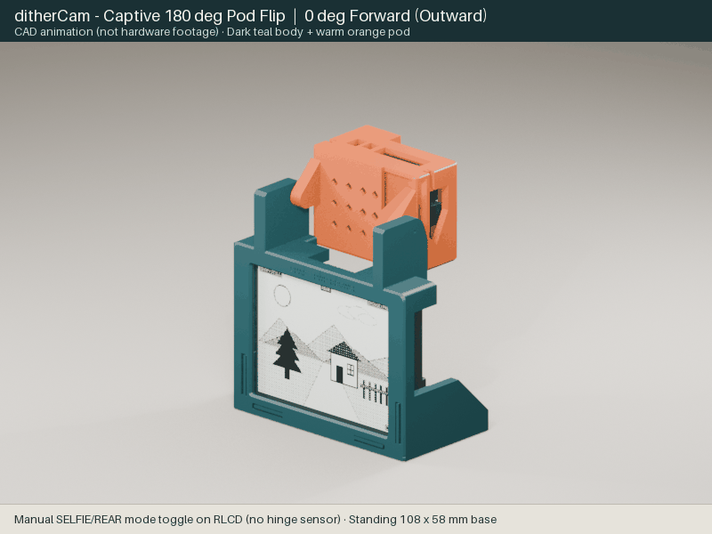
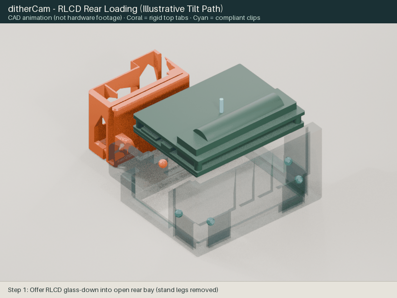
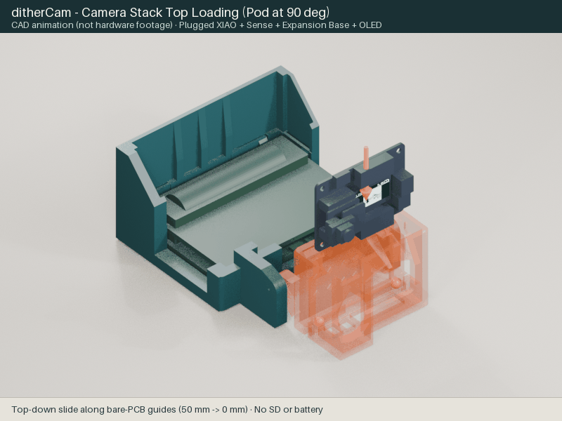

# ditherCam — captive top-flip enclosure

[3D printed designs](../README.md) · [All projects](../../README.md) · [ditherCam firmware & experience](../../ditherCam/README.md) · [Interactive assembly guide](https://yury-g.github.io/OpenToy-Coursework/dithercam/assembly/) · [Offline assembly guide](assembly/index.html) · [3D flip viewer](https://yury-g.github.io/OpenToy-Coursework/dithercam/)

One print-in-place captive assembly holds the **Waveshare ESP32-S3-RLCD-4.2** in the upright teal body and the **XIAO ESP32-S3 Sense + OV2640 + Expansion Base** stack inside the pivoting orange top pod. Gravity seats the pod against rigid `0°` Forward and `180°` Selfie stops — no screws, hinge pins, or glue.

**Owner printed & fitted (`"ok i got these"`) · Not a formal clip-life, hinge-fatigue, or supportless-print qualification**

[Print](#print) · [Hardware & layout](#hardware--layout) · [Assembly](#assembly) · [Owner fit & honest limitations](#owner-fit--honest-limitations) · [CAD & verification](#cad--verification)

<table>
<tr>
<td width="50%" valign="top">

**Standing Selfie pose (`180°`)**

</td>
<td width="50%" valign="top">

**Captive `0° ↔ 180°` top flip**

</td>
</tr>
</table>

*These are Blender CAD animations (`not hardware footage`). Dark teal body, warm orange pod, and board colors are illustrative; the RLCD face overlays the firmware-rendered synthetic UI.*

---

## Print

| Start here | File / setting |
| --- | --- |
| **Combined print file (recommended)** | [Download `Camera-print.3mf`](print/Camera-print.3mf?raw=true) (two captive solids in print pose) |
| **STL alternative** | [Download `Camera-print.stl`](print/Camera-print.stl?raw=true) |
| **Unsliced U1 preview project** | [`Camera-U1-PLA-preview.3mf`](print/Camera-U1-PLA-preview.3mf?raw=true) *(opened in Snapmaker Orca; toolpath preview NOT generated)* |
| **Printer / nozzle / material** | Snapmaker U1 · 0.4 mm nozzle · PLA |
| **Process** | 0.20 mm layers & first layer · 4 walls · 20% infill |
| **Supports / raft / brim** | **Supports OFF · Raft OFF · Brim OFF** (a brim across the pivot gaps can fuse the hinge) |
| **Print envelope** | **108 × 152.1 × 58 mm** (body face-down, pod pointing up at 90°) |
| **Standing footprint** | **108 × 58 mm** flat base (`~126.5 mm` tall Forward / `~130.7 mm` tall Selfie) |

Import `Camera-print.3mf` (or `Camera-print.stl`) as **one combined object** — do not split, auto-arrange, or scale the captive solids independently. A reference slice completed in Bambu Studio CLI with no support/raft toolpaths; **no Snapmaker U1 toolpath preview was generated**, and slice time/filament mass on the U1 are not invented here.

---

## Hardware & layout

| Part | Mount / role |
| --- | --- |
| **Waveshare ESP32-S3-RLCD-4.2** | Rear-loaded into fixed teal cradle; remove acrylic stand legs (keep rear protective acrylic backing). |
| **Seeed XIAO ESP32-S3 Sense (OV2640) + Expansion Base (0.96" OLED)** | Kept plugged together as **one complete stack**; top-loaded behind stepped pod faceplate (remove USB cables & SD cards first). |
| **Optional LiPo battery *(unmeasured)*** | Separate side-loading bay (`58 × 42.5 × 4 mm` design assumption inside `6.0 mm` pocket); **do not assume your cell fits without measuring wrap, leads, and connector**. |

---

## Assembly

<table>
<tr>
<td width="50%" valign="top">

**1. RLCD rear loading (body lying flat)**

</td>
<td width="50%" valign="top">

**2. Camera stack top loading (pod at 90°)**

</td>
</tr>
</table>

*CAD animations (`not hardware footage`). Clips and detents are shown rigid (elastic bending is not animated). The RLCD tilt path is illustrative and not collision-validated.*

### RLCD rear loading (screen down)

1. Lay the printed body face-down on a soft cloth (`Z_print = 0` down, open rear bay up). Remove the RLCD's stock acrylic stand legs while keeping its rear protective acrylic plate.
2. Offer the RLCD glass-down toward the front bezel, aligning `KEY` / `PWR` / `BOOT` with **`SNAP · PWR · BROWSE`** at the top crown.
3. Tuck the top button edge gently beneath the **two rigid top tabs** (highlighted coral — **do not bend or pry these**).
4. Ease the **four compliant lower/side clips** (highlighted cyan) slightly outward **in the board plane** — never prying away from the screen — and seat the PCB flat by its perimeter. **Stop immediately if parts bind or PLA whitens.**

### Camera stack top loading (pod pointing up at 90°)

1. Disconnect all USB cables and remove any MicroSD cards from both the XIAO Sense and the Expansion Base.
2. Keep the **XIAO Sense + OV2640 + Expansion Base** plugged together as one stack (do **not** install the optional battery first).
3. Align the lens and OLED toward the stepped front faceplate and slide the stack straight down (`50 mm → 0 mm`) behind the bare-PCB guides until the **two bottom hole detents** (highlighted coral) engage the Expansion Base mounting holes. Reinsert MicroSD cards through the side portals after seating.
4. *(Optional battery)* Stand the enclosure upright, release the side bay latch, and test-fit your battery from the right side — never use a soft LiPo pouch to force the latch aside.

For interactive step-by-step inspection, open the **[Public Assembly Webpage](https://dithercam-assembly.narwhal2025.chatgpt.site)** (or the offline **[Assembly Guide](assembly/index.html)**) and the **[3D Flip Viewer](index.html)** ([hosted flip view](https://dithercam-assembly.narwhal2025.chatgpt.site/flip/)).

---

## Owner fit & honest limitations

- **Owner physical fit attempt:** The owner printed the enclosure and fitted both electronics boards, reporting both were hard to insert and then confirming *"ok i got these"*. This is recorded as an **owner fit attempt**, **not** a formal clip-life, drop, hinge-wear, or supportless-print qualification.
- **CAD clips & RLCD tilt:** Model clips are shown rigid; compliant deflection (`~0.6%` PLA strain estimate) and repeated removal cycles are untested. The `16°` RLCD tilt path shown in the animation and assembly guide is illustrative, not collision-validated.
- **Pod top-entry CAD check:** Checked across `101` rigid positions (`0–50 mm` in `0.5 mm` steps) excluding the two bottom detent tips (`0.00104 mm³` max rigid overlap, `0.0 mm³` seated).
- **Unmeasured envelopes:** XIAO camera stack height, header stack height, RLCD V1 vs V2 depth (`13.5` vs `14.1 mm`), and LiPo pouch thickness (`58 × 42.5 × 4 mm` assumed in `6.0 mm` bay) rely on vendor/reference geometry.
- **Tabletop balance:** Analytic sensitivity across `2,048` modeled mass cases showed a worst front-heavy selfie margin of only **~0.8 mm** (`balance-sensitivity.json`) — actual loaded balance on a table with cables attached remains untested.

---

## CAD & verification

| Resource | Purpose |
| --- | --- |
| [`cad/Camera.scad`](cad/Camera.scad) · [`cad/parameters.json`](cad/parameters.json) | Parametric OpenSCAD model and grounded millimeter parameters |
| [`cad/body.stl`](cad/body.stl), [`pod.stl`](cad/pod.stl), [`hw_rlcd.stl`](cad/hw_rlcd.stl), [`hw_xiao_stack.stl`](cad/hw_xiao_stack.stl), [`hw_oled_active.stl`](cad/hw_oled_active.stl) | Exact inspection meshes (note: `hw_xiao_pod.stl` includes assumed battery+SD and is excluded from insertion) |
| [`blender/`](blender/README.md) · [`verification/media-manifest.json`](verification/media-manifest.json) | Reproducible Blender CLI + Pillow render scripts and asset SHA-256 manifest |
| [`verification/`](verification/) | Independent geometry (`543` flip poses), `101`-step rigid pod insertion, `675`-ray OLED visibility, and `2,048`-case balance sensitivity reports |
| [`source/THIRD-PARTY.md`](source/THIRD-PARTY.md) · [`source/THREE-LICENSE.txt`](source/THREE-LICENSE.txt) | Three.js `0.185.1` MIT attribution for offline HTML viewers |
| [`reference-README.md`](reference-README.md) · [`reference-SOURCES.md`](reference-SOURCES.md) | Historical pre-wireless mechanical handoff notes |
