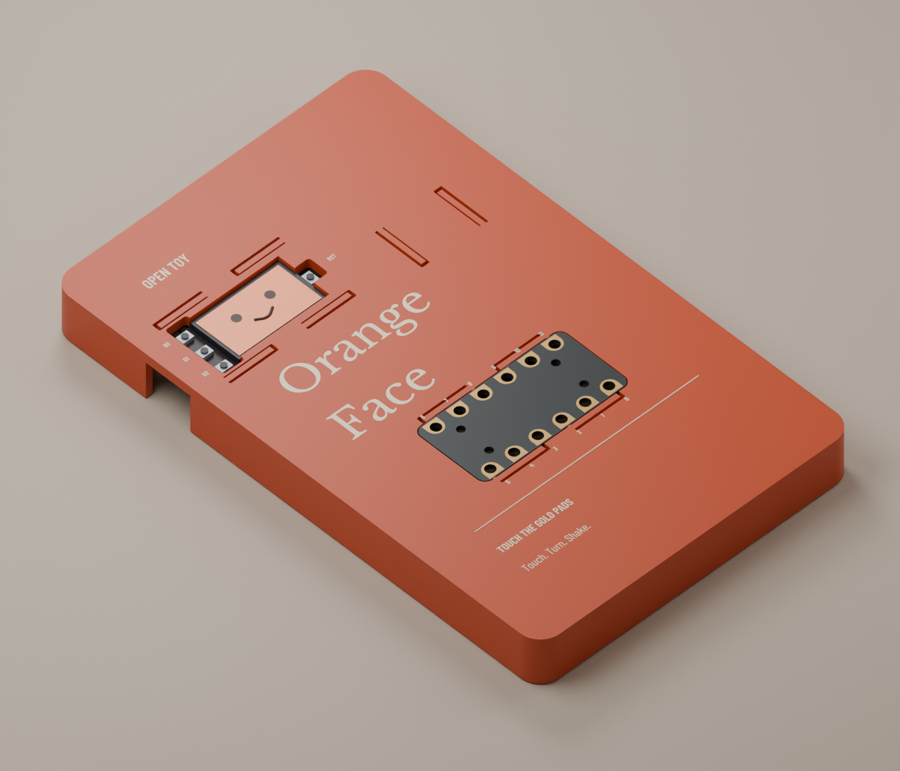
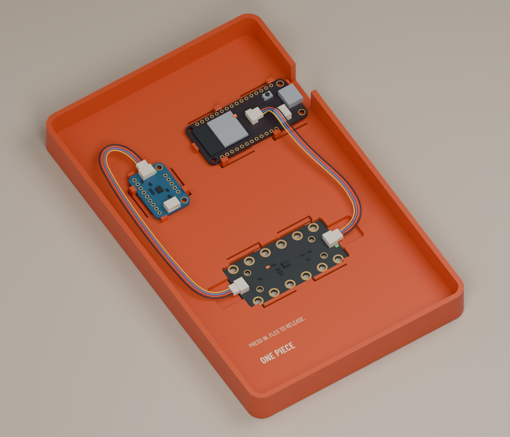
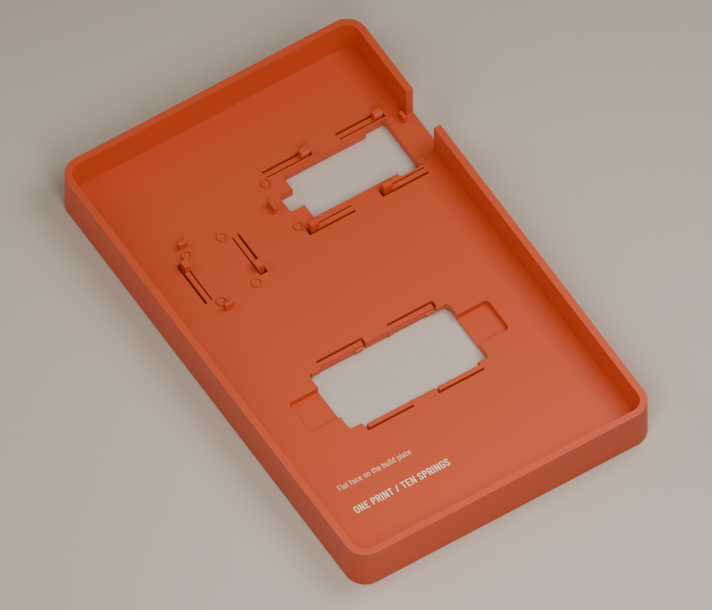
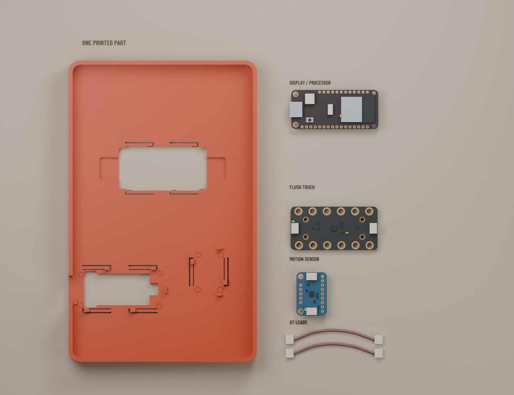
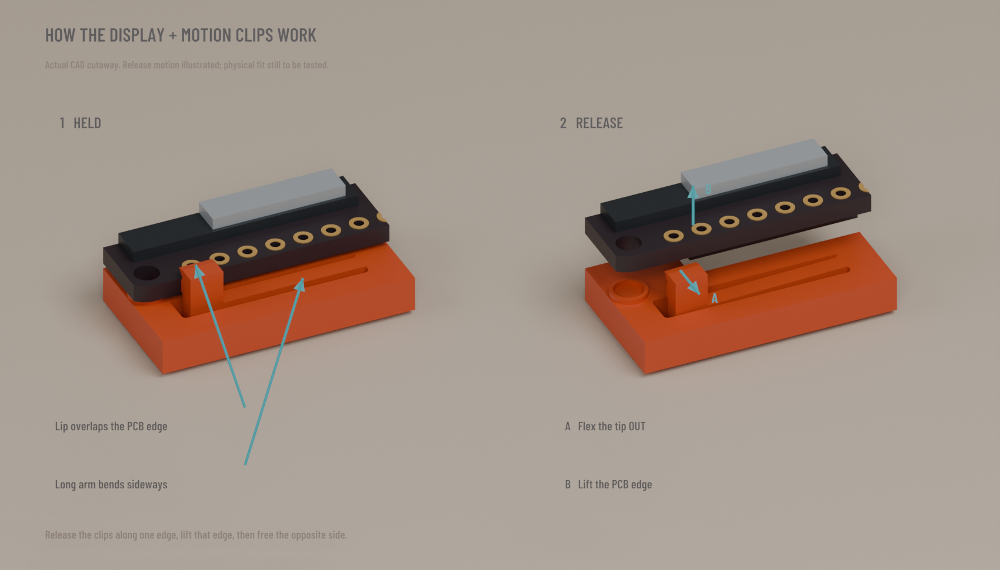

# Orange Face — one-piece printed faceplate

[3D printed designs](../README.md) · [All projects](../../README.md) · [Orange Face firmware and wiring](https://github.com/yury-g/OpenToy-Coursework/tree/feature/orange-face/projects/orange-face)

One printed part holds the **display/processor, touch board and motion sensor**.
Ten flexible fingers grip the PCB edges without screws. The touch surface is
flush with the front; the sockets and cables sit underneath, inside an open-back rim.

**First-fit prototype · CAD and slicing checked · Physical fit not yet tested**

[Print](#print) · [Parts](#parts-and-layout) · [Assembly and removal](#assemble-and-remove-the-boards) · [Edit the design](#edit-the-design) · [Checks](#what-has-been-checked)

<table>
<tr>
<td width="50%" valign="top">

**Front — flush touch surface**

</td>
<td width="50%" valign="top">

**Back — all three boards in the faceplate**

</td>
</tr>
</table>

These are Blender renders. Orange color, lettering, pad labels and
the screen face are illustration; the supplied print has no lettering. The
cutaways illustrate intended operation, not a tested physical mechanism.

## Feather buttons

The front now shows the **real board switches**: **D0 / BOOT, D1 and D2** beside
the screen, with **RST** separately on the other side. Their housings, terminals
and raised black actuators come from Adafruit's STEP model. The shared opening
exposes all three user buttons; there are no extra printed button caps.

D0 is also the boot button. D1 and D2 are programmable inputs; the old minus/plus
labels did not describe fixed hardware functions and have been removed. Reset
restarts the board. See [Adafruit's button guide](https://learn.adafruit.com/esp32-s3-reverse-tft-feather/pinouts).

The actuators are recessed **1.8 mm** below the cover. CAD checks confirm a clear
**7 mm diameter approach** to each user button and **5 mm to Reset**. These are
geometric access checks, not proof of comfortable finger operation. After printing,
press each button individually, confirm it releases freely, and check that holding
D0 while pressing Reset is possible without pressing the screen.

[Button positions and access checks](source/button-checks.json) · [Source and attribution](source/feather-switches.json)

## Print

| Start here | File / settings |
| --- | --- |
| **X1 Carbon print file** | [Download Bambu 3MF with G-code](print/Orange-Face-One-Piece-X1C-PLA.gcode.3mf?raw=true) |
| **Slice for another printer or material** | [Download STL](print/Orange-Face-One-Piece.stl?raw=true) |
| Printer / nozzle | Bambu Lab X1 Carbon / 0.4 mm |
| Material / plate | Bambu PLA Basic / Cool Plate SuperTack |
| Process | 0.16 mm High Quality, four walls, no supports |
| Estimated print | **2 h 20 min · 68 g · one object** |
| Nominal size | **110 × 176 × 16 mm** |

Print with the **flat exterior face on the bed, open back upward**, as supplied
in the STL. The 3MF is for the specific settings above. For a different setup,
re-slice the STL with the correct printer, material and plate profile. Do not
scale the entire part to change the grip. Nothing has been sent to a printer.

[Detailed print and first-fit notes](BUILD-NOTES.md#print)

## Parts and layout

<table>
<tr>
<td width="50%" valign="top">

**The single printed part**

</td>
<td width="50%" valign="top">

**Parts outside the faceplate**

</td>
</tr>
</table>

| Part | Mount / role |
| --- | --- |
| Adafruit Reverse TFT Feather **#5691** | Display faces forward; PCB clips in from the back. |
| Adafruit MPR121 **#4830** | Back electrodes face outward, flush with the cover; sockets face inward. |
| Adafruit LSM6DS3TR-C **#4503** | Motion board clips in beside the display. |
| Two STEMMA QT leads | Connect Feather → touch → motion sensor; route slack inside the rim. |

There is no battery mount in this version. The reference assembly contains the
three boards and leads above. It is an **open-back faceplate**, not a closed case.

## Assemble and remove the boards

1. **Check the cooled print.** Clear strings from the spring slots and seating ledges. Gently check the fingers can flex outward.
2. **Seat the touch board from the front.** Electrodes face outward; components face inward. Rest the PCB on all four ledges and check the surface is flush without rocking. Connect its leads from underneath.
3. **Fit the display and motion boards from the back.** Ease the fingers outward, seat the bare PCB edges on their supports, then release the fingers. Keep pressure off glass, chips and sockets.
4. **Route and test.** Follow the installed rear view above. Keep the lead bend clear of the Feather's battery socket. Check the boards stay seated when gently inverted, USB is accessible, buttons work and all twelve touch pads respond.

### How the clips hold and release

**Disconnect power and leads first.**

- **Display and motion boards:** the small lip overlaps the PCB edge. Use a fingernail or thin plastic pick to flex the tip **away from the board**. Release the clips along one edge, lift that bare PCB edge slightly, then free the opposite side.
- **Flush touch board:** its side fingers provide friction; fixed ledges carry touch pressure. Ease the side grips outward and gently push on bare PCB edge regions from underneath. The board comes **out through the front opening**, not through the rear seat.

The long arms flex sideways within the printed layers. Their nominal relief gap
is 0.8 mm, and the contacts have 0.15 mm interference per side. This is an initial
fit target: do not force a tight board or flex a finger beyond its relief gap.
The release view illustrates motion, not measured travel, force or fatigue life.

[Full assembly, removal and fit-test notes](BUILD-NOTES.md#assemble-and-test)

## Edit the design

| What to open | File |
| --- | --- |
| FreeCAD assembly and faceplate solid | [FreeCAD](cad/Orange-Face-One-Piece.FCStd?raw=true) |
| One faceplate solid for other CAD tools | [STEP](cad/Orange-Face-One-Piece.step?raw=true) |
| Front, installed, empty and loose-parts scenes | [Blender scenes](blender/Orange-Face-One-Piece.blend?raw=true) |
| Editable clip teaching diagram | [Blender close-up](blender/Clip-Removal-Closeup.blend?raw=true) |
| Reproducible builders and reference geometry | [Source guide](source/README.md) |

The FreeCAD spreadsheet records dimensions; it is not a live parametric feature
tree. Change the builder parameters to regenerate a design, then re-slice it.
The motion board's orientation differs from the earlier tray version: check
firmware axis mapping after assembly. This mechanical project does not flash or
change any firmware. Use the [Orange Face chapter on its named feature branch](https://github.com/yury-g/OpenToy-Coursework/tree/feature/orange-face/projects/orange-face)
for firmware and wiring.

## What has been checked

- One valid CAD solid; FreeCAD and STEP reopen at the stated dimensions.
- One connected, watertight STL; no unintended modeled mount, board or cable intersections.
- One sliced object with no supports and a verified G-code checksum.
- The spring relief slots remain open at the sampled first-layer and 1.0 mm toolpaths.

**Still to test:** actual grip, PCB thickness and print tolerance, flushness,
lead stiffness, motion direction and repeated removal. The renders are not
photographs or evidence of a physical assembly test.

[Validation details](verification/Validation.json) · [Slicer report](verification/Slicer-result.json) · [Build notes](BUILD-NOTES.md) · [File checksums](verification/SHA256.json)

Hardware geometry derives from [OpenToy Orange Face](https://github.com/yury-g/OpenToy-Coursework/tree/main/projects/orange-face)
and [Adafruit's MPR121 PCB](https://github.com/adafruit/Adafruit-MPR121-PCB).
[Design license](licenses/CC-BY-SA-3.0.txt) · [Adafruit attribution](licenses/Adafruit-PCB-README.md) · [Other licenses](licenses/)

Feather switch geometry: [Adafruit CAD Parts #5691](https://github.com/adafruit/Adafruit_CAD_Parts/tree/main/5691%20Feather%20ESP32%20S3%20Reverse%20TFT), under the [Adafruit CAD MIT license](licenses/Adafruit-CAD-License.txt).
