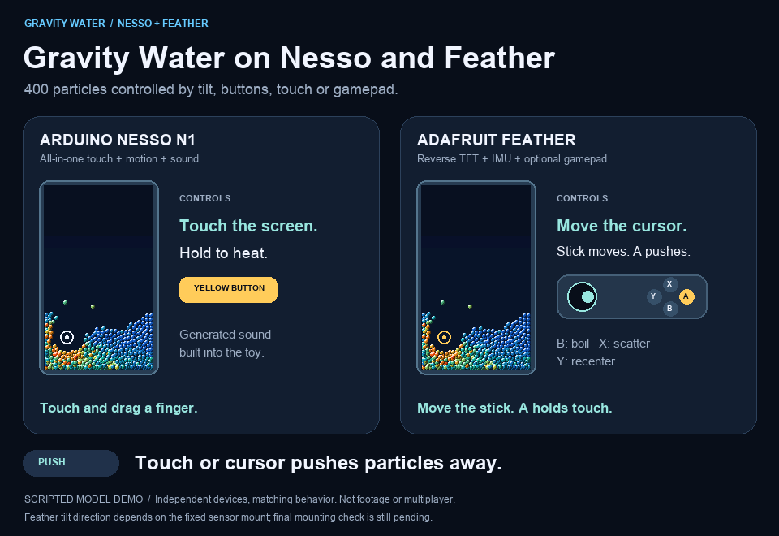
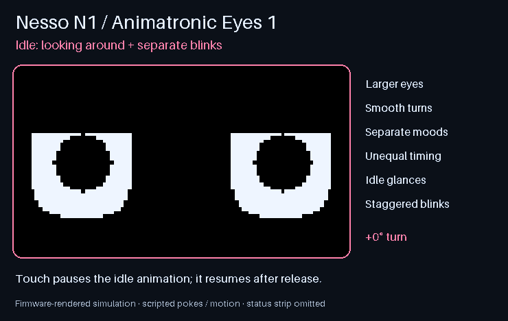
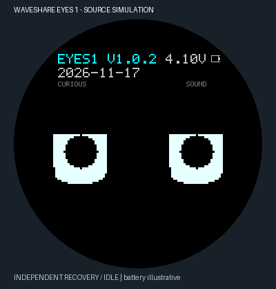
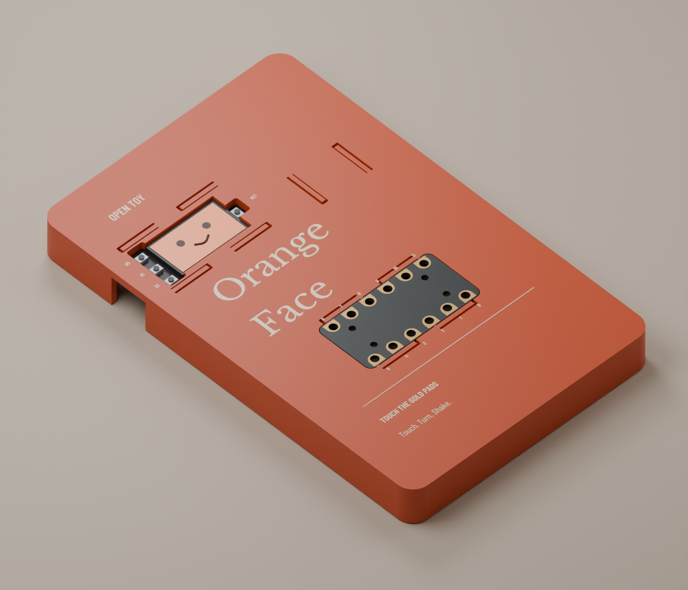

# Project directory

**[Feather](feather/README.md) · [Nesso](nesso/README.md) · [Waveshare 1.85C BOX](waveshare-1.85c/README.md) · [CrowPanel P4](crowpanel/README.md) · [3D printed designs](3d-printed-designs/README.md) · [Archive](../archive/README.md)**

Choose your device or a printed design, open a project, then follow its setup or
assembly guide. Each guide identifies the exact hardware and the files to use.
Firmware for one board is not interchangeable with another board's firmware.

All maintained apps and new ports follow the [OpenToy status-bar standard](../docs/APP-STATUS-BAR.md). Adoption status is tracked separately from existing installations.

Start with the [home-page device/app and control matrices](../README.md). The [shared control language](../docs/CONTROLS.md) uses exposed user buttons and touch menus; BOOT/RESET are reserved for recovery. This directory records source locations, not duplicate live installation status.

The [device-family strategy](../docs/DEVICE-FAMILY-ARCHITECTURE.md) describes how shared apps adapt to different screens, controls and power capabilities, including the new Waveshare ESP32-S3-RLCD-4.2 track. A new track is not yet a tested port.

## Choose where to start

| Preview | Browse | What you will find |
| --- | --- | --- |
|  | **[Feather projects](feather/README.md)** | Display, motion, touch and gamepad projects; each lists its required add-on boards. |
|  | **[Nesso projects](nesso/README.md)** | Projects using Nesso's built-in screen, touch and motion sensor. |
|  | **[Waveshare 1.85C BOX](waveshare-1.85c/README.md)** | Eyes touch/personality port, common status bar and the full catalog compatibility matrix. |
|  | **[3D printed designs](3d-printed-designs/README.md)** | Printable parts, existing CAD renders, assembly instructions and editable models. |

These previews are simulations and CAD renders, not photographs of tested prints.
For XIAO and earlier mechanical work, use the **[archive](../archive/README.md)**.

## Additional device and app tracks

[CrowPanel P4 + optional XIAO](crowpanel/README.md) — V1.0 wiring, recovery and
[per-project compatibility checklist](crowpanel/COMPATIBILITY.md). [Smooth Eyes 0.2.2](crowpanel/EYES1.md) is installed; [verification](crowpanel/EYES1-VERIFICATION.md) records host/live/reset checks and owner feedback. Battery remains unqualified. Other native ports and companion roles remain separate assessments.

[Waveshare 4.2 RLCD](https://github.com/yury-g/OpenToy-Coursework/tree/device/waveshare-rlcd-4.2/projects/waveshare-rlcd-4.2) — device-branch source, reflective-display controls and per-app evidence. **Copy-Face** is a new CrowPanel camera app in development; camera operation and expression copying are not yet confirmed. Its [source and verification](copy-face/README.md) distinguish installed simulation from the pending live-camera path.

## Projects and source locations

Some firmware lives on a named branch or in a separate repository. The links
below distinguish those locations from files included in OpenToy's `main` branch.

| Project | Board | Complete files |
| --- | --- | --- |
| Gravity Water — Feather | Reverse TFT Feather + LSM6DS3TR-C; optional QT gamepad | [OpenToy `feature/gravity-water-feather`](https://github.com/yury-g/OpenToy-Coursework/tree/feature/gravity-water-feather/projects/gravity-water) |
| Orange Face | Reverse TFT Feather + LSM6DS3TR-C + MPR121 | [OpenToy `feature/orange-face`](https://github.com/yury-g/OpenToy-Coursework/tree/feature/orange-face/projects/orange-face) |
| Nearby Buddy | Two Reverse TFT Feathers | [Standalone repository](https://github.com/yury-g/OpenToy-Coursework/tree/main/companions/nearby-buddy/main); [OpenToy chapter](https://github.com/yury-g/OpenToy-Coursework/tree/feature/nearby-buddy/projects/nearby-buddy) |
| Battery Faces — gamepad | Blue Feather | [Battery Faces `feature/seesaw-gamepad`](https://github.com/yury-g/OpenToy-Coursework/tree/main/companions/battery-faces/feature/seesaw-gamepad) |
| Battery Faces — buttons / haptics | Blue + Green Feathers; Tab5 dashboard | [Battery Faces `feature/qwiic-accessories`](https://github.com/yury-g/OpenToy-Coursework/tree/main/companions/battery-faces/feature/qwiic-accessories) |
| Battery Faces — base | Feathers and other documented boards | [Battery Faces `main`](https://github.com/yury-g/OpenToy-Coursework/tree/main/companions/battery-faces/main) |
| Gravity Water — Nesso | Arduino Nesso N1 | [Saved v0.3.0 release](https://github.com/yury-g/OpenToy-Coursework/tree/gravity-water-v0.3.0); [current guide](https://github.com/yury-g/OpenToy-Coursework/blob/feature/gravity-water-feather/projects/gravity-water/README.md) |
| Nesso Face | Arduino Nesso N1 | [OpenToy `feature/nesso-n1`](https://github.com/yury-g/OpenToy-Coursework/tree/feature/nesso-n1/projects/nesso-n1) |
| Animatronic Eyes 1 — eye puppetry | Reverse TFT + QT gamepad; Nesso N1 touchscreen + motion + autonomous idle | [Feather controls](animatronic-eyes/README.md) · [Nesso touch](animatronic-eyes/NESSO.md) · [History](../docs/V1-EYES.md) · [Saved source release](https://github.com/yury-g/OpenToy-Coursework/tree/v1.0.0-eyes) |
| Animatronic Eyes 1 — round touch/personality port | Waveshare ESP32-S3-Touch-LCD-1.85C-BOX-EN V2 | [Source + controls](animatronic-eyes/WAVESHARE.md) · [Compatibility / test matrix](waveshare-1.85c/README.md) |
| Animatronic Eyes 2 — doodle puppetry | Reverse TFT + QT gamepad | [Source + controls](animatronic-eyes/README.md) · [History](../docs/V2-FACE.md) · [Saved source release](https://github.com/yury-g/OpenToy-Coursework/tree/v2.0.0-face) |
| Copy-Face — camera gaze and mouth copying project | CrowPanel DHE04209D V1.0 P4; owner confirms no camera fitted | [Separate app](copy-face/README.md) · [Camera evidence](copy-face/docs/CAMERA-RESEARCH.md) · [Verification](copy-face/VERIFICATION.md); 0.2.0 installed in labeled Simulation, 0.2.1 built; live camera/lips pending |
| Orange Face — one-piece printed faceplate | Reverse TFT Feather + MPR121 + LSM6DS3TR-C; first-fit prototype | [Visual guide, print files and CAD in this repository](3d-printed-designs/orange-face/README.md) |
| XIAO hardware / earlier mechanical projects | Historical targets | [Archive](../archive/README.md) |

The browse folders organize links; implementation folders retain their existing
names so build paths, releases and cross-project includes remain valid. Branch
names in this table are intentional. The standalone Nearby Buddy repository
includes enclosure work beyond the OpenToy chapter. Battery Faces stays in its
own repository; the gamepad and haptic versions are not its `main` checkpoint.

[Organization evidence and preview sources](../docs/PROJECT-ORGANIZATION.md)
