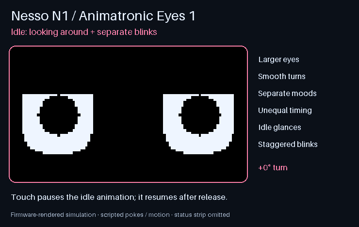

# Animatronic Eyes 1 — Nesso touch



*Firmware-rendered simulation with scripted pokes and motion; status strip omitted.*

Arduino Nesso N1 uses its built-in touchscreen to play the original v1 eyes. The larger eyes fill the available screen while preserving their proportions, with room for angry trembling. Pupils now have twice their original diameter, matching Feather Eyes 1. The happy upper lids are raised so those pupils remain visible, including upward glances. **EYES 1** and the battery indicator turn with the face.

- Leave it alone: both eyes look around and blink automatically. They share a general gaze direction, with small differences in target, response delay and blink timing. Touch pauses the idle animation; it resumes after about 0.9 seconds without a poke.
- Poke either eye: that eye closes, becomes fully angry, and trembles strongly. Its neighbor reacts more mildly and gives a brief sympathetic flinch.
- Release: the poked eye reopens over roughly 0.3–0.4 seconds. Each eye has a separate anger level, trembling rhythm and recovery time. A directly poked eye takes about 6–8 seconds to become happy; its neighbor recovers in about 3 seconds. Repeated pokes vary the timing slightly.
- Sliding between the eyes switches which eye is held closed. Two reported contacts can close both. Pokes elsewhere on the face also cause anger. Touches on the moving status strip do not count as face pokes.

The face follows the measured gravity angle continuously, including diagonal positions and full turns. Shortest-arc easing avoids a jump across the angle boundary. Scaling changes with the angle so the eyes stay inside the display. Touch coordinates use the same transform as the displayed frame. When lying flat, receiving stale readings, or undergoing excessive acceleration, it holds the last useful angle.

The display stays in one fixed hardware orientation; rotation is rendered into its existing framebuffer. The battery stays at the upright viewport’s top right as the viewport rotates. At narrow diagonal angles, its gauge remains visible while the percentage is omitted to avoid overlapping the label.

No gamepad or Mac relay is needed. The Feather versions remain available with their existing controls.

## Build

From this project directory, use Arduino-ESP32 **3.3.10**, M5Unified **0.2.18** and M5GFX **0.2.25**:

```sh
python3 tools/build_nesso.py --build-path /private/path/nesso-eyes-build
python3 tools/check.py
```

The build helper stages the unchanged original v1 renderer and shared bounded USB telemetry code. It compiles only. Keep the resulting image outside Git. If host checks use the full OpenToy runner, its Python environment also needs the existing Bleak dependency; select a working C++14 compiler with `CXX` if necessary.

Before installation, independently identify the **ESP32-C6** and factory MAC, check security and flash size, preserve two matching fresh full-flash reads with a hardware digest, and decode the partition table and active OTA slot. Write only that selected slot, after checking the image fits. Verify the app and unchanged bytes outside its sector-aligned write range. Do not use a stock whole-device upload. Keep recovery files private. On this Mac/Nesso combination, the default 4096-byte flash-read packets stalled on a block whose SLIP-encoded length was exactly 4160 bytes (65 USB packets of 64 bytes). A private reader uses 1024-byte blocks with per-block acknowledgment and verifies each range digest. Changing cables did not resolve the default-reader failure; do not mistake a partial read for a backup.

## Implementation and diagnostics

`firmware/NessoEyes/TouchReaction.h` separates independent timed eye reactions from hardware. `Idle.h` adds bounded autonomous gaze, separate blink schedules and touch priority. `Presentation.h` handles continuous gravity filtering, maximum fitted eye bounds, inverse touch mapping and fixed-point rotation. Original angry, neutral and happy eye/lid shapes are preserved, with the larger pupils clipped inside them; the intervening shapes change the original lid/mask geometry instead of fading images. Host tests check unequal eye reactions, repeated/held pokes, flinches, reopening, monotonic recovery, timer wrap and original endpoint pixel equality. A full 360-angle sweep checks transformed touch, maximum jitter bounds and the actual fixed-point rasterizer.

The app uses the proven Nesso FIFO display path (DMA disabled). FT5x06 at I2C 0x38 is read with checked transactions; coordinates use M5GFX's fixed landscape conversion followed by the displayed face's inverse transform. Failed reads release contact, and samples older than 100 ms cannot hold an eye shut. USB reports use a bounded queue. Serial `?` requests status. `L` or `R` generates a clearly labeled 300 ms synthetic left/right poke; `!` pauses input sampling for 1.5 seconds. These are diagnostic controls and never write flash.

Live installation and physical observations for the installed `1.3.2` build are recorded in [verification](docs/NESSO-VERIFICATION.md). **`1.4.0` source & compiled ESP32-C6 candidate (`Metadata.h`, `NessoMenu.h`, `Presentation.h`, `Nesso.cpp`):** adds the `APP-STATUS-BAR.md` v1.0 header (`EYES1 V1.4.0 2026-11-17` + `BAT XX%` or `BAT --`), rotated `[MENU]` pill, 2-page Common 7-entry Touch Menu turning smoothly across all 360° IMU angles, `0.8 s` top-center Performance restore, and `shared/SoundWake.h` hook while keeping the installed `1.3.2` bench hardware untouched until a scheduled install window.

## Rebuild the animations

From the OpenToy root, install the optional `tools/requirements-animation.txt` in a separate Python environment, then run `python projects/animatronic-eyes/tools/render_family.py` (set `CXX` if needed). The exporter uses the actual reaction, idle, rotation and original Feather renderers. It checks full blinks and unequal moods, decodes both looping GIFs, and saves source/output hashes in `docs/images/animation-manifest.json`. The scenes use scripted inputs; they are not videos of the hardware.
