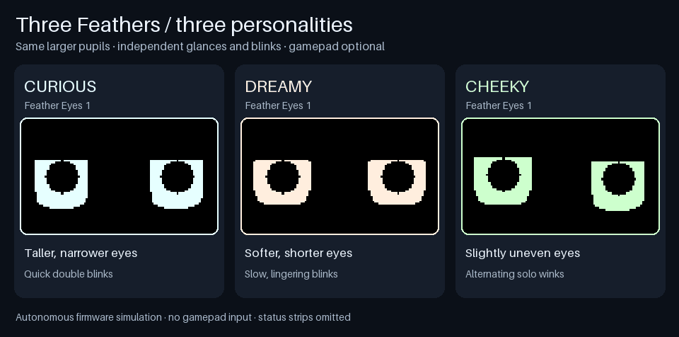
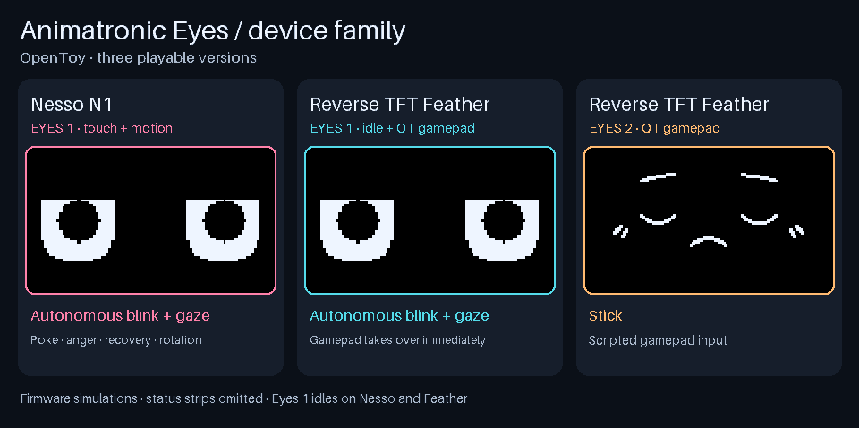

# Animatronic Eyes 1 and 2

**New device track:** [Waveshare 1.85C BOX Eyes 1](WAVESHARE.md) — round display, touch pokes, three personalities, quiet reactions and the common app/version/date/battery status bar. [Compatibility matrix](../waveshare-1.85c/README.md) · [Verification](docs/WAVESHARE-VERIFICATION.md).

[Current installed versions and stopping point](STOPPING-POINT.md) · November 16, 2026

## Three Feather personalities



All three keep the larger **2× pupils**, raised upper lids, independent eye reactions and battery indicator. They play autonomously without a controller; connecting a QT gamepad enables the familiar controls. Each screen shows its personality name.

| Personality | Look | Behavior |
| --- | --- | --- |
| **Curious** | Taller, narrower eyes; cool white | Faster, wider glances and quick double blinks |
| **Dreamy** | Softer, shorter eyes; warm white | Slower, smaller glances; lingering 1.45–1.95 second blinks, right eye leading |
| **Cheeky** | Slightly different left/right proportions; mint white | Off-center eye heights; alternating solo winks with irregular 1–2 second spacing |

*This is a 24-second autonomous firmware simulation with no gamepad input. Status strips are omitted; physical backlight brightness is not simulated. [Current power/build checks](docs/POWER.md) · [Initial three-board verification](docs/PERSONALITIES-VERIFICATION.md).*

## Battery-saving mode and revisions

Personality builds keep the screen visible in **eco mode**: dimmer backlight, 80 MHz CPU, 20 Hz animation updates and screen transfers only when the image changes. The unused NeoPixel supply is off. Battery runtime is not yet measured; see [power options and verification](docs/POWER.md). Use `--power normal` for the earlier brightness/speed.

[Revision and feature history](CHANGELOG.md) records each version and distinguishes measured results from expected improvements.

## Device family



*Firmware-rendered simulations with scripted touch, motion and gamepad inputs. Status strips are omitted; the device frames are illustrations.*

| Device / version | How you play | Behavior |
| --- | --- | --- |
| **Nesso N1 · Eyes 1** | Built-in touchscreen and motion sensor | Larger eyes; smooth upright rotation; poked eye closes and gets angrier; independent trembling/recovery; automatic glances and staggered blinks when untouched |
| **Reverse TFT Feather · Eyes 1** | Optional QT gamepad for personalities; required for classic | Larger eyes; autonomous glances/blinks; separate anger/recovery; manual pupils, eye movement, winks and expressions |
| **Reverse TFT Feather · Eyes 2** | Direct QT gamepad | Spring-animated curved eyes, brows, mouth and jaw |

**Nesso:** [Touch controls, idle behavior and setup](NESSO.md) · [Detailed behavior animation](docs/images/nesso-eyes-behavior.gif). Autonomous idle behavior is available on Nesso and Feather Eyes 1. The three newly connected Feathers run Curious, Dreamy and Cheeky. The earlier Nesso and gamepad Feather installations are retained separately; Eyes 2 remains a selectable firmware version.

## Feather versions

Direct puppetry with an Adafruit Feather ESP32-S3 Reverse TFT (#5691) and Mini I2C Gamepad QT (#5743), connected with STEMMA QT. No Mac/Xbox/BLE relay is needed for play. This OpenToy project has two selectable firmware versions: **Animatronic Eyes 1** (eye puppetry) and **Animatronic Eyes 2** (doodle puppetry). Both remain active in the OpenToy Feather gallery. The saved `v1.0.0-eyes` and `v2.0.0-face` releases remain unchanged.

The Feather display is landscape, 240×135, with a 15-pixel status strip. Nesso and Feather Eyes 1 pupils are now twice the original radius (8 rather than 4 logical pixels), clipped inside the eye shapes. The happy upper lids sit higher and follow upward glances enough to leave the larger pupils visible. Eyes 1 uses the larger fitted Nesso eye framing; it scales down when manual eye-shape travel needs more room. Eyes 2 retains the original 128×64 face enlarged to 240×120. Feather has no built-in motion sensor or touchscreen, so the Nesso rotation and touch inputs are replaced by the existing gamepad controls. Classic `EYES 1` uses a cyan label; the three personality builds show their names. `EYES 2` uses orange. A small battery icon and gauge percentage sit at the top right, matching Gravity Water; `--` means the gauge is unavailable. The percentage is the MAX17048 estimate, not a measured battery-capacity test. The original eye geometry and procedural doodle springs/curves come directly from preserved OpenToy source in `shared/opentoy`.

## Controls

All directions refer to the displayed face. Hold a modifier to use another layer; release returns that layer's continuous offsets to rest. Eyes 1 idles with automatic glances and independently timed blinks after 0.9 seconds without gamepad activity. Stick or button activity takes over immediately. A/X/Y presets stay selected until another choice, a poke or controller loss; B and targeted pokes recover to happy on separate eye timings. Eyes 2 retains its selected emotions.

| Gamepad | Animatronic Eyes 1 | Animatronic Eyes 2 |
| --- | --- | --- |
| Stick | Move pupils | Up/down bends eyes; left/right bends brows |
| Hold Select + stick | Up/down moves white eye shapes | Up/down curves mouth; left/right pulls mouth sideways |
| Hold Start + stick | Left/right winks that eye; up closes both from bottom; down closes from top | Up opens jaw; left/right winks that eye |
| Hold Select + Start | Close both eyes | Blink both eyes |
| A | Happy | Happy |
| B | Both eyes angry; recover to happy after release | Angry |
| X | Surprised | Surprised |
| Y | Neutral | Sorry |
| Hold Select + tap A | Happy | Nervous |
| Hold Select + tap B | Both eyes angry; recover after release | Neutral |
| Hold Select + X | Poke left eye: close, stronger anger and slower recovery | Existing X / surprised preset |
| Hold Select + Y | Poke right eye: close, stronger anger and slower recovery | Existing Y / sorry preset |

The single stick cannot manipulate all original Xbox axes simultaneously. These held layers preserve access to the original face parameters. V1 left/right eye-shape translation remains unused, as in the original mapping. Jaw and winks share the stick here, rather than independent analog triggers. Happy retains its original 25% jaw opening and Surprised 92%; Start + stick up adds to that opening. A roughly 12.5% center dead zone suppresses stick noise.

**`1.4.0` shared-header & Common Menu source candidate (host-tested + target-compiled, not yet flashed onto the `1.3.0` bench boards):** `firmware/AnimatronicEyes/{Metadata.h,FeatherMenu.h}` and `Feather.cpp` migrate Feather Eyes 1 and Eyes 2 to `APP-STATUS-BAR.md` v1.0 (`EYES1`/`EYES2 V1.4.0 2026-11-17` + `BAT XX%` or `BAT --`), qualify onboard active-high `D1` (`GPIO1` Primary: short reaction, `0.8 s` hold opens Menu / restores from Performance) and `D2` (`GPIO2` Secondary: Next / Back), explicitly exclude `D0` (`GPIO0` `BOOT` strap), disambiguate stationary `Select + Start` (`< 0.8 s` quick blink vs `>= 0.8 s` Menu / Performance restore), and integrate volatile-only `shared/SoundWake.h` (reporting mic/speaker add-ons honestly as absent on stock `#5691`).

## Build

Run the commands below from `projects/animatronic-eyes` in the OpenToy checkout.

Pinned board core: Arduino-ESP32 2.0.17, `adafruit_feather_esp32s3_reversetft`, GNU C++14. Libraries: Adafruit GFX 1.12.6, BusIO 1.17.4, ST7735/ST7789 1.11.0, seesaw 1.7.9. Use an external build directory; the helper stages canonical renderers and the Gravity Water bounded telemetry implementation without copying their source into this project.

```sh
python3 tools/build.py --version 1 \
  --config-file /absolute/path/to/arduino-cli.yaml \
  --build-path /private/path/build-v1
# Add --personality curious, dreamy or cheeky for autonomous Eyes 1.
# Omit it (classic) for the earlier gamepad-required behavior.
# Repeat with --version 2 and a different build directory for Eyes 2.
```

On Apple Silicon, older Arduino packages may contain Intel-only ctags/esptool binaries. The helper accepts repeated `--build-property` arguments for `runtime.tools.ctags.path` and `tools.esptool_py.path`; use installed native tools or a Python esptool wrapper. Do not replace another project's ESP32 toolchain.

For the verified November 15–16 bench boards, convert the resulting ELF using the verified TinyUF2-compatible application header:

```sh
python -m esptool --chip esp32s3 elf2image --flash-mode dio \
  --flash-freq 80m --flash-size 4MB --max-rev-full 0 \
  --elf-sha256-offset 0xb0 -o /private/path/face-compatible.bin \
  /private/path/build-v1/AnimatronicEyes.ino.elf
```

This builds an application only. **Do not use stock Arduino Upload or replace the generated partition table.** Identify each board through ROM, inspect security and flash size, preserve a new full-flash backup with a matching hardware digest, decode its partition/OTA selection, and bound the write to that selected application's original slot. The bench boards have different app capacities. Verify the app after writing and verify all flash outside the sector-aligned write range remains unchanged. Keep backups, identity records, compiled files and raw logs outside Git.

## Runtime and checks

Gamepad reads run on core 0, rendering on core 1 at a target 20 frames/s in eco mode or 30 in normal mode. The driver verifies I2C address 0x50 and product 5743 before configuring pins: X ADC14, Y ADC15, active-low A5/B1/X6/Y2/Start16/Select0. Each read is checked, the bus has a 15 ms timeout, and missing controllers are retried every second. Invalid reads or samples 100 ms old clear manual input. The classic gamepad build returns to neutral; personality builds return to autonomous happy play, so they also work without a controller. Reconnection resumes local control. Doodle geometry eases toward neutral through its original spring.

TFT uses the correct board-variant pins, power rail high, rotation 1, SPI 24 MHz, byte-swapped RGB565. USB output uses the existing bounded Telemetry queue, with writes limited to `availableForWrite`; no blocking `printf` calls occur.

`python tools/check.py` includes the original eye/doodle suites and the Feather control mapping/freshness checks. Set `CXX` if the default compiler is unavailable. Serial `?` requests telemetry; `!` pauses input sampling for 1.5 seconds to exercise the stale-input path and automatically resumes. For Eyes 1, `L` and `R` also issue labeled 300 ms synthetic left/right pokes. None of these commands changes flash. There is no wireless update service in this local-control port; future installation uses the same identity-checked app-only procedure.

See [verification](docs/VERIFICATION.md) for measured device results and outstanding physical observations. Historical Mac/Xbox guides: [Face v1](https://github.com/yury-g/OpenToy-Coursework/blob/main/docs/V1-EYES.md), [Face v2](https://github.com/yury-g/OpenToy-Coursework/blob/main/docs/V2-FACE.md).

## Rebuild the personality animation

From the OpenToy root, use the optional Pillow environment described in `tools/requirements-animation.txt`, then run `python projects/animatronic-eyes/tools/render_personalities.py`. The exporter runs the actual autonomous firmware classes, verifies different gaze tempos and active blink counters, and compares decoded GIF pixels with the rendered frames. Source and output hashes are saved in `docs/images/personalities-manifest.json`.
