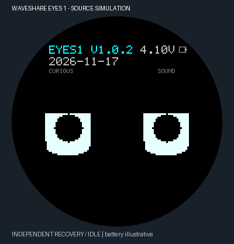
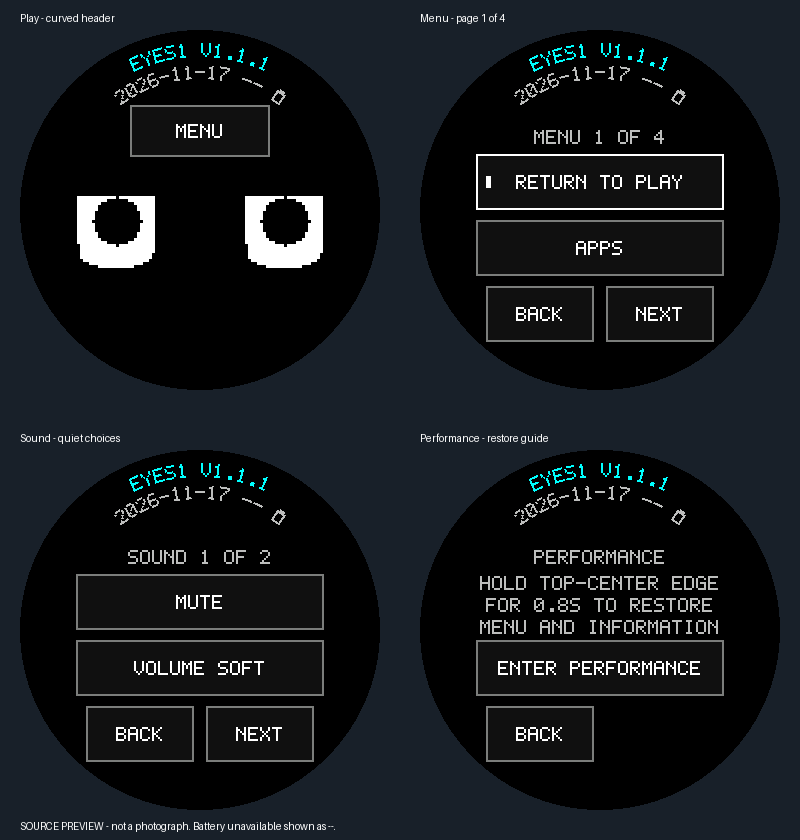

# Animatronic Eyes 1 · Waveshare 1.85C BOX

**Version 1.1.1 · created 2026-11-17 · V2 audio hardware.** Target metadata is canonical in [Metadata.h](firmware/WaveshareEyes/Metadata.h). This is the Waveshare adapter version; Feather and Nesso version numbers remain separate.

[Device family / compatibility matrix](../waveshare-1.85c/README.md) · [Verification record](docs/WAVESHARE-VERIFICATION.md) · [Revision history](CHANGELOG.md) · [All Eyes variants](README.md)



*Source simulation from the actual round compositor and shared Companion logic. The touches and 4.10 V battery reading are illustrative. It is not hardware video.*

## Play

Curious starts by default. Curious double-blinks; Dreamy holds slow closures; Cheeky alternates winks. They retain the existing large pupils, raised happy lids, separate gaze timing, stronger directly poked eye, jitter and independent recovery. No controller is needed.

| Control | Action |
| --- | --- |
| Poke the left or right eye | That eye flinches and gets angrier; its neighbor reacts less and recovers separately. Single-contact touch cannot poke both at once. |
| Tap **Menu** | Open the common menu, initially on **Return to play**. **Next** cycles pages; **Back** returns one level. |
| **Personality** | Select Curious, Dreamy or Cheeky. |
| **Sound** | Mute/unmute; choose Soft or Quiet, both bounded at or below the original quiet level. |
| **Display** | Dim/normal backlight, or Performance with a restore reminder before entry. |
| Performance: hold **top-center edge** for 0.8 seconds | Restore the header and open Menu. Release before resuming play. |
| Restart | Restore visible status, Curious, normal backlight and unmuted Quiet reactions. No boot chirp. |

The Menu target is x110–249/y75–126 (140×52) on the 360×360 display. Menu rows are 248×56 pixels across two-row pages, and Back/Next are 108×56 pixels. Restore is x130–229/y12–67 (100×56), centered at 12 o'clock. A tap starts and releases inside its control; dragging outside cancels even after reentry. Input loss cancels rather than activating a control. Transitions require fresh contact before held play input resumes. BOOT/RESET/EN are never ordinary app controls.

Root order: **Return to play → Apps → Personality → Sound → Display → Controls → About**, across four pages. Apps honestly lists only the current app; more apps require installation. Listening and rotation are not implemented controls. Controls explains the restore gesture; About identifies the app, board and battery.

The header curves **EYES1, V1.1.1, 2026-11-17, measured battery voltage and an outline battery icon** around two concentric circular baselines. Every 14-pixel-high glyph rotates to the local tangent; the raster is cached, so the animation does not recalculate trigonometry per frame. Unavailable/implausible battery reads show `--`; no percentage or charging state is invented. Performance hides all metadata and Menu without moving the eyes or hit targets. Settings are session-only.



*Actual compositor source preview, not a hardware photograph. Battery unavailable is shown as `--`.*

**Migration from 1.0.2:** the old top-cap header toggle and hidden lower-left mute/lower-right personality holds are replaced by the visible menu. Only the top-edge **restore** hold remains in performance. Earlier release records are preserved.

Sound is an 80 ms synthesized chirp with fades, PCM peak ≤900/32767 (Soft ≤450), 45% codec volume and at least 500 ms between triggers. Left and right have different pitches. The amplifier shuts off after each sound through an independent 110 ms timer. Holding an eye does not repeat audio. Audible loudness/clicks still need an owner check; amplitude bounds are not an acoustic measurement.

## Build without uploading

Arduino-ESP32 **3.3.10**, Arduino CLI, Python 3.9+. Vendor display/codec code is included with [Apache-2.0 attribution and changes](firmware/WaveshareEyes/THIRD-PARTY.md). No LVGL, microphone, networking or cloud dependency is added.

```sh
python3 projects/animatronic-eyes/tools/build_waveshare.py \
  --build-path /absolute/private/waveshare-build --revision YOUR_SOURCE_REV
```

The helper stages exact shared sources into a temporary sketch and builds ESP32-S3, DIO/80 MHz/16 MB, OPI PSRAM, native hardware CDC. It does **not** upload. Keep compiled output outside Git. This adapter does not alter the original eye/doodle renderers or other targets' behavior.

## Installation boundary and recovery

Do not use stock Arduino Upload or whole-chip erase. The enrolled board has an original factory application at `0x10000`, capacity `0x300000`; the original bootloader, partition table, NVS, test and speech-model data remain outside the allowed write range. Other devices require their own ROM identity, security, physical flash, selected partition and backup checks.

The current USB bench reading is zero, so the installed header shows `--`. Battery connection/switch state and battery-only operation await physical checking. Measured play-mode cadence under USB stress is about 19.6 frames/s; no battery-runtime claim is made.

The private installer validates the app header/checksum/digest, identifies the enrolled chip through ROM, preserves a current full 16 MiB snapshot and verifies it against a fresh whole-chip hardware digest (reading the whole chip again whenever the prior verified snapshot no longer matches). It preserves the final sector's unused bytes, writes only the bounded application range, reads it back, and verifies all flash outside that range before boot. Device identities, binaries, full backups and raw telemetry remain private.

For rollback, verify this same device and current layout, then restore its own preserved factory application through the same bounded procedure. Full original flash is retained as last-resort recovery evidence; full restoration has **not** been exercised. Never copy another device's NVS or recovery image.

## Diagnostic controls

USB at 115200 baud; single-character commands, no line ending required. `?` reports current metadata, slot, frame/DMA counters, touch reads, lifts/release packet diagnostics, moods, battery and audio state. `N` opens Menu, `B` goes Back, `>` goes Next, and `a`/`b` tap the two current menu rows through the same input model. `H` enters performance or restores Menu; `M` toggles mute, `1`/`2`/`3` select personalities. `L`/`R` apply a bounded 300 ms synthetic poke; `!` pauses touch sampling for 1.5 seconds to check stale-input behavior. Synthetic commands are not proof of physical touch. Diagnostics are bounded and request-only; there are no periodic screen labels or automatic metadata popups.

The firmware keeps the microphone input and radios off. There is no gravity rotation, gamepad, launcher, OTA or network service in this installation.
