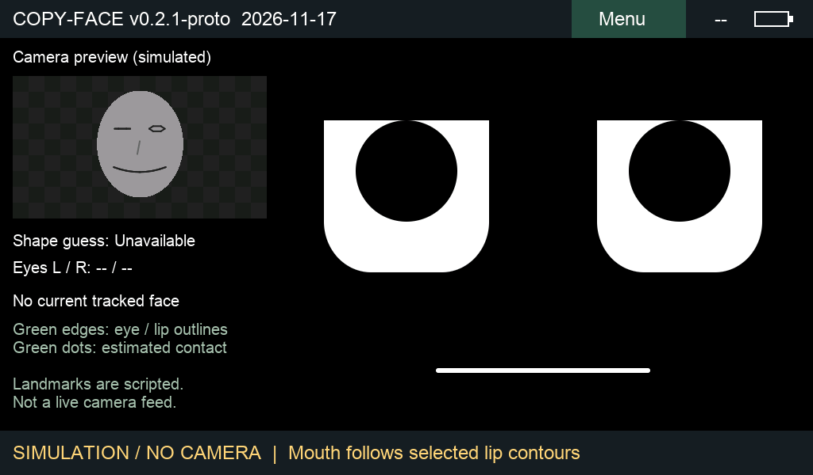

# Copy-Face

A separate OpenToy app for eyes that follow a visible face and a mouth that
copies visible lip geometry when a suitable tracker is available. First target:
**Elecrow CrowPanel Advanced 9-inch DHE04209D V1.0 / ESP32-P4**, 1024×600.
Animatronic Eyes keeps its own name and project.

**0.2.1-proto — 2026-11-17:** local camera capture and five-point face detection
are integrated. Detailed **live lip copying and eye activity remain unavailable**.
The live mouth stays neutral. The owner confirmed no camera is connected to the
panel; installed0.2.0 is left in labeled Simulation, and0.2.1 is built only. See [verification](VERIFICATION.md) for the separate
build, installation and physical-camera evidence.



*Explicit simulation: scripted lip contours, eye activity and gaze, rendered with
the actual C++ renderer. Header/text annotation is simulated. This is not camera
footage, a device recording or a performance measurement.*

[Project directory](../README.md) · [Design](docs/DESIGN.md) ·
[Camera/model evidence](docs/CAMERA-RESEARCH.md) · [Verification](VERIFICATION.md) ·
[Revision log](CHANGELOG.md) · [CrowPanel hardware track](../crowpanel/README.md)

## Camera and mouth view

The small developer preview shows local camera pixels, a green selected-face box
and the five genuine detected points (eyes, nose, mouth corners). Capture,
inference and drawing run separately. Image and overlays come from the same
frame; stale observations cannot keep controlling the toy. No real lip contact,
smile/frown or eye-open/closed result is invented from these five points.

A separate bottom mouth area accepts nine matched upper/lower lip samples.
Its explicit simulation demonstrates smile, frown, neutral and open shapes,
asymmetric curves, and a single estimated contact line where the lip samples
meet. Open sections draw two edges. Contact is a geometric tolerance, not proof
of physical touching. Shape labels describe visible geometry, not feelings.
A validated live lip-contour adapter remains required to drive this from camera.

## Controls

The default header shows COPY-FACE, version, creation date, **Menu** and battery
`--`. Menu follows the [family controls](../../docs/CONTROLS.md): Return to play,
Apps, Personality, Sound, Display, Controls, About. Unavailable capabilities are
explained in their pages. Display contains Performance, Debug preview, Mirror
and an explicitly labeled simulation switch. Performance hides the interface;
hold the top-center edge for 0.8 seconds to restore the menu. Reboot restores the
normal live view. Simulation remains marked even in Performance.

UART developer diagnostics: `?` status, `H` Performance/menu, `M` mirror,
`D` simulation/live. `C` explicitly exports one RAM preview frame over UART for
private diagnostics; there is no automatic image recording or network upload.
Do not publish diagnostic camera images. BOOT/RESET are recovery controls only.
Physical touch and orientation acceptance are listed separately in verification.

## Build and preview

From the repository root:

```sh
python3 projects/copy-face/tools/check.py
python3 projects/copy-face/tools/render_preview.py
```

Preview export needs a C++14 compiler and Pillow 12.0.0. Its manifest records
source hashes and synthetic timing. With ESP-IDF **5.4.2** activated:

```sh
python projects/copy-face/tools/build.py --work /private/path/copy-face-build
```

The complete pinned camera/display dependencies and revision-specific SC2336
configuration are documented in [camera lock notes](locks/camera-notes.md).
Models reside inside the application; no model partition is added.

This script only compiles. **Do not run IDF's printed whole-device flash command.**
Installation requires explicit hardware ownership, verified identity, recovery,
live layout and an application-only update preserving every other flash byte.
Keep backups, binaries and raw logs outside Git. The external XIAO is unnecessary.

Battery sensing remains unqualified even when a battery is attached. Later sound
responses follow the [roadmap](../../docs/ROADMAP.md). No identification, emotion
inference, automatic recording or cloud processing is implemented.

## Future camera source: XIAO ESP32-S3 Sense

The owner has a Sense with a camera. It is a viable candidate for a separate
local camera node: [Seeed documents a live camera web stream](https://wiki.seeedstudio.com/xiao_esp32s3_camera_usage/).
This does **not** establish a working CrowPanel camera link. Evaluate transport,
frame age, decoding, power isolation and recovery before connecting or flashing
either board. Keep the Sense camera on its own supported interface. A compatible
CrowPanel MIPI camera is the direct alternative; verify exact module/cable first.
Dense lip/eyelid inference is a separate requirement whichever source is used.
This is roadmap work, not an installed feature.
