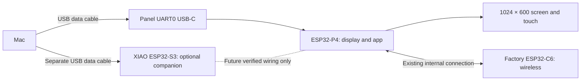

# CrowPanel P4 device family

**Elecrow CrowPanel Advanced 9-inch ESP32-P4, DHE04209D, V1.0.**
This track belongs to OpenToy. It covers the panel, its optional Seeed XIAO
ESP32-S3 companion, recovery, project ports and their verification.

[All projects](../README.md) · [Project checklist](COMPATIBILITY.md) ·
[Wiring evidence](HARDWARE.md) · [Build baseline](BUILDING.md) · [Revision log](CHANGELOG.md)

**Start here: [Eyes 1 controls and setup](EYES1.md).** The last verified standalone Eyes
installation is **0.2.2**. Hardware is now released to Copy-Face; [0.3.0 common
Menu/performance controls](MENU.md) are a source/build candidate awaiting handback. It uses the CrowPanel's UART0 USB cable and touchscreen;
XIAO is not needed. Keep the boards physically separate. See the
[verification record](EYES1-VERIFICATION.md) for measured results and observation gaps.

## First USB connection

With all power disconnected, remove the XIAO from the panel's add-on socket.
Keep the boards physically separate for initial identification and backups.

| Cable | Mac connection | Board connection |
| --- | --- | --- |
| 1 | USB data port | CrowPanel USB-C marked **UART0**; panel POWER switch ON |
| 2 | USB data port | XIAO's own USB-C, while removed from the panel |

Leave the CrowPanel's USB 2.0 socket unused during this initial check. The
manufacturer documents it as an additional panel power input when screen load
exceeds the programming connection's supply. This is different from powering
an inserted XIAO through its USB socket. Do not infer permission for that from
the panel's dual-USB instructions. [Power and programming evidence](HARDWARE.md).

*Connection diagram, not a hardware test result. The dotted connection is not
installed or approved. The onboard C6 and the external XIAO are different chips.*

## Current checkpoint — 2026-11-17

- Owner confirmed **V1.0** and separate USB cables with the XIAO removed.
- Work uses its own checkout and branch. The Waveshare, Nesso and Feather
  targets owned by other tracks are excluded from hardware operations.
- XIAO ROM identification succeeded: ESP32-S3, revision 0.2, 8 MiB flash;
  security flags reported zero. Two full 8 MiB reads match each other and the
  device digest; its partition table and selected app were decoded privately.
- CrowPanel connection works after enabling the official WCH driver. P4 ROM
  identification succeeded: chip revision 1.3, 16 MiB flash, security flags zero.
  Two full 16 MiB reads match each other and the device digest; the original
  factory app and partition layout are saved privately. Enrollment made no flash writes.
- The manufacturer's screen example builds with ESP-IDF v5.4.2; it was not
  installed. Native OpenToy Eyes 1 0.2.2 subsequently built and was installed
  through a verified application-only write. Live checks pass; owner screen/touch
  observation is tracked separately. Other project suitability remains an assessment.

## First port and shared presentation

The first native port is **Animatronic Eyes 1** on the P4 using the panel's touchscreen.
Follow the shared [device-family strategy](../../docs/DEVICE-FAMILY-ARCHITECTURE.md):
reuse app behavior and adapt the display, inputs and power to verified hardware.
The XIAO is not required for local animation or touch. Reuse the preserved
renderers and reactions; adapt the display and input layers. Keep Curious,
Dreamy and Cheeky behavior distinct, with large 2× pupils, raised lids,
independent blinks and anger/recovery, and a visible eco presentation.
Do not copy Feather clock or backlight settings into the P4 without testing.

Every new build must implement the shared [app status bar](../../docs/APP-STATUS-BAR.md):
app name, installed version, that version's creation date and local battery at
right, on by default and deliberately hideable/restorable for performance.
Use readable text on the 9-inch screen. Unknown battery information is `--`;
neither a charger circuit nor the XIAO's power state establishes panel charge.

## Recovery before replacement

1. Identify the actual target through its own ROM: P4 for the panel, S3 for the
   XIAO. USB descriptions and paths are selection clues, never final identity.
2. Inspect security and physical flash size; save two fresh matching full reads
   and check a device digest where supported. Preserve existing recovery copies.
3. Decode the live bootloader, partition table and selected application/OTA
   state. Do not assume a Feather/XIAO layout applies to the panel.
4. Build outside Git. Only install a compatible image within the selected
   application slot, after checking capacity and image/chip compatibility.
5. Verify readback and unchanged bytes outside the sector-aligned write range.
   Preserve bootloader, partitions, OTA state, NVS, filesystems and recovery.

No routine whole-chip erase, stock whole-device upload or automatic update of
the factory C6. Stop before writes if compatible application-only installation
cannot preserve the live layout. Backup verification does not establish a tested
restore; restoration has not been exercised on either board in this track.
Never publish identities, backups, credentials, compiled firmware or raw logs.
