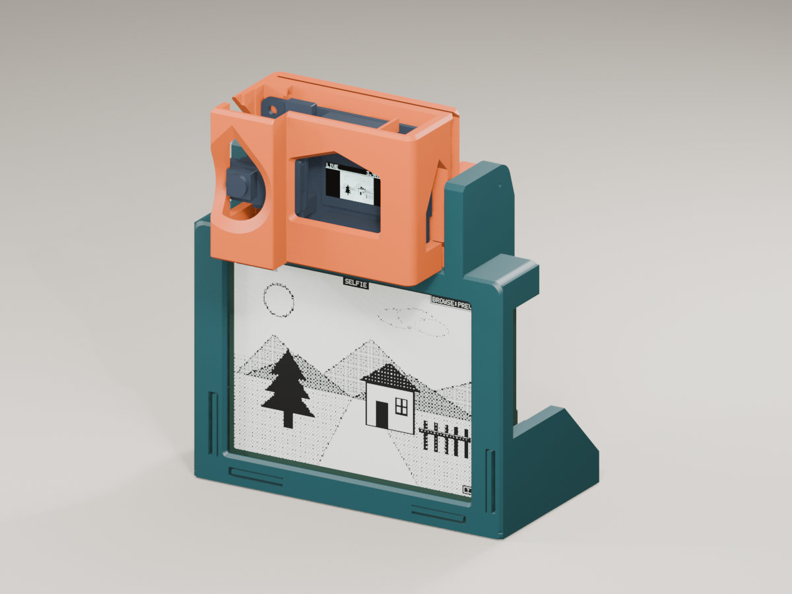
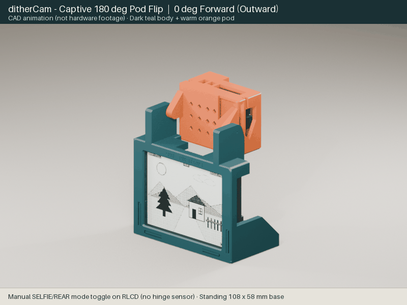
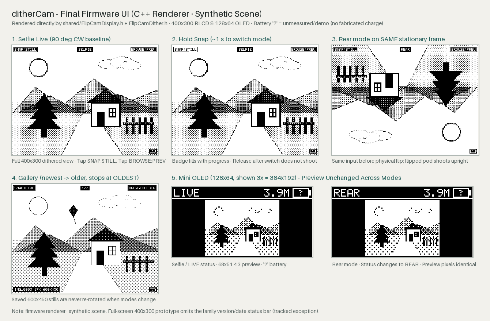

# ditherCam — Two-Board Wireless Flip Camera

[All projects](../README.md) · [3D enclosure & assembly](../3d-printed-designs/ditherCam/README.md) · [Public assembly webpage](https://dithercam-assembly.narwhal2025.chatgpt.site) · [Development log](docs/DEVELOPMENT-LOG.md) · [Visual history](docs/visual-history.md)

A monochrome point-and-shoot camera with a flip-over camera pod, a large reflective viewfinder and a small preview screen. The two boards talk directly over Wi-Fi; photos save to internal flash.

<table>
<tr>
<td width="50%" valign="top">

**Standing Selfie pose (180°)**

</td>
<td width="50%" valign="top">

**Captive 180° pod flip**

</td>
</tr>
</table>

*CAD renders above (`not hardware footage`) combine the exact enclosure STLs with the C++ firmware UI on a synthetic scene.*

---

## What it is

- **Two-board wireless camera:** Built from a **Waveshare ESP32-S3-RLCD-4.2** display board and a **Seeed Studio XIAO ESP32-S3 Sense** (`OV2640` camera) plugged into a **Seeed Expansion Base** (`0.96"` OLED and buzzer).
- **One captive print:** A print-in-place captive PLA enclosure holds the upright display cradle and a pivoting top pod that flips 180° between Selfie and Forward shooting without screws or glue.
- **Full-screen reflective viewfinder:** The 400 × 300 monochrome screen fills edge-to-edge with ordered dithering and compact overlay badges (`SNAP`, `SELFIE` / `REAR`, `BROWSE`, and battery icon).
- **Photos only, internal flash storage:** Captures save as `600 × 450` grayscale JPEGs directly to onboard flash—no SD card needed, up to 256 photos per board (subject to free flash). Video and microphone recording are disabled.
- **Mini OLED preview:** The Expansion Base OLED (`128 × 64`) displays a letterboxed preview, free flash, and `LIVE` / `REAR` status.

---

## Final firmware UI

*`firmware renderer · synthetic scene` — Rendered directly by [`shared/FlipCamDisplay.h`](shared/FlipCamDisplay.h) and [`shared/FlipCamDither.h`](shared/FlipCamDither.h). Panel 3 applies the 180° `REAR` transform to the **same** unflipped test input to show the software rotation (when the pod is physically flipped outward and `REAR` is selected, the resulting photo is upright). Battery icons show `?` where unmeasured.*

---

## Controls

| Input | Action | Notes |
| --- | --- | --- |
| **RLCD `KEY` (`Snap`) — tap** | Take photo (live) / Return to live (gallery) | Saves `600 × 450` grayscale JPEG; brief pause during capture |
| **RLCD `KEY` (`Snap`) — hold ~1 s** | Toggle **`SELFIE` / `REAR`** (live only) | Badge shows hold progress; releasing after switch does not shoot; no-op in gallery |
| **RLCD `BOOT` (`Browse`) — tap** | Browse saved photos newest → older | Stops at `OLDEST` (no wraparound, no menus, no hold action) |
| **Expansion Base `D1` — tap** | Save photo directly on camera board | Separate XIAO flash store; hold disabled |
| **RLCD `PWR`** | Hardware power latch | Power control only |

> [!NOTE]
> **Prototype exceptions:** `RLCD Browse` uses `BOOT` (`GPIO0`) per owner request as an explicit exception to [OpenToy's shared control rules](../../docs/CONTROLS.md), and the full-screen viewfinder omits the [family version/date status bar](../../docs/APP-STATUS-BAR.md).

---

## Manual mode & orientation

- **No hinge sensor:** Flip the pod manually between Forward (`0°`) and Selfie (`180°`), then hold `Snap` for ~1 s to switch **`SELFIE` ↔ `REAR`**. Mode persists across restarts.
- **90° CW baseline + Rear 180°:** `SELFIE` uses the confirmed 90° CW baseline. Selecting `REAR` rotates the RLCD live preview and **newly saved** photos by an additional 180° while keeping overlay labels upright.
- **OLED & old photos stay fixed:** The mini OLED preview and text orientation remain unchanged (`LIVE` → `REAR` status label only), and previously saved photos are never re-rotated when changing modes.

---

## Engineering appendix & guides

| Topic | Where to go |
| --- | --- |
| **Development log** | [Stage-by-stage design & firmware history](docs/DEVELOPMENT-LOG.md) |
| **Visual design history** | [All 23 preserved historical mockups & CAD studies](docs/visual-history.md) |
| **3D print & assembly** | [Enclosure print & assembly guide](../3d-printed-designs/ditherCam/README.md) · [Public assembly webpage](https://dithercam-assembly.narwhal2025.chatgpt.site) · [Offline assembly HTML](../3d-printed-designs/ditherCam/assembly/index.html) · [Offline 3D flip viewer](../3d-printed-designs/ditherCam/index.html) |
| **Hardware references** | [Waveshare ESP32-S3-RLCD-4.2](../../hardware/waveshare-rlcd/README.md) · [XIAO ESP32-S3 Sense](../../hardware/xiao/README.md) |
| **Build, protocol & checks** | [Setup, pairing & partitions](docs/SETUP.md) · [USB & FMB1 protocol](docs/PROTOCOL.md) · [Verification & bench status](docs/VERIFICATION.md) · [Third-party licenses](docs/LICENSES.md) |

*Note: the OpenToy GitHub repository is private (repository access required for source links); the standalone [assembly guide webpage](https://dithercam-assembly.narwhal2025.chatgpt.site) is public.*
