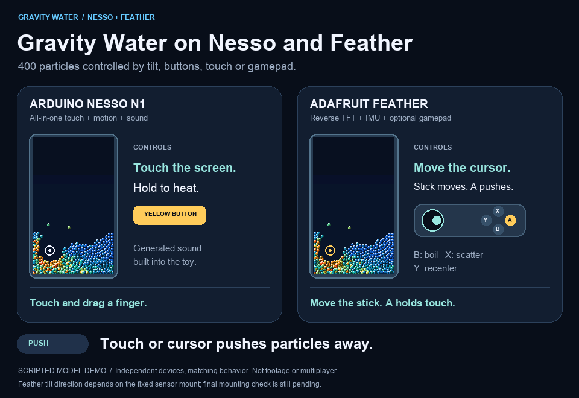
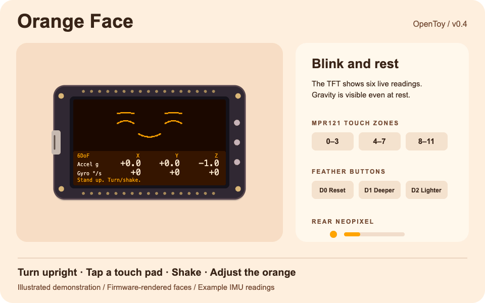
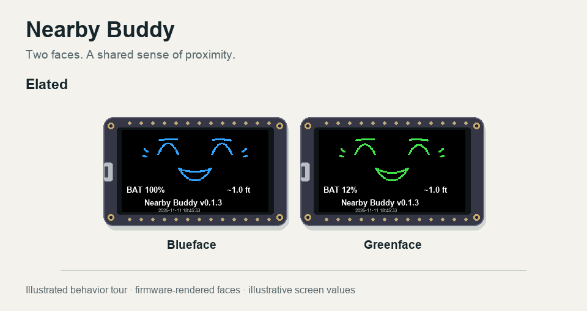
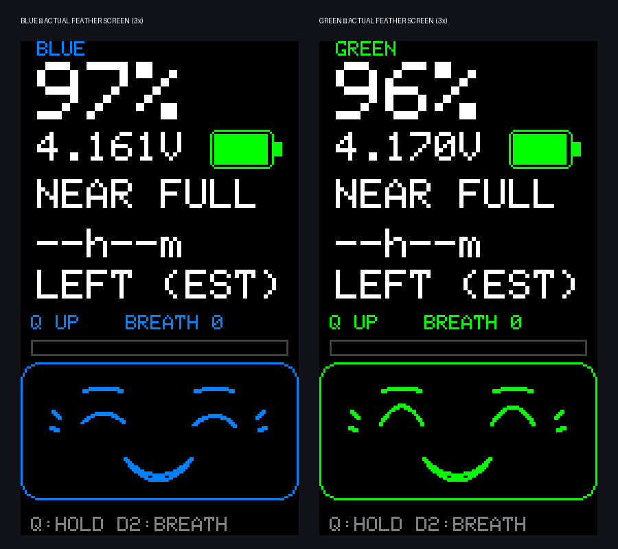
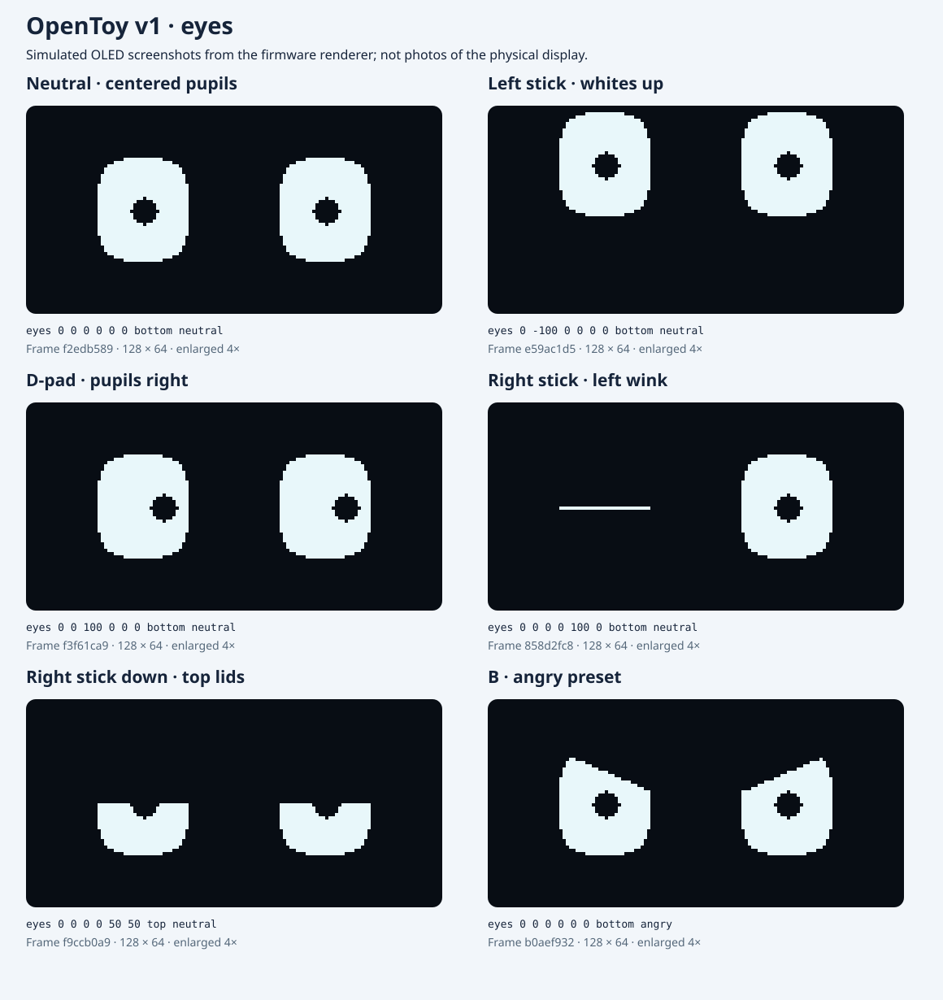
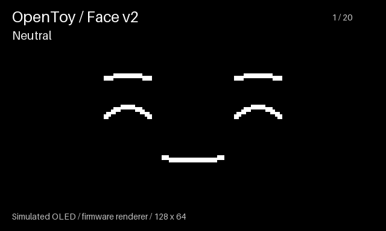

# Feather projects

Browse the active Feather projects below. Gravity Water, Orange Face, Nearby
Buddy and the Blue/Green Battery Faces use the **Reverse TFT Feather #5691**.
Face v1 and Face v2 are also Feather projects. Open each guide for its controls
and version-specific build notes.

[All projects](../README.md) · [Nesso](../nesso/README.md) · [Archive](../../archive/README.md)

| Preview | Project | Hardware / source |
| --- | --- | --- |
|  | **Gravity Water** — particles, heat, shake and gamepad cursor | LSM6DS3TR-C + optional QT gamepad. [Setup](https://github.com/yury-g/OpenToy-Coursework/blob/feature/gravity-water-feather/projects/gravity-water/FEATHER.md) · [Source](https://github.com/yury-g/OpenToy-Coursework/tree/feature/gravity-water-feather/projects/gravity-water) |
|  | **Orange Face** — motion and touch reactions | LSM6DS3TR-C + MPR121. [Setup](https://github.com/yury-g/OpenToy-Coursework/blob/feature/orange-face/projects/orange-face/README.md) · [Source](https://github.com/yury-g/OpenToy-Coursework/tree/feature/orange-face/projects/orange-face) |
|  | **Nearby Buddy** — paired proximity faces | Two Feathers. [Standalone project](https://github.com/yury-g/OpenToy-Coursework/tree/main/companions/nearby-buddy/main) includes enclosures. |
|  | **Battery Faces** — battery information and accessories | Blue / Green Feathers. [Gamepad](https://github.com/yury-g/OpenToy-Coursework/tree/main/companions/battery-faces/feature/seesaw-gamepad) · [Qwiic buttons + haptics](https://github.com/yury-g/OpenToy-Coursework/tree/main/companions/battery-faces/feature/qwiic-accessories) · [Battery-only](https://github.com/yury-g/OpenToy-Coursework/tree/main/companions/battery-faces/main) |
|  | **Animatronic Eyes 1 — eye puppetry** — eyes, pupils, blinks and winks | Reverse TFT + QT gamepad. [Source + controls](https://github.com/yury-g/OpenToy-Coursework/tree/main/projects/animatronic-eyes) · [History](../../docs/V1-EYES.md) · [Saved release](https://github.com/yury-g/OpenToy-Coursework/tree/v1.0.0-eyes) |
|  | **Animatronic Eyes 2 — doodle puppetry** — eyes, brows, mouth and expressions | Reverse TFT + QT gamepad. [Source + controls](https://github.com/yury-g/OpenToy-Coursework/tree/main/projects/animatronic-eyes) · [History](../../docs/V2-FACE.md) · [Saved release](https://github.com/yury-g/OpenToy-Coursework/tree/v2.0.0-face) |

These are separate firmware projects. A project's documented checkpoint does not
mean it is still installed on a board that has since been used for another project.
Battery Faces also supports other hardware; its color names identify roles in
that project. Its Orange / StickS3 role is separate from the **Orange Face**
Feather application above.

[Preview sources and organization record](../../docs/PROJECT-ORGANIZATION.md)

Face v1 and Face v2 now share a [direct Feather/QT gamepad port](../face-feather/README.md), with separate builds preserving each original renderer.
