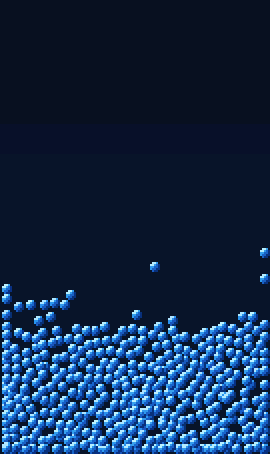

# Gravity Water · development guide

[Visual app guide](README.md) · [Install](INSTALL.md) · [Stopping point](STOPPING-POINT.md)

Turn a Nesso N1 and watch hundreds of tiny droplets tumble toward the bottom.
Hold the yellow user button to heat them, shake to scatter them, or brush the
touchscreen to push them aside. Colors run from cool blue through teal and yellow
to hot orange/red; a generated sound texture follows the activity.
Each bead has its own position and motion; the pool can break apart and settle
again. About one-third of the bottle is filled. A fixed 13-pixel top bar contains
the battery and a tiny face. This is a separate chapter from [Nesso Face](https://github.com/yury-g/OpenToy-Coursework/blob/feature/nesso-n1/projects/nesso-n1/README.md).

The owner chose the aesthetic of [UnityCoder's Water Particles](https://unitycoder.com/blog/2013/04/12/water-particles-unity/):
visible individual blue beads and loose droplets. This implementation is original
C++; it does not import that demo's code or assets. The initial connected-surface
experiment was replaced after the owner clarified the intended look.



*Host simulation using the same particle solver and bead renderer. The battery
bar is omitted; this is not footage of the physical Nesso.*

## What it does

- **400 small shaded beads** collide, tumble and retain a little momentum after a
  turn. After input stops and the pool stops travelling, it freezes in place to
  eliminate idle solver bubbling. Tilt, touch, heat and shaking wake it promptly.
- **Hold the yellow user button (M5 BtnA / KEY1)** to build heat and upward boiling
  kicks. Heat reaches maximum in about 0.37 seconds and drops to zero within
  0.22 seconds after release at 60 physics steps/sec. Remaining motion damps out.
- **Touch and drag** to repel beads within 24 pixels of your fingertip.
- **Shake like a snow globe.** A separate motion detector adds a bounded scatter
  kick immediately on the next displayed frame, including forward/back shaking.
  It is an artistic response, not an inertial fluid model.
- **Color follows activity:** each particle blends its speed with the shared heat,
  retaining shaded highlights throughout the blue-to-red palette.
- **Generated sound:** filtered noise plus a low triangle undertone mixes heat,
  motion and touch in one 8 kHz stream. It fades to silence at rest. The small
  built-in buzzer limits bass reproduction. A 2 kHz timer callback averages four 8 kHz synthesis samples and
  drives 31.25 kHz PWM on the buzzer pin. Smooth startup/shutdown avoids abrupt
  duty changes, and the timer skip policy limits catch-up after delays. No sound files, decoding, runtime allocation or DMA audio queue.
- The amount is conserved by keeping the same particles. The settled pool is
  approximately one-third of the available area; temporary spreading, overlap,
  droplets and gaps change its visible outline.
- Near-flat tilt reduces the in-plane gravity smoothly. Tiny noisy readings do
  not spin the direction; the particles coast and damp down.
- The face smiles at 70% battery or above, is neutral in the middle, and frowns at
  15% or below. Unknown battery reads show `--`. The bar stays at the same screen
  edge through turns.

This is a lightweight **2D particle approximation**, chosen for Nesso's ESP32-C6.
A fixed-point solver and a spatial grid check nearby particles, avoiding an
all-pairs search. One collision-relaxation pass approximates soft round droplets.
Five-pixel bead sprites provide the bright highlights and colored shaded edges.
It is deliberately granular, not a continuous surface or a physically accurate
water solver. There is no full SPH model, surface tension or 3D renderer.

## Shared behavior and Nesso-specific code

| File | Responsibility |
| --- | --- |
| [`src/fluid/Particles.h`](firmware/GravityWaterNesso/src/fluid/Particles.h) | Portable fixed-point particle positions, velocities, neighbor collisions, boundaries and conserved count; no Arduino, screen, sensor, heap or clock dependencies. |
| [`src/fluid/Gravity.h`](firmware/GravityWaterNesso/src/fluid/Gravity.h) | Portable continuous direction and in-plane strength filter, including near-flat noise handling. |
| [`src/fluid/Motion.h`](firmware/GravityWaterNesso/src/fluid/Motion.h) | High-pass acceleration and gyro-speed triggers for bounded artistic shake kicks. |
| [`src/fluid/TextureSound.h`](firmware/GravityWaterNesso/src/fluid/TextureSound.h) | Portable integer noise/tone mixer with bounded amplitude and a smoothing envelope. |
| [`NessoAxes.h`](firmware/GravityWaterNesso/NessoAxes.h) | The Nesso sensor-to-screen mapping. Rotation 0 upright was measured as approximately +X acceleration; screen-down is `(ay, ax)`. |
| [`NessoPixels.h`](firmware/GravityWaterNesso/NessoPixels.h) | Nesso bead palette and RGB565 pixel rendering, also used by the host preview. |
| [`Nesso.cpp`](firmware/GravityWaterNesso/Nesso.cpp) | BMI270 configuration and task, battery bar, M5GFX screen transfer, scheduling and USB timing. |

Other OpenToy devices should supply their own sensor/display adapter and choose
appropriate particle count and viewport sizes. Those ports are deferred.

The BMI270 is configured and read back at a nominal 200 Hz. Only fresh acceleration
samples count; gyro-only data and polls do not. A dedicated sensor task keeps
sampling independently of drawing and owns the shared I2C bus. It also reads
touch and button state every 10 ms, and battery state every two seconds. Useful tilt has a 16 ms direction-filter time
constant. Below 0.06 g in-plane the last direction is held; direction response
ramps up through 0.24 g. Force strength follows the in-plane acceleration with a
25 ms time constant. Shaking/translation also affects it: there is no absolute
orientation estimate with gyro fusion in this first chapter.

Screen updates cover the union of the old and new particle rows; the battery
bar transfers only when it changes. Host checks compare these partial updates
with full frames to catch trails and missed color changes.

The display bypasses the DMA transfer path after a confirmed FIFO wait stalled
both the old and new apps on this bench. SPI FIFO transfers keep the screen moving
but cost more CPU time. Touch uses its separate I2C connection without interrupting
display transactions. These changes do not guarantee that every hardware fault
can recover automatically.

Physics targets 60 steps/sec with a maximum three-step catch-up per displayed
frame. Under overload, it drops accumulated time instead of blocking indefinitely;
actual step rate must be measured. Missing sensor data removes gravity after
100 ms while particles coast and settle, and shows `IMU?` in the bar.

## Build and host checks

Development versions: Arduino-ESP32 **3.3.10**, **M5Unified 0.2.18**,
**M5GFX 0.2.25**. Keep build output outside Git.

```sh
arduino-cli compile \
  --fqbn esp32:esp32:arduino_nesso_n1:PartitionScheme=app3M_fat9M_16MB \
  --build-path /absolute/private/gravity-water-build \
  projects/gravity-water/firmware/GravityWaterNesso
python tools/check.py
```

The full repository host suite requires the whole-repository source archive
(the focused chapter ZIP is sufficient for the firmware build and preview).
The host suite needs the existing Python test dependencies and a working C++14
or newer compiler. It includes the old chapters and the new direction, particle,
axis and pixel-boundary checks, plus exact quiet rest, heating/cooling, touch and
shake wake, simultaneous-control stress, noise rejection and bounded PCM output. [`tools/preview.cpp`](tools/preview.cpp) can be
compiled with a host C++ compiler to emit a PPM using the same solver and bead
renderer. Its optional argument is the number of physics ticks: the first 240
use downward gravity, then the input turns right. The preview omits the battery
bar content and is a synthetic simulation, not a picture of the physical screen.

## Safe app-only install and recovery

Identify the intended **ESP32-C6 and factory MAC** before any write. The general
repository's ESP32-S3 instructions do not identify this Nesso. Preserve two matching
full-flash factory reads, inspect the live partition table and OTA selection, and
save the currently working app before replacing it. Write only the selected app
partition and verify its bytes. Do not use routine whole-flash upload or erase-flash.

The bench unit selects app0 at `0x10000`, capacity `0x300000`. That is a verified
property of this unit, not a universal upload assumption. The original Face app
was freshly read and matched to its saved working image. A private restoration
helper checks identity, image hash, partition table and OTA selection before
restoring it. The helper is prepared but not exercised; full factory restoration
also remains untested. Backups, binaries, identity and raw logs stay outside Git.

## Timing and playtesting

[Bench measurements and limitations](BENCH.md) separate instrumented results from
owner observations. USB serial at 115200 reports every two seconds; `?` requests
a report. `WATER` gives fresh sensor and completed-frame rates; `TIMING` gives
cumulative sensor gaps, drawing/transfer cost and sample age at completed transfer;
`GRAVITY` includes filtered direction, force strength, simulation steps and cost.
`PLAY` reports heat, mean particle energy, sleep, input counts, shake event-to-frame
start delay, audio callback count/gaps, generation cost and free heap. A callback gap
is a software observation, not an audible-glitch measurement.
Rate lines cover their report interval; averages/extremes cover the boot session.
The first report includes startup. Sample age is **not motion-to-photon latency**:
sensor filter delay, direction smoothing and LCD scanout are additional factors.

Hold the board upright, turn it a quarter-turn and stop. The beads should tumble
toward the lower physical edge and settle. Try almost-flat and upside-down poses.
**Blue Team:** distinguish software counters from visible response. **Green Team:**
notice whether the beads invite another tilt. **Red Team:** watch reversals and
near-flat noise for jitter or particles escaping the bottle. Battery-low appearance
and unplugged endurance require separate physical checks.

Hardware references: [Nesso guide](https://docs.m5stack.com/en/core/Arduino_Nesso_N1),
[BMI270 datasheet](https://www.bosch-sensortec.com/media/boschsensortec/downloads/datasheets/bst-bmi270-ds000.pdf),
and installed M5Unified/M5GFX sources. Original code is MIT licensed under the
repository license; dependencies retain their own licenses.

## Rebuild the README visuals

`tools/showcase.cpp` scripts tilt, heat, touch and shake inputs through the shipping
particle model and renderer. `tools/make_showcase.py` turns those frames into the
21-second hero GIF, poster and six-card explainer. Install Pillow in a local Python
environment, set `CXX` if needed, then run:

```sh
python projects/gravity-water/tools/make_showcase.py
```

The script uses local Arial fonts by default on macOS. Set `FONT_REGULAR` and
`FONT_BOLD` to available TrueType font files on another OS. Build intermediates
use a temporary folder. The animation is a 15fps scripted host preview; it omits
the hardware battery bar and audio and does not represent measured device timing.
