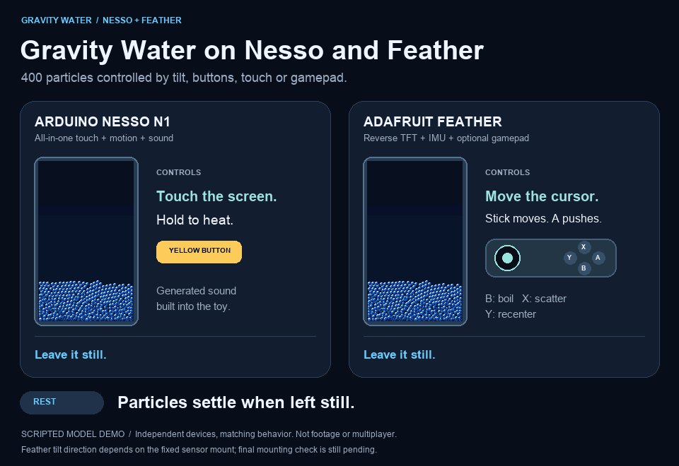

# Gravity Water · Feather edition

The next family member uses the kit's **Adafruit Feather ESP32-S3 Reverse TFT
#5691** and **Adafruit LSM6DS3TR-C #4503**. It shares the Nesso version's 400-bead
particle model, renderer, energy colors, quiet rest and shake response. Add the
**Adafruit Mini I2C Gamepad #5743** for a virtual fingertip.



*Scripted preview of the shared model, not camera footage. Both devices play independently.*

## Play

| Control | Effect |
| --- | --- |
| Tilt the fixed Feather + sensor assembly | Beads tumble toward the lower edge. |
| Hold **D1** | Add heat, boiling and warm colors. |
| Release **D1** | Cool quickly and let the motion settle. |
| Tap **D2** | Scatter the beads in a burst. |
| Shake the assembly | Trigger motion-driven scatter. |
| Leave it still | The pool settles and idle jitter stops. |
| Move the gamepad stick | Move a visible fingertip and push beads aside. |
| Hold gamepad **A** | Keep pushing at the cursor, even with the stick centered. |
| Hold gamepad **B** | Boil; release to cool. |
| Tap gamepad **X** | Scatter the beads. |
| Press gamepad **Y** | Return the cursor to its starting position. |

D0 remains available for the board's normal boot/recovery function. The screen
is fixed in portrait, with the same battery/face bar as Nesso. Battery charge is
read from the Feather's MAX17048. A missing or stale motion reading shows `IMU?`.

The Feather TFT is not a touchscreen. The optional gamepad gives it the same
particle repulsion through a virtual finger: pale cursor at rest, gold while
pushing. This kit configuration has no speaker; generated audio remains a Nesso
capability. D1/D2 continue to work with or without the gamepad.

## Connect the kit

With power off, connect the Feather's STEMMA QT socket to the LSM6DS3TR-C using a
QT/Qwiic cable. A compatible existing I2C hub or pass-through board can remain in
the chain. The IMU is probed at `0x6A` and `0x6B`; this adapter does not initialize
other touch or accessory boards except the optional gamepad.

Connect the gamepad on the same QT/Qwiic bus before powering up. The adapter
checks address `0x50` and product ID `5743`, then reads its stick and buttons
about every 10 ms. The IMU, fuel gauge and gamepad use different addresses.
A failed gamepad read releases the virtual touch; the cursor disappears when
input becomes stale. Reconnect at the same address to resume after a cable loss;
if the gamepad was absent at boot, restart with it connected. Start/Select are
currently unused. The stick has a center dead zone and bounded cursor speed.

**Secure the IMU to the Feather.** A sensor dangling from its cable measures its
own movement, not the display's. Start with the IMU's XY plane parallel to the
screen and its Y axis along the screen's long edge. The physical axes and signs
must be checked on the mounted assembly; board position is not inferred from the
cable. The initial mapping is documented in `FeatherAxes.h`.

Hardware references: [Reverse TFT Feather pinouts](https://learn.adafruit.com/esp32-s3-reverse-tft-feather/pinouts)
· [LSM6DS3TR-C #4503](https://www.adafruit.com/product/4503)
· [Gamepad controls and pinout](https://learn.adafruit.com/gamepad-qt/pinouts).

## Build

The verified Feather bootloader used by Orange Face needs Arduino-ESP32 **2.0.17**
and its original **TinyUF2 4 MB** partition scheme. Nesso continues using its own
ESP32 core/toolchain setup. Do not replace the Nesso configuration to build this port.

Dependencies: Adafruit GFX 1.12.6, Adafruit ST7735/ST7789 1.11.0, Adafruit LSM6DS
4.7.4, Adafruit BusIO 1.17.4, Adafruit Unified Sensor 1.1.15 and Adafruit seesaw 1.7.9.
The build helper requires Python 3.9 or later.

```sh
python3 projects/gravity-water/tools/build_feather.py \
  --config-file /absolute/path/to/feather-arduino-cli.yaml \
  --build-path /absolute/private/gravity-water-feather-build
```

The helper stages the adapter plus exact copies of the canonical model and
renderer into a temporary directory, selects C++14, and builds there. Those
shared files remain single-source in Git under `GravityWaterNesso`; there is no
separate Feather physics fork. The script compiles only and never flashes USB.
Use a whole-repository checkout of this branch for this new adapter; the saved
Nesso v0.3.0 release predates it.

The bench's existing TinyUF2 bootloader required the same compatible app header
used by Orange Face. For that verified unit, generate from the built ELF with:

```sh
esptool --chip esp32s3 elf2image --flash-mode dio --flash-freq 80m \
  --flash-size 4MB --max-rev-full 0 --elf-sha256-offset 0xb0 \
  -o /absolute/private/GravityWaterFeather-compatible.bin \
  /absolute/private/gravity-water-feather-build/GravityWaterFeather.ino.elf
```

That compatibility setting is based on the inspected original app, not a
universal recommendation for every bootloader. Verify the intended board,
backup, live partition table and active app before an app-only installation.
Never send a Nesso image to a Feather, or assume the same chip/layout from a
reused USB port name.

## Bench evidence and limits

Initial bring-up on the connected Feather verified the ESP32-S3 factory identity,
two matching saved factory backups, a fresh 4 MiB backup of its current Orange
Face installation, the original partition table and active `ota_0` slot. Only the
app at `0x10000` (capacity `0x160000`) was written, independently verified and
rebooted. Recovery artifacts and raw identity stay outside Git.

The gamepad sketch built successfully with 354,365 bytes of code and 46,852 bytes
static RAM. The first Feather-only play session recorded roughly 204–205 fresh
motion samples/sec, 30–58 completed frames/sec depending on activity and about
60 physics steps/sec. These software counters do not measure motion-to-photon
latency.

On November 15, 2026, the owner confirmed D1 boiling/warm colors and D2 scatter
both work. The IMU is currently loose, so screen-relative gravity direction is
**not yet physically validated**. The owner also confirmed the gamepad cursor direction, particle repulsion and
controls feel right. Initial gamepad-enabled telemetry showed about 204–205
fresh IMU samples/sec, 96 gamepad polls/sec, 55–56 frames/sec at rest and zero
gamepad read errors. Idle particles reached zero energy and sleep. The gamepad
app image is 354,736 bytes.

The full host suite passes with AddressSanitizer and UndefinedBehaviorSanitizer,
including the existing particle, color, quiet-rest and stress checks. The new
axis test verifies the declared mapping only; it cannot verify a physical mount.
The sensor uses fresh accel+gyro data-ready bits, coherent burst reads and the
library's block-data-update setting. One task owns I2C; rendering uses SPI on the
other core. Per-frame physics catch-up is capped. USB reports use a fixed-size
queue and write only what the transmit buffer can accept; a stalled serial host
cannot block a report's rendering loop. Host tests exercise empty USB space,
partial draining, disconnect and cursor bounds/dead-zone behavior. A live check
requested USB reports for 12 seconds without reading them; rendering advanced
741 frames over the 15.274-second observation interval (48.5 fps average), with
no reset, zero gamepad read errors and stable reported free heap.

[Family guide](README.md) · [Nesso checkpoint](STOPPING-POINT.md) · [Development](DEVELOPMENT.md)
