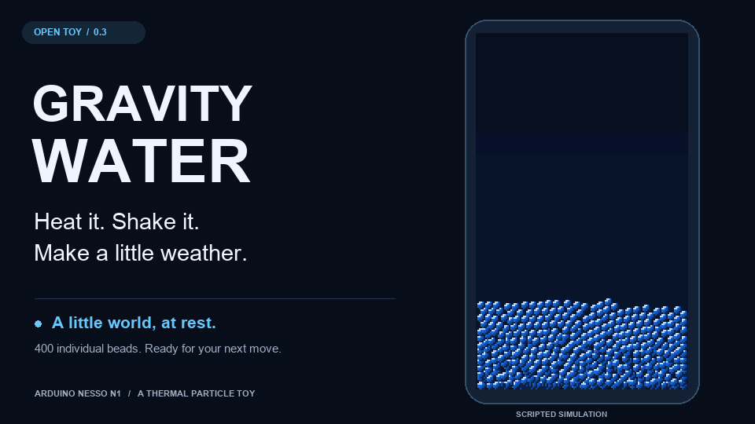
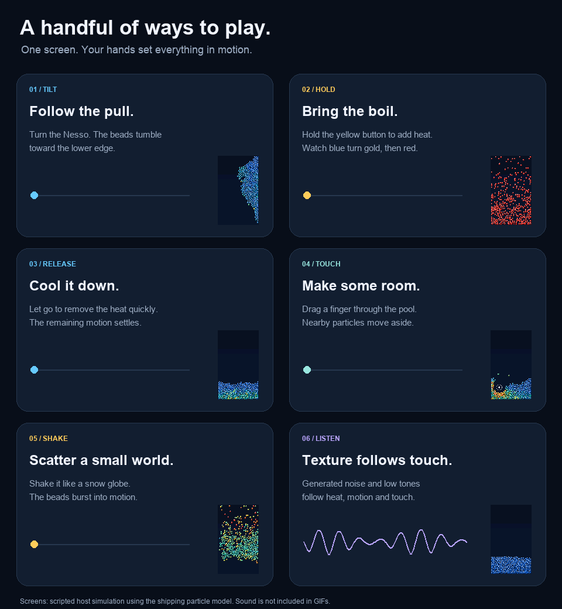

# Gravity Water

**A little world that warms up in your hands.**

Arduino Nesso N1 · v0.3.0 · 400 particles · MIT licensed

[**Download the source**](https://github.com/yury-g/OpenToy-Coursework/tree/gravity-water-v0.3.0) · [**Install on Nesso**](INSTALL.md) · [**Saved stopping point**](STOPPING-POINT.md)

*Scripted preview generated from the same particle solver and pixel renderer as the device. Not camera footage. The battery bar is omitted; GIFs have no audio.*

## Make a little weather

Tilt a pocketful of blue beads. Hold the yellow button and bring them to a boil.
Drag a finger through the pool, or shake the whole thing like a snow globe.
Warm colors and a soft generated sound texture follow the energy. Let it settle,
and the little world becomes still again.

## Your hands are the controls

| Do this | Watch and listen |
| --- | --- |
| **Tilt** the Nesso | The beads tumble toward the lower physical edge. |
| **Hold the yellow button** | Boiling builds, and the beads warm from blue through teal and yellow to orange/red. |
| **Release the button** | Heat drops quickly. The remaining motion settles. |
| **Touch and drag** | Beads near your fingertip move away. |
| **Shake** | Particles scatter in a quick snow-globe burst. |
| **Leave it still** | The pool settles to a complete stop and the sound fades out. |

### Color you can feel

**Blue → teal → yellow → orange → red.** Each bead's color follows its motion
and the shared heat. Fast beads can warm up even when the button isn't held.
These are playful energy colors, not readings from a temperature sensor.

### A tiny sound world

Filtered noise and a low tone blend heat, motion and touch into one generated
texture. The sound is made as you play, without recordings to load. The Nesso's
small buzzer gives it a compact, grainy character; deep bass is limited.

### Small details, always there

- **400 shaded beads**, with bright highlights and individual motion.
- **Quiet rest**: the simulation stops its tiny idle jitters after settling.
- **Near-flat behavior**: gravity eases down as the screen becomes horizontal.
- **A fixed battery bar and tiny face**: smile at high charge, neutral in the
  middle, frown near empty. The bar stays on the same screen edge as you turn.
- **Conserved particles**: shaking spreads the pool without adding or losing beads.
- **On-device play**: tilt, touch, the button and sound run on the Nesso itself.

## Get it onto a Nesso

**Already on the playtest Nesso? Pick it up and play.** v0.3.0 is installed.
The owner has confirmed boiling, warm/cool colors, cooling, audible sound,
and responsive touch and shaking on the physical device.

For another Nesso, [download the v0.3.0 source release](https://github.com/yury-g/OpenToy-Coursework/tree/gravity-water-v0.3.0)
and follow the [installation guide](INSTALL.md). This is firmware for **Arduino
Nesso N1 (ESP32-C6)**, not a phone app or a universal one-click installer.
The release contains source and preview artwork; build the firmware locally.
OpenToy is currently private, so GitHub access is required to download it.

## Ready for a play break

The installed firmware is saved, verified and left running. The
[stopping-point note](STOPPING-POINT.md) records the exact version and what has
been checked. No new hardware changes are needed to keep playing.

The preview is a scripted demonstration, not a frame-rate measurement.
On the final bench build, settling measured about **24–38 frames/sec**, with
about **197 fresh motion samples/sec**. A short run completed without resets.
Long-term endurance and other devices remain untested; see the
[bench record](BENCH.md) for the measured results and their limits.

<strong>For makers: code, tests and how it works</strong>

This is a lightweight 2D particle toy with fixed-point motion, nearby-particle
collisions, bounded shake kicks and a generated PWM sound texture. It is a playful
approximation, not a calibrated water or temperature simulation.

- [Development guide](DEVELOPMENT.md): architecture, build commands and timing.
- [Firmware](firmware/GravityWaterNesso): the Nesso app and portable behavior.
- [Host checks](tests): physics, quiet rest, heat, touch, sound and pixel bounds.
- [Preview generator](tools/make_showcase.py): rebuild these visuals from the model.
- [Nesso Face](https://github.com/yury-g/OpenToy-Coursework/blob/feature/nesso-n1/projects/nesso-n1/README.md): the separate Face chapter.

The visual direction was inspired by [UnityCoder's Water Particles](https://unitycoder.com/blog/2013/04/12/water-particles-unity/).
The implementation is original C++; no code or assets from that demo are included.
MIT licensed under the [OpenToy license](../../LICENSE).

