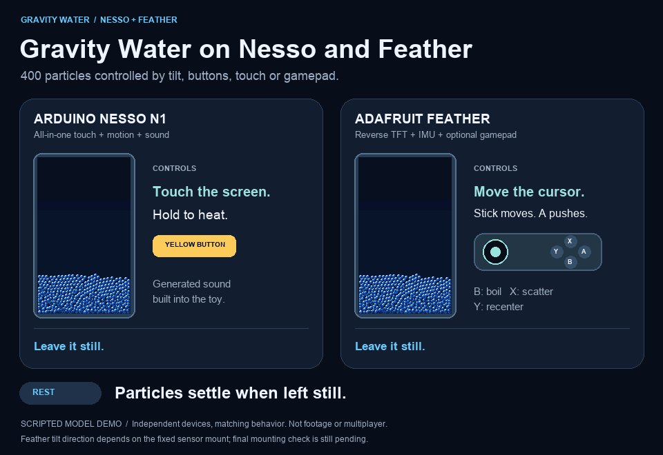
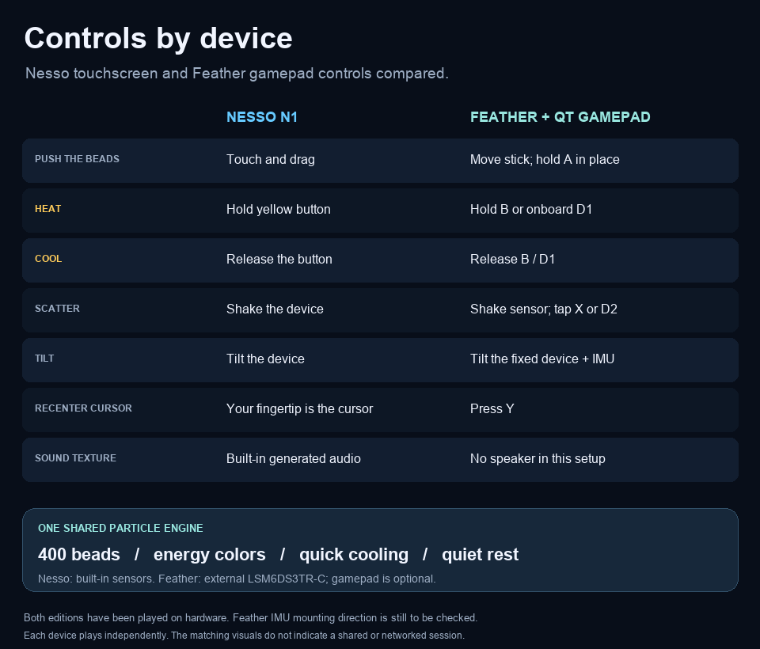

# Gravity Water

**A particle display toy for Nesso and Feather.**

Arduino Nesso N1 + Adafruit Feather · 400 particles · MIT licensed

[**Nesso source release**](https://github.com/yury-g/OpenToy-Coursework/tree/gravity-water-v0.3.0) · [**Install on Nesso**](INSTALL.md) · [**Feather + gamepad guide**](FEATHER.md)

*Scripted preview from the shared particle model. Each device plays independently. Not camera footage; battery bars and audio are omitted.*

## Play on either device

**Gravity Water runs on Arduino Nesso N1 and Adafruit Feather ESP32-S3 Reverse TFT.**
Nesso puts touch, motion and sound in one device. Feather uses the kit's
LSM6DS3TR-C motion sensor, with an optional STEMMA QT gamepad for a virtual
fingertip. Both run the same 400-bead particle model and energy colors.

Nesso touch, heat, shake and sound have been owner-tested. Feather D1/D2 and
gamepad controls have also been owner-tested; its loose motion sensor still
needs a fixed mounting before screen-relative tilt direction is checked.
[Choose Nesso](INSTALL.md) · [Choose Feather](FEATHER.md)

## What it does

Tilt to move the particles, hold the heat button to make them boil, or shake
to scatter them. Touch the Nesso screen or use the Feather gamepad to push
particles aside. Color follows motion and heat; particles stop moving after
settling. On Nesso, generated sound also follows the activity.

## Your hands are the controls

| Do this | Watch and listen |
| --- | --- |
| **Tilt** the Nesso | The beads tumble toward the lower physical edge. |
| **Hold the yellow button** | Boiling builds, and the beads warm from blue through teal and yellow to orange/red. |
| **Release the button** | Heat drops quickly. The remaining motion settles. |
| **Touch and drag** | Beads near your fingertip move away. |
| **Shake** | Particles scatter in a quick snow-globe burst. |
| **Leave it still** | The pool settles to a complete stop and the sound fades out. |

### Particle colors

**Blue → teal → yellow → orange → red.** Each bead's color follows its motion
and the shared heat. Fast beads can warm up even when the button isn't held.
These are playful energy colors, not readings from a temperature sensor.

### Generated sound on Nesso

Filtered noise and a low tone blend heat, motion and touch into one generated
texture. The sound is made as you play, without recordings to load. The Nesso's
small buzzer gives it a compact, grainy character; deep bass is limited.

### Other features

- **400 shaded beads**, with bright highlights and individual motion.
- **Quiet rest**: the simulation stops its tiny idle jitters after settling.
- **Near-flat behavior**: gravity eases down as the screen becomes horizontal.
- **A fixed battery bar and tiny face**: smile at high charge, neutral in the
  middle, frown near empty. The bar stays on the same screen edge as you turn.
- **Conserved particles**: shaking spreads the pool without adding or losing beads.
- **On-device play**: tilt, touch, the button and sound run on the Nesso itself.

## Meet the family

| Device | Motion | Controls | Touch / sound |
| --- | --- | --- | --- |
| **Arduino Nesso N1** | Built-in motion sensor | Yellow button: heat; shake: scatter | Screen repulsion + generated buzzer texture |
| **[Adafruit Reverse TFT Feather](FEATHER.md)** | Kit LSM6DS3TR-C breakout | D1: heat; D2: scatter; tilt and shake; optional gamepad fingertip | External IMU + optional QT gamepad; no speaker |

Both use the same particle code and energy colors. The saved v0.3.0 release is
the Nesso checkpoint; use this branch for the newer Feather adapter.

## Get it onto a Nesso

**Already on the playtest Nesso? Pick it up and play.** v0.3.0 is installed.
The owner has confirmed boiling, warm/cool colors, cooling, audible sound,
and responsive touch and shaking on the physical device.

For another Nesso, [download the v0.3.0 source release](https://github.com/yury-g/OpenToy-Coursework/tree/gravity-water-v0.3.0)
and follow the [installation guide](INSTALL.md). This is firmware for **Arduino
Nesso N1 (ESP32-C6)**, not a phone app or a universal one-click installer.
The release contains source and preview artwork; build the firmware locally.
OpenToy is currently private, so GitHub access is required to download it.

## Saved Nesso version

The installed firmware is saved, verified and left running. The
[stopping-point note](STOPPING-POINT.md) records the exact version and what has
been checked. No new hardware changes are needed to keep playing.

The preview is a scripted demonstration, not a frame-rate measurement.
On the final bench build, settling measured about **24–38 frames/sec**, with
about **197 fresh motion samples/sec**. A short run completed without resets.
Long-term endurance and other devices remain untested; see the
[bench record](BENCH.md) for the measured results and their limits.

<strong>For makers: code, tests and how it works</strong>

This is a lightweight 2D particle toy with fixed-point motion, nearby-particle
collisions, bounded shake kicks and a generated PWM sound texture. It is a playful
approximation, not a calibrated water or temperature simulation.

- [Development guide](DEVELOPMENT.md): architecture, build commands and timing.
- [Firmware](firmware/GravityWaterNesso): the Nesso app and portable behavior.
- [Host checks](tests): physics, quiet rest, heat, touch, sound and pixel bounds.
- [Family preview generator](tools/make_family_showcase.py): rebuild the cross-platform animation and control map.
- [Nesso preview generator](tools/make_showcase.py): rebuild the original Nesso artwork.
- [Nesso Face](https://github.com/yury-g/OpenToy-Coursework/blob/main/projects/nesso-n1/README.md): the separate Face chapter.

The visual direction was inspired by [UnityCoder's Water Particles](https://unitycoder.com/blog/2013/04/12/water-particles-unity/).
The implementation is original C++; no code or assets from that demo are included.
MIT licensed under the [OpenToy license](../../LICENSE).

