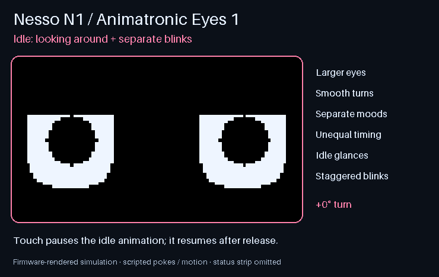
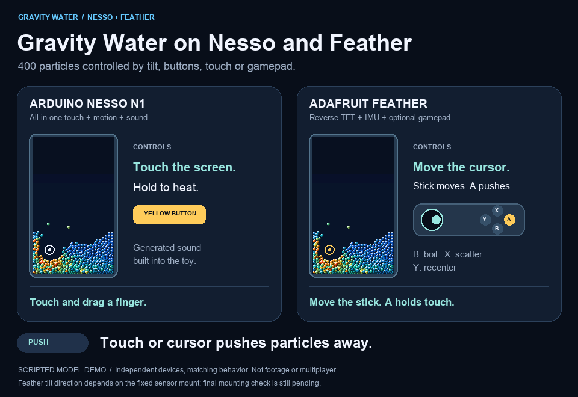

# Nesso projects

These target **Arduino Nesso N1 (ESP32-C6)**, with its built-in display, motion
sensor and touchscreen.

[All projects](../README.md) · [Feather](../feather/README.md) · [3D printed designs](../3d-printed-designs/README.md) · [Archive](../../archive/README.md)

## Animatronic Eyes 1 — touch puppetry

*Firmware simulation, not hardware video.*

Automatic glances and independently timed blinks when untouched. Larger original eye shapes with continuous upright rotation and local touchscreen reactions. The poked eye closes and gets angrier than its neighbor; each eye trembles and recovers on separate timing. [Source, controls and build](../animatronic-eyes/NESSO.md).

## Gravity Water

Tilt and shake particles, hold the heat button, push them with your finger and
hear generated sound. [Visual guide](https://github.com/yury-g/OpenToy-Coursework/blob/feature/gravity-water-feather/projects/gravity-water/README.md) · [Nesso installation](https://github.com/yury-g/OpenToy-Coursework/blob/feature/gravity-water-feather/projects/gravity-water/INSTALL.md) · [Saved source release](https://github.com/yury-g/OpenToy-Coursework/tree/gravity-water-v0.3.0)

## Nesso Face

Touch zones, gravity-driven face orientation, shake reactions and shade buttons.
[Project guide and source](https://github.com/yury-g/OpenToy-Coursework/blob/feature/nesso-n1/projects/nesso-n1/README.md)

## Related: Battery Faces

The [Battery Faces gamepad-branch hardware table](https://github.com/yury-g/OpenToy-Coursework/tree/main/companions/battery-faces/feature/seesaw-gamepad#current-family)
lists Nesso as the Pink role. That guide distinguishes prepared changes from
changes installed on available hardware; it is a separate project from Nesso Face.
