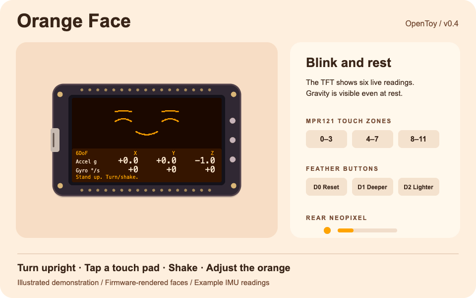
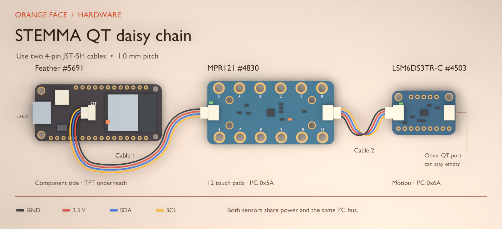

# Orange Face

Orange Face is a pocket-sized OpenToy character for the Adafruit Feather ESP32-S3
Reverse TFT. Turn it, shake it, or tickle one of three touch zones to change
its expression. Three buttons tune the orange on the TFT and the rear NeoPixel.



[Open the animated SVG](docs/images/orange-face-tour.svg) · [Regenerate the SVG](tools/render_tour.py)

The tour uses the firmware's face renderer and animation logic with scripted
inputs. The board drawing and motion readings are illustrative. Download the
SVG and open it in a browser to play it locally.

[For AI](#for-ai) · Copy the student prompt for setup, troubleshooting, modeling, or playtesting.

## Try it

Orange Face blinks every few seconds. Hold the screen upright and turn it a
quarter-turn at a time. The whole face rotates with gravity, including upside
down. It holds the last orientation when the IMU is nearly flat, diagonal or
moving quickly. A quick shake still makes it look startled and then dizzy.

The **6DoF** panel below the face shows two rows of live X/Y/Z readings.
**Accel g** shows acceleration, including the pull of gravity at rest. Stand
the screen up and turn it slowly to see gravity move between axes.
**Gyro °/s** shows how fast the IMU is turning about each axis. Twist it and
watch those readings jump, then settle near zero when you stop. Give it a
quick shake to see the dizzy reaction.

Tap **D1** for a deeper, redder orange and **D2** for a lighter, more golden
orange. **D0/BOOT** returns to the original orange while the app is running.
Each tap moves one of nine steps and briefly shows the level below the motion
readings. The face and rear NeoPixel change together. Orange starts at step
5 after a restart.

| Tickle pads | Reaction |
| --- | --- |
| 0–3 | Left wink and a crooked laugh |
| 4–7 | Both eyes scrunch and the mouth opens wide |
| 8–11 | Right wink and a crooked laugh |
| Multiple zones | Alternating winks and a bigger wobble |
| Tickle plus shake | A stronger giggle and brighter orange glow |

<a name="what-to-notice-as-a-toy-designer"></a>

## How to playtest

- **Blue Team** checks whether the physical toy behaves as programmed.
- **Green Team** looks at what players discover, enjoy, and come back to.
- **Red Team** looks for ways the toy can fail through deliberate stress or
  unexpected handling. It asks which failures interrupt play, which stop the
  toy entirely, and how the toy recovers.

| Optional ways to play | Blue Team · Does it work? | Green Team · Does it invite play? |
| --- | --- | --- |
| Rotate slowly, pause diagonally, then lay it flat. | The 6DoF readings change with motion. The face waits for a steady orientation before rotating and holds its last orientation when flat. | Does waiting feel steady or sluggish? Does the face staying upright invite another turn? |
| Tickle pads 0, 5, and 10, or hold a pad and shake. | The pads give different expressions. Touch plus shake triggers the stronger giggle. | Which laugh makes someone try again? Do they discover the combined reaction while playing? |
| Change the orange shade and look at the screen and rear glow. | D1 and D2 shift both colors. D0 restores the default shade. The screen briefly shows the shade level. | Is the light visible from where someone naturally holds the toy? Does changing the color feel worth another press? |

For Red Team, a held touch at startup, an IMU left loose inside the toy, or
a break in the shared sensor cable are plausible failure cases. A missed
tickle interrupts one reaction. Losing the cable between the Feather and
the MPR121 can take both sensors offline. The bench checkpoint records
which behaviors have actually been observed.

The design lesson is that a gesture goes through sensing, interpretation,
and feedback. Blue Team checks that chain, Green Team asks what it's like
to play with, and Red Team shows where the chain needs a fallback.

## Plug in the sensors

[](docs/images/orange-face-hookup.png)

**[Download all five 3D model files (ZIP)](https://github.com/yury-g/OpenToy/raw/refs/heads/feature/orange-face/projects/orange-face/mechanical/orange-face-models.zip)**

Includes the Blender scene, FreeCAD assembly, and individual STEP files for the Feather, MPR121, and LSM6DS3TR-C.

Use two **4-pin JST-SH, 1.0 mm pitch** cables sold as STEMMA QT or Qwiic.

1. With the Feather unpowered, flip it over so the TFT faces down. Plug the
   first cable into the **QT socket on the component side** and into either
   QT socket on the [MPR121 Gator touch board #4830](https://www.adafruit.com/product/4830).
2. Plug the second cable into the MPR121's other QT socket and either QT
   socket on the [LSM6DS3TR-C motion board #4503](https://www.adafruit.com/product/4503).
   Leave the spare IMU socket empty. Both sensors share the same 3.3 V,
   ground, SDA and SCL lines.
3. Power the [Reverse TFT Feather #5691](https://www.adafruit.com/product/5691)
   by USB-C. To make the face rotate with the toy, secure the IMU flat
   against the Feather with the IMU's Y axis along the screen's long edge.

[Open the exact Blender scene](mechanical/orange-face-hookup.blend) ·
[Open the FreeCAD model](mechanical/orange-face-hookup.FCStd) ·
[Download the STEP assembly](mechanical/orange-face-hookup.step) ·
[Individual board models and credits](mechanical/README.md)

If the IMU is mounted differently, adjust the axis and sign mapping in
`Orientation.h` and `Reactions.h`. The onboard NeoPixel uses GPIO 33 with its
power enable on GPIO 21. GPIO 7 enables the shared TFT and sensor rail.

The curved eyes, brows and mouth use OpenToy's MIT-licensed Nearby Buddy renderer
and damped transitions from `feature/nearby-buddy` at `0c180b0`. As in Battery
Faces and Nearby Buddy, the page-packed face bitmap is expanded into RGB565
scanlines for the Feather's ST7789. The sketch runs on the Feather by itself.

## For AI

Students can share [this section](https://github.com/yury-g/OpenToy-Coursework/blob/main/projects/orange-face/README.md#for-ai)
with an AI assistant or copy the prompt below. If the assistant can't open the
private repo, download the branch ZIP from GitHub and give it the extracted
`projects/orange-face` folder or attach this README and the files relevant to
your question.

```text
I'm working with Orange Face v0.4 for an OpenToy student project.
Read the Orange Face README on the feature/orange-face branch:
https://github.com/yury-g/OpenToy-Coursework/blob/main/projects/orange-face/README.md
Use my local or attached project files if you can't open the repo.

Use my stated goal. Start with what you can inspect on my computer.
If I'm setting up or fixing Orange Face, use the tools you have access
to. Check the operating system, project files, and installed Arduino
board package and libraries. For a USB or sensor issue, check whether
you can reach my local USB port, identify the Feather, and read its
serial output. Match the fix to this setup and the error you find.

Run the checks yourself. Reproduce the problem when possible, fix the
cause in the project's code or setup, and rerun the relevant build or
device check. Ask me for one specific thing only when my input, access,
or physical handling is needed. If you lack access to my computer,
tell me the smallest check I can do and what result to send back.

For wiring, use the hookup picture. Trace both 4-pin JST-SH cables from
the Feather's component-side QT socket to the MPR121 and then to the IMU.
For 3D modeling, read mechanical/README.md. Help me open the Blender or
FreeCAD assembly, or import an individual board STEP file in millimeters.
For firmware, start with firmware/OrangeFace/OrangeFace.cpp. Follow
Inputs.h for sensor reads, Orientation.h for rotation, Reactions.h for
touch and shake, OrangeShade.h for the buttons, and Face.h for the display.

If I ask what this project teaches or want to playtest, use How to playtest.
Blue Team compares intended behavior with what the physical toy actually
does. Run the checks you can access and say what still needs observation.
Green Team uses actual player observations to discuss what was discovered,
enjoyed, or repeated. Connect those observations to a design choice.
Red Team reviews the code, hardware, and bench notes for ways deliberate
stress or unexpected handling could make a feature fail or stop the toy.
Explain the impact and recovery. Mark each case as observed or plausible,
and use reversible checks on authorized hardware when you can verify it.
Use the evidence we already have. Keep examples optional and avoid assigning
students work. Treat play value as open when there's no player evidence.

Before replacing firmware, verify the connected Feather's factory ID
and its recovery backup. Use the v0.4 bench checkpoint as a reference.
After a fix, briefly tell me what caused the issue, what you changed,
and what the build or device verified. Call out any physical behavior
that still needs observation.
```

## Build

The bench build used Arduino-ESP32 2.0.17 and esptool 5.3.0, with Adafruit GFX Library 1.12.6,
Adafruit ST7735 and ST7789 Library 1.11.0, Adafruit NeoPixel 1.15.4,
Adafruit LSM6DS 4.7.4 and Adafruit MPR121 1.2.1. Install their dependencies
when prompted. Select **Adafruit Feather ESP32-S3 Reverse TFT**, USB-OTG with USB
CDC on boot, and **TinyUF2 4 MB** with two OTA slots for this board's original
partition layout.

```sh
arduino-cli compile --fqbn esp32:esp32:adafruit_feather_esp32s3_reversetft:PartitionScheme=tinyuf2 \
  --build-path "$PWD/build" firmware/OrangeFace
```

On this Feather's original TinyUF2 0.12.3, the default generated images returned
to the recovery drive. Generate the app from the built ELF with the same maximum
chip-revision header value as the original factory app. In the first working
build, that header field and the resulting validation digest were the only
differences from the default 2.0.17 app image.

```sh
esptool --chip esp32s3 elf2image --flash-mode dio --flash-freq 80m \
  --flash-size 4MB --max-rev-full 0 --elf-sha256-offset 0xb0 \
  -o build/OrangeFace-compatible.bin build/OrangeFace.ino.elf
```

## Bench checkpoint · v0.4

The dedicated Feather booted v0.4 after an application-only write verified by
esptool. USB reported live accelerometer and gyro data, advancing TFT frame
counters, and the default orange shade of 5/9. The motion bring-up recorded
physical movement changing gaze and shaking triggering startled and dizzy
poses. All 12 touch channels reported in range after calibration.

Software checks passed for the four orientations, tickle and shake reactions,
and shade stepping and reset. On-device visual checks for the four orientations,
the three tickle reactions, the three shade buttons, and the rear LED color
are still open.

## Recovery

- Orange Feather factory MAC **02:00:00:00:00:0e**, ESP32-S3 revision 0.2,
  4 MiB flash, 2 MiB PSRAM. Check ROM identity before any write.
- The preflight backup consists of two matching full ROM reads with a saved
  SHA-256. The original sketch matched the factory demo's serial output.
  Restoring its app through the Feather's TinyUF2 recovery drive was exercised
  and the factory demo came back over USB.
- The bench install wrote and verified only the app at `0x10000` in the
  original `ota_0` slot. Its capacity is `0x160000`. The ROM installer checks
  the original partition table and active app slot every time. Keep the full
  original backup private.
- If the app's USB port is missing, hold BOOT, tap RESET, then release BOOT
  to enter ROM download mode. Restore the saved original app slot via the
  identity-checked local installer. Full-chip recovery remains available
  from the private full-flash backup.

At 115200, the sketch reports the I²C scan, running pose, screen rotation, frame
count, touched pad mask, out-of-range mask, shade level and IMU readings.
The bench scan found `0x36` (onboard fuel gauge), `0x5A` (MPR121) and `0x6A`
(LSM6DS3TR-C). Both sensor drivers
initialized and returned live reads. The first touch configuration showed
`oor=0xfff`. MPR121 charge auto-configuration cleared it to `oor=0x000` on the
physical breakout.

[Feather pinouts](https://learn.adafruit.com/esp32-s3-reverse-tft-feather/pinouts) ·
[MPR121 board](https://www.adafruit.com/product/4830) ·
[LSM6DS3TR-C board](https://www.adafruit.com/product/4503)

### Visual source

From the chapter directory, run `python3 tools/render_tour.py` with a C++17
compiler available as `c++` or selected through `CXX`. The editable SVG uses no
external assets or scripts.
