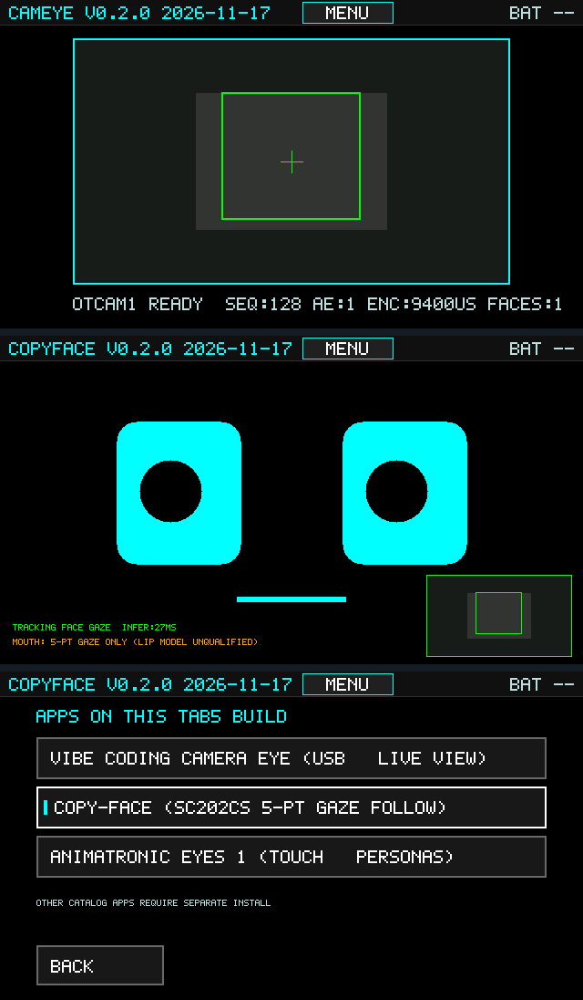

# M5Stack Tab5

**Post-restart status, November 17.** Camera Eye 0.2.0 remains installed. Before restart it returned fresh USB snapshots and reported a working display controller. At the bench the Tab5 screen was subsequently reported blank. A USB cable reconnect restored camera access. Camera Eye captured both UNO Q installations, first the color test and then Eyes. A later mirror photo confirmed the physical screen was dark even though the display controller reported ready. Capture also stalled during testing. Work is parked with 0.2.0 installed and the original recovery image retained. A local 0.2.1 patch is saved, pending integration, build and installation. On resume, initialize the display independently of the camera and verify a bright boot pattern in the mirror before testing Copy-Face gaze. Smile and frown copying require additional mouth tracking.

*Synthetic host-rendered model preview (`tools/render_tab5_preview.py`), not a camera photograph.*

The enrolled target is ESP32-P4 revision 1.3 (`0xeb52` `SC202CS` MIPI-CSI camera) with 16 MiB flash. Its complete original 16 MiB flash backup was verified against the device and preserved privately outside Git.

## Verified `0.2.0` architecture and live hardware qualification (`projects/tab5/`)
- **Display & touch auto-detection (`BoardTab5.{h,cpp}`)**: Safely releases `LCD_RST` (`P4` on `PI4IOE5V6408` #1 `0x43`) open-drain without driving 3.3 V push-pull onto 1.8 V reset logic, configures `GPIO22` backlight (`LEDC_TIMER_0`), and auto-detects `ILI9881C+GT911`, `ST7123`, or `ST7121`. Live `HW` telemetry on the enrolled unit qualified **`ST7123`** (`panel_rev=2`, `disp=1`, 2-lane 1000 Mbps / 70 MHz DPI) and **`ST7123` capacitive touch** (`0x55`, `touch_fw=3`, `touch=1`).
- **3 local modes + Common Menu (`adapter/Tab5Ui.h`)**: Renders a `640x360` landscape canvas blitted 2x2 rotated `90°` into the `720x1280` portrait DPI buffer (matching horizontal desk orientation, with 1-tap `180°` flip) with [APP-STATUS-BAR v1.0](../../docs/APP-STATUS-BAR.md), the Common 7-entry Touch Menu (**Return to play · Apps · Personality · Sound · Display · Controls · About**), `0.8 s` top-center Performance restore, and three selectable local modes: **Camera Eye** (`CAMEYE`), **Copy-Face** (`COPYFACE`), and **Animatronic Eyes 1** (`EYES1`: Curious / Dreamy / Cheeky + dual-eye touch pokes).
- **Camera + face gaze + honest mouth boundary (`CameraTab5.{h,cpp}`, `FaceDetectorTab5.{h,cpp}`)**: Preserves `1280x720` `SC202CS` V4L2 `/dev/video0` + hardware JPEG (`~30 ms` encode, `<= 250 ms` freshness) over `OTCAM1`, while running `HumanFaceDetect` `0.5.2` (`MSRMNP_S8_V1` on `320x180` frames, `det_ready=1`) into `copy_face::Tracker` smooth gaze-follow with `copy_face::applyFivePointOnly()` (`mouth="unavailable_5pt_only"`, `mouthValid=false`).
- **Peripherals, battery & opt-in volatile audio**: Live `HW` qualified `INA226` (`0x41`, `ina_die=0x2260`; USB-only `vbus_mv=1200` truthfully renders `BAT --`, while a fitted 2S `5.4–9.0 V` pack renders `BAT X.XXV`), `PI4IOE5V6408` #2 (`0x44`), `ES8388` (`0x10`), `ES7210` (`0x40`, `0x1072`), `BMI270` (`0x68`, `0x24`), and `RX8130` (`0x32`). `ES7210` microphone sampling (`MIC 1` / Sound menu, default OFF `MIC 0`) computes volatile 16 kHz RMS/peak into `SoundWake` (`shared/SoundWake.h`) and scrubs the stack buffer immediately without recording or storing audio.
- **Bounded install & live verification**: Factory-slot write (`[0x10000, 0x30d000)` inside `[0x10000, 0x310000)`) passed whole-chip hardware MD5 and byte-for-byte readback while leaving all flash outside the app slot unchanged; live `SNAP` (`age_ms=188`, `camera_eye_eval.py` grade `PASS`) captured crisp `1280x720` evidence of both the UNO Q TFT and Round Waveshare `1.1.1`.

Next work: restore visible output on the owner-reported black screen, verify the viewfinder in the mirror, and exercise Copy-Face gaze with real camera input. Later checks include physical touch, optional `ES8388` quiet speaker reaction qualification, and licensed dense inner-lip (`esp-dl` int8 ONNX) second-stage crop integration. See [Vibe Coding Camera Eye](../vibe-coding-camera-eye/README.md), [checkpoint](../../docs/CHECKPOINT-2026-11-17.md), and [roadmap](../../docs/ROADMAP.md).
