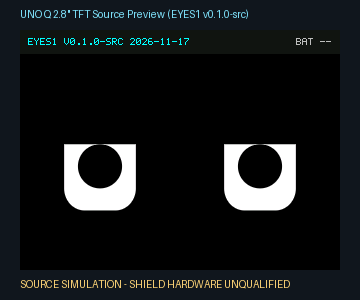

# Arduino UNO Q with a 2.8-inch TFT shield

**Parked on November 17, 2026 with Eyes 1 v0.1.0 installed.** The firmware, shield pin map and build commands below are the restart point. The Tab5 captured two bursts after installation. The eyes and header stayed visible. Individual blink and gaze changes and shield touch remain unverified.

**OpenToy Eyes 1 v0.1.0 ran on the UNO Q TFT on November 17, 2026.** A Tab5 camera capture showed both eyes and the `EYES1 V0.1.0 2026-11-17 BAT --` status bar. The UNO Q was USB-powered and had no qualified battery sensor.

The blue shield with yellow headers matched the [MAR2808 reference layout](https://www.lcdwiki.com/2.8inch_Arduino_Display). The write-only ILI9341 driver produced four color bars, a border and an asymmetric corner marker before Eyes was installed. This verifies the 8-bit parallel interface and ILI9341-compatible writes on the tested shield. The exact controller marking is unconfirmed. The firmware holds `LCD_RD` high and leaves touch and the SD interface unused.

| Shield connection | UNO Q header |
| --- | --- |
| LCD D0–D7 in order | D8, D9, D2, D3, D4, D5, D6, D7 |
| LCD RD, WR, RS, CS, RESET | A0, A1, A2, A3, A4 |

Use this wiring only with a matching 3.3 V-compatible 8080 shield. See the [UNO Q board documentation](https://docs.arduino.cc/hardware/uno-q/) for the header and STM32 MCU.

## Build

The installed sketch was built with Arduino CLI 1.4.0 and **Arduino UNO Q Board 0.52.0** on the UNO Q's AArch64 Debian Linux. Use that version of the toolchain to reproduce the image for its existing loader. Run these commands from the OpenToy checkout on Linux. Use a checkout path without spaces for the compiler include flags.

```sh
arduino-cli core update-index --additional-urls https://downloads.arduino.cc/packages/package_zephyr_index.json
arduino-cli core install arduino:zephyr@0.52.0 --additional-urls https://downloads.arduino.cc/packages/package_zephyr_index.json

repo=$(pwd)
flags="-DOPENTOY_UNOQ_MAR2808=1 -I$repo/projects/uno-q/core"
flags="$flags -I$repo/projects/animatronic-eyes/firmware/AnimatronicEyes"
flags="$flags -I$repo/projects/animatronic-eyes/firmware/NessoEyes"
app="$repo/projects/uno-q/firmware/UnoQTft"

arduino-cli compile --fqbn arduino:zephyr:unoq:link_mode=dynamic \
  --build-property "compiler.cpp.extra_flags=$flags" \
  --build-path /tmp/opentoy-uno-q-eyes "$app"
arduino-cli compile --fqbn arduino:zephyr:unoq:link_mode=dynamic \
  --build-property "compiler.cpp.extra_flags=$flags -DOPENTOY_UNOQ_DIAGNOSTIC=1" \
  --build-path /tmp/opentoy-uno-q-diagnostic "$app"
```

The upload artifact in each directory is `UnoQTft.ino.elf-zsk.bin`. Confirm the installed loader's sketch format and address before uploading. On the tested board, only the STM32 sketch at `0x080F0000` was replaced, with an original 64 KiB slot backup and exact readback of each new image. The verified Eyes build was 15,448 bytes with SHA-256 `961786c502d74e58be771285c0b2d884ef8d0694904c7417dcb96f07022e4cad`. The diagnostic was 5,832 bytes with SHA-256 `4a8e2d641a183a4c9ad5d01f83a650c1437a03a6d50681cca3d27046c880149b`.

The default sketch runs autonomous eyes at a logical 240×180, scaled to 320×240 to fit the installed loader's memory budget. The diagnostic build draws a static red, green, blue and white pattern with a black border and corner marker.

## Portable renderer

The portable C++14 renderer and qualification checks are in `core/` and `tests/`. This earlier image is a labeled source simulation.


