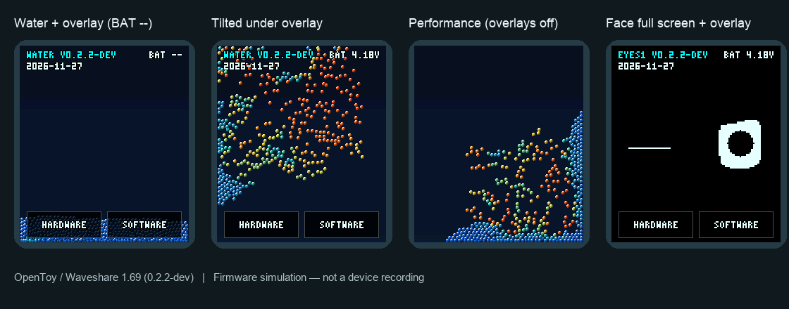
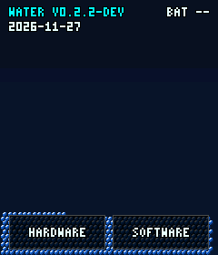
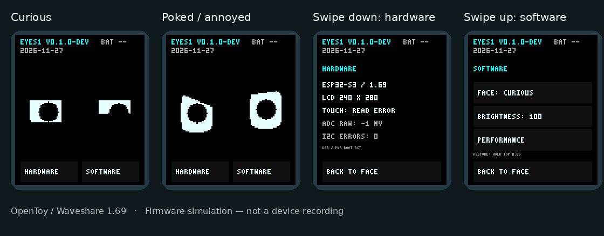
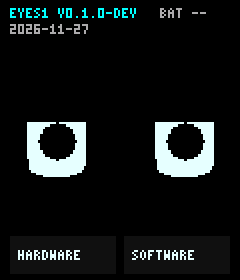

# Waveshare 1.69 touch — Curious face + Gravity Water

**0.2.2-dev · 2026-11-27 · full-screen `240x280` edge-to-edge Water and Face under 2-row shadowed status overlay.**

[Hardware references](../../hardware/waveshare-1.69/README.md) (PLA enclosure CAD remains in historical OpenToy checkpoint `836d5ff`; no CAD port is included here)





*Firmware simulations (`0.2.2-dev`) with scripted input, not device recordings.*





*These two legacy preview images are `0.1.0` Curious-face simulations with simulated input, retained for history.*

## Interaction

| Input | Result |
| --- | --- |
| Face (`EYES1`) idle / tap | Curious personality glances and double blinks; tapping pokes left, right or both eyes on release |
| Water (`WATER`) tilt / shake | 400-bead Gravity Water simulation driven by onboard QMI8658 accelerometer and gyroscope |
| Water touch and drag | Beads near your fingertip move aside |
| Swipe left or right (from either app or either panel) | Cycle installed apps (`EYES1` ↔ `WATER`: left = previous, right = next) and close any panel without activating buttons |
| Swipe down | Hardware developer panel: display geometry, touch state, QMI8658 presence/address/ID/samples/errors/accel, raw battery-terminal ADC, I2C errors and frame count |
| Swipe up | Software settings: active app indicator, face personality, backlight level and session-only Performance mode |
| Visible Hardware / Software overlays | Compact button overlays over the full-screen canvas; taps starting inside them open panels without triggering water repulsion or eye pokes |
| Back to play | Return to the currently selected play app |
| Performance | Hide status text and button overlays across both apps with no layout or physics reset; restore by holding top-center for 0.8 seconds or swiping vertically |
| USB serial (`115200`) | Read-only bounded nonblocking telemetry (`?` or `status`) |
| PWR | Electrical power hold; a new 2-second press releases the battery power latch. USB may continue to power the board |
| BOOT / RESET | Recovery controls only; never used for play or water actions |

Swipes are classified on release at 48 pixels of predominantly vertical or horizontal travel within 1.5 seconds. Vertical swipes open the panels; horizontal swipes cycle through the ordered installed apps (`EYES1`, `WATER`) and return to play while preserving Performance mode and settings. Face reactions begin on release so a swipe never leaks an early poke; dragging off a setting row or swiping over a row never activates that setting. Drag-out and input failures cancel the contact and require release. Taps/presses starting inside the visible `HARDWARE` or `SOFTWARE` overlays are consumed by controls (never triggering water repulsion or eye pokes), while touches anywhere else—including under the overlaid 2-row header text and in the gap between/around buttons—map in direct `240 × 280` screen coordinates while keeping swipes available.

This port reuses the canonical 400-particle `Particles`, `Gravity` and `Motion` physics plus `NessoPixels` shading from `projects/gravity-water/firmware/GravityWaterNesso` across the full `240 × 280` native canvas (`y = 0..279`). App/version/date/battery text is drawn **after** the app scene in two non-overlapping rows with a compact dark contrast halo, without any opaque reserved bar or tank borders. Nesso's heat button and generated buzzer audio are omitted in this port because `PWR`, `BOOT` and `RESET` are reserved for power/recovery and the unused buzzer pin (`GPIO42`) is kept quiet.

### Revision history

- **0.2.2-dev (2026-11-27):** renders both Water (`240 × 280` pool) and Face edge-to-edge under a 2-row shadowed status overlay and compact `HARDWARE`/`SOFTWARE` button overlays; removes opaque bars and tank borders; uses direct screen touch coordinates across the full canvas while consuming control presses cleanly; keeps Performance mode overlay-only with no physics or layout reset. Preserves `BoardAxes` `{ay, -ax}` and battery/IMU truthfulness.
- **0.2.1-dev (2026-11-27):** reverses both Water gravity axes (`{ay, -ax}`) in response to the owner reporting backwards/upside-down motion. Display/touch orientation and app gestures are unchanged. Four-direction host regression and instrumented build pass; physical correction still needs a tilt recheck.

- **0.2.0-dev (2026-11-27):** added Gravity Water app with QMI8658 IMU driver (`0x6B`/`0x6A` probe, `WHO_AM_I` `0x05` verification, ±4g / ±512 dps scaling, freshness/stale rejection), ordered sideways app cycling from apps and panels, live IMU diagnostics, and bounded nonblocking USB serial telemetry (`?` / `status`).
- **0.1.1-dev (2026-11-27):** left or right swipes return from either panel to the face. The owner found the touch buttons difficult to use. Settings and up/down gesture directions are preserved.
- **0.1.0-dev (2026-11-27):** original Curious face and swipe-panel prototype. Its original build evidence remains preserved in `verification.json`; preview images show this revision.

## Build

Pinned and checked: Arduino CLI 1.6.0; Arduino-ESP32 **2.0.17**; Adafruit ST7735/ST7789 **1.11.0**, GFX **1.12.6**, BusIO **1.17.4**; GNU C++17. Use a separate Arduino config/data directory to avoid replacing another target's toolchain. `tools/build.py` stages the canonical OpenToy Eyes headers (`projects/animatronic-eyes`) and Gravity Water particle/pixel headers (`projects/gravity-water`) without modifying or duplicating their canonical sources.

```sh
python3 projects/waveshare-1.69/tools/check.py
python3 projects/waveshare-1.69/tools/build.py --config-file /path/to/arduino-cli.yaml \
  --build-path /private/outside-repository/touch169
```

`--cli` accepts a specific Arduino CLI executable. Host tests use AddressSanitizer and UndefinedBehaviorSanitizer; if the host runs under ptrace, set `ASAN_OPTIONS=detect_leaks=0` (leak checking is then excluded).

Build target: `esp32:esp32:esp32s3:FlashSize=16M,PSRAM=opi,USBMode=hwcdc,CDCOnBoot=cdc,PartitionScheme=app3M_fat9M_16MB`. This is a compile profile, not permission to overwrite the actual device partition table. Compiled binaries are kept outside Git and must fit an app-only `0x140000` (`1,310,720`-byte) `app0` slot when flashed onto a unit with that layout.

## Verification and next physical checks

[Current machine-readable verification record](verification-0.2.2.json).

- **0.2.2-dev host tests & build (2026-11-27):** `check.py` (ASan/UBSan, leak check disabled under ptrace) covers full-height `240 × 280` Water particle bounds and native RGB565 colors, 2-row overlay contrast/non-overlap without opaque header/footer bars, Face full-screen rendering independent of header visibility, Performance hiding overlays without physics/layout reset, direct full-screen touch mapping, control hit consumption, swipe gestures, rollover, QMI8658, `BoardAxes` `{ay, -ax}`, and telemetry (`version=0.2.2-dev`). Target `esp32:esp32:esp32s3` compile passes outside Git (`328,289` bytes flash / `37,368` bytes RAM). Installed on the connected Rainbow bench unit: app-only flash digest matched, the first 64 KiB stayed byte-identical, and five post-boot USB reports showed `0.2.2-dev`, increasing frames/IMU samples, healthy touch and zero touch/IMU errors. Starts in Eyes; swipe sideways to Water. Screen appearance and physical touch/tilt feel still need observation. Yellow is disconnected and remains at its last verified `0.2.0-dev`.
- **Historical verification records (`0.1.0-dev`–`0.2.1-dev`):**
  - Initial `0.1.0-dev` build evidence remains preserved in `verification.json` as historical evidence only.
  - **Installed and instrumented on both bench units (`0.2.0-dev`, 2026-11-27):** app-only writes were digest-verified; the first 64 KiB (bootloader, partition table, NVS and OTA data) remained byte-identical. Live USB status reported version `0.2.0-dev`, touch healthy, QMI8658 at `0x6B`, ID `0x05`, revision `0x7C`, increasing frame/sample counts and fresh acceleration with zero reported I2C errors during the short check. This verifies sensor communication, not physical motion-to-screen behavior.
  - **Historical `0.2.1-dev` installation:** one connected bench unit was updated and digest-verified, with its first 64 KiB unchanged. Live telemetry confirmed `0.2.1-dev`, touch and fresh IMU samples. The second unit was disconnected and remained at `0.2.0-dev`.
  - **Owner feedback and pending physical checks:** the owner reported both directions backwards in `0.2.0-dev`. `0.2.1-dev` changed the Water mapping to `{ay, -ax}`, and `0.2.2-dev` switches to full-screen overlaid layout; the corrected **screen-relative right/left/up/down direction**, full-screen water touch/drag responsiveness, control overlay tap feel, sideways app cycling between Face and Water, and battery-presence ADC qualification (`BAT --` remains in the header until qualified) remain pending physical verification.

## Provenance

Imported from reviewed historical OpenToy checkpoint `836d5ff` (based on `08e5dec69797018f7608ee5732547ec7da4c2ae0`) plus `0.1.1-dev` horizontal swipe fix, re-branched onto public `OpenToy-Coursework` `main` (`67e663c`). Shared Eyes and Gravity Water code retains MIT headers and canonical locations. QMI8658 register map, reset handshake, scaling and board axis references come from `waveshareteam/ESP32-S3-Touch-LCD-1.69` revision `f24f10d53d4cff5c2e2ac47a2e23da39a82454a6` (`SensorQMI8658.hpp`, `QMI8658Constants.h`, `10_LVGL_QMI8658_ui.ino`, `ESP32-S3-Touch-LCD-1.69_V2.1.pdf`, `ESP32-S3-Touch-LCD-1.69-Pinout.webp`, `ESP32-S3-Touch-LCD-1.69-Size.webp`). Display transfers use Adafruit's separately installed BSD-licensed libraries.
