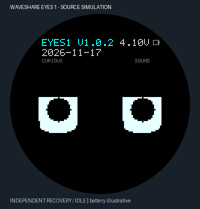

# Waveshare 1.85C BOX device track

**Parked on November 17, 2026 with Eyes 1.1.1 installed in Play.** USB reported 1.1.1. The Tab5 photographed both Play and the menu and captured a 12-frame Play sequence. Physical tap feel, touch-release telemetry and speaker loudness can wait until the device returns to the bench.

**Waveshare ESP32-S3-Touch-LCD-1.85C-BOX-EN, V2 audio hardware.** This is an OpenToy device adapter, not a separate project repository. Firmware images for Feather, Nesso, other Waveshare models and CrowPanel are not interchangeable.

[All OpenToy projects](../README.md) · [Eyes guide](../animatronic-eyes/WAVESHARE.md) · [Verification](../animatronic-eyes/docs/WAVESHARE-VERIFICATION.md) · [Shared status-bar standard](../../docs/APP-STATUS-BAR.md) · [Family architecture](../../docs/DEVICE-FAMILY-ARCHITECTURE.md)

*Generated by the actual target compositor and shared Companion behavior. Scripted pokes and battery reading are illustrative; this is not a recording of the device.*

## Hardware boundary

360×360 round ST77916 QSPI display; single-contact CST816 touch; V2 ES8311 speaker output; ADC battery voltage. This adapter uses a fixed upright layout. No onboard IMU is established by the vendor inventory, so gravity rotation and shake input are unsupported on the stock device. No calibrated charge percentage or software charge-state signal is established. Report measured voltage, never a fabricated gauge percentage.

The [vendor documentation](https://docs.waveshare.com/ESP32-S3-Touch-LCD-1.85C) distinguishes V1 and V2 audio/pins. The [pinned vendor source](https://github.com/waveshareteam/ESP32-S3-Touch-LCD-1.85C/tree/8ead4a96bf3a278fc4ebd8ef4768657e17fa2880) is the adapter's provenance. This target accepts the enrolled case2 LCD initialization; other panel IDs fail closed.

## Catalog compatibility and test matrix

Reviewed November 17, 2026 against the [project directory](../README.md), its named branches/standalone repositories and [archive](../../archive/README.md). “Port candidate” means source logic can be adapted; it does **not** mean the original binary runs. Unless explicitly listed as installed below, nothing in this table has been built, installed or physically tested on this Waveshare. Every future maintained port must adopt the common status bar.

| Project and source | Required hardware / behavior | Waveshare assessment | Build / installed version | Display, touch, audio, network checks and limitations |
| --- | --- | --- | --- | --- |
| [Animatronic Eyes 1](../animatronic-eyes/WAVESHARE.md), main | Screen, direct pokes, large pupils, independent reaction/idle personalities | First port; existing shared eye renderer retained | Built and installed **1.1.1 / 2026-11-17** | Enlarged touch targets, 2-row 4-page Menu (`1 of 4`), 8 ms inter-strip touch polling, high-contrast cyan press feedback, and `TOUCH lifts/lift0/rel` telemetry. Full `tools/check.py` host suite, Arduino-ESP32 build, bounded app-only install, live USB `?` telemetry (`version=1.1.1`), and live Tab5 Camera Eye stills (`EYES1 V1.1.1` Play eyes + `Menu 1 of 4`) + 12-frame Play burst verified. **Owner physical fingertip tap feel & release trace remain pending.** Battery input zero -> `--`; cell/switch unverified. Mic/radios disabled; no IMU rotation. |
| [Animatronic Eyes 2](../animatronic-eyes/README.md), main | Doodle renderer; existing Feather controls use QT gamepad | Next screen/touch port candidate | Not built / not installed | Display projection and touch expression controls need implementation. Gamepad, audio and networking untested; no gamepad enrolled here. |
| [Gravity Water — Nesso/Feather](https://github.com/yury-g/OpenToy-Coursework/tree/main/projects/gravity-water) | Particle model, IMU tilt/shake, screen; Nesso touch/audio, Feather optional gamepad | Touch + audio candidate; stock tilt/shake unsupported | Not built / not installed | Need round particle boundary/status exclusion and touch transform. Fixed/synthetic gravity must be labeled as adaptation. A real IMU would require new hardware enrollment/mapping. |
| [Orange Face](https://github.com/yury-g/OpenToy-Coursework/tree/main/projects/orange-face) | LSM6DS3TR-C, MPR121 pads, buttons, TFT and rear NeoPixel | Face/touch-zone adaptation candidate; full original behavior unsupported stock | Not built / not installed | No established IMU, 12 electrodes or rear NeoPixel. Screen touch is not equivalent to the physical pads. Display/touch/audio/network all untested on this target. |
| [Nesso Face](https://github.com/yury-g/OpenToy-Coursework/tree/main/projects/nesso-n1) | Doodle face, touch, BMI270, two shade buttons; BLE/USB pose protocol | Doodle/touch candidate; gravity/shake unavailable stock | Not built / not installed | Round layout, touch zones and button substitutions needed. BLE/relay untested and disabled in the Eyes installation. Nesso's ESP32-C6 binary cannot run here. |
| [Nearby Buddy](https://github.com/yury-g/OpenToy-Coursework/tree/main/companions/nearby-buddy/main), standalone; [OpenToy chapter](https://github.com/yury-g/OpenToy-Coursework/tree/feature/nearby-buddy/projects/nearby-buddy) | BLE advertiser/scanner and explicitly enrolled partner; display/battery | ESP32-S3 radio capability makes a source port plausible | Not built / not installed | Needs display adapter, voltage-only battery and partner enrollment/calibration. No second board accessed or paired here. Distance/contact claims remain provisional even upstream. Radio testing requires a coordinated device-track scope. |
| [Battery Faces — base](https://github.com/yury-g/OpenToy-Coursework/tree/main/companions/battery-faces/main), standalone main | Local battery adapter, expressive display, enrolled ESP-NOW peers; gateway/Tab5 for dashboard | Local voltage/display candidate; existing 1.69 target is a different board | Not built / not installed | No MAX17048/BQ27220 gauge here; do not reuse another board's SOC. Network identity/relay, trend controls, touch, display and runtime untested. |
| [Battery Faces — gamepad](https://github.com/yury-g/OpenToy-Coursework/tree/main/companions/battery-faces/feature/seesaw-gamepad) | Base app + Adafruit Mini I2C Gamepad QT | Requires external gamepad and port | Not built / not installed | No gamepad enrolled/attached in this track; bus/power/pin integration and failure handling untested. No other device access. |
| [Battery Faces — buttons/haptics](https://github.com/yury-g/OpenToy-Coursework/tree/main/companions/battery-faces/feature/qwiic-accessories) | Qwiic Button, DA7280 motor, peer/gateway/Tab5 Find Me | Full feature set unsupported with stock hardware | Not built / not installed | No haptic actuator/button, no Tab5 test authorization in this track. Do not substitute the speaker for motor behavior or claim paired control. |
| [Archived bare XIAO](../xiao-toy), main | Historical BLE/controller/update protocol; private provisioning and target-specific partitions | Logic/protocol study only; fresh port required | Not built / not installed | XIAO updater/boot/partition assumptions must not be applied to this factory layout. Radio/controller/OTA not tested or enabled. |
| [Archived XIAO OLED/touch](../xiao-class), main | Small OLED/native touch inputs, face controllers and private update identity | Shared face logic reusable; hardware adapter required | Not built / not installed | OLED/touch pins and old uploader do not match. Screen/touch/control/protocol migration and status bar untested. |
| [Plant v0.2 and older mechanical experiments](../../archive/README.md#earlier-mechanical-experiments) | Servos, mechanisms, dedicated power and assembled parts | Cannot run as intended on stock display box | Not built / not installed | No motors, driver/power wiring or mechanical assembly enrolled. CAD simulations do not establish physical operation. |
| [Orange Face printed faceplate](../3d-printed-designs/orange-face/README.md) / Nearby Buddy enclosure | Board-specific CAD/print geometry | Not firmware; existing prints do not establish fit | Not applicable | Mechanical fit to the Waveshare round box is unsupported and untested. Preserve original designs. |

The matrix covers the currently cataloged apps and archive, not every unrelated branch experiment. CrowPanel P4/XIAO belongs to its own device track; that hardware is neither opened nor managed here.

## Next ports and gates

1. Finish the Eyes physical observation checklist when the owner is available; retain the recoverable installation and exact version record.
2. Port Eyes 2's original doodle renderer with touchscreen controls and the same status contract. Then consider local-only Battery Faces and a clearly labeled fixed-gravity Water adaptation.
3. Full motion, paired radio, gamepad and haptic editions require their actual peripherals and coordinated enrollment. Record each build, installation, transport test and owner observation separately. Do not silently turn on a microphone, cloud voice service or networking in Eyes.

This is a living plan and matrix, not an automatic background test service or a multi-app launcher. Only one application is installed in the original factory slot at a time; source and verified private recovery snapshots preserve the ability to switch deliberately.

## Planned sound-responsive Eyes

Added November 17, 2026 from the [family roadmap](../../docs/ROADMAP.md). **Planning only:** installed Eyes 1.1.0 remains microphone-disabled, with the existing optional quiet reaction sounds. No new capture, wake, recording, network or cloud feature is implemented by this update.

| Capability | Evidence now | Next qualification |
| --- | --- | --- |
| Speaker output | V2 ES8311 TX and amplifier control passed the existing live checks; owner audible acceptance remains pending | Check actual loudness/clicks on this enrolled unit, keeping mute, amplitude/duration limits and amplifier-off behavior |
| Microphone input | Vendor V2 documentation specifies analog microphones and an ES7210 input codec; actual capture on this enrolled unit is **untested** | Confirm codec identity, microphone channel mapping, bias/gain, meaningful samples, clipping/noise floor, missing-device behavior and capture shutdown |
| Shared audio wiring | Pinned vendor board header specifies input GPIO39 and output GPIO47 with shared MCLK2/BCLK48/LRCK38 | Resolve capture/playback clock and slot format before simultaneous use: vendor capture configuration is 16 kHz/32-bit stereo, while current Eyes output is 24 kHz/16-bit stereo |
| Sound alertness | Not built or installed | Local loudness/onset/rhythm response, sensitivity relative to measured background, debounce and cooldown; smooth alert/settle behavior with distinct personalities |
| Reply feedback suppression | Current Eyes has no input capture, so no listening loop exists | Suppress detection during the toy's own chirp and a measured settling interval; test echoes and repeated triggers in quiet/noisy rooms before considering more complex cancellation |
| True low-power acoustic wake | No qualified wake mechanism or current measurement | Separately establish supported sleep/capture/wake circuitry; measure whole-device current, latency, false/missed wakes and codec overhead before runtime claims |

Start with **waking the character from quiet idle while keeping the screen visible**, preserving the status/performance-mode contract. Sound should add alertness without interrupting eye pokes or replacing the established personality timing. Process short buffers locally and discard them; no recording or uploading by default. Do not infer sound direction, identity or emotional state from loudness. Speech recognition/wake words remain separate work.

Qualification order: re-enumerate and ROM-verify this round device → test microphone capture separately → confirm existing bounded playback → reconcile shared clocks and suppress speaker feedback → host-test reactions/failures → versioned app-only install/live checks → owner observation. Keep hardware, driver, behavior, installation and observation evidence separate in this matrix. Recheck the existing zero battery input when the round device returns, without treating a connected cell as proof of a valid reading.

The family roadmap does not change hardware ownership: RLCD and CrowPanel remain with their own chats, including their battery follow-ups. Copy-Face's camera mouth/gaze priorities belong to its implementation track and must survive any later sound integration there. No other device is opened for this plan.

Microphone wiring evidence: [pinned vendor audio-board header](https://github.com/waveshareteam/ESP32-S3-Touch-LCD-1.85C/blob/8ead4a96bf3a278fc4ebd8ef4768657e17fa2880/ESP-IDF/ESP32-S3-Touch-LCD-1.85C-Test/components/auido_borad/boards/include/ESP32_S3_AUDIO_Board.h). This is a source specification, not a capture test on the enrolled hardware.

## Source audit snapshots

Compatibility assessments above use the guides at these snapshots, not a claim of a compiled port:

- OpenToy `feature/gravity-water-feather`: `f9402edb6244`.
- OpenToy `feature/orange-face`: `44ecd87575de`.
- OpenToy `feature/nesso-n1`: `7196c33e7588`.
- OpenToy `feature/nearby-buddy`: `abc451e2409d`.
- Nearby Buddy `main` README blob: `b7dd2f79f3b9bf5b7614fec09157d95234e67b22`.
- Battery Faces `feature/seesaw-gamepad` README blob: `29a5e7264f87eae0fe2b138086ce5b68b4a6fe7f`; it identifies the base and qwiic-accessory branch boundaries. Those branches were not built or installed in this track.
