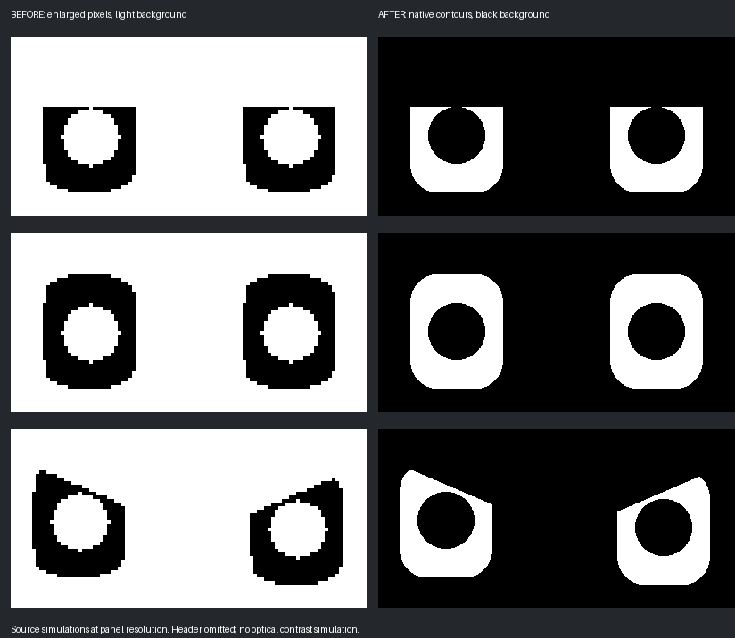
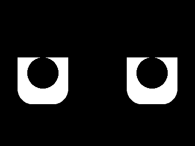

# Native contours and battery visibility — v0.2.0

Created 2026-11-17. Owner observed the v0.1.1 light background and enlarged pixel edges and requested a black background with crisp eye contours. This is visual feedback about the old build, not confirmation of physical button behavior. Owner initially reported attaching the supplied battery, then removing it before reconnection. Current battery presence is not inferred from a voltage reading.

## Rendering decision

v0.1.1 enlarged the original 128 × 64 bitmap by four. Its white background was explicitly filled by `compose`, not evidence of an incorrect ST7305 controller setup. Keep the pinned vendor initialization/polarity commands unchanged. v0.2.0 fills panel bits with black, draws light eye shapes and dark pupils, and changes header ink to light.

`NativeEyes.h` evaluates analytic rounded rectangles, circles and lid half-planes at native pixel centers in the 400 × 300 panel buffer. It consumes the existing Companion pose, personality proportions, independent mood/recovery, blink timing and trembling. Pupil radius remains eight logical units (32 native pixels), twice the original four-unit design; the raised happy lid follows upward gaze. Geometry and gaze coordinates are continuous before the final binary pixel decision. Closed eyes use a rounded stroke. Bounds reserve the header and re-center when it is hidden.

This is a new target presentation mode, not a replacement of the preserved historical renderer. `Display.h::compose` and the shared renderer remain available for history/comparison; the live build no longer draws or scales that small bitmap. No shared source files or CrowPanel drivers are edited.

The panel is used as **1-bit black/light**, with no verified grayscale mode. Native curves remove four-pixel blocks; they cannot remove the panel's physical pixels or produce color-TFT antialiasing. There is no temporal dithering/flicker or noisy spatial dithering. Reflective contrast depends on ambient light and viewing angle, so the pure black/white simulation does not predict optical contrast.

*Actual old/new renderer outputs at panel resolution; header omitted. Not device photographs.*

*12-second deterministic source simulation with labeled-in-code synthetic left/right pokes. Actual device idle seeds vary. Output pixels were decoded and compared with all 240 source frames.*

## Battery

The exact vendor ADC example and schematic identify a 3:1 divider into GPIO4 / ADC1 channel3. The port averages four checked, eFuse-calibrated pin-voltage samples every two seconds and shows measured battery-node volts. Failed calibration/read, implausible voltage or a reading older than five seconds becomes `--`. The header and diagnostic display field use the same formatter. This is not a fuel gauge: percentage, battery presence and charging remain unknown. Attaching a battery does not supply a calibrated state-of-charge curve or a charging-status signal.

v0.2.0 diagnostics expose calibration availability, pin millivolts, sample/error counters, reading age and maximum read duration, so fresh sensing and continued animation can be verified independently. Reads are bounded; no percentage or charging icon is inferred. Microphone wake/expressive sound input and optional speaker reactions remain a later stage under [the family roadmap](../../../docs/ROADMAP.md), not a dependency of this display/battery update.

## Checks

- Host: native circle area, polarity, non-four-pixel contour positions, pupil clipping, raised lid, independent closure, viewport guards, extreme gaze/mood/lids/personality combinations; existing shared behavior suites unchanged.
- Battery: exact divider conversion, absent calibration, empty/invalid/out-of-range readings; stale/error formatting and wrap arithmetic. Fresh sample cadence and timing require the live record below.
- Build/install: compile the normal C++ entry file, verify current ROM identity and recoverable live flash state, write only the selected app range and verify all outside bytes.
- Live: native renderer/version metadata, frame timing, reactions, battery freshness, header toggle and default-visible reboot. Owner confirms appearance/physical controls separately in VERIFICATION.md.

## Controls migration

The native release also adopts the [family controls](../../../docs/CONTROLS.md) through exposed KEY only. Short press reacts; hold opens a menu. BOOT/RESET remain recovery controls. See the device README for navigation and the deliberate performance/restore path. Host tests cover debounce, stuck holds, release isolation, menu reachability, explicit Back and restoring the header. Physical KEY confirmation remains separate.
